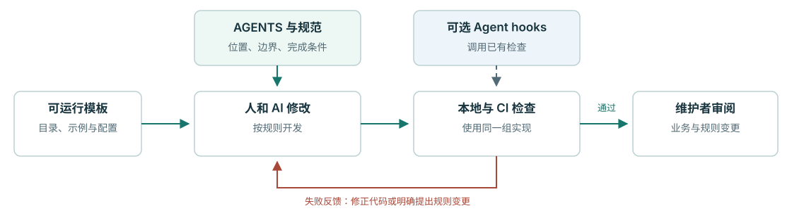
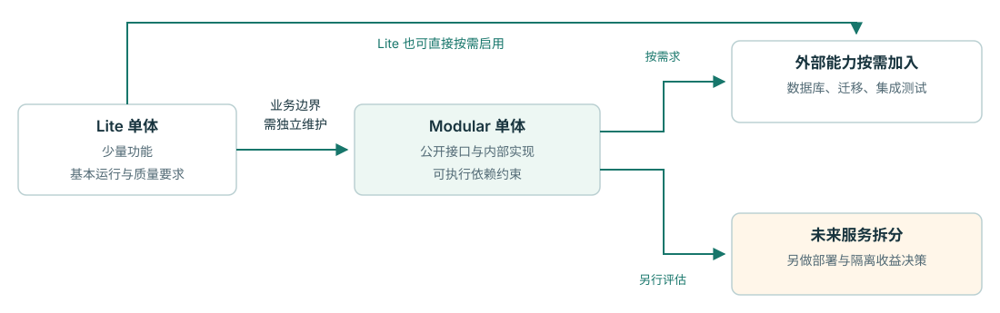
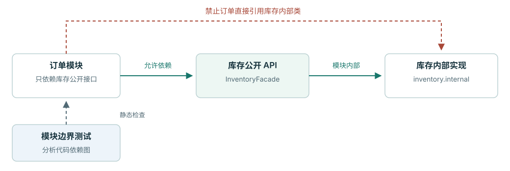
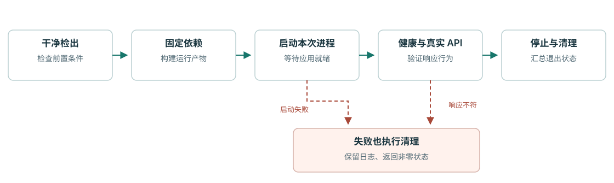
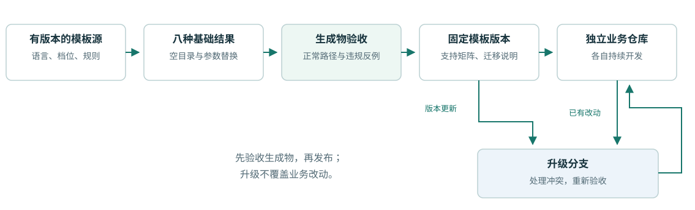

<!-- document-id: show-14 -->
<!-- document-version: 1.0-review -->

<a id="overview"></a>
# AI 协作项目底座：从四语言设计到可验证的 Java 样板

[图解讲解](../阅读/讲解-14-AI协作工程底座.html) · [返回首页](../index.html)


文档类型：decision｜版本：1.0｜资料核查：2026-11-03（Asia/Shanghai）  
读者：架构师、项目维护者，以及参与后续开发的 Coding Agent。  
原设计稿于 2026-11-03 完成四语言、两档模板调研。本公开副本保留该设计范围，并增加 Java Lite V2 首个实现于 2026-11-13 的重新验证；八种模板并未全部实现。

<a id="sec-01"></a>
## 01 先看结论：需要一套可验收的项目底座

这个目标可以落成一个模板库：**四种语言 × 两种档位，共八个生成结果，共用一组工程约定。** 每个结果都要能启动、能验证，告诉人和 AI 新功能放在哪里、改完需要检查什么、哪些文档要同步。

建议从语言原生的框架起点生成项目，再补自己的规则和验收。模板库统一开发体验；源码目录、类型系统、构建工具和模块边界分别按语言实现。

| 语言 | 简单版 Lite：默认建议 | 复杂版 Modular：沿用并增加 | 选择原因与主要代价 |
|---|---|---|---|
| Java | Spring Boot + Spring MVC；Maven Wrapper | 同一 Boot 应用，增加 Spring Modulith 模块验证；有持久化需求再加迁移与集成测试 | 框架已经提供配置、生命周期、校验和测试支持，减少自造基础设施；要控制 starter 数量与自动配置带来的隐含行为 |
| Python | FastAPI + uv；Pydantic 做外部输入与配置校验 | 业务包边界 + Import Linter；按需加入 SQLAlchemy / Alembic | 适合 API 与 Python 库集成，环境管理清晰；类型检查、同步与异步边界必须主动约束 |
| Go | Go module + `net/http` + Chi | 保留 HTTP 路线，增加业务包与 import 依赖规则、真实依赖测试 | Chi 保留标准 `http.Handler` 组合方式，便于组织路由；配置、错误、日志与生命周期的约定需要自己补齐 |
| TypeScript | Node.js + Fastify；TypeScript strict；npm 锁文件 | 按业务组织 Fastify plugins，增加依赖规则与集成测试 | 较少框架机制，适合干净 API 底座；模块约定与依赖装配需要模板明确规定 |

以上是**本报告的技术建议**，并非已完成兼容性验收。Java 起点参考 [Spring Initializr](https://github.com/spring-io/initializr)，Python 参考 [uv](https://docs.astral.sh/uv/guides/projects/)，Go 路由参考 [Chi](https://github.com/go-chi/chi)，TS 起点参考 [Fastify CLI](https://github.com/fastify/fastify-cli#generate)。

**GitHub 上确实有人在解决你遇到的问题。** [SivaLabs 的示范仓库](https://github.com/sivaprasadreddy/agent-skills-demo)直接以 AI 写出 N+1、内存分页等问题作对照；[FastAPI 全栈模板](https://github.com/fastapi/full-stack-fastapi-template/tree/master/.agents/skills)已经加入库 Skills；[Nest starter](https://github.com/nestjs/typescript-starter/blob/master/AGENTS.md)已有 Agent 指引；[Hono](https://hono.dev/docs/agents)在建设面向 Coding Agent 的开发反馈。它们覆盖的范围各不相同，仍需要检查生成结果与本项目的约定。

<figure><figcaption>设计示意。共同规则落实为不同语言的检查与生成物；是否真正运行通过，仍须逐个模板验证。</figcaption></figure>

图 1｜拟议协作方式。模板提供起点，规则解释改法，检查判断可机械验证的结果。Hooks 调用同一组检查；业务正确性、模块划分和规则变更仍由维护者审阅。

最值得优先投入的部分是：**启动验收、目录依赖约束、一个正确的业务示例、简短的 AI 入口、按变更维护文档。** 这几项比先堆大量中间件和流程工具更直接地解决当前问题。

<a id="sec-02"></a>
## 02 两档怎么分：升级工程能力，保留应用骨架

档位按维护需求区分。代码多、并发高或语言不同，都不能单独决定是否拆微服务。

| 项目能力 | Lite 简单单体 | Modular 模块化单体 |
|---|---|---|
| 适用场景 | 小型 API、工具服务、业务边界较少的第一版产品 | 订单、库存等多个业务模块，需要多人或多个 Agent 持续协作 |
| 部署与构建 | 一个服务、一个主要构建单元 | 仍是一个服务；默认不增加 Maven 多模块、Python workspace 或 Go 多 module |
| 源码组织 | 按功能放代码；给出一个小而完整的示例 | 显式声明模块公开接口、内部实现与允许依赖 |
| 基础运行 | 配置校验、健康检查、错误处理、结构化日志、优雅退出 | 继续保留；外部依赖影响 readiness，有恢复与故障说明 |
| 数据与迁移 | 无状态默认不要求数据库；业务需要时可添加持久化能力 | 同样按需；一旦使用 DB，迁移、事务边界和真实 DB 测试一起加入 |
| 测试与检查 | 格式、静态检查、关键行为测试、构建及产物启动验收 | 增加模块边界检查、跨模块行为与已启用依赖的集成测试 |
| 本地环境与运维 | 不强制 Docker；README 有明确启动与排错说明 | 使用外部依赖时提供 Compose 等本地配置；补 runbook、备份恢复或迁移说明 |
| 文档 | 启动入口、目录职责、代码约定、变更完成标准 | 增加模块图、依赖规则、重要 ADR、数据与运维约定 |

<figure><figcaption>设计示意。共同规则落实为不同语言的检查与生成物；是否真正运行通过，仍须逐个模板验证。</figcaption></figure>

图 2｜拟议演进路径。简单版已有基本质量要求；复杂版增加可检查的边界。外部依赖和服务拆分各自有触发条件，不能由“复杂版”三个字自动推导出来。

例如，只有一个订单 API 时，可以使用 Lite 并加 PostgreSQL；出现订单、库存、结算等独立职责时，再使用 Modular。**有数据库不等于复杂版，无数据库也可能需要模块化。**

消息队列、Redis、注册中心、分布式网关、服务网格、Kubernetes、完整后台管理系统均按需求引入。身份认证也需明确：本地无敏感数据的示例可不带登录；一旦承载受保护业务，必须选择认证与授权方案，不能把缺省示例视为可公开部署的产品。

<a id="sec-03"></a>
## 03 四种语言的目录：共同规则，分别实现

下面是**拟议目录**。省略构建细节与部分测试文件，只展示维护边界。模板中保留有职责的文件，避免生成四层空目录。

### Java：业务包是第一层边界

```text
src/main/java/com/example/app/
  App.java
  orders/                      # 模块公开 API / facade
    OrderFacade.java
    internal/                  # HTTP、业务实现、持久化按需要再细分
  inventory/
    InventoryFacade.java
    internal/
src/main/resources/
  application.yml
src/test/java/com/example/app/
  ArchitectureTest.java         # Modular 执行模块验证
pom.xml
mvnw / mvnw.cmd / .mvn/
```

Lite 可以只保留一个 `orders` 功能包。Modular 默认遵循 Spring Modulith 的识别方式：应用根包下的直接子包是模块；模块根包公开类型是 API，子包是内部实现。不要擅自插入一层 `modules/` 后仍声称默认识别方式相同。Java 的 `public` 不会阻止其他模块 import 内部类，需执行 `ApplicationModules.of(App.class).verify()`，并按需要声明允许依赖。[Boot 代码组织](https://docs.spring.io/spring-boot/reference/using/structuring-your-code.html)、[Modulith 模块模型](https://docs.spring.io/spring-modulith/reference/fundamentals.html)、[验证机制](https://docs.spring.io/spring-modulith/reference/verification.html)。

Modulith 会把符合默认结构的新顶层包识别为模块，不会因为名字叫 `utils` 就自动拒绝。因此模板还需维护允许的根包 / 模块清单，以独立目录检查发现未经说明的新模块；新增合理模块通过更新清单与设计记录完成。

构建默认选 Maven：固定常见生命周期和插件配置，减少模板自身的构建逻辑。团队已有 Gradle 约定或确有复杂构建需求时可以改选；首版不同时维护两套。Wrapper 固定 Maven，不负责安装 JDK，也不锁定全部依赖。[Maven Wrapper](https://maven.apache.org/tools/wrapper/)。

持久化能力建议首版选 Spring JDBC 一条路线并配 Flyway；团队明确需要聚合映射、ORM 或 SQL 映射框架时，再分别评估 Spring Data JDBC、JPA 或 MyBatis。模板首版只维护一种实现。MVC 是普通 API 的默认；端到端响应式需求明确且团队能维护响应式调用链时，才另开 WebFlux 变体。

### Python：环境、类型与运行时校验分别负责

```text
src/my_app/
  main.py                      # app factory / ASGI 入口
  config.py
  platform/                    # 仅放配置、日志等技术设施
  orders/
    api.py                     # 模块对外 Python 接口
    routes.py
    models.py
    _internal/                 # Modular 的内部实现约定
tests/
  unit/
  integration/                 # 启用真实外部依赖时生成
pyproject.toml / uv.lock / .python-version
```

`_internal`、`__all__` 和类型注解表达意图，不形成 Java package-private 那样的编译约束。Modular 用 Import Linter 检查禁止导入、允许的依赖方向与循环。Mypy 检查 Python 类型使用；Pydantic 检查 HTTP、配置等运行时外部数据。两者解决不同阶段的问题。[Import Linter 契约](https://import-linter.readthedocs.io/en/stable/contract_types/)、[Mypy](https://mypy.readthedocs.io/en/stable/)、[Pydantic](https://docs.pydantic.dev/latest/concepts/models/)。

默认先选一致的同步 DB 调用路线。只有使用异步库的链路才写成相应异步处理；禁止在 `async` 路由中直接塞入会阻塞事件循环的同步 I/O。CPU 密集任务另行决定进程或任务执行方式，不能靠把函数改成 `async` 获得计算并行。[FastAPI 并发说明](https://fastapi.tiangolo.com/async/)。

在 FastAPI 中，同步阻塞处理可放在普通 `def` 路由 / 依赖中，由框架在线程池执行；从 `async` 函数直接调用普通辅助函数不会自动卸载到线程池，必要时应显式使用受控线程执行。

### Go：包、小接口与显式装配

```text
cmd/api/main.go                 # 入口与依赖装配
internal/
  orders/
    handler.go
    service.go
    service_test.go             # 测试保留 Go 原生位置
  inventory/
  platform/
    config/
    logging/
go.mod / go.sum
```

同包内优先用未导出标识符隐藏实现；跨包只暴露必要类型。`internal/` 有工具链导入限制，但顶层 `internal/orders` 与 `internal/inventory` 仍可以互相依赖，业务规则需额外检查。建议在确有依赖抽象时由调用方声明窄接口，避免为每个 struct 预先生成 interface / impl。[Go 官方目录指南](https://go.dev/doc/modules/layout)、[Effective Go](https://go.dev/doc/effective_go)。

`golang-standards/project-layout` 的名字容易造成误解，它的 README 明说不是 Go 核心团队官方标准，简单项目无需照搬整棵目录树。`pkg/` 也没有 `internal/` 的访问限制。[该项目的自我说明](https://github.com/golang-standards/project-layout#overview)。

### TypeScript：编译类型不替代外部数据校验

```text
src/
  app.ts                       # 构造应用，供测试注入
  server.ts                    # 进程启动与退出
  modules/
    orders/
      index.ts                 # 公开入口
      routes.ts
      service.ts
      internal/
    inventory/
  platform/
test/
package.json / package-lock.json / tsconfig.json
```

同一框架下，Lite 少量路由、Modular 按业务组织插件。用 dependency-cruiser 检查越过 `index.ts` 的内部引用与循环；导出入口约定本身不能阻止同仓库相对路径 import。`strict`、运行时请求 schema、API 行为测试分别保留。[TypeScript strict](https://www.typescriptlang.org/tsconfig/strict.html)、[dependency-cruiser 规则](https://github.com/sverweij/dependency-cruiser/blob/main/doc/rules-reference.md)、[Fastify 校验](https://fastify.dev/docs/latest/Reference/Validation-and-Serialization/)。

如果团队明确需要统一 DI、decorator 和 controller/provider 组织方式，**可以从第一天就选 Nest，并为它做 Lite / Modular 两档**。首版推荐 Fastify，是为了少维护一种框架机制；不代表 Nest 只适合复杂项目。也不应把“项目变大”定义成必须从 Fastify 迁移 Nest。

### 用 Java 组件类别对齐四种语言

这张表描述设计建议，便于按常见 Java 工程类别比较其他语言。

| Java 中熟悉的类别 | Java | Python | Go | TypeScript | 差别与检查重点 |
|---|---|---|---|---|---|
| Web 框架与启动容器 | Boot + MVC | FastAPI + ASGI server | `net/http` + Chi | Fastify + Node.js | Go/TS 需要补足自己的装配与生命周期约定；不是把 Spring 的所有机制逐项复制过去 |
| 构建与依赖 | Maven Wrapper、BOM、固定插件版本 | uv、pyproject、uv.lock | Go toolchain、go.mod、go.sum | npm、package-lock、tsc | 各自可复现机制不同；go.sum 是校验记录，不能统称为 lockfile |
| Bean Validation / 配置绑定 | Jakarta Validation、配置绑定与启动校验 | Pydantic | 显式解析校验，必要时选一个库 | Fastify JSON Schema + 配置 schema | Python/TS 的静态类型不会自动校验网络输入 |
| 统一代码风格 | Spotless | Ruff format / check | gofmt、go vet | Prettier、ESLint、tsc | 格式、常见错误与类型检查分工，控制规则数量 |
| 架构依赖测试 | Modulith；特殊规则再用 ArchUnit | Import Linter | 编译可见性 + depguard 等导入规则 | dependency-cruiser | 都需要项目自己定义允许依赖，不能自动推断合理业务边界 |
| 单元 / HTTP 测试 | JUnit、Spring 测试 | pytest、HTTP client | testing、httptest | Node test runner、Fastify inject | 再补构建产物启动；框架内请求测试不等于进程真实启动 |
| 持久化与迁移能力包 | Spring JDBC + Flyway | SQLAlchemy + Alembic | pgx + 固定迁移工具 | pg + 固定迁移工具 | 仅在启用 PostgreSQL 时接入；首版避免 ORM/driver 多路线组合 |

依赖与检查工具的事实来源：[uv 锁定与同步](https://docs.astral.sh/uv/concepts/projects/sync/)、[Go modules](https://go.dev/wiki/Modules)、[Spotless](https://github.com/diffplug/spotless/blob/main/plugin-maven/README.md)、[Ruff](https://docs.astral.sh/ruff/)、[depguard](https://golangci-lint.run/docs/linters/configuration/#depguard)、[Fastify 测试](https://fastify.dev/docs/latest/Guides/Testing/)。持久化一行是拟议能力组合，尚未完成库版本配套验证。

<a id="sec-04"></a>
## 04 规范怎么写：明确放置位置，也能阻止越界

编码规范应回答一次真实改动怎样完成。仅列“遵守 SOLID、保持高内聚”不足以指导 AI 放文件。

| 规范内容 | 模板需要交付的具体约定 | 可执行约束 / 审阅边界 |
|---|---|---|
| 目录与命名 | 每个目录负责什么；入口在哪里；新增功能、测试、迁移、文档各放哪里 | 路径与命名检查；新增顶层目录或业务模块出现在 diff 摘要中 |
| 模块依赖 | 模块 API、内部实现、允许调用方向；技术基础设施不能反向依赖业务 | 各语言依赖工具；不能把 formatter 当作边界检查 |
| 接口与错误 | 输入校验位置、错误分类、HTTP 映射、稳定错误码；不返回堆栈和内部凭据 | 非法输入、业务拒绝、未知异常各有代表性行为测试 |
| 配置与日志 | 配置唯一入口、优先级、缺省值、缺失时行为；请求关联信息和敏感字段处理 | 启动配置验证、配置样例检查；日志语义仍需审阅 |
| 数据访问 | 谁拥有表和事务；查询边界；迁移新增规则；禁止从别的模块绕过 API 直接改表 | 依赖检查只能拦截部分绕过；事务、SQL 和性能需测试与 review |
| 外部调用 | 超时、取消、失败返回；重试须说明幂等性与预算 | 使用故障 stub 验证超时与取消；不默认给所有方法加重试 |
| 依赖引入 | 先用已有能力；新增库说明用途、版本与维护成本；不得手工改生成锁文件 | 构建与锁文件一致性；维护者审阅依赖变化 |
| 注释与抽象 | 解释约束、业务原因、非直观取舍；避免给每个简单函数加复述注释 | 语义审阅；不拿注释行数或接口数量衡量质量 |
| 完成标准 | 修改代码、验证行为、检查受影响文档、说明未验证部分 | 同一验收入口 + 变更摘要；“已完成”必须有执行证据 |

### 具体例子：订单调用库存

拟议任务：新增“下单前检查库存”。订单可以调用库存的公开 API，不能为了少写一个接口直接读取库存内部 DAO。Java 示例中 `InventoryFacade` 放在模块根包，DAO 放在 `inventory.internal`。

<figure><figcaption>设计示意。共同规则落实为不同语言的检查与生成物；是否真正运行通过，仍须逐个模板验证。</figcaption></figure>

图 3｜拟议模块依赖规则。实线是允许的代码依赖，红色虚线是应失败的越界引用，检查线表示测试分析依赖图；这张图不表示数据库事务或运行时调用时序。

对应四种实现：Java 用 Modulith；Python 用受保护模块 / 禁止导入契约；Go 用导出 API 与导入限制；TS 用公开入口与路径依赖规则。默认检查只约束静态可见的关系，反射、动态导入、直接 SQL 或跨模块共享可变对象仍可能破坏边界，必须结合具体代码审阅。

AI 的正确改法应是：先找到模块公开 API → 按现有接口新增最小能力 → 业务行为测试 → 执行边界检查。**检查失败后修正依赖，不能为通过任务把模块全部设成开放、添加宽泛忽略规则或删除边界测试。** 确需改变边界时，作为明确设计变更交维护者审阅。

<a id="sec-05"></a>
## 05 AI 入口、项目文档与工具配置各放什么

建议生成后的仓库拥有如下共同资料。原生构建文件继续留在语言约定的位置；共同目录只承载跨语言工程要求。

```text
README.md                      # 人：如何安装、启动、验证、排错
AGENTS.md                      # AI：位置、边界、命令、完成条件
CLAUDE.md                      # 仅在需要兼容/专属配置时提供薄入口
docs/
  architecture.md              # 当前模块职责、依赖与重要运行链路
  standards.md                 # 编码、API、配置、数据与测试约定
  runbook.md                   # 运行与故障处理，按真实依赖展开
  adr/                         # 重大决定时才创建记录
scripts/                       # 项目自己的启动与验证实现
.editorconfig / .gitattributes / .gitignore
.env.example                   # 非敏感配置样例，按加载契约使用
dev                            # 拟议统一任务入口
.github/workflows/             # 若使用 GitHub Actions
```

不要生成一整套空的 ADR、需求和运维章节。Lite 的若干说明可以合并为少量文件；从 README 和 AGENTS 能找到有效内容即可。

### AGENTS.md 要短，而且指向真实入口

以下是拟议片段，命令在模板实现后必须可执行，不能先放进项目再让 AI 猜实现：

```text
项目：单体 Web API。源码布局见 docs/architecture.md。
新增订单能力放 orders；跨模块只调用文档列出的公开 API。
不要新建通用 utils/common 存放尚未确定归属的业务逻辑。

启动：./dev doctor → ./dev setup → ./dev run
提交前：./dev verify；命令职责见 README。
改配置：同步配置 schema、.env.example 与运行说明。
改 API：同步接口契约、示例和受影响测试。
新增业务模块或放宽质量规则：单独说明理由，交维护者审阅。

完成时报告：改了什么；执行了哪些检查及结果；哪些没有验证。
不得把未执行、跳过或环境缺失报告为通过。
```

[AGENTS.md](https://agents.md/)是指令约定，不能强制模型遵守；具体工具的查找、作用域、大小和优先级也不同。Codex 官方说明了它自己的项目指令发现机制，不能反推所有 Agent 都相同。[Codex 官方指引](https://learn.chatgpt.com/docs/agent-configuration/agents-md)。

Claude Code 当前文档已列出原生 AGENTS.md 支持，起于 **v2.1.277**；是否存在 CLAUDE.md / CLAUDE.local.md 会影响默认加载选择。因此不应照旧资料断言“Claude 一定不读 AGENTS”。需要兼容旧版本时，可用 `CLAUDE.md` 的 `@AGENTS.md` 导入；不要复制两套相同规则正文。实际制作时列出目标客户端与最低版本，并验证加载结果。[Claude memory 与 AGENTS](https://code.claude.com/docs/en/memory#agentsmd)。

### Skills、Hooks、规格流程如何选

| 机制 | 适合承担的内容 | 本次建议 |
|---|---|---|
| 项目常驻指令 | 放置位置、关键边界、检查入口、完成定义 | 默认提供，保持短小；细则按需读取 |
| Skills | 新增 API、改数据库、排错等任务步骤；依赖库的正确用法 | 有重复任务后添加；保持步骤与仓库真实命令同步 |
| Hooks | 工具事件触发的快速检查与反馈 | 可选；调用已有脚本，避免在 hook 内另写一套检查逻辑 |
| Spec Kit / OpenSpec | 多步功能的需求、设计、任务与规格变更追踪 | 按变更规模选一个；首版模板不同时默认引入两套 |
| 多角色工作流 | 复杂产品需求、研究、开发与评审分工 | 等实际协作收益明确后选择，不作为每个 API 项目的前置条件 |

PreToolUse hook 可在其支持的事件上拒绝操作；PostToolUse 发生在操作之后。只监听 Edit / Write 也覆盖不了 shell 等所有写入路径。它们提供及时反馈，最终仓库结果仍需本地验证和 CI。[Claude Hooks](https://code.claude.com/docs/en/hooks)。

<a id="sec-06"></a>
## 06 基础启动：用一次真实运行证明项目能用

建议提供一个很薄的 `./dev` 入口，内部调用各语言原生命令。它不要求 Go 项目为了启动先装 Node，也不把全部构建重写成一套自造系统。首版拟覆盖 macOS / Linux；Windows 若通过 WSL2 使用，应另列验证结果，不能由 POSIX 脚本推断原生 Windows 可用。

| 拟议命令 | 必须做到什么 | 成功 / 失败如何区分 |
|---|---|---|
| `./dev doctor` | 检查工具链、所需执行器；报告配置和端口条件及下一步 | 区分阻断前置条件与 setup 可创建的本地文件，避免互相卡住；不改全局配置 |
| `./dev setup` | 按固定版本安装项目依赖，创建项目本地环境；给出缺配置说明 | 不重置用户已有配置；失败保持非零状态，保留可定位错误 |
| `./dev run` | 使用文档定义的本地配置启动；Ctrl-C 能停止自己的进程与资源 | 启动失败清楚报因；不静默退回未说明的内存存储 |
| `./dev check` | 格式检查、lint、类型或编译检查、已启用的目录边界和文档结构检查 | 默认检查不自动改文件；修复格式另给命令 |
| `./dev test` | 关键业务、HTTP 与错误行为；范围写清 | 无外部依赖的测试可单独运行；不把缺 Docker 导致的跳过视为集成验证通过 |
| `./dev build` | 构建部署产物或可安装应用包，并验证入口 | 能找到明确产物；Python 也需明确从干净项目环境运行哪一个安装包 / 入口 |
| `./dev smoke` | 启动构建产物，探测 readiness 与一条真实 API，再停止本次进程 | 有超时、失败日志、退出码和清理；不误杀占用端口的其他进程 |
| `./dev verify` | 组合该档位必需的 check、test、build、smoke；启用依赖时加入集成检查 | 缺少必需环境就失败；允许局部命令，但不得冒充完整验收 |

这些是**未来模板的命令契约**，不代表八种模板均已实现的脚本；Java V2 的实际入口与执行结果见第 11 节。

<figure><figcaption>设计示意。共同规则落实为不同语言的检查与生成物；是否真正运行通过，仍须逐个模板验证。</figcaption></figure>

图 4｜拟议启动验收。检查覆盖实际产物、运行配置和 HTTP 路径；启动或请求失败都进入清理与错误汇总。框架中的 `contextLoads`、TestClient、inject 或 httptest 各有价值，但不能代替这里的进程启动。

### 配置加载必须说清楚

建议将“环境变量优先，项目配置给出非敏感默认值，必需项在启动时校验”作为共同约定。`.env.example` 提供已知字段；本地如何把文件传成环境变量，由明确的启动器或框架配置完成。不能让 Java 依赖一个没人实现的 `.env` 自动加载假设。

若支持 `.env`，需要定义解析器、优先级、引号与特殊字符规则，并让开发启动、测试和产物启动使用同一约定；不要用任意 shell `source` 执行用户配置。端口、数据库 DSN、运行模式等字段从配置模型生成或校验示例，减少手工维护的重复真相。

Lite 默认完成结构化日志和最小健康检查；跨服务追踪、指标导出等作为可选可观测能力包。没有跨服务调用时，不为展示完整性先安装 Collector、Prometheus、Grafana 全套。加入时再落实采集端、后端、上下文传播与告警责任。

<a id="sec-07"></a>
## 07 验收和文档维护：哪些能自动化，哪些必须审阅

### 检查分层，但本地和 CI 使用同一实现

| 层次 | 建议内容 | 要防止的假通过 |
|---|---|---|
| 快速检查 | 格式、lint、类型 / 编译、路径和依赖约束 | 只有 formatter，通过了却仍能乱 import |
| 行为测试 | 真实业务成功与失败、输入校验、错误映射 | 测试只断言 mock 被调用，未验证外部行为 |
| 集成检查 | 已启用 DB 的迁移、事务、查询与连接配置；其他真实依赖按需 | 用 H2 或内存对象完全替代 PostgreSQL 行为；必需测试被默认跳过 |
| 启动验收 | 在干净环境安装、构建、启动、请求、停止 | 只在开发者已配置的机器里成功；仅返回静态健康字符串 |
| 交付审阅 | 需求满足、边界合理、依赖与规则变化、文档语义 | AI 为让检查通过而放宽规则；README 随意加一句就算同步 |

无需用覆盖率百分比作为首版唯一目标。底座重点验证一条完整业务路径、重要错误与运行条件；对每个 getter 或目录名生成测试只会增加维护噪声。

### 文档按变更触发更新

| 发生的变更 | 应同步的资料 | 自动化边界 |
|---|---|---|
| 新增或更改配置 | 配置模型、样例、必需项 / 默认值 / 优先级说明 | 校验字段与样例可解析性；用途解释仍需 review |
| 修改 API | OpenAPI 或对应接口契约、调用示例、行为测试 | 导出并比较契约差异；兼容性语义需要判断 |
| 改目录或模块边界 | 目录职责图、依赖规则、Agent 放置指引 | 检查引用与依赖图；模块职责正确性由人判断 |
| 改启动、构建、测试命令 | README、CI 与 AGENTS 中的入口 | 从干净检出执行命令；避免三份不同启动说明 |
| 加 DB、队列等外部依赖 | 本地环境、迁移 / 故障 / 恢复说明 | 实际运行配置与集成测试；真实灾难恢复不能凭文档宣称 |
| 作重大架构取舍 | ADR：条件、选择、代价、何时重评 | 校验文件可达；理由本身不是机器能证明的 |

不规定“每次提交都改 README”。需要的是变更影响到了哪个契约，那个契约有可追溯更新。

### 保护检查本身

托管到 GitHub 后，建议给主要分支配置必需检查；CI、边界规则、AI 指令与 CODEOWNERS 的变更由维护者复核。CODEOWNERS 要配合必需审阅规则才会形成合并约束，且其自身也应保护；Agent 身份不授予绕过与规则管理权限。单人本地项目可以先做同一组检查与 diff 审阅，再接入托管保护。[GitHub 必需检查](https://docs.github.com/en/repositories/configuring-branches-and-merges-in-your-repository/managing-rulesets/available-rules-for-rulesets)、[Ruleset 绕过权限](https://docs.github.com/en/repositories/configuring-branches-and-merges-in-your-repository/managing-rulesets/creating-rulesets-for-a-repository)、[CODEOWNERS](https://docs.github.com/en/repositories/managing-your-repositorys-settings-and-features/customizing-your-repository/about-code-owners)。

本地 hooks 可关闭，项目 CI 也可被有权限者修改。因此“检查已配置”与“合并确实受到约束”要分别验收。

<a id="sec-08"></a>
## 08 模板库怎么维护：八个结果，一套来源

建议维护一个模板源仓库。业务项目生成后各自独立，不要求四种语言最终住在同一个大仓库。

```text
template-library/
  shared/                      # README/AGENTS 结构、共同任务契约
  languages/
    java/
    python/
    go/
    typescript/
  profiles/
    lite/
    modular/
  capabilities/                # 后续按需；首版先控制数量
    postgres/
  tests/
    generation/                # 八个结果的安装、验证、启动
    violations/                # 故意写错，证明规则能拦截
  docs/                        # 版本、支持矩阵、升级说明
```

这是逻辑设计，具体渲染组织可随生成器调整。共享的是可复用约定和文本，语言实现允许不同；不要抽象出充满语言判断分支的巨大万能脚本。

<figure><figcaption>设计示意。共同规则落实为不同语言的检查与生成物；是否真正运行通过，仍须逐个模板验证。</figcaption></figure>

图 5｜拟议模板发布与升级。验收对象是生成出来的应用，不能只测生成器自身。业务仓库已有修改时，升级经过独立分支、冲突审阅与重新验证。

### 分发建议：先评估 Copier，再决定是否采用

[Copier](https://github.com/copier-org/copier)可以参数化生成不同语言项目，并记录原模板与回答信息，支持后续 update；更新仍可能冲突。[官方更新文档](https://copier.readthedocs.io/en/stable/updating/)。这与“长期维护多个派生项目”的需求较契合，因此建议把它列为第一候选。

代价是生成环节需要 Python 工具环境。它不应成为生成后 Java / Go / TS 应用启动与构建的前置依赖。若不想承担模板合并维护，可先发布固定版本的仓库模板与迁移补丁。Cookiecutter 也能跨语言生成，但其 Replay 复用的是输入参数，不等于合并升级已有项目。[Cookiecutter Replay](https://cookiecutter.readthedocs.io/en/stable/advanced/replay.html)。

生成记录建议包含模板版本、档位、已启用能力、所用规则版本。若采用 Copier，优先使用它已有的答案与来源文件，不再复制第二份相同元数据。运行时版本、依赖和构建插件则保留在原生配置中，避免一处更新四处失配。

### 模板发布前的验收重点

1. 八种基础结果都生成到空目录，验证项目名、Java package / Python import / Go module / npm 名称等替换一致，无旧示例名残留。
2. 每个结果按相应支持环境执行完整验证。DB 能力启用时增加对应组合，不能用八个无 DB 结果代表所有可选能力已验收。
3. 故意加入跨模块内部引用、不允许的顶层目录、循环依赖、缺失配置等反例，确认相应检查确实失败。
4. 对已经改过业务代码的样例项目演练升级，保存冲突处理与迁移说明。Lite → Modular 是可审阅迁移，不能承诺一个参数切换就无风险完成。
5. 生成器、依赖、镜像和工具来自固定版本；首次下载所需网络与镜像源明确说明。国内网络适配作为配置能力提供，不在业务源码中硬编码镜像或代理。

### 版本基线：按当前日期重新选择

本轮只提出待实现验证的基线，**不把版本“被框架支持”写成整个模板已验证**。精确补丁、JDK 发行商、插件和镜像 digest 应在首个模板版本验收时固定。

| 语言 | 本次建议基线 | 原因与回退条件 |
|---|---|---|
| Java | 新项目优先评估 JDK 25 LTS + Boot 4.1 稳定线 | 当前 Boot 官方要求页列出 4.1.2，支持 Java 17–27；25 是 LTS。若关键库或组织运行环境仍约束旧线，再选经验证的 21 兼容路线，不能沿用旧上下文把 21 永久设为最佳答案 |
| Python | 先验证 CPython 3.14 的普通构建 | 官方仍处于 bugfix 阶段；3.15 刚进入发布周期，本模板先给依赖生态留兼容窗口。实际所需库有约束时再调整，不默认 free-threaded 构建 |
| Go | 先验证 1.27 支持线，固定补丁 | 官方当前列出 1.27；Go 没有 Java 式 LTS 分档，支持窗口需持续跟进。`go` / `toolchain` 行也不能单独保证所有机器运行完全相同的补丁 |
| TypeScript / Node | Node 24 LTS 作为首版保守候选，固定 npm 与依赖 | Node 26 已进入 LTS，但时间较近；首版先验证 24。需要 26 的能力或兼容验证成熟后可前移；不继续以已 EOL 的 Node 20 作默认 |

事实快照来源：[Boot 当前要求](https://docs.spring.io/spring-boot/system-requirements.html)、[Java LTS 路线](https://www.oracle.com/java/technologies/java-se-support-roadmap.html)、[Python 支持状态](https://devguide.python.org/versions/)、[Go 发布与支持政策](https://go.dev/doc/devel/release)、[Go toolchain 选择](https://go.dev/doc/toolchain)、[Node 发布状态](https://nodejs.org/en/about/previous-releases)。Oracle 路线中的商业支持期限不代表全部 OpenJDK 发行商政策；本报告不据此作许可选择。

CI 不能隐式刷新依赖锁。Python 可用 `uv sync --locked` 在锁不一致时失败；npm 使用 `npm ci`。Go 提交 go.mod / go.sum 并检查构建前后无意外修改；Maven 固定受支持依赖管理和插件版本，禁止无理由使用动态版本。可复现不意味着四种语言都有同一种锁文件。[uv locked](https://docs.astral.sh/uv/concepts/projects/sync/)、[npm ci](https://docs.npmjs.com/cli/commands/npm-ci)、[Go 依赖机制](https://go.dev/blog/supply-chain)。

<a id="sec-09"></a>
## 09 GitHub 方案对照：按解决的问题选择

核查日期：2026-11-03。下表根据官方文档与源码只读观察；没有对这些模板执行生成、构建、生产压测或团队采用率审计。Stars 不作为稳定性与正确性的证据。

### 能生成应用起点的项目

| 项目 | 解决什么 | 与本次需求的差距 | 本次定位 |
|---|---|---|---|
| [Spring Initializr](https://github.com/spring-io/initializr) | 官方 Boot 项目、构建文件、入口与所选依赖 | 不替你定义业务包、AI 完成标准和文档更新责任 | Java 生成起点 |
| [progen](https://github.com/sivaprasadreddy/progen) | 社区 Java 生成器；支持格式、迁移、测试容器、Modulith 等选项 | 应核验最小组合能否保持干净；离线生成不等于依赖离线 | 后续实测能否减少自建工作 |
| [JHipster](https://github.com/jhipster/generator-jhipster) | 完整应用生成，含认证、数据、可选前端与部署组合 | 接受其总体约定能省事，但维护面比干净 API 大 | 需要完整业务应用时选；不默认套用 |
| [Full Stack FastAPI Template](https://github.com/fastapi/full-stack-fastapi-template) | 前后端、PostgreSQL、认证、迁移、Compose、测试与运行说明 | 不是最小 FastAPI API 模板，直接采用会带入额外能力 | 借鉴启动、迁移、测试和文档的配套方式 |
| [Go Blueprint](https://github.com/Melkeydev/go-blueprint) | 可选择 HTTP 框架、DB 等能力，生成 cmd / internal 等结构 | 社区生成器，非 Go 官方；选项组合和规则约束仍要验收 | 借鉴生成方式，候选最小配置待实测 |
| [Fastify CLI](https://github.com/fastify/fastify-cli) | 官方生成入口、TS 模板与 build / test 等脚本 | 团队 lint、模块边界、配置和 CI 需补 | TS 生成起点 |
| [Nest starter](https://github.com/nestjs/typescript-starter) | 模块、DI、controller/provider、测试与格式工具 | 框架模块不是自动业务隔离；当前 Agent 文件也不涵盖全部规范 | 明确需要 Nest 约定时的替代路线 |
| [Hono starter](https://github.com/honojs/starter) | 按运行环境生成很小的 API 起点 | agent 专页示例使用 `@next`，不能把全部预览能力写成稳定默认 | 边缘 / 多运行时需求出现后评估 |

当前 Nest starter 已使用 ESM、Vitest、Oxlint 等配置，不宜照旧教程把 Jest / ESLint 写成它唯一的官方默认。本报告给 Fastify 选择 ESLint 是自家规则建议，不是描述 Nest 模板。[Nest package.json](https://github.com/nestjs/typescript-starter/blob/master/package.json)。

### 让 AI 找到规则、按流程改动的项目

| 项目 | 具体价值 | 使用边界 |
|---|---|---|
| [AGENTS.md](https://github.com/agentsmd/agents.md) | 约定 Agent 可查找的项目说明入口，承载安装、测试、编码等导航 | 文本指令，不是强制机制；客户端支持需单独核验 |
| [Claude Code 配置与 Hooks](https://code.claude.com/docs/en/memory) | 项目上下文、路径规则、工具事件反馈 | 只覆盖相应客户端及事件；配置存在不等于不可绕过 |
| [SivaLabs Agent Skills](https://github.com/sivaprasadreddy/sivalabs-agent-skills) | Spring Boot 包结构、JPA、测试、模块化与评审经验按需提供 | 作者工程偏好需筛选；安装 Skills 不等于应用通过测试 |
| [GitHub Spec Kit](https://github.com/github/spec-kit) | 规格、计划、任务、项目原则与可扩展工程流程 | 不替代语言底座、编译、启动与架构测试 |
| [OpenSpec](https://github.com/Fission-AI/OpenSpec) | 持续维护当前规格与单次变更的提案、设计、任务 | `validate` 主要验证规格结构与一致性，不证明代码行为正确 |
| [BMad Method](https://github.com/bmad-code-org/BMAD-METHOD) | 多角色产品与工程工作流 | 当前 main 为 V7 alpha，稳定线为 V6.12；不要把预览功能当稳定能力，也不必为小 API 全量引入 |

更准确地说，业界正在分别补齐**项目入口、库知识、变更规格、自动检查和生成物维护**。你的模板库可以把与当前问题直接相关的部分组合起来，保持每一层责任清楚。

### 维护快照与证据边界

| 对象 | 本次观察点 | 可以证明什么 |
|---|---|---|
| Spec Kit / OpenSpec | 发布条目分别为 v1.2.6 / v1.16.0 | 有可定位版本，不证明本项目适配成功 |
| BMad | 发布 v6.12.4；main 属 V7 preview | 稳定与预览需要分开比较 |
| FastAPI 模板 | 默认分支 `f4bcfaba7c85` | 本次读取的 AI 技能与项目配置快照 |
| Nest starter | 默认分支 `da4aab8ea68d` | 本次读取的工具链与 Agent 指引快照 |
| Fastify CLI | 默认分支 `2aa1d5f76af6` | 本次读取的 TS 模板与生成脚本快照 |
| Go Blueprint / Hono starter | `81f56f8c2463` / `c59d199151b2` | 本次读取的生成结构与最小模板快照 |

发布定位：[Spec Kit v1.2.6](https://github.com/github/spec-kit/releases/tag/v1.2.6)、[OpenSpec v1.16.0](https://github.com/Fission-AI/OpenSpec/releases/tag/v1.16.0)、[BMad v6.12.4](https://github.com/bmad-code-org/BMAD-METHOD/releases/tag/v6.12.4)。分支快照用于定位观察，具体生成时仍应锁定发布版本或 commit 并验证。

<a id="sec-10"></a>
## 10 最终建议与后续实施边界

建议把它做成一个你能长期维护的“小型工程底座库”：默认框架少、能力包少，生成物有版本；人和 AI 使用同一套命令与边界规则。每种语言都有 Lite 和 Modular，但不默认扩展成八个不同技术栈。

| 决策 | 当前结论 | 代价与重新评估条件 |
|---|---|---|
| 本轮交付 | 已确认：设计与调研 | 原设计阶段未运行模板；本公开副本新增的 Java V2 实测见第 11 节，不能外推到八种模板 |
| 覆盖范围 | 已确认：Java、Python、Go、TypeScript 的 Web/API | CLI、前端、Agent harness、模型训练 / 推理服务另开 profile，避免挤进同一个 Web 底座 |
| 两档边界 | 已确认：简单单体、模块化单体；外部能力按需 | 多服务确有独立发布、扩缩容或故障隔离收益时另作决策 |
| 默认框架 | 建议：Boot MVC、FastAPI、Chi、Fastify | 需要组织特有能力时可改变；不要仅因项目“复杂”换框架 |
| 约束方式 | 建议：共同规则入口 + 语言原生检查 + 运行验收 | 工具升级会带来规则维护；先保证少量规则真的运行 |
| 模板分发 | 建议：Copier 第一候选，固定版本生成 | 需演练升级冲突；如维护成本偏高，可改为仓库模板 + 迁移补丁 |
| 规格流程 | 建议：先轻量任务与设计记录；复杂变更再选一种工具 | 引入工具后要明确规格真相与归档位置，避免平行文档漂移 |

实施时建议先做 Java Lite 的完整样板，验证“空目录 → 启动 → 新增一个 API → 故意违反目录放置规则并确认失败 → 更新配置与文档”这条路径；再做 Java Modular，加入跨模块内部引用的失败反例，并把共同契约迁移到其他三种语言。这里的先后是为了先验明底座设计，不表示其他语言只能做特定业务。

首版能够交付的标准应很具体：**八种生成结果能通过对应验收；AI 能找到正确示例；错误依赖被检查拦住；启动缺条件能明确失败；文档更新有触发规则；模板升级有可审阅路径。**

原设计阶段已完成范围与方案设计、官方资料及源码只读比对；未审计所有候选的生产采用率，未执行生成物兼容性、许可证适配、CI 权限和真实部署验证。其他模板实现前应将选定组合变成锁定版本的支持矩阵，逐项验证后再标为可用模板。

<a id="java-v2-evidence"></a>
## 11 Java Lite V2：从设计到一次真实验证

四语言、两档模板是总体设计；当前已经实现并验证的是 Java Lite 样板。它使用 Maven 单体、Spring Boot 3.5.16 和 Java 17 基线，以 `items` 示例说明统一响应、类型化配置、日志、OpenAPI、结构检查与架构检查。这里没有默认交付订单系统、数据库、权限模型或生产部署。

### 11.1 规则失败要由正确的检查拒绝

在隔离的临时副本中，让 `items` 模块直接引用 `platform.internal.RequestIdFilter`，ArchUnit 的架构规则拒绝了这个依赖。测试并非因为类不存在或语法编译错误而偶然失败。其他负例包括缺文档、包路径错误、模块未登记、格式、平台反向依赖和模块循环。

这说明静态类依赖的若干边界已经可执行；它不证明反射、直接 SQL 或运行时业务交互都正确。

### 11.2 资源边界要连接到实际写入

示例默认容量 1000 条、最大页长 100；配置允许容量 1–10000、页长 1–1000。创建记录时，输入与重名检查、容量准入和写入有明确控制；容量检查与写入在同一同步临界区完成。满时返回 503，已有数据仍可读取。

本轮真实 JAR 冒烟将容量覆盖为 2：前两条创建得到 201，第三条被 503 拒绝。它验证的是条目准入边界，不是整个 JVM 的内存上限、内存无泄漏或生产容量。

### 11.3 文档检查不等于文档语义正确

结构脚本检查必需文件、Markdown 本地链接、模块登记，以及 `.env.example` 的变量名与 `project-policy.json` 登记名单是否一致；不据此证明配置模型的语义始终对应。新增模块需要登记规则并在架构说明中出现；链接指向不存在文件会失败。这些检查让具体遗漏暴露，不能证明每句解释都仍然符合运行事实。

### 11.4 本轮实际运行与没有运行的内容

[作者本地实测] 2026-11-13，macOS arm64 / JDK 17.0.19，在临时副本中执行：

```bash
./dev structure
python3 -m unittest discover -s scripts/tests -v
./dev verify
./dev negative
```

结果为 4 项 Python 自测、16 项 Java 测试通过；Java 测试失败、错误、跳过均为 0；7 类违规反例被预期规则拒绝。真实 JAR 以随机端口启动，检查增查与分页、400/404/409/503、精确容量、OpenAPI/Swagger、请求 ID 与 JSON 日志、进程退出及非法配置启动失败。

原源码与历史记录未修改。本轮没有重跑旧性能记录，没有核对远端 CI 实际执行，也没有验证 Python、Go、TypeScript 模板或 Java Modular。测试记录在作者本地保存；公开正文提供了机制、命令与验证范围，不把不可公开的路径包装成公开证据。

CI 文件调用与本地相同的检查命令，只说明入口一致；云端环境、权限和实际运行结果仍需另验。下一步应先判断样板的边界是否覆盖目标任务，再将共同契约迁移到其他语言。
