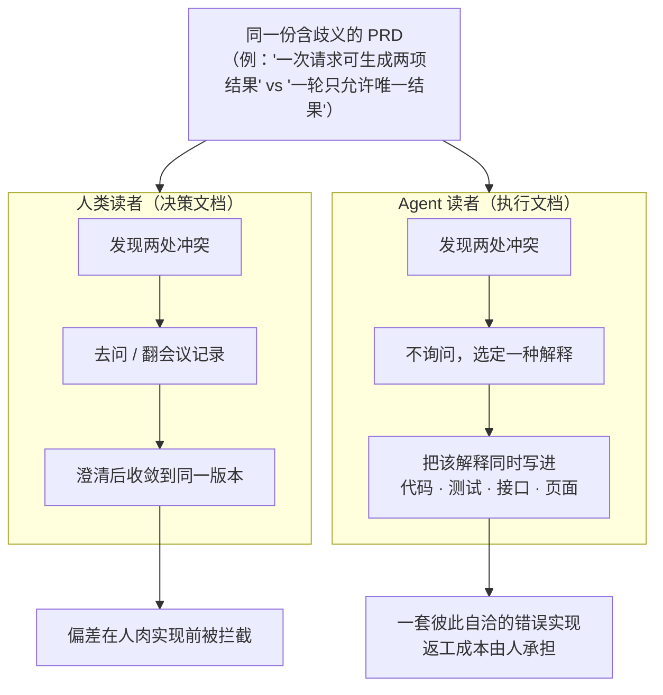

# AI 时代，PRD 有了第二类读者：把需求文档变成可验证契约

> **讲解版入口**：配套图文版在 `阅读/讲解-03-PRD契约.html`；第二类读者对应本文 §一，歧义放大案例对应 §二，四个可检查标准对应 §三，两道关卡对应 §四，契约骨架对应 §七。

> **断言标注约定**：本文关键判断按三分法标注——`[经验]`（抽象自作者真实参与的 AI 功能评审与实践观察）、`[推测]`（本文提出的判断，附理由）。无标注的为可直接核对的定义、流程或模板描述。外部资料的定位见文末"这些来源分别解决什么问题"表。

## 引子：三个系统，三份"正确"

一个功能评审结束后，所有人都说自己听懂了。

前端按"一次最多展示两张卡"设计布局，后端按"一轮只能生成一张卡"实现；产品文档里的状态枚举是"升高、正常、降低"，质量规则里允许的却是"升高、平稳、降低"；PRD 要求展示预测概率，安全规则又禁止系统输出没有证据的概率。

每个人都遵循了一份看起来正式的文档，每个人也都能解释自己为什么这样做。最后，团队做出了三个互相不兼容的系统。`[经验]`

这类问题过去也存在，只是常常被人脑掩盖。参加过会议的人知道产品经理"其实想表达什么"，发现前后矛盾会在群里问一句，看到缺失边界会根据组织经验补齐。

现在，PRD 多了一类读者：编码 Agent、测试 Agent、设计生成器和其他自动化系统。

它们可以极快地执行文档，也会极快地放大文档中的矛盾。AI 没有让 PRD 变得不重要，恰恰相反：**当实现成本下降后，规格中的歧义成为更昂贵的错误来源**。

痛点并不是"Agent 看不懂中文"，而是它能够在不询问的情况下选定一种解释，并把这个解释同时写进代码、测试、接口和页面。过去一次会议能纠正的歧义，现在可能先变成一整套彼此自洽的错误实现，再由人承担返工成本。

**一句话答案**：当 PRD 同时被人类和机器执行，它就不能再停留在"可读说明"，而要升级为"可验证契约"。本文给出三个可直接采用的控制点：**发布前找冲突、实现前回放意图、变更时生成影响账单**，外加一份可复用的契约骨架（§七）。

本文结构：§一定义"第二类读者"（问题的根源）；§二用一个完整案例展示歧义如何被放大；§三给出四个可检查标准（方法主体）；§四、§五、§六分别处理发布前检查、AI 功能的额外内容、变更管理；§七是模板。

问题不是文档写得差，而是文档的读者变了——过去的治理机制（开会、口口相传）假设所有读者都会提问，这个假设已经失效。

## 一、第二类读者：执行文档的机器读者

### 1.1 定义

**PRD 的传统读者是人类协作者——研发、测试、设计师。他们读的是决策文档：文档只是决策的索引，真正的语义由会议、群聊和组织惯例共同承载。发现歧义时，人会停下来问。**

**AI 时代新增的第二类读者是执行文档的机器读者——编码 Agent、测试 Agent、设计生成器。它们读的是执行文档：文档本身就是唯一输入，输出直接是可运行的实现。发现歧义时，它们不会问，只会选。**

一句话概括：**人类读者把 PRD 当作"待澄清的意图记录"，机器读者把 PRD 当作"待执行的规格本身"。**这个差异不在阅读能力，而在遇到歧义后的行为分叉。

### 1.2 两类读者的行为对比

| 人类读者 | Agent 读者 |
|---|---|
| 发现矛盾后可能主动询问 | 可能选择其中一个版本继续执行 |
| 能从会议和常识补齐留白 | 会用训练先验填补空白 |
| 能感觉某个示例已经过时 | 可能把示例当成最具体的权威指令 |
| 知道口头拍板覆盖旧方案 | 新会话未必拥有拍板记录 |
| 实现速度受限，偏差逐步暴露 | 可以同时在代码、测试和文档中复制偏差 |

这张表描述的是行为**倾向**的结构性差异，不是逐条必然：它不预测某个具体 Agent 会怎么处理某份具体文档——"选哪个版本"取决于训练先验和上下文细节，往往不可预知。

这里的问题不是"AI 只会照字面执行"。模型同样会解释、概括和推断。危险之处恰恰是它能为冲突文档生成一个自洽解释，然后继续工作，而不是可靠地停下来要求权威决定。



过去由人脑默默承担的需求治理成本，在自动化链路中必须被显式化。第二类读者的出现，改变的不是 PRD 的写法偏好，而是 PRD 的错误成本结构——歧义从"会被追问的小瑕疵"变成"会被批量执行的分叉点"。

## 二、一个歧义的三条岔路：先看一个完整案例

### 2.1 "两轮 vs 一轮"：一个歧义如何被三条链路放大

下面是一个**构造的原型案例**，抽象自真实 AI 功能评审，业务细节已做泛化 `[经验]`。它只讲一个冲突，但完整展示放大路径。

**起点**：某生成式功能立项时，PRD 写道——"单次请求最多生成两项结果，供用户对比挑选"。这是当时的真实产品意图：两个候选卡片并排展示。

**漂移**：两个迭代之后，出于成本和页面节奏考虑，工程方案改成了"一轮只允许输出唯一结果"。这个决定写进了三个地方：门禁代码、系统提示词、接口 schema——**唯独没有回写 PRD**。

**放大**：新会话里，三个 Agent 各自领任务并同时开工：

- 前端 Agent 拿到 PRD，按"最多两项"设计了双卡自适应布局；
- 后端 Agent 拿到接口 schema 和门禁规则，实现了单结果的生命周期（生成→展示→归档，均为单对象）；
- 测试 Agent 按门禁代码生成断言："单轮输出数 = 1"。

三个实现各自完全自洽——每个 Agent 都"正确"地遵循了自己读到的权威材料。直到联调，双卡布局遇上单结果接口，团队才发现：**没有任何一处代码报错，因为每一处都符合它读到的那份规格**。

如果是人类工程师，联调前问一句"以哪版为准"就能拦住这个问题。Agent 不问——这正是 §一 说的行为分叉。而三个 Agent 的并行速度意味着，分叉从"一个问题"膨胀成"一次跨端返工"，只用了过去写完一份代码的时间。

这个案例的教训可以压缩成一句：**歧义本身的成本不高，高的是歧义被并行执行的成本。**

### 2.2 更多冲突：同一结构的六种变体

"两轮 vs 一轮"不是孤例。同一次功能迭代中出现过下面几类结构相同的冲突，业务已经抽象，但模式十分常见 `[经验]`：

| PRD 中的定义 | 后续工程规则 | 直接后果 |
|---|---|---|
| 一次请求可生成两项结果 | 一轮只允许唯一结果 | 前端布局和后端生命周期不一致（2.1 案例） |
| 状态为"升高/正常/降低" | 门禁只允许"升高/平稳/降低" | 模型、接口和 UI 使用不同枚举 |
| 摘要先汇报系统执行状态 | 最终决定要求结论优先 | PRD 的示例成为需要被消灭的反例 |
| 页面展示预测概率 | 禁止输出无证据概率 | 产品字段与安全约束直接冲突 |
| 使用材料中的最新日期 | 必须使用带日期和时间的单点时刻 | 统计区间可能被误写成数据截止时间 |
| 没有定义"不展示" | 低质量结果必须被拦截 | 系统最重要的失败行为没有进入 PRD |

这张表只负责把冲突暴露出来，它不告诉你"哪一处最致命"——致命程度取决于功能的风险等级（第 1 行影响布局，第 6 行影响系统最重要的失败行为）；也不替你判断哪一侧才是正确版本，拍板永远是人（产品负责人）的工作。

这些冲突不是因为团队没有文档，而是因为有多份各自合理的"事实源"。需求继续变化，决定只写进工程方案、会议纪要、提示词或门禁代码，没有回到权威规格。

当人和 Agent 分别读取不同材料时，局部正确会组合成全局错误。

六个冲突共享同一个结构——决定落在了权威规格之外的地方。所以解法不是"更努力地写好 PRD"，而是给每个易变事实指定唯一权威位置。

## 三、把"所有人都懂"改造成四个可检查标准

口头合伙靠默契，书面合同靠条款。这一节把"大家都懂"的隐性共识拆成四个可逐条检查的标准：**内部一致、意图明确、可验收、机器友好**。前两个保证文档不自己打自己，后两个保证文档能被人和机器执行到同一个结果。

### 3.1 内部一致：同一问题不能有两套答案

"两轮 vs 一轮"的根因是**没有单一事实源**。注意，单一事实源经常被误解为"维护一份巨型文档"——真正重要的不是文件数量，而是**每个易变事实只能有一个权威定义**。

下面这些内容非常容易漂移，应该在一个权威位置定义，其他材料只引用、不复制：

- 枚举值；
- 字段名称和类型；
- 数量上限；
- 阈值；
- 生命周期；
- 输出格式；
- 失败和降级策略。

```text
错误方式：
PRD 写一份枚举
接口文档复制一份
Prompt 再写一份
测试代码维护第四份

更可靠的方式：
契约中定义枚举
PRD 解释业务语义并链接契约
Prompt 使用同一术语
测试从契约或同一规则生成断言
```

第二份副本不只是维护成本，也是一枚延迟生效的 bug。

落到操作层面，"内部一致"检查的不只是前后段落，也包括：

- 正文与示例；
- PRD 与接口契约；
- PRD 与质量、安全规则；
- 当前版本与历史拍板；
- 功能说明与验收标准。

其中示例值得单独强调：示例往往比抽象规则更容易被 Agent 模仿，因此"文字要求结论优先、示例却仍以系统状态开头"不是小问题，而是直接冲突。

### 3.2 意图明确：边界必须正面写出

"没有提到"不等于"不做"。模型会用最常见的实现方式补齐留白，开发者也会根据各自经验作出不同选择。

因此，需要独立列出：

```text
本期做什么
本期明确不做什么
只支持哪些场景
哪些输入必须拒绝
数据不足时怎样处理
哪些动作必须由用户确认
```

非目标不是附录，而是防止范围漂移的重要需求。

### 3.3 可验收：每条关键需求都能判断真假

"标题要简洁""结果要准确""体验要流畅"都不能直接验收。

更好的写法是：

```text
标题最多 32 个字符；超长时删除完整语义段，不允许截断单词。
没有基线数据时，不得输出上升或下降趋势。
查询失败时不生成正常结论，必须进入明确的失败状态。
同一轮最多展示一个总结结果。
```

一条可独立检验的验收标准，可以直接转化成测试、门禁或评测用例。需求工程和评测工程不是两个阶段，而是同一套"正确性定义"的不同载体。

### 3.4 机器友好：结构比辞藻重要

Agent 依赖标题、列表、表格和明确术语定位信息。关键规则适合使用：

- 编号需求；
- 字段表；
- 状态机；
- 正例和反例；
- 条件—行为句式；
- 术语表。

例如：

```text
When 数据源查询失败，系统应记录失败原因，并且不得生成正常业务结论。

While 证据时间范围无法确定，系统不得使用"近期""上升""下降"等时间性判断。
```

这类受控句式不会消除所有歧义，但能显著减少"条件藏在句尾""多个动作混在一段"等问题。

四个标准回答的是同一个问题——把口头合伙中由默契承担的部分，显式写进合同：一致性条款（3.1）、范围条款（3.2）、验收条款（3.3）、可执行格式（3.4）。

## 四、AI 在 PRD 流程中的正确位置：检查，不是拍板

文档改造成了契约，还要有验收流程。AI 非常适合通读长文档、寻找远距离冲突和生成澄清问题——但它不能替产品负责人决定业务真相。

可以在 PRD 发布前设置两道关卡。

### 关卡一：一致性与完整性检查

要求 AI 只找问题，不直接重写：

```text
通读 PRD、接口契约、质量规则和示例，输出：

1. 自相矛盾：列出冲突的两处原文和所在章节；
2. 信息缺口：缺少边界、异常处理、数据来源或验收标准的需求；
3. 术语漂移：同一概念的不同名称和不同取值集合；
4. 示例违规：示例是否违反正文规则；
5. 决策冲突：新要求是否重新引入已否决方案。

不要替负责人选择正确版本，只提出需要拍板的问题。
```

AI 的报告可能漏报或误报，必须由人确认。它是需求体检工具，不是权威来源。

> 与《AI 让看起来正确变得廉价》的关系：那篇的判断是"生成成本趋零而验证成本未降，工程重心要转向证据链与门禁"。本节的关卡一就是证据链思想在需求侧的落点——AI 产出的是**待复核的检查报告**（证据），不是裁决；门禁（发布）由人执行。同样保留那篇的边界：AI 判别可能误杀，报告的误报率需要靠使用中的抽检复核来校准。

### 关卡二：意图回放

一致不代表意图正确。一份文档可以内部完全自洽，却精确地描述了错误产品。

让 AI 复述：

- 目标用户是谁；
- 用户问题是什么；
- 什么情况下系统行动；
- 什么情况下系统保持沉默；
- 失败和数据不足如何处理；
- 哪些决定仍需要人拍板。

再给出几个边界输入，让它说明会怎么处理以及依据哪条需求。

如果复述偏离产品意图，说明文档表达存在问题；如果它提出的问题产品负责人也无法回答，说明需求本身还没有决定。

关卡一管"文档不自相矛盾"，关卡二管"矛盾之外还要是对的"——前者是合同条款审查，后者是签约前确认双方理解一致；两道关卡都只产出问题清单，拍板权始终在人。

## 五、AI 功能的 PRD 还要多写四类内容

普通软件的 PRD 已经需要边界和验收条件，生成式 AI 功能的不确定性更高，还需要额外内容。

### 5.1 数据来源和刷新语义

必须说明：使用哪些数据、从哪里获取、时间范围是什么、刷新频率如何、缺失时怎样处理。

"使用最新数据"不是可执行要求。最新是事件时间、入库时间、抓取时间还是报告生成时间，需要明确。

### 5.2 输出口径

关键语气、结论强度、禁止表达和引用规则属于产品需求，不应该完全留给工程人员写 Prompt 时决定。

最有效的形式通常是：原则 + 正例 + 反例。

### 5.3 负面用例

不要只描述"应该输出什么"，还要说明"不应该输出什么"：

- 没有证据时不得补全事实；
- 查询失败不得伪装成没有异常；
- 只有明细时不得描述趋势；
- 用户越权请求不得调用高风险能力；
- 低质量结果宁可不展示，也不能填充模板。

负面用例往往比理想示例更能定义产品边界。

### 5.4 质量和失败策略

生成失败、结构失败、证据不足和业务价值不足是不同状态。PRD 应明确：

| 状态 | 产品行为 |
|---|---|
| 格式不合法 | 重试或阻断 |
| 数据不足 | 明确提示或不生成 |
| 语义风险较高 | 降级、人工确认或隐藏 |
| 工具调用失败 | 显示真实失败，不生成正常结论 |
| 结果有效但价值低 | 不一定展示 |

这张表不回答"每个状态的具体阈值定在哪"（那取决于业务风险偏好，需要产品负责人拍板），也不覆盖表中五种状态之外的新型失败——每次接新的工具或数据源，都应回到这张表问一句"它引入了哪种失败"。

这些不是实现细节，而是用户最终会看到什么。四类内容补的是同一样东西：AI 输出的不确定性在传统 PRD 里没有对应栏目；不确定性越大，失败行为越需要被当作一等需求来写。

## 六、需求变更必须带一张"影响账单"

PRD 质量经常不是初稿问题，而是后续修改只落在一个地方——§二 的"两轮 vs 一轮"正是这样发生的。

每个重要决定可以记录：

```markdown
## 决定
一轮只生成一个总结结果。

## 原因
避免多个候选结果之间互相矛盾，并简化用户认知。

## 替代
废止"单次请求最多两项结果"的旧规则。

## 影响范围
PRD、接口 schema、前端布局、Prompt、门禁、测试用例。

## 确认
负责人、日期、关联讨论。
```

这张账单的价值是迫使团队回答：修改的是一句文字，还是一组跨系统契约？

影响账单是契约的"变更记录页"——合同改一条，所有引用该条款的附件都要同步；没有台账，第二份副本就会悄悄变成权威。

## 七、一份可复用的 PRD 契约骨架

把前六节的方法压缩成一份可直接套用的骨架：

```markdown
# 功能名称

## 目标与用户价值

## 术语表

## 范围
### 本期包含
### 明确不包含

## 数据来源与时间语义

## 功能需求
### R1：触发条件
- 规则：
- 正例：
- 反例：
- 验收标准：

## 状态与失败行为

## 输出契约

## 安全与权限边界

## 负面用例

## 非功能要求

## 变更记录与决策台账

## 未决问题
```

PRD 不需要因此变成形式化证明。目标不是消灭自然语言，而是把最容易产生分叉的规则变成可以被引用、检查和验收的契约。

骨架只是清单化的四个标准——每一段都对应 §三 的一个检查项，使用时按功能规模裁剪，但"未决问题"和"变更台账"建议始终保留，它们是两道关卡和影响账单的落点。

## 结语

AI 加快的不只是实现速度，也包括误解被复制的速度。

当 PRD 只被少数熟悉背景的人阅读，留白和矛盾可能暂时由沟通补齐；当同一份文档进入多个 Agent、多个会话和多条生成链路，隐含共识就不再可靠。

因此，AI 时代的 PRD 第一质量标准不只是"人读起来顺"，而是：

> 不依赖会议记忆和作者脑补，不同读者仍能得到同一组可验证行为。

规格越容易被自动执行，规格本身越需要成为工程资产。

---

## 证据边界声明

**这份声明的范围**：适用于正文所有带标注的判断，也适用于未标注但涉及具体团队行为的描述。

- `[经验]` 抽象自作者真实参与的 AI 功能评审与实践观察。业务名称、具体阈值、内部系统和人员信息均已抽象；案例（引子场景、2.1"两轮 vs 一轮"、2.2 冲突表）用于证明失败模式**存在且结构常见**，不代表所有 PRD 都会以相同方式失败，也不构成任何真实事故的复盘记录。
- 文中"Agent 会选一种解释而不询问"是对观察到的行为倾向的概括，具体 Agent 在具体文档上的行为不可预知；对背后机制（模型倾向自洽解释而非停机询问）的进一步归因，本文未给出实验证据，属于 `[推测]` 层面的定性描述。
- 外部资料均为方法与工具实践（见下表），不构成需求质量的受控实验证据。

### 这些来源分别解决什么问题

| 来源 | 主要价值 | 使用边界 |
|---|---|---|
| GitHub Spec Kit 与 GitHub Blog | 展示规格驱动开发如何把需求、计划和实现连接起来 | 产品方法与工具实践，不证明某种模板适合所有团队 |
| Addy Osmani 的 spec 指南 | 提供面向编码 Agent 的规格写作经验 | 工程经验，不是需求质量的受控实验 |
| EARS | 提供条件—行为式的受控需求句法 | 降低句法歧义，不能替负责人决定业务意图 |
| ALICE | 支持用自动方法发现需求矛盾的可行性 | 发现冲突不等于自动裁决哪个版本正确 |
| Kiro Deep Spec Analysis | 展示 Agent 辅助规格检查的产品化路径 | 产品能力会变化，应以实际版本为准 |

## 参考资料

- [GitHub Spec Kit](https://github.com/github/spec-kit)
- [Spec-driven development with AI — GitHub Blog](https://github.blog/ai-and-ml/generative-ai/spec-driven-development-with-ai-get-started-with-a-new-open-source-toolkit/)
- [How to write a good spec for AI agents — Addy Osmani](https://addyosmani.com/blog/good-spec/)
- [Easy Approach to Requirements Syntax (EARS) — IEEE Requirements Engineering 2009](https://doi.org/10.1109/RE.2009.9)
- [Deep Spec Analysis — Kiro](https://kiro.dev/blog/deep-spec-analysis/)
- [ALICE: detecting inconsistencies in requirements](https://link.springer.com/article/10.1007/s10515-024-00452-x)

## Changelog

- **v3（2026-10-27，按 SHOW v3.1 重写）**
  - 结构：七节次序不动（篇型 C 方法指南：问题→原则→步骤→清单→边界）；删去五处同句式的"本节本质"栏目，收口句并入各节正文末尾——原写法在引子、§一、§二、§三、§四、§五、§六、§七 共八处使用同一句式，属模板报幕句批量复制（同 V-002 事故形态）；
  - 边界：三处"这张表不能告诉你什么"引导语删除，边界内容改写进表后正文；§一 1.2 原有的"表说的是行为倾向"与边界句合并成一句，避免同一层意思写两遍；
  - 交叉引用：正文中"第一节/第二节/第三至七节"统一改为"§一"到"§七"，与讲解版的灰色回链标记对齐；§四 关卡一上方保留与《AI 让看起来正确变得廉价》的交叉引用块；
  - 入口：顶部改为讲解版入口并按 SHOW-P05 给出对应小节号。原 v2 记录的理由"讲解版 html 位于 gitignore 的 `阅读/` 目录"已过期（当前 `.gitignore` 只忽略 `.DS_Store`），本次不再以该理由偏离 P-2；
  - 未改：全部案例事实、六种冲突变体、四个标准、两道关卡、骨架结构、引用与标注等级保持原样；未新增未经核实的外部结论。
- **v2（2026-10-16，重写，任务卡 3）**
  - PRD-1：原第三节"单一事实源"并入第三节 3.1"内部一致"，全文由 8 节收敛为 7 节（含附录骨架节）；
  - PRD-2：新增第一节"第二类读者"独立定义块（决策文档的人类读者 vs 执行文档的机器读者），原引言中的散点表述收拢；
  - PRD-3：第二节先讲透"两轮 vs 一轮"一个完整故事（起点→漂移→三条链路放大→教训），再上六冲突表；表后补"这张表不能告诉你什么"；
  - PRD-4：第一节新增 mermaid"人类 vs Agent 读者"对比图；
  - 规范适配：开头新增断言标注约定（[M-7]）；案例按 [M-8] 标注"构造的原型案例"；主要表格补 [M-3] 的表前因果链与表后边界句；每节末补"本节本质"（[M-4]）；第四节补与《似真产出》篇门禁/证据表述的交叉引用（不冲突：两道关卡产出待复核报告，拍板与发布由人执行）；
  - **偏离记录**：偏离 [P-2]（md 顶部→html 讲解版入口链接），理由：讲解版 html 位于 gitignore 的 `阅读/` 目录、不推送公开仓库（拍板 D2），在推送的 md 中放相对链接会在 GitHub 上 404；两层互引改在本地核验流程中完成。（该理由已于 v3 失效）
- **v1（原稿）**：初始版本（status: draft）。
