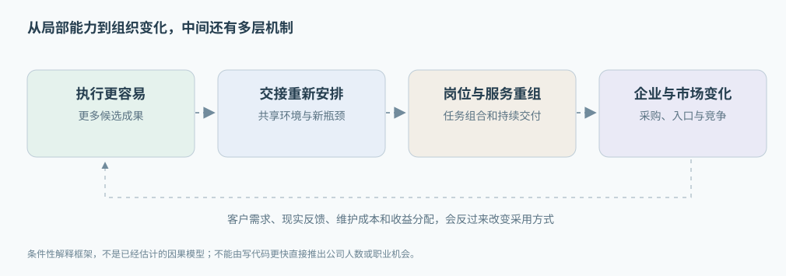
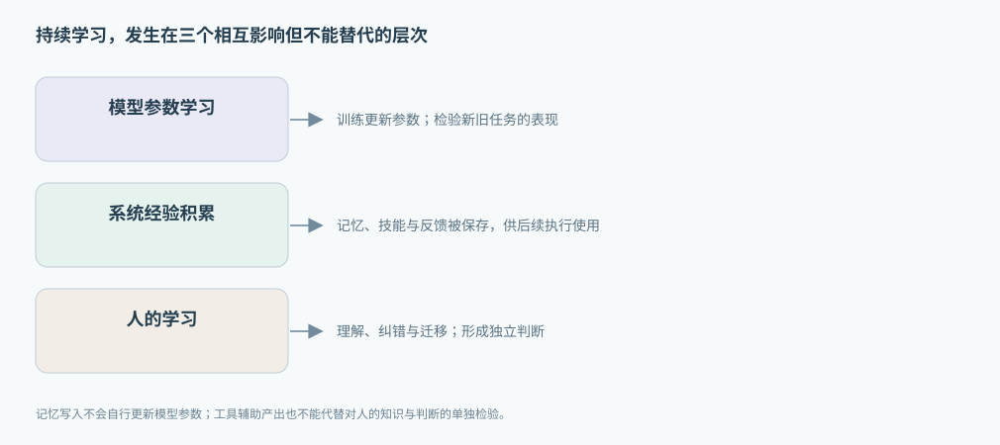

<!-- document-id: show-12 -->
<!-- document-version: 1.0-review -->

# AI 正在怎样改写工作、公司与社会

[图解讲解](../阅读/讲解-12-AI与组织演进.html) · [返回首页](../index.html)

原研究检索截止 2026-11-05；本公开副本于 2026-11-13 对四项承重来源作定点补核，其余材料保留原研究时点。

研究问题是：AI 让哪些事情变得容易，原有生产和协作方式因此怎样改变，这些变化又可能怎样传导到岗位、公司、市场与社会。软件提供变化较早的观察窗口；咨询、法律、金融、设计、生物研发、消费交易等提供各自独立的检验。分类随发现调整。

本文围绕执行能力变化如何传导到工作、产品、公司和社会组织论证。正文中的“观察”是来源所报告的事实，不保证已独立审计；“解释”与“推演”是跨材料综合。近期发表的旧样本、已发布产品、真实运营案例、随机实验与理论模型分别标注。配套的[未来分叉矩阵](#future-matrix)把推演进一步展开。

## 一、目前最有解释力的判断

**AI 正在降低调用执行能力的成本，工作、产品和企业随之重新划界。** 原来需要把意图翻译给另一个岗位的事情，部分可以由意图提出者直接启动；原来由多人反复完成的服务，部分可以进入持续运行的产品；原来围绕人类使用者设计的软件，开始把能力、状态和交易暴露给代理。

这会同时产生几种形态：能覆盖更宽任务的人、专门处理难例和情境的专家、少量人维护的大型执行系统、掌握入口与基础设施的平台，以及把专业服务和软件运行结合起来的公司。它们可以共存。执行变容易后，客户需求、注意力、组织知识、现实反馈和利益分配会重新决定哪里成为瓶颈。

以下六条是当前较有现实支点的方向，发生范围仍不相同：

1. **软件生产的重构已进入审查、源控与运行环境。** “代码更快生成”只是变化的一段。
2. **部分跨岗位交接可以变成直接提交可运行的成果。** 产品、设计、支持、分析和工程的边界因此更有弹性。
3. **软件开始交付可由代理使用的能力。** 人类界面、机器动作、商业计量可能各有一套表达。
4. **专业服务与持续运行的软件相互进入。** 咨询机构、模型商和软件企业都在延伸边界。
5. **更少员工与更大的经营覆盖可以同时出现。** 人数、计算投入、客户覆盖、资产控制与决策权需要分开观察。
6. **生产能力的普及和职业机会、权力的普及没有自动对应关系。** 学习、入口、评价和分配是独立的传导过程。

## 二、变化已经发生在哪里

### 1. Claude Code：代码生产和代码阅读都开始进入机器循环

**观察。** Claude Code 团队 10 月 15 日披露，绝大部分代码阅读交给机器；低风险可信作者变更可以没有人工批准，其余按风险保留不同要求。“多数 PR 至多一名人类参与”仍是目标。自动审查、修复、验证与回滚构成持续流程。这是团队内部运营自述，不能代表普通软件公司。[团队原文](https://claude.dev/blog/solving-code-review-at-anthropic/)

10 月 13 日的 Scion 复盘则显示，当代理成为主要客户端，源控向服务端计算、API 和稀疏物化调整。Scion 的巨大 monorepo 与 Claude Code 的独立仓库采用不同合并安排，不能拼成一套统一流程。[源控工程复盘](https://www.anthropic.com/research/redesigning-source-control)

**解释。** 旧工具把“每个人理解一小块、交给下个人”当作基本单位。高吞吐代理工作更需要可执行环境、明确状态、快速反馈与变更整合。人的工作可以继续向问题选择、系统取舍和少数难例移动；审查本身也在自动化，不能把所有人的未来固定为逐行审查。

**新的研究问题。** 当日常读代码减少，共同理解、维护经验和新人学习怎样获得？短期交付增长之后，组织记忆是否仍能积累？

11月1日最新Chen与Stratton工作论文提供多公司对照：655家企业、2021—2026年8月工作记录，错峰采用设计下，代码增长大于以Jira事项/项目衡量的最终产出；在活跃工程用工及LinkedIn就业代理中未检出显著效应，估计区间仍允许一定幅度变化，审查出现等待与返工压力。采用非随机，产出代理也不是用户价值；长期减员来自模型模拟。[最新作者PDF](https://fion.ac/jellyfish.pdf) 这与前沿公司并不矛盾：不同组织、工具和流程可以处在不同阶段，审查自动化也可能继续移动瓶颈。

### 2. Replit：业务意见可以直接变成公司代码库里的可审查变更

**观察。** 10 月 27 日发布的 Cloud Agents 能让业务专家描述修改，在基于公司代码库的共享开发环境与隔离沙箱中实现、运行浏览器测试，提交带截图或录像的 PR/MR；工程师控制最终发布。将审查意见转为共享 skills 的功能仍是 early access。产品可用证明这种贡献路径存在，尚无独立的长期收益与质量研究。[官方当前页；2026-11-13补核，页面标注11月12日更新](https://replit.com/blog/anyone-can-bring-ideas-to-company-codebase)

**解释。** 支持人员发现的问题，以前可能要经历工单、排期、解释、实现、来回确认；现在部分问题可以直接到达“具体变更＋行为证据”的阶段。减少的是某些翻译和等待，工程组织仍需吸收新增贡献。

**推演。** 分工可能更多围绕“谁理解问题、谁控制交付边界”组织。综合岗位会更有经济吸引力，深度专家则可能服务多个任务或团队。Linear 当前 Product Engineer 招聘体现产品判断与全栈交付的组合；但 Design Engineer 等岗位早于这一轮 AI 已存在，职位名称不能充当净新增职业的统计。[当前岗位](https://linear.app/careers/0c7c2e26-0a98-42cf-a47c-9a3999fb513b)、[Vercel 2024 年历史锚点](https://vercel.com/blog/design-engineering-at-vercel)

### 3. 软件生态：从“让人操作”扩展到“让代理理解并使用能力”

**观察。** Chrome WebMCP 让网页声明动作和输入定义，10 月更新的文档仍处 origin trial；Windows 10 月 7 日发布的 MXC 为代理提供隔离运行空间，但部分产品整合仍属未来支持。前者是浏览器试验，后者部分组件已 GA，成熟度不同。[Chrome 工程文档](https://developer.chrome.com/docs/ai/webmcp/)、[Windows 工程说明](https://blogs.windows.com/windowsdeveloper/2026/10/07/microsoft-execution-containers-policy-driven-containment-for-ai-agents/)

Salesforce 8 月提出把企业应用开放为可调用能力；9 月计费说明又为代理身份及成功调用设计 Headless Platform Interaction。当前页仍写倍率 TBA、尚未计量，不能当成已实际收取的固定费用。[能力发布](https://www.salesforce.com/ap/news/press-releases/2026/08/25/salesforce-turns-enterprise-applications-into-enterprise-capabilities/)、[计量说明](https://help.salesforce.com/s/articleView?id=005360285&language=en_US&type=1)

**解释。** 软件的竞争对象增加了：能力能否被发现，动作能否组合，结果能否验证，失败能否恢复。屏幕仍能承担探索、判断和直接操作；代理可以通过另一路径使用同一业务系统。掌握业务记录、语义和权限的企业，也可能从席位扩展到机器调用收费。

**推演。** 用户可能更多表达目标，由代理临时组合现有软件；部分应用后台化，部分专业界面反而得到强化。“电脑端言出法随”会沿着具体可执行任务扩展，跨系统互通程度决定它能走多远。

### 4. 交易：机器已经开始穿过公司的边界执行

**观察。** Visa、BILL 与 Billtrust 10 月 20 日宣布的实时试点，让获授权代理在供应商门户完成已批准发票的付款；未披露笔数、金额或差错。Shopify 10 月开发者版本继续开放目录、购物车与结账，把交易能力带入其他应用入口，购买仍要求买家批准。[Visa 原始公告与FAQ](https://usa.visa.com/about-visa/newsroom/press-releases.releaseId.22856.html)、[Shopify Fall ’26](https://www.shopify.com/news/fall-26-edition-developer)

Stripe 3 月的 MPP 已给出按浏览器 session、API 调用等临时购买能力的早期例子；它说明服务可以被切成程序可购买的单元，没有证明自主代理市场已成规模。[Stripe 原文](https://stripe.com/blog/machine-payments-protocol)

**推演。** 一次任务可能临时采购数据、浏览器、分析、计算和履约。商家需要面对新的“顾客”：替人筛选、比较、调用与支付的代理。市场竞争可能部分转向机器可读报价、可调用交付和代理排序；入口费、归因和客户关系可能随之迁移。

### 5. 咨询：收费、运行责任与人员构成开始出现可核对的变化

**观察。** Accenture FY2026 披露固定价工作占 bookings 超过 65%，其中包括结果计费，不能写成“65% 都按结果收费”。同年员工约 77.9 万增至 81.4 万，局部自动化与公司总用工增长并存。[FY2026 业绩材料](https://investor.accenture.com/~/media/Files/A/accenture-v4/investors/documents/accentures-fourth-quarter-fiscal-2026-earnings-presentation.pdf)

BCG CEO 5 月访谈称，最大 AI 项目中约 75% 包含浮动费，全公司范围显著不到三分之一；同时称没有削减新人招聘。这是管理层披露，尚无合同级独立面板。[直接访谈](https://www.bcg.com/about/expertise/ai-changing-consulting-and-pricing-models)

PwC Australia 8 月推出固定费财务托管，10 月又推出固定费订阅网络安全服务。其试点效果为匿名客户和供应商自述，但收费与持续交付形态已经可以核对。[财务托管](https://www.pwc.com.au/media/2026/PwC-Australia-launches-new-agentic-powered-finance-manages-services.html)、[网络安全托管](https://www.pwc.com.au/media/2026/PwC-Australia-launches-AI-powered-Cyber-Managed-Services.html)

**解释。** 固定价、托管和浮动费早已存在。AI 的新作用可能在于降低重复交付成本，使机构更愿把专业工作封装成可重复运行的能力，并重新分配节约收益、价格和维护责任。不能把既有商业模式的延伸写成 AI 首次发明。

**推演。** 咨询与软件、产品与服务可能进一步交叉：少数领域专家和工程人员维护系统，客户团队处理情境、关系与改进。传统按人员投入扩张的部分业务可能改变，但项目配员、合伙人跨度和长期毛利仍缺直接数据。

### 6. 公司边界：咨询商吸收技术能力，模型商延伸到交付

**观察。** 
Accenture 3 月完成 Faculty 收购，400 多名专业人员加入，包括数据科学家与 AI 工程师，创始人进入集团技术管理高层。另一侧，澳大利亚竞争监管文件描述了 OpenAI 与 Tomoro 已有的不同部署服务，以及拟议交易；6 月批准不能直接等同收购交割。[已完成的 Faculty 收购](https://newsroom.accenture.com/news/2026/accenture-completes-acquisition-of-faculty)、[ACCC 原始决定](https://www.accc.gov.au/system/files/public-merger-register/documents/OpenAI-Tomoro%20-%20Phase%201%20determination.pdf)

**解释。** 价值可能来自组合：模型、领域知识、客户关系、系统整合、持续运行。谁缺哪一段，就可能通过收购、合作或组织内部重组补足。技术能力普及也可能提高互补资产的相对价值。

**推演。** 一些“软件公司”会承担更多专业服务；一些“咨询公司”会经营更多软件资产。行业名称可能落后于实际生产方式，研究应追踪交付对象和收益来源。

第三轮还有相反方向的具名案例：Heimstaden的11月3日材料称，领域分析师建成数据管线，避免聘请外部顾问；“五人一年到两人两月”是交付需求估算，不是实测裁员。Legora总法律顾问10月称，常规NDA占团队能力份额由约20%降至不足1%，同时承接原可能外包的尽调；公司正扩张，没有总人数或工时对照。[Heimstaden](https://openai.com/index/heimstaden/)、[Legora](https://openai.com/index/legora/)

**新的解释分支：员工数不变，专业服务的采购边界也可能已变。** 内部人员直接执行和外包服务产品化可在不同市场并行；少买顾问，也可能多买模型、集成与验证服务。

### 7. 创业公司：更小团队已有结构相关，原因需要细分

**观察。** Kim 与 Koning 的 6 月 HBS 工作论文比较 YC 与美国风投企业，同批次、同业的 YC AI 原生公司约小 25%。员工主快照是 **2025年1月**；YC身份来自企业自贴AI标签，不等同于全部采用当前LLM或代理。这是描述性比较。产品中嵌入 AI 与组织规模较小相关，招聘中提到内部工具的粗糙代理不能充分解释差异；不能推出内部 AI 无效或全部企业都会缩小。[官方全文](https://www.hbs.edu/ris/Publication%20Files/26-090_96f92aa0-37d9-4789-beaa-5c0cb87a4032.pdf)

**解释。** 让员工使用 AI，与直接让产品承担原本由人员交付的服务，是两条不同路径。后者可能改变新增一个客户需要增加多少人，前者可能先改变既有任务的做法。

**推演。** 行业结构可能通过新公司的进入而变：先出现能用新成本结构服务细分市场的企业，再迫使旧企业调整。多数既有公司尚未改组，不足以否定结构变化；少数明星创业公司也不足以证明全经济趋势。

### 8. 其他行业提供不同的边界条件

| 观察窗口 | 专业材料与实际发现 | 对演化的启发 |
|---|---|---|
| 法律 | [Autor 等专利律师研究，9月/10月](https://www.nber.org/papers/w35720)：11家律所、133名律师的三个月随机研究，工具辅助与撤去工具后的判断分开测量 | 当前交付与持久专业能力可能分离；资深与初级的学习路径不同 |
| 咨询跨专业 | [Nature Human Behaviour，10月26日](https://www.nature.com/articles/s41562-026-02566-6)：487名完成者；2026年10月发表，本轮按公开摘要核对借AI改善陌生数据科学任务，但未达到专家等效 | 一个人可以借用其他领域的执行能力，专业资格和判断未必同时获得 |
| 金融研究 | [Generative AI for Analysts，9月修订](https://arxiv.org/abs/2512.19705)：主要为2022—2024年数据，报告内容更丰富，但高信息负荷下预测表现恶化，非随机采用 | 生产候选和信息更容易后，筛选、注意力与市场反馈可能更稀缺 |
| 会计 | [Choi与Xie，JAR正式版4月](https://onlinelibrary.wiley.com/doi/full/10.1111/1475-679x.70052)：生产数据、调查与分类实验分别观察录入、沟通及质量保证 | 岗位可以先从内部重切，而不立即消失 |
| 生物研发 | [Generate合作研究，10月27日](https://www.anthropic.com/research/early-progress-drug-development)：6名科学家连接文献、计算与多轮湿实验 | 专业人员可能更直接调动计算执行；物理实验仍提供独立反馈，非临床成功证明 |
| 药品质量 | [Enveda技术报告，10月27日](https://enveda.com/CMC-Document-Processor/)：4份批记录、1061页探索审查，疑点定位与正式质量签字分开，误报多 | 高责任场景可能先改写证据生产链，责任和生产资格仍是另一层 |
| 设计 | [Figma作者实验，9月22日](https://arxiv.org/html/2609.26725v1)：100名设计师/PM随机分组，有限UI任务；时间分析仅针对成功任务 | PM可更多进入设计执行；端到端品味、探索与用户价值仍需另外验证 |

这些行业沿各自的现实反馈演变。代码可快速运行，药物需湿实验与临床，法律有资格和客户责任，金融有市场结果，设计有感知与使用者反馈。反馈成本和错误后果会塑造不同速度与组织形态。

### 9. 制造与物流：先变化的是计划、工程准备和异常协调

**观察。** Siemens 10月19日披露，Erlangen真实生产中的共同开发试验，把新订单变成多个生产方案，供计划人员比较，再用全厂数字孪生验证。文中的成本与工程节约百分比使用潜力措辞，未提供可比实测样本。[原始现场披露](https://press.siemens.com/global/en/pressrelease/siemens-partners-nvidia-advance-ai-driven-autonomous-factories)

独立研究的162次离线排程生成中，多代理工作流改善了可运行模型生成，但最复杂仓内问题的原样脚本仍无成功。它测求解器建模能力，没有部署在工厂。[10月7日原始论文](https://arxiv.org/html/2610.10184v1)

**解释与推演。** 一部分工业知识工作开始连接数据、备选方案、仿真和执行，运筹、工程与现场之间的分工可能重排。机器能力与物理状态之间的距离仍需现场反馈弥合；现有材料不足以量化工人的任务、劳动强度或净岗位变化。软件经验可以提供问题，实体研究负责判断这些机制能否迁移。

### 10. 基层医疗：同步电话变成可分诊的任务队列

**观察。** Magdalen诊所9月公开的案例称，首月接待少接约5000通电话，同时收到约5000份由语音系统捕获的表单。这是供应商发布的具名诊所复盘，未给独立对照、配员或临床结果。电话与请求在三个月统计中也不是一一对应。[原始运营案例](https://www.animahealth.com/blog/magdalen-calls-triage-and-documents)

**解释。** 一部分即时沟通变为结构化、异步、可分诊的待办。接收方式已变，需求仍需后续判断和行动；提高入口容量还可能暴露原来被排队和接不通压住的需求。组织因此可能先重排接待、行政与专业人员的交接，岗位数暂时不变。

### 11. 教育与公共决策：专业人的方法可以进入机器过程

**观察。** BU的9月定制导师论文，实际试验在2026年7—8月。研究团队将先尝试再反馈编码为互动规则，并配置教师监测看板；86人随机分组，完整前后测51人、筛选后主分析46人，效果对筛选敏感。它支持继续研究方法如何被持续执行，未测教师岗位替代。[原始预注册现场研究](https://arxiv.org/html/2609.23958v1)

PlanAssist的11月开发复盘又有不同变化：官员先确认重要事实与考虑因素，代理再解释政策适用。当前仍从静态材料的Alpha测试走向实时系统整合Beta，不能当全国生产服务已上线。[Faculty原始复盘](https://faculty.ai/en-au/insights/news/were-working-with-planning-officers-to-build-an-agentic-ai-system-for-them)

**解释与推演。** 教师的专业判断可进入练习规则，官员的裁量可进入“什么算证据”的定义。专业角色不只在最终签字时发挥作用。更重要的是，一些工作本来就要培养能力、建立共同事实或获得程序信任；更快交付成品不总是这些活动的完整目标。未来应研究系统是否承接了这些功能，而非只测动作减少多少。

## 三、变化怎样从任务传导到社会

以下是用于组织研究的机制图，各箭头都需要案例检验：

<figure><figcaption>机制推演。每一步都需要独立证据，不能由一次任务变快直接推导企业缩编或收益分配。</figcaption></figure>

最重要的是沿中间机制前进。更多产出会引发更多选择，选择会消耗注意力；更容易启动项目会增加并行依赖；服务降价会扩张需求，也会挤压既有供应商；任务被工具承接会改变训练机会；谁控制客户和评价，会影响节约归属。

### 第一条反馈：执行变便宜，什么值得做变得更稀缺

软件、方案、报告、原型的候选数量扩大，客户和组织却没有同比增加的注意力。竞争可能向问题发现、筛选、分发和信任迁移。反过来，明确而可计算的评价也能被进一步自动化，因此不存在永久固定的“人只负责验收”终点。

Anthropic 10 月就业研究中，技术个人贡献者会议时间同比增加16%，代理流程与监控等元工作会话占比增加。它说明高自动化与协调增加可以共存，但单公司观察不能确定是哪一种机制导致。[内部就业研究](https://www.anthropic.com/research/employment-at-anthropic)

### 第二条反馈：跨职能执行扩大，共享生产环境变得更有价值

如果每个人各做一个孤立原型，交接问题可能只是后移；能在共同代码、数据、规则和运行环境里贡献，才可能减少翻译。企业专用知识因此可能从个人记忆和口头辅导，转成可执行约束、脚本、示例和反馈记录。

这类资产也会过时。Claude Code 7 月工程文称，适配新模型时删去80%以上系统提示，在内部编码评估中无可测损失；它提示过去有效的组织规则可能成为新摩擦，而非证明约束都不需要。[上下文工程复盘](https://claude.dev/blog/the-new-rules-of-context-engineering-for-claude-5-generation-models/)

### 第三条反馈：服务可重复运行，价值与责任一起重新划界

把专业服务做成系统，增加客户可能主要增加运行量；但现场整合、解释、例外和客户关系仍可能需要人。节约既可能留在供应商利润，也可能通过竞争降价、扩大需求或转成新的维护工作。

“按结果收费”本身也需要拆解。Intercom 5 月说明销售代理按合格线索收费，曾考虑最终成交收入分成，因归因和接入CRM的测量负担而放弃。可核对的中间交付，与承担客户最终营业结果风险，是不同合同。[定价设计原文](https://www.intercom.com/blog/building-outcome-based-pricing-for-fin-for-sales)

### 第四条反馈：个人能力更广，组织与平台仍可能更集中

小团队可以购买此前只有大公司拥有的执行能力；大公司也可把内部知识和执行能力集中复用。平台可能同时控制模型、身份、分发、付款和反馈，开放接口则让更多小团队接入同一市场。开放与集中可以同时增长。

这里至少应分开看五个量：**人类员工、机器执行量、客户/收入规模、资产与基础设施控制、实际决策权。** 人少不等于资本少，层级少不等于分权，代理多不等于更多有效产出。

信息服务也有相似但独立的入口变化。Reuters Institute 10月29日九国调查观察到新闻AI用户跟进追问；事实报道与按需解释可能分属不同组织，谁掌握用户的问题和后续反馈会影响客户关系。调查不识别AI造成的流量或收入变化，商业转移仍是推演。[8—9月原始调查](https://reutersinstitute.politics.ox.ac.uk/generative-ai-and-news-report-2026-standalone-tools-information-infrastructure)

### 第五条反馈：组织的计量方式也会创造劳动

中国医疗器械企业的一项9月预印本，使用2025年日志与销售记录研究调用配额降低。非随机错峰设计估计，AI调用下降，重复/非工作查询占了下降的大部分；销售子样本销售额反而增加。它识别配额调整，未识别AI相对不用的净收益。[Gong等原始研究](https://arxiv.org/html/2609.32859v1)

**解释。** 技术释放执行能力后，组织也可能要求员工生产更多“使用证明”、报告或审阅记录。观察到的活动增长需要分辨客户需求、能力学习与指标应付；工作强化不能全归因于模型。评价标准怎样选择，可能影响生产力最终流向。

## 四、借助理论，提出可以相互竞争的解释

### 分工与任务捆绑：哪些边界值得保留

当交接的主要作用是传递标准动作，代理可能减少交接；当任务共享大量情境、需要共同判断或承担连带后果，把任务留在同一人或同一团队内仍可能更有效。岗位融合与重新专业化因此可以并行。

Garicano、Li与Wu的2026年任务捆绑研究为这一问题提供线索，本轮仅核到作者说明与机构摘要，未通读模型；这里保留为解释方向。[CEPR研究页](https://cepr.org/publications/dp21453)

Demirer等的任务链模型更明确地让“任务如何切分、哪些步骤连起来”成为组织选择。同样比例的可执行步骤，连续或分散会产生不同效果。实证使用职业任务、Claude分类和模型生成顺序，没有观测企业真实流程，相关支持不能当重组因果。[2月稿、6月公开原始论文](https://arxiv.org/html/2606.15960v1)

现实中，Anthropic 10月22日企业部署复盘称，部分紧密共享上下文的专门代理合并后效果改善，同时保留并行、验证和隔离的分工理由。没有公开可复现全量比较。[工程原文](https://claude.com/resources/articles/building-agents-when-to-fold-subagents-into-your-main-agent-loop)

**由此产生的新推演：知识可以分属多个专业团队，执行却不必复制这些部门的边界。** 谁维护知识、机器怎样执行、谁有决定权可以分别组织；为每个旧岗位安排一名数字员工，并不是唯一形态。

### 科斯的企业边界：内部和外部都变便宜，方向取决于相对变化

代理降低搜索、沟通与执行成本，可能支持小团队购买外部能力；专有数据、复用、责任与知识保护，也可能使内部整合更划算。2026年知识保护理论允许内部整合、中立知识枢纽和业务拆分等不同结果，不是单一的“企业消失”。[Fadeev与Powell作者稿，6月26日](https://evgeniifadeev.github.io/files/firm_knowledge.pdf)

### 最新组织经济学：更会执行与更会协作，是两个变化

DeepMind 10 月 29 日的《Organizing Intelligence》把任务能力与协作能力分开：前者改变产出和人员组合，后者改变扩大组织规模的收益。在不同条件下，任务能力提高可使部分公司缩小；协作能力提高则可能提高最优规模、推动集中。这是理论模型，不能当成Google运营事实或转型时间表。[108页原始论文](https://storage.googleapis.com/deepmind-media/papers/organizing-intelligence.pdf)

据此可以提出一个值得现实检验的组合：**经营单元变小，背后的计算、平台和市场覆盖变大。** 它比把所有公司都推向同一种规模更能容纳当前材料。

### 西蒙的注意力与组织学习：产出能力和判断能力需要分别研究

信息增加后，选择和共同理解更重要；工具辅助完成任务，也未必形成可脱离工具的经验。基础问答减少后，导师关系可能更多承担情境校准，也可能失去新人被看见和纠错的机会。

一项10月任务分配研究，用2015—2024年工程师资料和工具变量设计，估计初期复杂任务影响后续晋升；结论依赖任务波动与入职时点等识别假设，未检验AI冲击。[原始作者稿](https://fion.ac/tasks.pdf) 它提出了更具体的研究线索：AI拿走基础任务后，新人能否获得真实复杂问题、反馈与责任，可能比是否更熟练调用工具更影响成长。

2026年动态学徒模型进一步区分生产率提高与学习加快：在特定假设下，二者可带来不同的招聘过渡和长期初级/资深结构。它帮助提出竞争解释，不提供实际招聘预测。[Friebel等4月作者稿](https://soumitrashukla.github.io/Pyramids_Diamonds_Oscillations_NBERORG_2026.pdf)

### 劳动过程与职业身份：能做更多，不自动得到更多裁量和回报

组织可以把节约转为更高产出、更低价格、较少工时、较高工资或更多监督；这些取决于竞争、所有权和议价。Berkeley研究者的8个月单公司田野发现，任务范围扩张、工作侵入休息和并行活动增加可能伴随AI使用；自愿使用也不保证工作自动减轻。质性单案例不估计普遍发生率。[研究者原始介绍，2月18日](https://newsroom.haas.berkeley.edu/ai-promised-to-free-up-workers-time-uc-berkeley-haas-researchers-found-the-opposite/)

因此社会层面的核心问题逐渐变成：谁能进入，谁拥有客户和生产资产，谁定义评价，谁承担失败，谁获得节约。它们需要制度、劳动与市场材料继续检验。

## 五、未来推演：允许多个方向同时发生

下列均为条件性推演。时间表示逻辑阶段，不是保证何年兑现。

| 路径 | 已有现实起点 | 下一步可能的变化 | 更远一层的影响 | 会使推演改向的事实 |
|---|---|---|---|---|
| 工作跨过岗位边界 | 业务人员可提交真实变更，跨专业任务已有辅助收益 | 综合交付岗位扩展，深度专家覆盖多团队 | 职业边界更多围绕判断、资格与客户关系 | 全流程失败、返工或责任成本使专业交接重新增加 |
| 软件成为可组合能力 | 网页工具、共享环境、交易接口出现 | 代理跨软件完成具体目标，部分应用后台化 | 用户入口、分发与平台收费重排 | 跨平台任务持续低可靠、供应商封闭、切换困难 |
| 服务进入产品 | 固定费托管、专业系统与产品渠道已有案例 | 人维护可重复运行的专业服务 | 服务业出现新的成本结构与细分进入者 | 现场交付随客户一比一增加，规模收益被支持成本吃掉 |
| 人数少、覆盖大 | AI原生企业结构相关与代理执行系统出现 | 小经营单元连接大平台 | 创业门槛部分降低，基础设施控制可能集中 | 计算和获客成本封锁进入，或开放可迁移生态分散控制 |
| 协调重新分配 | 元工作与会议增加，部分管理技能需求下降 | 状态汇总自动化，人际协作集中于取舍与承诺 | 层级、管理跨度和决策权重新组合 | 并行项目和例外增长超过系统处理能力 |
| 专业培养重排 | 辅助产出与独立判断已被分开测量 | 学习可能加快，也可能被外包 | 新人入口、晋升和未来专家供给分化 | 长期独立表现、师徒关系和晋升数据推翻当前解释 |
| 生产力进入分配 | 同一工具支持增产、降价与工作强化等不同路径 | 效益在客户、资本、劳动之间重新分配 | 职业地位、消费结构与制度诉求变化 | 实际工资、工时、进入机会与市场结构显示不同归属 |

更细的20条路径、相反分支及可查证材料，见[变化机制与未来分叉矩阵](#future-matrix)。

## 六、反例怎样改变判断

这些材料用于约束推演范围，也会产生新的研究方向：

- **广泛使用仍可能未达预期组织收益。** Proton CTO 11月1日公开的内部备忘录承认，LLM已普遍使用，仍未出现其期待的大幅生产率提升，跨团队流程重建和瓶颈可见性不足；这是未附量化指标的内部判断。后续要求每人指导代理是职责主张，未证明汇报关系已改变。[当事人原文](https://proton.me/blog/ai-manifesto)
- **机器生成不自动意味着无法维护。** 一项6月正式发表、2024年末执行的两阶段开发者实验中，第二阶段随机分配既有代码给新开发者继续修改，未检出稳定的维护时间或代码质量差异。它不测当前agent或多年系统演化，但能约束“机器写的必然更难维护”的推断。[原始研究](https://link.springer.com/article/10.1007/s10664-026-10889-1)

- **判断仍可能被模型塑形。** 10月27日专家分析实验随机设置代理偏向，50名使用者在四项选择中86%跟随偏向；这是单一设计任务中的代理偏向效应，不是“现实中86%专家盲从”，也不是AI使用相对不用的随机效应。[实验原文](https://www.anthropic.com/research/agents-judgment-calls)
- **贡献门槛可能重新升高。** 10月PR研究的灰文献样本中，多数保留PR，限制贡献是常被报告的已采用安排；信息生产便宜，也可能让维护者收紧入口。样本不是行业普查，且截至10月6日。[研究全文](https://arxiv.org/abs/2610.34933)
- **专业者可能主动减少某些AI使用。** Linear设计师访谈描述大量使用后保留更多视觉探索，把净新设计中的AI用量降至约20%—30%。这是第一人称个案；它提示输入媒介与思考方式也影响专业分工。[访谈](https://designerfund.substack.com/p/ai-design-linear)
- **正式审阅仍可能漏掉错误。** 澳大利亚政府原始函件记录Deloitte报告问题与尾款退还要求；公开的解释信表明人员接受培训、输出经过审阅，仍有错误。事件发生于2025年，不能当作2026新模型现场结果。[政府原始函件](https://www.dewr.gov.au/download/17410/correspondence-relating-targeted-compliance-framework-assurance-review-final-report/41820/correspondence-relating-targeted-compliance-framework-assurance-review-final-report/pdf)、[公开的Deloitte解释信](https://www.finance.gov.au/sites/default/files/foi-25-26-084-document-1.pdf)
- **新增执行未必立即改变招聘。** 515家创业公司现场实验的生产重组指导增加用例与任务；招聘结果测的是创始人想招的职位数，未显著变化，不能改写成实际用工稳定。实验在2025年，处理包含多种指导与学习活动。[机构研究页，2026年3月](https://www.insead.edu/faculty-research/publications/working-papers/mapping-ai-production-a-field-experiment-firm)

本版据此修正几种过早结论：岗位变宽不等于人人同质化；审查自动化不等于所有问题已有客观标准；小团队不等于分散的市场；节省执行不等于减少工作；收费变化有可核对事实，但风险与收益转移的程度仍待研究。

## 七、接下来观察什么

当前仍缺普通公司的真实项目配员、实际汇报关系、长期晋升与独立判断、跨平台任务净成功率，以及工资、工时、利润和消费者收益的联合资料。后续应沿真实任务与反例继续检验，而不是先给所有企业写一份相同转型路线。

上游平台集中、下游市场集中度和加价率也是不同变量。一个竞争模型允许在 AI 供给改善推动扩散时，下游较小企业采用扩展、集中度下降而平均加价率上升；这是模型条件下的结果，不是已经观察到的全市场结局。[旧金山联储原始工作论文](https://www.frbsf.org/wp-content/uploads/wp2026-15.pdf)

## 本公开副本的来源补核

- Replit 官方页面发表于 2026-10-27，当前页更新为 2026-11-12。本轮确认的是描述变更、生成测试证据并提交 PR/MR 的能力声明，发布仍由工程师控制；未据此声称全公司长期收益已证明。[原始页面](https://replit.com/blog/anyone-can-bring-ideas-to-company-codebase)
- Chrome WebMCP 的官方说明仍属提议标准和 origin trial，不是跨浏览器全面正式发布。[官方文档](https://developer.chrome.com/docs/ai/webmcp/)
- PwC 的固定费财务托管是一个具体产品的交付方式；专家监督与责任没有因采用 Agent 自动消失。[官方公告](https://www.pwc.com.au/media/2026/PwC-Australia-launches-new-agentic-powered-finance-manages-services.html)
- 487 名咨询师研究的公开摘要支持“有工具时成绩改善、撤去工具后的知识测验未见额外优势”，不能写成 AI 使用者不会学习。本轮取得公开摘要，未通读付费全文。[PubMed 公开摘要](https://pubmed.ncbi.nlm.nih.gov/42934398/)

## 学习发生在不同层次

模型参数层面的学习，需要训练过程更新参数，并验证更新后的任务表现；本文没有报告新的持续训练实验。运行系统则可以把经验保存到模型之外，以记忆、技能、示例和反馈供后续任务调用；这些读写本身不更新模型参数。[Hermes 公开记忆机制](https://hermes-agent.nousresearch.com/docs/user-guide/features/memory/)

人的学习要看解释、纠错与迁移表现。借助工具完成一次任务，与形成可以独立使用的知识，是不同观察对象。487 名咨询师研究在特定任务与事后测量中将二者分开，不支持“使用 AI 不会学习”的一般结论。[公开摘要](https://pubmed.ncbi.nlm.nih.gov/42934398/)

Harness 可以连接经验记录、调用与反馈；人也能通过真实问题和责任积累判断。三者会相互影响，但不能用某一层的成功替代另外两层的验证。个人能力放大的愿景，应当同时追踪当前成果和长期能力。

<figure><figcaption>概念分层。三类能力可以共同演进，各自仍需要训练评测、经验使用检查或人的迁移表现来判断。</figcaption></figure>

## 附录：变化机制与未来分叉矩阵

第三轮修订v1.1｜20条路径｜核查截止：2026-11-05。与[前沿重构版主报告](#change-core)配套。

这张矩阵用于逐步推演：从已经观察到的局部变化出发，说明机制，继续推到下一层，再寻找相反案例。行是可以扩展的观察窗口，不是事先锁定的行业清单。“近一步”与“再一步”表示条件顺序，均为研究假说，不构成必然时间表。

证据标签：**运营**＝当事组织公开的工作流；**产品**＝能力已发布或试验；**实验**＝特定干预和任务；**关联**＝观察性比较；**质性**＝访谈/田野；**理论**＝模型或概念。运营和产品材料多为第一方披露，不自动具有独立因果效力。

### 一、从生产方式到岗位和协作

| 变化窗口 | 已观察到什么 | 为什么会发生〔解释〕 | 近一步可能发生什么〔推演〕 | 再一步可能影响什么〔推演〕 | 相反分支，以及继续查什么 |
|---|---|---|---|---|---|
| 1. 软件实现与审查 | **运营**：Claude Code让机器承接多数代码阅读，按风险设置人类介入；源控为代理访问重设计。[审查](https://claude.dev/blog/solving-code-review-at-anthropic/)、[Scion](https://www.anthropic.com/research/redesigning-source-control) | 生成和阅读吞吐增加，旧的人类逐件交接成本突出 | 任务越来越以目标、环境、验证与发布状态为单位管理 | 工程组织围绕产品判断、系统整合与难例重新分工 | 隐性依赖和维护经验使人工阅读重新增加；追长期事故、回滚、维护知识与实际使用价值 |
| 2. 产品/设计/支持/技术边界 | **产品**：Replit让非工程角色把意见送成带行为证据的公司代码变更，最终发布仍有工程控制。[10月发布](https://replit.com/blog/anyone-can-bring-ideas-to-company-codebase) | AI减少局部实现门槛，共享环境降低首次贡献成本 | 意图提出者可以直接交付更完整的候选成果；组合岗位更有吸引力 | 部分职能从排队交接变成共同围绕产品工作 | 贡献增加导致审查拥堵，孤立原型加重整合；查每个上线成果的总工时与跨职能等待 |
| 3. 知识与组织记忆 | **运营/实验**：Claude删去大量旧提示；SkillsBench精选知识包有收益但有负任务，自生成条件更差。[工程复盘](https://claude.dev/blog/the-new-rules-of-context-engineering-for-claude-5-generation-models/)、[原始实验](https://arxiv.org/html/2602.12670v4) | 反复执行可以复用专业程序，规则过量和过时又会干扰 | 专家经验部分进入脚本、示例、工具与检验条件；维护和淘汰成为工作 | 企业差异化更多来自可持续更新的生产知识 | 包装不等于知识，错误可能规模复制；查迁移、更新成本、反例覆盖和脱离原作者后的效果 |
| 4. 协调与管理 | **关联/运营**：2021—2023年数据中部分组织技能招聘需求下降；Anthropic技术人员会议和元工作增加。[招聘研究](https://pubsonline.informs.org/doi/epdf/10.1287/mnsc.2025.01859)、[内部研究](https://www.anthropic.com/research/employment-at-anthropic) | 汇总、跟踪等动作更便宜，但并行事项和相互依赖增加 | 自动化管理动作与人际取舍、冲突、承诺重新分开 | 管理跨度、层级与实际权力沿不同方向调整 | 省下单次处理时间被更多事项吃掉；招聘技能不等于真实管理跨度，需查汇报线、等待和例外量 |
| 5. 审查与评价权 | **实验**：固定任务中随机改变代理偏向，专家选择明显受影响。[10月判断实验](https://www.anthropic.com/research/agents-judgment-calls) | 人常用代理界定问题、候选与证据，影响发生在最终签字之前 | 专业能力包含质疑问题设定、检查遗漏和形成独立解释 | 谁控制评价标准、默认选项与证据来源，谁可能获得更大影响 | 不同任务或透明展示偏向可能弱化效应；追现实独立判断与更正，不能沿用实验86%作发生率 |
| 6. 人际学习与职业入口 | **实验/质性**：律师的辅助交付与持久判断不同；开发者少问基础问题仍向人寻求情境。[律师](https://www.nber.org/papers/w35720)、[开发者](https://www.cs.ubc.ca/~rtholmes/papers/tse_2026_salomon.pdf) | 基础执行和答疑同时具有生产、学习和关系功能，自动化可能只替代其中一部分 | 学习可更快、更广，也可能失去被纠错与获得信任的机会 | 初级入口、晋升速度、未来专家供给分化 | AI辅导和真实反馈可能补足旧阶梯；需跨年无AI判断、师徒互动及晋升数据，不能仅看当年招聘 |

### 二、从软件生态到交易和公司边界

| 变化窗口 | 已观察到什么 | 为什么会发生〔解释〕 | 近一步可能发生什么〔推演〕 | 再一步可能影响什么〔推演〕 | 相反分支，以及继续查什么 |
|---|---|---|---|---|---|
| 7. 软件的使用者 | **产品**：WebMCP声明网页动作，仍处origin trial；Windows MXC已GA、部分整合待发布。[浏览器](https://developer.chrome.com/docs/ai/webmcp/)、[OS](https://blogs.windows.com/windowsdeveloper/2026/10/07/microsoft-execution-containers-policy-driven-containment-for-ai-agents/) | 代理需要能力、状态与可执行动作，人需要理解、探索与控制 | 人和代理通过不同通路使用同一系统；部分应用后台化 | 软件标准、产品体验与分发入口改变 | 孤岛与商业封闭保留；专业图形界面可能强化，查真实跨应用成功与迁移成本，而非协议数量 |
| 8. 市场与机器交易 | **实时试点/产品**：Visa代理付款、Shopify交易接口、Stripe逐次购买能力。[支付试点](https://usa.visa.com/about-visa/newsroom/press-releases.releaseId.22856.html)、[商店](https://www.shopify.com/news/fall-26-edition-developer)、[MPP](https://stripe.com/blog/machine-payments-protocol) | 搜索、比较和执行的一部分可以程序组合，服务可切成窄单元 | 代理按任务采购数据、工具与履约；商家经营机器可读能力 | 客户发现、排序、广告与平台中介收益重排 | 授权、履约和争议摩擦抵消节约；查真实交易、差错、代理为谁优化与客户可切换性 |
| 9. 专业服务产品化 | **运营/商业披露**：PwC固定费托管、BCG浮动费、Accenture固定价占比已有事实。[PwC](https://www.pwc.com.au/media/2026/PwC-Australia-launches-new-agentic-powered-finance-manages-services.html)、[BCG](https://www.bcg.com/about/expertise/ai-changing-consulting-and-pricing-models) | 重复认知执行可由系统承接，交付成本与人工投入的关系改变 | 部分咨询与外包变成持续运行、维护和改善的能力 | 服务与软件公司交叉，收入扩张未必要求人员同比增长 | 托管和固定费早已存在；客户情境、人际政治与现场运行可能仍耗人，查合同毛利、配员和责任期间 |
| 10. 收费单位与交付边界 | **产品/定价自述**：席位、额度、机器调用和窄成果并存；Intercom放弃最终收入分成而售合格线索。[Intercom](https://www.intercom.com/blog/building-outcome-based-pricing-for-fin-for-sales)、[Salesforce](https://help.salesforce.com/s/articleView?id=005360285&language=en_US&type=1) | 成果的可观测、可归因程度决定什么能进入合同 | 供应商将可检验中间成果作为交易单位，新增计量与归因工具 | 软件外包边界、客户预算和供应商风险分配改变 | 使用收费可能增长而结果收费受限；新价格尚未meter的部分不能作实际收入，查续约、争议与有效单价 |
| 11. 小团队与大规模经营 | **关联/理论**：AI原生创业公司更小；产品渠道与规模相关。最新模型区分任务能力与协调能力。[HBS](https://www.hbs.edu/ris/Publication%20Files/26-090_96f92aa0-37d9-4789-beaa-5c0cb87a4032.pdf)、[DeepMind](https://storage.googleapis.com/deepmind-media/papers/organizing-intelligence.pdf) | 被产品承担的认知工作可按调用扩张，协调改善又可能增加规模收益 | 小经营单元服务更多客户，较大组织管理更多执行网络 | 企业数量、就业分布与集中度可能重排 | 工程、获客、支持和算力成本制约；查人、机器量、收入/客户、资产和决策权五个量，不能只数员工 |
| 12. 公司互相进入对方领域 | **已完成交易/监管记录**：Accenture吸收Faculty技术团队；模型商延伸到部署服务。[Faculty](https://newsroom.accenture.com/news/2026/accenture-completes-acquisition-of-faculty)、[监管决定](https://www.accc.gov.au/system/files/public-merger-register/documents/OpenAI-Tomoro%20-%20Phase%201%20determination.pdf) | 模型能力、客户关系、行业数据和运行能力互补 | 收购、合资和合作补齐交付链，行业身份混合 | 专业服务市场竞争与利润池转移 | 资产太重、客户冲突或跨域整合失败，也可能促使拆分；查交付人员来源、客户归属与实际完成的交易 |

### 三、从实体反馈到社会分工

| 变化窗口 | 已观察到什么 | 为什么会发生〔解释〕 | 近一步可能发生什么〔推演〕 | 再一步可能影响什么〔推演〕 | 相反分支，以及继续查什么 |
|---|---|---|---|---|---|
| 13. 数字执行进入物理生产 | **现场试验/离线实验**：Siemens生成计划并用数字孪生验证；独立排程模型生成改善，但最复杂仓内题的原样脚本未成功。[10月现场披露](https://press.siemens.com/global/en/pressrelease/siemens-partners-nvidia-advance-ai-driven-autonomous-factories)、[排程原始论文](https://arxiv.org/html/2610.10184v1) | 代理可连接数据和求解器，物理过程仍依赖模型有效性和真实状态 | 计划、工程准备和异常协调先变化，人比较更多备选 | 工程、运筹和现场岗位之间的边界重新安排 | 仿真与现场偏差、停机和设备周期阻滞；查实际接管、调试、维护与工人任务，勿引用潜力百分比作实测 |
| 14. 自主性、身份与收益分配 | **质性/结构观察**：任务变宽可伴随工作强化；少人公司仍可能集中技术背景人才。[Berkeley田野](https://newsroom.haas.berkeley.edu/ai-promised-to-free-up-workers-time-uc-berkeley-haas-researchers-found-the-opposite/)、[HBS](https://www.hbs.edu/ris/Publication%20Files/26-090_96f92aa0-37d9-4789-beaa-5c0cb87a4032.pdf) | 生产能力、评价权、资产所有和议价权不同步变化 | 同样工具可以带来更多裁量，也可以带来更多工作和监控 | 职业地位、代际入口、消费机会与制度诉求变化 | 降价、需求扩张或劳动协商可能分散收益；需工资、工时、利润、消费者收益及进入机会联合数据 |

### 四、第三轮新增：组织怎样改变执行、学习与判断

| 变化窗口 | 新的现实起点 | 为什么会发生〔解释〕 | 下一层与更远变化〔推演〕 | 相反分支，以及继续查什么 |
|---|---|---|---|---|
| 15. 人的部门与机器执行边界分开 | **部署复盘**：Anthropic称部分紧密共享上下文的专门代理合并后，质量、延迟或成本改善；仍保留并行、验证和隔离理由。[10月22日原文](https://claude.com/resources/articles/building-agents-when-to-fold-subagents-into-your-main-agent-loop) | 人的专业知识需要分工维护，机器执行却可能因交接损失而更适合共用上下文 | 多个专业团队维护知识与能力，执行围绕完整任务重组；岗位图、知识所有与机器流程不再一一对应 | 持续隔离、并行与独立验证仍有收益；查真实任务对照，不从单代理直接推出人类公司扁平化 |
| 16. 专业服务采购先改变 | **具名客户自述**：Heimstaden领域分析师建数据管线并称避免外聘顾问；Legora法律团队承接原可能外包或因容量有限而缩小的尽调。[11月3日](https://openai.com/index/heimstaden/)、[10月28日](https://openai.com/index/legora/) | 企业已有业务情境，AI补足执行后，一部分外部专业服务可以内部完成 | 员工人数先不变，购买的服务、部门任务和客户范围先变；外部机构转向难例或持续系统 | 集成、维护、责任与验证也可能增加外购；查完整采购与总工时，估算配员不是实测裁员 |
| 17. 同步沟通变为结构化队列 | **运营自述**：诊所首月接待少接约5000电话，同时捕获约5000表单；无独立对照。[Magdalen](https://www.animahealth.com/blog/magdalen-calls-triage-and-documents) | 代理把即时问答转为可路由、补充和异步处理的对象 | 接待、行政和专业人员的交接改变；接收更多需求后，后续诊疗或其他服务容量成为新瓶颈 | 表单重复、遗漏和排队可能转移负担；查收到到行动的全过程与未获服务者，不把通话下降当需求消失 |
| 18. 专业方法与学习机会重组 | **实验/历史机制**：2026年BU导师把先尝试后反馈做成持续规则，样本小且流失；10月任务分配论文使用2015—2024数据研究复杂任务与晋升。[导师](https://arxiv.org/html/2609.23958v1)、[职业研究](https://fion.ac/tasks.pdf) | 有些活动要培养能力；节省执行后，还需决定把什么真实问题、反馈与责任给谁 | 教师和导师部分转为互动过程设计者；AI可使新人更早接触难题，也可让难题更集中给资深者 | 看板、维护与接管可能增负；AI辅助当场成绩不等于长期独立能力，需追晋升和复杂任务分配 |
| 19. 裁量进入证据定义 | **共同开发测试**：PlanAssist让官员先确认事实和重要因素，再看政策适用；Alpha静态材料转实时Beta仍在推进。[11月2日复盘](https://faculty.ai/en-au/insights/news/were-working-with-planning-officers-to-build-an-agentic-ai-system-for-them) | 判断不仅发生在最后批准，还发生在决定什么算问题、证据和相关约束 | 专业人员通过可修改的证据环境塑造执行；公众与机构围绕证据、异议及解释形成新接口 | 关键分类若已被系统隐性固定，裁量可能向设计者集中；查实时部署、错误、公众参与和申诉，测试节时不是生产结果 |
| 20. 管理指标制造或减少新劳动 | **非随机错峰研究**：2025年企业降低AI调用配额后，重复或非工作查询减少、销售子样本表现改善。[9月论文](https://arxiv.org/html/2609.32859v1) | 评价容易计量的活动，可能诱发员工生产使用证明而非业务价值 | AI时代的工作负担和收益取决于管理激励；用量增长与产出增长可能脱钩 | 配额也可能帮助首次学习；本研究只识别降低配额，不能外推不用AI更好，也不能把所有审阅劳动当无效 |

### 五、几条可以跨行组合的未来路径

下面把20条路径向前多走一步。它们是竞争情景，不是互斥的全社会终局，也没有人为设定的概率。

### 路径A：更容易经营的小团队

跨职能执行变容易 → 共享生产环境减少交接 → 外部能力可以逐次采购 → 少数人覆盖过去更多职能 → 新公司进入原本需要较大团队的细分市场。

已有支点是跨岗位贡献、产品承接服务以及AI原生公司结构相关。成立条件是客户获取、现实交付、计算和维护没有重新变成同样大的成本；信任与责任仍可能要求专业组织。下一步要找持续经营、真实复购和完整成本，而非“一人做出原型”。

### 路径B：少人经营，大平台控制

小团队广泛调用外部能力 → 模型、身份、分发、数据与支付依赖少数平台 → 开发入口开放、使用门槛下降 → 流量、计量和交易规则集中 → 自主创业增加与中介权力增加并行。

已有支点是机器接口、调用计费和交易入口。成立条件是跨平台迁移困难、客户关系由入口掌握、规模经济强；相反分支是可迁移协议、开放模型和直接客户关系削弱平台控制。这里的“人更能做事”与“组织更受平台影响”可以同时成立。

还须区分上游平台、下游市场集中度与加价率。8月联储模型允许AI供给改善时，较小下游企业进入采用范围、集中度下降，同时销售加权平均加价率上升；这是条件性理论，不是实际消费者节约。[原始模型](https://www.frbsf.org/wp-content/uploads/wp2026-15.pdf)

新闻提供商品交易以外的新入口：Reuters Institute 10月29日九国调查显示，AI新闻用户会跟进追问。事实生产与按需解释可能由不同机构承担；该调查不测AI造成的流量或收入变化，不能据此宣布平台已拿走新闻价值。[8—9月原始调查](https://reutersinstitute.politics.ox.ac.uk/generative-ai-and-news-report-2026-standalone-tools-information-infrastructure)

### 路径C：专业服务成为可运行资产

反复认知执行被编码 → 固定费持续交付 → 少量人维护生产系统、更多人围绕客户与难例工作 → 服务和软件收益结构混合 → 公司估值、投资与人才组合改变。

已有支点是专业托管、产品渠道、技术收购和交付团队。成立条件是多客户复用真实有效，且维护和责任可持续；相反分支是每个客户都需大量定制，最终仍是用软件辅助的人力业务。不能仅凭有AI产品就判定公司已完成产品化。

### 路径D：专业能力普及，专业地位重新分层

跨领域任务更易完成 → 初级执行机会重切 → 部分人借工具进入更复杂工作，另一部分只扩大工具依赖 → 组织更看重情境、判断、关系与可信履历 → 专业入口和内部晋升重新排序。

已有支点是任务实验、持久判断测量、任务分配与学习田野。成立方向取决于真实反馈、辅导和雇主培养；因此不能把“新人会更强”或“新人必被淘汰”当成统一结果。需要追踪多年，而不是把单次做得好等同于形成专家。

### 路径E：更多生产，更强竞争，也可能更多劳动

执行成本下降 → 更多试验、内容、产品和服务 → 客户注意力与获客变稀缺 → 降价、筛选和差异化竞争 → 节约一部分转给消费者，另一部分被分发费、计算或工作强化吸收。

已有支点是信息负荷、隐性协调与工作强化研究；全链条仍是综合假说。需求扩张也可能创造新职业、客户群和消费习惯，劳动制度与竞争政策又会反过来改变收益归属。未来研究需同时观察产品供给、价格、工资、工时与利润。

### 六、怎样让推演继续前进

新的材料先回答“哪一行发生了什么变化”，再检查它是否改变了机制或分支。以下缺口由研究继续寻找材料，不是要求用户补充：

- 从单案例推进到普通企业的项目配员、任务时间与汇报关系。
- 从产品可用推进到真实跨系统成功率、净成本与反复使用。
- 从辅助交付推进到长期独立判断、晋升与职业入口。
- 从员工人数推进到经营覆盖、资产控制与决策权。
- 从企业节约推进到价格、工资、工时、需求和收益归属。
- 从数字试验推进到实体运行、工人经验与长期反馈。

支持与反对的材料都保留。没有观察到变化时，进一步区分：技术尚不能完成、组织尚未调整、测量尚未覆盖，还是原有机制本就仍有价值。
