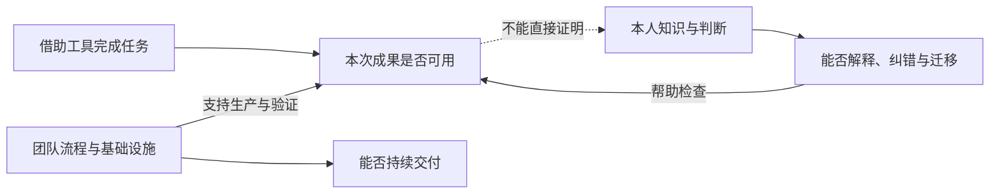

<!-- document-id: show-10 -->
<!-- document-version: 0.1-review -->

# AI 趋势新闻 2026-11月观察

> 深入版 v0.1 · 审阅版 · 2026-11-05 
> 面向希望理解 AI 怎样改变专业工作的读者，不要求编程、法律或生物学背景。 
> 配套[离线图解讲解版](../%E9%98%85%E8%AF%BB/AI%20%E8%B6%8B%E5%8A%BF%E6%96%B0%E9%97%BB%202026-11%E6%9C%88%E8%A7%82%E5%AF%9F.html) · [阅读目录](../index.html)

**AI 正在扩大一个人能够完成的任务范围，但能交出成果、本人学会了、团队能稳定交付，是三件需要分别验证的事。**

一个人可以借助 AI 完成原本不会的数据分析；软件团队可以让 AI 写代码，再安排 AI 检查；科学家也开始用它连接设计与实验。接下来的问题随之改变：结果由谁判断，工具能否承受使用量，新人怎样积累本领，团队如何持续运转？

本文沿七份公开材料回答这些问题。它们不是同一项调查，也不是七个独立行业都已完成转型的证明。前三份都来自 Anthropic，其中还有同一家公司不同层面的相关变化。把它们并读，有助于理解工作怎样重新分配；据此预测整个就业市场，则超过了材料的能力。

**证据标签约定：** `[团队自述]` 表示企业公开的工程或运营复盘；`[公司观察研究]` 表示内部数据与访谈，不能自动识别因果；`[随机实验]` 表示在特定样本和任务中随机分配工具；`[合作早期研究]` 表示研发方报告的初步结果；`[综合判断]` 和 `[待验证解释]` 分别表示本文的跨材料解读与尚未被直接验证的机制。来源均公开可查，本轮未访问企业内部数据、未重跑实验；期刊研究只按可访问摘要和公开作者材料解读，不声称已审阅付费全文。

## 一、先分清三个问题：能做、会做、能持续交付

假设一名不熟悉编程的运营人员，用 AI 做出一张销售预测表。这个**构造示例**可以同时引出三个不同问题。

第一，预测表是否满足这次需要？这检查的是**借助工具完成任务的能力**。第二，他能否解释预测为什么这样算、数据换一种分布会出什么问题？这检查的是**本人掌握的知识与判断**。第三，公司每周都要更新预测，谁维护数据、检查异常、承担模型费用？这检查的是**团队持续交付的能力**。

三者会互相影响，却不能互相替代。一次成果不错，不能直接证明本人掌握了全部方法；本人懂原理，也不保证公司的系统能承担大规模使用。反过来，知识没有在短期测验中增加，也不抹掉工具当时带来的实际帮助。

图中是本文的分析分工，不是经过估计的因果模型。接下来的七份材料，分别照亮这三件事的不同部分。

## 二、软件生产流程：AI 写得越多，检查越需要重新安排

### 背景：同事逐行看代码，曾是常见的质量关口

**代码审查（Review）**，就是检查一项代码修改有没有解决问题、会不会破坏其他功能。它还让同事理解彼此的工作。**Claude Code** 是能够读取项目文件、修改代码并运行工具的 AI 编程助手。

过去，一人写完代码，另一人检查，是可以运转的协作方式。当 AI 大量生成修改后，逐条等待同事阅读就可能排队。这里紧缺的是人的检查时间，不只是生成代码的速度。

### 出现的变化：检查贯穿开发过程，人按风险加入

Claude Code 团队 2026 年 10 月 15 日的文章介绍：多数代码阅读已移交机器，AI 审查与自动测试贯穿开发流程。对可信作者的低风险修改，自动检查通过后可以不再要求人工审批；风险较高的修改需要相应人工参与，敏感路径另有规则。发起修改的人继续对结果负责。`[团队自述]` [S1]

这不是一句“让 AI 互相看看”就完成的安排。关键是把可运行检查、AI 找错、风险分级和出错后的恢复接起来，分别处理不同问题。**代理（Agent）**在这里指能够调用工具、执行多步任务的 AI 系统；它的审核不能顶替流程明确要求的人类审批。

### 为什么这样变，可能意味着什么

如果每次加快写代码，都让更多修改堆在同一个人工关口，整体交付未必同步加快。按风险安排检查，可以把人的精力留给更难自动判断、后果更重的部分。`[综合判断]`

对工程师，值得关注的工作包括：说清需求、制定验证办法、判断风险、处理发布后果。它不证明所有代码都可以自动合并，更不证明人已不需要理解系统。团队自述展示了一套实际流程；其对其他公司的效果仍取决于测试基础、风险结构和维护能力。

## 三、软件基础设施：工具的主要使用者变了，设计假设也会变

### 背景：版本控制是软件团队的“代码账本”

**版本控制**记录谁改了什么、如何回看历史、怎样合并不同修改；Git 是常用工具。**持续集成（CI）**会在代码变化后自动构建和测试。它们一直在处理机器任务，只是不同公司的规模差别很大。

Anthropic 的情况是，AI 与自动任务成了代码库的主要客户端。这里的客户端就是访问工具的一端，可以是人的电脑，也可以是一项自动任务。

### 出现的变化：高频访问推动了内部工具重建

2026 年 10 月 13 日的工程复盘称，其大型统一代码库每日合并的改动，从当年 5 月约 2,500 次增至 9 月超过 30,000 次。公司建设了 Scion 版本控制系统，让更多历史查询、合并等工作由服务器承担，客户端按需取得数据，并建设相关代码搜索、审查与权限工具。`[团队自述]` [S2]

**这组数字属于 Anthropic 的统一代码库，不是上一节 Claude Code 独立仓库的产出数据。** 两份材料相互关联，但不能把对象混在一起。改动数量也不能直接换算成功能价值或代码质量。

### 为什么这样变，可能意味着什么

可以把它想成一个仓库：少数员工偶尔取货，与大量自动设备全天高频取货，对搬运和查询系统的要求不同。这个类比只解释负载变化，不能拿来证明某种版本控制设计必然更好。

AI 的影响可能沿工作链向外传导：代码生成变快，代码存取、测试容量和权限管理就需要跟上。`[综合判断]` 但原文明确说明其负载特殊；Git 仍适合绝大多数代码库。“所有团队都该换工具”不属于这个案例能支持的结论。

## 四、公司内部组织：少做一些具体操作，也可能多做一些协调

### 背景：任务自动化以后，岗位还包含哪些工作

一份岗位通常同时包含具体操作和判断协调。例如，工程师既写代码，也决定优先级、理解其他团队的需求。AI 接走一部分操作后，剩余工作的比例和相互关系都可能改变。

Anthropic 在 2026 年 10 月 16 日公布内部就业研究，综合招聘、工具使用、产出、日程数据与访谈，观察这种变化。

### 出现的变化：招聘结构、管理 AI 的工作和会议都在变

研究报告，初级技术人员在新聘技术人员中的占比从 27% 降至 9%；员工开始更多建设 AI 工作规则、监控工具和任务流程。即使是不担任管理职务的技术员工，会议时间也比一年前增加了 16%。与此同时，公司整体和技术招聘的绝对规模仍在增长。`[公司观察研究]` [S3]

**招聘占比下降不能直接解释成裁员，也不能单凭这一家公司推出全市场趋势。** 会议变化同时受到公司扩张、角色变化等因素影响。

### 为什么可能这样变

当一个人安排多个 AI 工作时，会遇到新的选择：哪个任务先做，什么异常值得中断，两个结果冲突时接受哪一个。涉及团队目标或职责的问题，还需要和其他人商量。AI 增加产出，也可能增加需要处理的提议、例外和依赖。`[待验证解释]`

因此，个人少打一些字，并不自动意味着组织少开一些会。员工可能需要更多独立判断和组织任务的能力。另一个值得追踪的问题是：基础任务被分担后，新人怎样获得形成这些判断力的练习？这份观察研究提出了问题，但没有测完一个职业生涯的答案。

## 五、咨询师跨专业工作：工具帮助完成任务，知识还要另考

### 背景：商业问题可能需要原本不会的数据科学技能

**管理咨询师**帮助企业分析和解决经营问题，但并非人人掌握数据科学。数据科学包含处理数据、建立分析或预测方法、解释结果等工作。这项研究让咨询师尝试超出原有技能范围的任务。

### 出现的变化：借助工具表现更好，撤去工具未见额外知识收益

发表于 2026 年 10 月 26 日的研究对 487 名管理咨询师开展随机实验，为处理组提供 ChatGPT 和使用培训。处理组在三项数据科学任务上表现更好，但整体未达到专家基准；事后不用 ChatGPT 回答技术知识题时，没有发现处理组更有优势。任务也不是 ChatGPT 当时可以独立完成的。`[随机实验]` [S4]

**实验实际发生于 2024 年。** 它检验的是当时工具、培训与任务的组合，不能直接当作 2026 年最新代理能力的测试。

### 为什么这两个结果可以同时成立

借助导航到了目的地，不意味着已经记住每个路口。类比放在这里，是为了区分完成一次任务与独立掌握方法；它不表示 AI 只能用于代劳，也不解释所有学习机制。

同样，一个人可以和工具共同做出可用结果，而未在该实验的知识测验中显示额外学习收益。“未发现额外收益”也不等于证明任何人、任何用法都学不到东西。

### 可能意味着什么

企业可以尝试扩大员工承担任务的范围，同时另行验证他们解释、检查和迁移方法的能力。`[综合判断]` 对培训而言，成品成绩与学习成绩应该分开看；对工作交付而言，缺少短期知识增长也不能自动否定工具的帮助。

## 六、咨询公司的生产系统：用上 AI 以后，还要长期维护和算账

### 背景：内部知识需要被方便地查找和使用

**Lilli** 是麦肯锡的内部生成式 AI 知识工具。它服务于员工获取和使用公司积累的知识。小范围试用可以看到便利，大规模使用还要面对成本、速度、准确性和维护问题。

### 出现的变化：从单一供应商依赖，转向可组合的平台

麦肯锡 2026 年 6 月 29 日的复盘称，随着更多应用场景加入，平台成本快速上涨；原来依赖一家供应商提供的多个模型，难以针对各项任务优化。团队因此重建为不绑定某一家模型供应商、组件更易组合的平台。`[团队自述]` [S5]

这里要留意原文口径：问题是**单一供应商下的配置与适配限制**，不能简写成“以前所有任务只用同一个模型”。

### 为什么要改，可能意味着什么

举个**构造示例**：查询某份材料的位置，可能更看重速度和成本；比较多份复杂材料，可能更看重准确性。按任务要求选择合适模型，常被称作**模型路由**。这个例子解释调度思路，不声称 Lilli 的实际路由就是这两条。

公司需要经营的不只是一个聊天窗口，还包括知识更新、模型选择、质量检查和费用控制。经验也可能逐步写进机器可重复执行的流程。`[综合判断]`

但“内部平台改造”与“咨询公司主要靠卖行业系统赚钱”之间，还缺客户合同、收入结构和长期维护责任等证据。这个案例支持前者；后者只能保留为待观察的商业方向。

## 七、法律专业能力：已有基础，可能影响怎样从 AI 协作中学习

### 背景：律师的判断力常在反复起草与修改中形成

专利律师不仅需要写通顺的文字，还要判断保护范围、准确性与法律风险。研究者想区分两件事：AI 当时让稿件变好了吗？使用一段时间后，律师本人独立判断的能力有没有变化？

### 出现的变化：即时收益与独立能力收益，分布在不同人群

Autor 等人的工作论文于 2026 年 9 月发布、10 月修订。研究在 11 家美国知识产权律所对 133 名专利律师开展三个月随机实验。使用 AI 起草助手时，稿件质量提高，初级律师的收益更大；之后不用 AI 修改一份现有申请时，额外收益集中在资深律师，初级律师平均未见收益，成绩分布出现分化。`[随机实验／工作论文]` [S6]

本研究由 Google 资助并实施，使用其未公开的工具；结果具有特定工具、样本、任务和观察期条件。本轮依据公开摘要与作者解释，没有将它当作整个法律职业的长期结论。

### 为什么可能有这种差异

一种解释是：有基础的人更容易识别 AI 提供的方法中哪些有用、哪些值得怀疑，从而通过比较与追问积累知识；缺少基础的人，可能接受了好稿件，却没有练习同样的判断。`[待验证解释]`

这仍然是对机制的解释，不是实验已经逐步证明的心理过程。研究没有证明初级律师平均能力下降，也不能把所有新人视为同一种使用方式。

### 可能意味着什么

新人培养需要在高质量交付之外安排判断练习，例如解释一处修改的理由，或在没有工具时识别明显问题。这是本文根据研究提出的建议，效果尚未在上述实验中检验。资深者也不能只凭年资免于检查，实际能力仍应看具体任务。

## 八、生物研发：AI 开始连接设计、数据和真实实验

### 背景：药物研究有大量需要来回迭代的工作

**CAR T** 是通过改造免疫细胞，让它们识别并攻击癌细胞的一类治疗技术。**信号结构**在这里指受体内部传递激活信息的部分。Generate 团队希望缩短这部分结构，同时保留或改善功能。**湿实验**就是对真实细胞、样本等做实验，与在电脑里计算相区别。

### 出现的变化：小团队把工具接入设计与实验循环

2026 年 10 月 27 日的合作说明称，六名 Generate 科学家使用 Claude Code 参与设计。团队复盘描述了代理提出候选、科学家筛选、细胞实验和根据结果继续设计的过程。其中一种信号结构比参照设计短约 70%，并在部分实验室指标上表现更好；团队还使用 Claude Code 建设实验记录和数据工具。`[合作早期研究]` [S7a][S7b]

**70% 指信号结构的长度变化，不是整个药物缩小 70%，也不是研发周期缩短 70%。** 团队公开材料链接预印本，本文把这些结果视为研发方报告的早期证据。

### 为什么编程助手能成为科学家的工作界面

科研中也有读取材料、整理记录、编写分析代码、调用计算工具和比较设计的工作。编程助手能够连接这些电脑上的步骤，帮助科学家探索更多候选。真实细胞实验提供另一种检验，实验结果再约束下一轮设计。

这里 AI 参与的是研究过程；提出一个看似合理的方案，仍需经过现实检验。小团队跨专业承担更多任务，是值得跟踪的组织变化。`[综合判断]`

### 可能意味着什么

科研团队可以尝试减少部分工具和专业交接，让设计、分析与反馈更紧密。但这个案例没有证明患者获益，也没有给出可普遍套用的药物开发总成本或周期改善。实验室指标、动物研究、临床试验和实际医疗效果，是不同阶段的证据。

## 九、把七条放在一起：工作的边界、学习和组织要一起看

### 9.1 一个人能承担更多任务，专业判断仍需形成

咨询实验显示，工具能帮助人完成邻近专业的任务；法律实验提醒，成品收益与独立能力收益可能分开。两项研究的样本、工具、任务和观察期不同，不能把它们拼成同一个实验，也不能用一项的结论覆盖另一项。它们共同支持的是：**评价工具辅助工作时，应分别观察成果和人的能力。** `[综合判断]`

一个可能的变化是，执行某些任务的门槛下降后，发现错误、理解后果和决定例外仍然需要专业知识。这并不保证每位资深者都受益，也不预言每个初级岗位都会消失。真正需要跟踪的是具体任务、培训方式和人员的变化。

### 9.2 经验可以进入流程，但写进规则还不等于有效

代码审查的风险规则、员工建设的代理流程、Lilli 的平台改造，都提供了一种观察方向：公司开始把部分知识整理成可以被重复调用的工作安排。`[综合判断]`

例如，资深员工过去口头提醒“改权限时检查越权访问”，团队现在可以把它变成有负责人维护的检查任务。这是**构造示例**。价值是否成立，还要看规则能不能被执行、能不能发现真实问题，以及规则过期后谁来修改。把一段经验放进文件，本身并不证明已形成竞争优势。

### 9.3 具体任务做快以后，要重新寻找整个流程的限制

软件案例中的限制可以出现在阅读审查、代码访问和测试；组织案例可能涉及判断与协调；生物案例则必须继续依靠实验检验。**瓶颈**就是当前最限制整体进度的环节。它会随工作量和其他环节的能力变化，不会永远停在同一处。`[综合判断]`

把它想成餐厅：切菜更快，出餐仍可能等灶台、等检查、等服务员。这是流程直觉，不是七个案例共同测出的生产函数。它也不表示检查永远昂贵；AI 同样在帮助检查，最终要观察完整交付的成本与质量。

### 9.4 还可能有哪些解释，接下来该看什么

第一，Anthropic 同时处于快速扩张期，招聘与会议变化可能包含组织成长因素。第二，企业复盘有选择成功案例的动机，披露的流程和效果应与独立观察区分。第三，新模型与新用法可能改变旧实验结果；2024 年实验不能代表所有后续工具。第四，任务被替代后，新增需求也可能扩大产出和用工，不能只按原有工作量计算人数。

若要进一步检验本文的判断，可以观察：端到端交付是否变快、返工和事故是否变化、包含维护的成本是否下降、新人独立能力如何发展，以及新增岗位到底做什么。这些是后续核查方向，本文没有提供相应的跨行业长期数据。

对团队，一个可尝试的起点是把**成果验收与能力培养分开安排**：交付时允许充分使用工具，培养时另外检验解释、纠错和换情境处理问题的能力。这是由证据启发的建议，尚不能称为经这七份材料验证的最佳方案。

## 十、来源、证据边界与复核入口

材料发布日期除特别注明外均为 2026 年；本轮核对日为 2026-11-05。发布日期、实验发生时间与观察期分别理解。

| 编号 | 材料与日期 | 本文实际使用的证据 | 能支持的范围与主要限制 |
|---|---|---|---|
| S1 | [How the Claude Code team does code review](https://claude.dev/blog/solving-code-review-at-anthropic/)，10-15 | 公开团队工程博客 | 支持该团队的审查流程；不能证明所有团队采用后有相同效果 |
| S2 | [Redesigning source control at Anthropic](https://www.anthropic.com/research/redesigning-source-control)，10-13，10-15 更新 | 公司工程复盘 | 统一代码库负载与 Scion 设计；特殊负载，改动数不等于价值 |
| S3 | [How employment is changing at Anthropic](https://www.anthropic.com/research/employment-at-anthropic)，10-16 | 公司内部数据观察与访谈的公开报告 | 招聘占比、工作内容与日程变化；单公司观察，不直接识别全市场因果 |
| S4 | [Generative AI and the temporary upskilling of knowledge workers](https://www.nature.com/articles/s41562-026-02566-6)，10-26 | 期刊公开摘要；论文页面可检索信息，未读付费全文 | 487 人随机实验的任务表现与事后知识结果；实验发生于 2024 年，不能代表当前所有模型 |
| S5 | [Plan for midstream adjustments](https://www.mckinsey.com/capabilities/tech-and-ai/our-insights/plan-for-midstream-adjustments)，06-29 | 公司书摘式运营复盘 | Lilli 内部平台的成本、适配与架构调整；未证明咨询收入模式转型 |
| S6 | [NBER Working Paper 35720](https://www.nber.org/papers/w35720)，9 月发表、10 月修订；[作者公开解读](https://cepr.org/voxeu/columns/better-work-not-always-better-workers)，09-29 | 工作论文公开摘要与作者解释，未逐项重分析实验数据 | 三个月专利起草实验；特定工具、任务与样本，不能推出长期能力退化 |
| S7a | [Early progress on accelerating drug development with Claude](https://www.anthropic.com/research/early-progress-drug-development)，10-27 | 合作方研究说明 | 六名科学家案例与早期结果；合作方自述，不是临床疗效证明 |
| S7b | [Less is More: Refactoring the CAR Signaling Domain](https://generatebiomedicines.com/blog-posts/less-is-more-refactoring-the-car-signaling-domain/)，10-27 | Generate 团队的实验流程与结果说明，页面链接预印本 | 信号结构长度与部分细胞实验指标；未独立复现实验或确认后续临床效果 |

**证据边界声明：** 本文是公开材料的解释与评审，不是劳动力市场预测模型、法律意见或临床研究报告。企业自述、公司观察、期刊实验、工作论文和合作早期研究分别保留其证据身份。文中的类比、构造示例与综合判断不充当新实测；没有宣称完成目标读者实验或独立科研复现。

**版本与配对：** 审阅版 v0.1，两版使用 `show-10 / 0.1-review` 标记。HTML 默认提供独立图解，内置从本 Markdown 生成的深入全文，精确回链使用 `?view=deep#work-…`；在普通浏览器里无需安装 Markdown 阅读器。外部证据链接需要联网核对，正文和图解离线可读。
