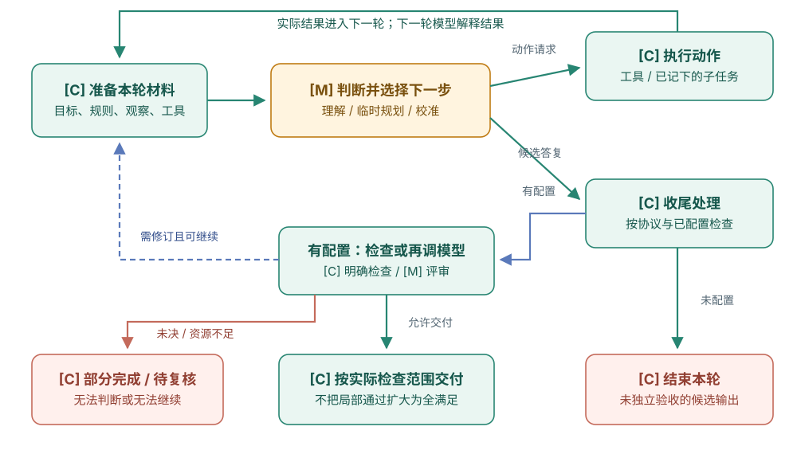
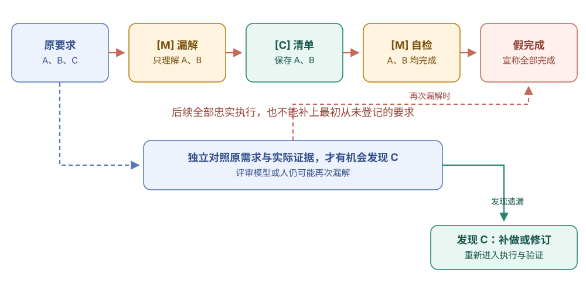

<!-- document-id: show-11 -->
<!-- document-version: 1.0-review -->

<a id="overview"></a>
<!-- document-type: show -->

# Agent Loop：谁规划、谁纠偏、谁验收，以及为什么仍会假完成

[图解讲解](../阅读/讲解-11-Agent运行循环.html) · [返回首页](../index.html)


文档类型：技术科普与机制研究。结构模板：A 结论先行 + C 对比分析。按“总—分—总—分层展开”组织：先回答判断责任，再分别核对四家，然后重建通用 loop，展开调用时机、失败链、人机协作和情报研判。

[打开 HTML 展示版](../阅读/讲解-11-Agent运行循环.html) · [项目入口](../index.html) · [源码与资料索引](#sources-and-verification)

<a id="decision-core"></a>
## 1. 总论：通用 Agent 主要靠模型理解任务、选择下一步

**对于没有预先写死解题步骤的通用任务，通常由模型理解目标、决定下一步，并在需要时拆分或修改计划；执行程序（harness）负责发起调用、执行动作、记录进度和运行已定义的检查。** 模型能力不足时，任务理解、计划、纠偏和内容验收可能一起失效。把它们画成四个模块，不能自动得到四份可靠判断。

先校正两个容易让整篇讨论失焦的说法。

**“拆任务就是流程编排型 Agent”不成立。** 人或程序预设步骤，是工作流；模型在执行中发现子问题、调整顺序，也是拆任务。通用自主 loop 不一定先输出完整任务表：模型可以先查资料，读到结果后再决定下一步。把步骤写成清单是可选的；根据新结果决定下一步，是循环继续工作的关键。

**“harness 只能校验格式”也过窄。** 代码可以核验订单实际存在、计算结果符合规则、测试是否通过等实质条件。但“这篇报告是否切题”“论据是否足以支撑结论”通常需要模型或人理解内容。程序可以把某项检查设为必须执行，不能由此证明检查标准已经完整。

### 1.1 三种任务组织方式，以及混用关系

| 方式 | 步骤从哪里来 | 执行中谁决定下一步 | 典型适用情况与风险 |
|---|---|---|---|
| 预设工作流 | 人制定规则、模板或依赖图，代码保存 | 代码按条件分支；某个步骤里面仍可调用模型 | 稳定业务流程可控；未设计的情况可能走错分支 |
| 模型自主 loop | 用户目标、指令和当前观察进入模型 | 模型选择行动；必要时显式列计划 | 开放问题灵活；遗漏、偏离、假完成主要受模型能力影响 |
| 混合系统 | 外层规定必须经过的阶段；内层由模型探索 | 代码决定阶段约束，模型决定阶段内策略 | 兼顾业务约束与探索；阶段齐全仍不等于判断正确 |

“是否显式列计划”和“是否由模型决策”是两个维度。一个没有任务清单的 Agent 仍然可能在持续规划；一个显示精美任务板的 Agent 也可能只是执行人写好的工作流。

### 1.2 本文的责任标记

- **[M] 模型判断**：理解含义、提出计划、解释失败、判断切题与否。主模型与评审模型都属于这一类。
- **[C] 程序控制**：发起调用、解析响应、执行动作、读写状态、检查明确规则、处理预算与退出。
- **[H] 人的判断**：定义业务标准、修订目标、判断难以自动验证的结果；是否需要介入取决于任务与能力。

后文把模型周围的执行系统简称为“程序”（技术上常叫 harness）；Hermes 是一个具体 Agent 产品。程序还可以再调用其他模型，所以“系统做了验收”必须继续追问：**是代码直接检查，还是程序又请一个模型读内容？**


先把常用术语对应到具体动作：

| 术语 | 本文实际指什么 | 例子 |
|---|---|---|
| 上下文 | 这一次真正交给模型看的材料 | 用户要求、报告片段、上一步结果 |
| 状态 | 程序记下的已做、待做、等待事项 | 报告 A 已读，报告 B 等待读取 |
| 内容判断，也叫语义判断 | 读懂内容后判断它意味着什么、是否切题 | 两份报告日期不同，能否直接比较 |
| 候选答复 | 模型准备交付、尚需程序处理收尾的答复 | 草拟说明已写出；额外检查是否运行看配置 |
| 结束时检查，常叫 Hook | 开发者事先约定走到这里就多做一项检查 | 检查说明文件存在，或再请模型查遗漏 |

<a id="decision-ownership"></a>
### 1.3 先给判断责任总表

| 决定什么 | 通用自主 loop 的通常判断来源 | 程序能保证的部分 | 仍可能出错的地方 |
|---|---|---|---|
| 要不要列计划、拆哪些任务 | [M]；[H]/模式可要求必须列 | [C] 提供指令、计划工具和存储 | 模型没意识到需要计划，或起初漏解需求 |
| 谁先谁后、哪些可并行 | [M] 提出依赖；预设流程可由 [H] 给定 | 已实现依赖校验与调度时，[C] 按登记关系和资源限制调度 | 普通并发器未必检查依赖；登记关系也可能错误 |
| 当前行动是否偏离 | [M] 对照目标与观察；[C] 检查明确约束 | [C] 发现测试失败、越界、超限等 | 没有违反硬条件，仍然可能解决错问题 |
| 是否重规划、怎样改 | [M] 决定语义策略；[C] 可触发检查 | [C] 重试、切换预设分支、保存计划版本 | 不理解根因时，换计划也可能继续错 |
| 结果是否满足需要 | 可检查项由 [C]；复杂内容由 [M]/[H] | [C] 强制检查、核验环境事实、执行判定分支 | 标准漏项、评审误判、共同误解 |
| 是否结束本次运行 | [M] 可以提出收尾；[C] 最终执行退出 | [C] 处理停止事件、错误、预算和可选检查步骤 | 正常结束不代表业务成功 |

后文每个涉及判断的位置，都要说明是代码检查、模型读内容，还是人作决定。“安排步骤”“验收”只是工作名称，不能省略实际判断者。

<a id="four-products"></a>
## 2. 分析四家：每一步都说清程序做什么、模型做什么

四家都在反复做这件事：**程序把任务和新结果交给模型，模型决定下一步，程序再执行。** 差别是怎样保存进度、怎样暂停恢复、怎样加检查。Hermes 是可直接使用的 Agent 应用；AgentScope 是供开发者组装 Agent 的框架；Codex、Claude Code 是编码 Agent 产品。比较范围不同，不能仅凭下面的机制说明给出能力排名。

本节统一使用一个构造例子：**“比较两份项目报告，解释为什么一份说基本完成、另一份说还有很多未做；列出仍无法确认的问题，保存一份说明。”** 下面演示各产品的机制怎样承载这个任务，不声称已经实测了相同次数或同样结果。源码函数名、原始字段和固定版本统一放到[源码与资料索引](#sources-and-verification)。

<a id="hermes-loop"></a>
### 2.1 Hermes：模型安排工作，程序执行并替它记进度

可以把它理解成“模型带着工具和工作记录，边做边决定下一步”。程序会把任务、可用工具和相关记录准备好；复杂任务使用清单的要求，也会作为提示交给模型。**清单怎么拆、先查什么，主要由模型决定；程序并不会仅凭这句提示就准确识别所有复杂任务。** [H1](#source-h1) [H2](#source-h2)

| 阶段 | 程序负责什么 | 模型负责什么 |
|---|---|---|
| 开始：先获得材料 | 把原始要求和“可读取文件、可记录计划”等能力交给模型；模型请求读文件后，程序执行读取 | 理解三个要求：解释矛盾、列未决项、保存说明；决定先读报告，或先登记暂定步骤。此时还不知道矛盾原因 |
| 中间：根据新结果改路线 | 把读到的内容或错误放入下一次模型输入；保存模型提交的清单更新 | 例如发现两份报告日期不同，决定先查时间口径，再判断是否真的矛盾；需要时补任务、改顺序 |
| 收尾：决定继续还是返回 | 在模型给出准备交付的答复后，检查还有没有待执行动作、是否触发已配置检查、是否遇到预算或错误边界；然后继续或结束 | 判断是否已经解释了矛盾、是否列出未决项；决定再查、再改，或提出最终答复。额外检查要求补做时，再解释反馈并继续 |

**清单是谁维护的？** 模型提交“先读报告”“核对时间”等步骤及其进度；程序负责保存、显示和检查格式。模型把某条标成“已完成”，程序可以照此记录，但不会因此自动知道它是否漏读了一份报告。

**收尾检查是谁判断的？** 本篇核对的公开固定版本还有一项默认关闭的可选检查，主要根据代码是否改过、是否留下验证记录，决定要不要提醒模型继续核查。**程序判断的是这些明确记录；收到提醒后，模型决定怎样检查和修复。** 它并不会自动验收任意研究报告的内容。[H3](#source-h3)

这种分工能让任务路线保持灵活，又能把进度保存下来。风险是：如果模型起初漏掉“列未决项”，程序可能完整保存并执行一张本来就漏项的清单。

<a id="agentscope-loop"></a>
### 2.2 AgentScope：程序按当前记录接续工作，模型决定具体查什么

这里最容易被源码名误导的，其实是一个普通的程序控制过程：**有动作没执行，就处理动作；需要等待确认，就暂停；结果已经返回，就再让模型判断；到了可返回答复的位置，就处理结束。** 程序查看的是当前记录，研究方向仍由模型根据内容决定。[A1](#source-a1)

| 阶段 | 程序负责什么 | 模型负责什么 |
|---|---|---|
| 开始：建立本轮工作记录 | 准备输入，记录这轮刚开始、尚无结果，并发起模型请求 | 理解用户要求，决定直接回答还是先读材料；并没有通用规定要求先另调一个规划模型 |
| 中间：动作与判断接力 | 处理模型提出的读取等动作，保存结果；若需要确认或外部结果，就等待，条件满足后再接着运行 | 看报告后判断日期、口径或项目范围是否一致，提出下一步；若使用任务清单，则提交步骤、先后关系和进度 |
| 收尾：返回这一轮的结果 | 接到可返回答复，检查待执行动作、待确认事项及开发者加的检查；按当前记录处理后决定继续或返回 | 形成解释和未决项，判断是否还需要补查；若另行安排了内容评审，则由承担评审的模型或人判断 |

**什么叫“保存状态”？** 例如程序记住“报告 A 已读、报告 B 还在等结果、当前等用户确认”。恢复时可以接着处理，不必让用户重新讲一遍。但“记住做到了哪”不等于“知道做得对不对”。

如果要求按“结论、依据、未决项”等字段返回，程序还可以检查约定的输出是否已经生成。这不表示“未决项”写得全面，正如表格每格都填了字，也可能没有回答问题。

这种设计方便开发者把 Agent 接入可暂停、可恢复的服务。**它让程序能准确接续已经记录的步骤；能否提出正确步骤、解释材料、判断遗漏，仍依赖模型、业务检查和人。**

<a id="codex-loop"></a>
### 2.3 Codex：模型提出行动和修改，程序把真实执行结果交回来

可以把它理解成“模型在真实工作区里做事，执行程序不断把文件、命令和检查结果交给它”。模型既能处理代码，也能处理工作区里的说明文档。编辑、检查、看结果、再修复，可以反复发生；这些词并不各自对应固定的一次模型调用。[O1](#source-o1)

| 阶段 | 程序负责什么 | 模型负责什么 |
|---|---|---|
| 开始：把任务放进实际工作环境 | 提供用户要求、相关工作区信息和可用动作，发起模型请求；若启用某种模式，则按该模式的规则组织输入 | 决定先找报告、先读文件还是先列步骤。执行中的进度清单由模型提交，程序负责接收与展示 |
| 中间：执行、反馈、再判断 | 运行获准的读取、编辑或检查动作，返回内容、错误、文件差异及检查结果 | 例如发现日期不一致，决定重查口径；写出说明后，决定是否需要检查遗漏、修正文档或继续查资料 |
| 收尾：处理待办与附加检查 | 模型提出收尾后，检查是否还有待处理动作、新输入或阻止结束的已配置检查；需要继续时，把反馈交回模型 | 提出准备交付的答复；若程序安排了独立评审，评审模型再判断结果，主模型根据反馈修订 |

**计划由谁定？** 一般仍由模型根据任务和指令安排。执行中的“进度清单”与专门的“计划模式”是不同机制；本篇不拿一个工具名称来替代二者的说明。程序能保存计划，不能仅凭保存成功就证明计划正确。[O2](#source-o2)

**结束是谁决定的？** 两者共同完成：模型写出它准备交付的答案；程序按实际控制条件决定还要不要继续调用。若另行发起评审，**程序负责发起和执行分支，评审模型负责看内容是否有问题。** 没有公开证据支持把它写成每次都默认发生。

真实文件和检查结果能帮助模型减少猜测。但如果模型只检查“说明文件已保存”，仍可能遗漏“列出未决项”。检查通过能证明到哪里，要看检查实际覆盖了什么。

<a id="claude-loop"></a>
### 2.4 Claude Code：模型决定怎么做，程序可在收尾时加一道检查

官方描述中的“Claude 决定下一步”，指的是模型根据前一步的信息进行判断；程序负责提供工具、维护本次给模型看的材料，并组织执行。[C1](#source-c1)

| 阶段 | 程序负责什么 | 模型负责什么 |
|---|---|---|
| 开始：准备输入与当前模式 | 把任务、规则和可用能力交给模型；如果启用计划模式，程序按该模式限制当前可进行的动作 | 理解用户想要什么，调查材料并安排步骤。计划模式里的计划内容也由模型写 |
| 中间：把新情况送回模型 | 执行动作，保存并提供相关结果；把用户新增的要求放入后续输入 | 读报告、识别冲突、改变查证顺序；用户纠正“不要扩展范围”时，理解这次纠正和旧要求的关系 |
| 收尾：运行已配置的检查 | 模型准备结束时，程序可运行开发者事先加好的检查步骤，并按结果允许结束或继续 | 主模型提出答复；如检查使用另一轮模型，则由评审模型判断遗漏或论证问题；需要修订时，主模型继续处理 |

结束时“加一道检查”在产品中称为 Hook，可理解为**事先约定：走到某个位置，就多做一件检查工作**。它不是天然懂业务的判断者。具体可以这样实现：[C4](#source-c4)

| 检查方式 | 谁发起、执行 | 谁判断什么 | 结果以后怎么办 |
|---|---|---|---|
| 跑检查脚本 | 程序在收尾位置执行已配置脚本 | 脚本可按文件、测试或明确规则作出程序判断；脚本也可能被开发者写成另调模型 | 程序读取约定结果，决定允许结束还是送回反馈 |
| 再问模型一次 | 程序发送配置的评审指令与事件信息；开发者需提供评审所需的原始要求和材料 | 评审模型判断是否满足要求、哪里还缺内容 | 程序接收判断，允许结束或让主模型修订 |
| 让验证 Agent 查材料 | 程序启动已配置的验证任务 | 验证模型可读文件、看证据，再给判断 | 程序处理判断；模型仍可能误判 |

例如：“说明文件是否存在”可以写成代码检查；“是否解释了矛盾，是否漏了未决项”通常需要模型或人读内容。**程序能保证某个已配置检查被触发，不能因此保证检查结论正确。** 没有公开依据表明每次答复后都默认有独立内容验收。

这种设计让开发者可以在需要的位置补检查。代价是额外时间、调用和误判机会；提示词、任务记录和额外评审都需要根据实际任务验证效果。[C2](#source-c2) [C3](#source-c3)

### 2.5 四家比较后，最该记住的共同分工

**程序负责“把该运行的部分接起来”，模型负责“理解当前情况、决定具体怎么做”。** 例如模型提出“还要核对日期”，程序执行读取并把结果交回；模型认为“可以交付了”，程序再检查有没有待执行动作、已配置的收尾检查或资源问题。

所以，“开始—中间—结束”都可能由两者接力。不能只写“Agent 判断”而省略判断者，也不能把程序保存的“已完成”直接解释成用户要求已经全部满足。


<a id="common-loop"></a>
## 3. 再总：一个请求从输入到输出，到底调用几次模型

### 3.1 最小 loop 没有强制独立的意图层、规划层和验收层

<figure><figcaption>机制示意。模型判断、程序动作与额外验收分别承担责任，结束状态不自动证明用户目标已满足。</figcaption></figure>

一轮模型调用可以同时承担目标理解、分析观察、调整计划、选择下一动作和决定收尾。我们为解释而拆出的职责，不一定对应多次调用；模型的内部思考也不等于可观察的完整计划表。

### 3.2 一个具体回放：不是“先把所有任务拆完，再执行第一层”

以下是构造示例，不声称四家都按同样次数运行。任务为“分析两份材料对某项目进度的矛盾，给出依据和未解决问题”。

| 时刻 | 谁做什么 | 是否发生新的模型调用 | 产生什么，仍缺什么 |
|---|---|---|---|
| 输入后 | [C] 加入原问题、规则和可用工具 | 否，准备阶段 | 模型尚未作出内容判断 |
| 第一次调用 | [M] 判断先读两份材料，可提出对照计划并请求读取 | 是，调用 1 | 计划可能只是暂定；此时还不能知道全部子问题 |
| 读取执行 | [C] 执行动作并返回材料 | 否，工具阶段 | 获得内容或错误，不代表已经理解 |
| 观察后 | [M] 发现两份材料使用不同日期口径，新增核对时间任务 | 是，调用 2 | 理解结果、重规划和选动作可在同一次完成 |
| 再次执行 | [C] 执行查询或读取 | 否 | 保存原始观察 |
| 收敛 | [M] 对照证据，解释冲突并给出候选答复 | 是，调用 3 | 仍可能漏掉“未解决问题”这个要求 |
| 停止处理 | [C] 若未配置额外检查，可以返回该答复 | 不必再调用 | 结束不代表已独立检查遗漏 |
| 可选复核 | [C] 把原始问题、有效要求、结果证据发给评审 [M] | 若配置，则调用 4 或更多 | 评审可发现遗漏，也可能继续漏掉 |

工具结果放入后续模型输入以后，一般需要模型理解其含义再决定策略。参数与分支已经确定的机械动作，也可以由程序直接连着执行；没有必要把每条确定性数据处理都变成一次模型调用。

### 3.3 哪些状态意味着什么

| 观察到的信号 | 程序能知道什么 | 不能据此知道什么 |
|---|---|---|
| 模型请求执行动作（例如 `tool_use`） | 需要交接执行动作，随后通常继续 | 当前计划正确、动作有价值 |
| 模型本次生成收尾（例如 `end_turn`），且没有待执行动作 | 这次生成可以进入程序的收尾处理 | 所有用户要求都满足 |
| 输出碰到长度限制（例如 `max_tokens`） | 输出碰到长度限制，可能不完整 | 任务成功；不能一律当成完整答复 |
| 限流、余额不足、网络错误 | API 或资源异常，应按错误路径处理 | 模型已主动完成；这些也不是同一类模型停止原因 |
| 最大轮次、时间或预算到达 | 程序必须停止或降级 | 未完成事项因此消失 |
| 任务清单全部 completed | 所记录条目的状态均被标完成 | 初始需求没有漏项，或条目有真实验证 |

各供应商使用的字段名不同。程序要一起检查返回内容、待处理动作和错误，不能只看一个“结束”标记就认定任务成功。

<a id="plan-and-replan"></a>
## 4. 分层展开：计划、纠偏与验收分别如何触发

### 4.1 “谁要求计划”与“谁生成计划”是两个问题

| 触发方式 | 程序具体做什么 | 模型具体做什么 | 能保证什么 |
|---|---|---|---|
| 模型按任务自行决定 | [C] 提供普通任务与行动能力 | [M] 直接行动或形成计划 | 灵活，但不保证显式列计划 |
| 指令要求复杂任务规划 | [C] 在提示词或工具说明里提供要求 | [M] 判断复杂度并写步骤 | 提供行为引导，未增加可靠的复杂度检测器 |
| 显式计划模式 | [C] 切换模式、权限和输出约束 | [M] 调查并生成计划 | 控制当前允许行为；不保证计划完整 |
| 强制规划节点 | [C] 工作流先发起一轮规划调用，再进入后续阶段 | [M] 产出结构化计划 | 可以保证调用被执行；内容质量仍取决于模型及标准 |
| 人写业务流程 | [H] 定义步骤，[C] 按步骤调度 | [M] 完成被分配的语义子任务 | 降低部分规划负担；业务流程设计责任在人 |

因此，“模型主动拆计划”和“提示词让模型规划”可以同时成立：模型是在指令、工具和训练形成的行为条件下决定的。不要把它们想成互斥的两种大脑。

### 4.2 中间何时重新规划

最小 loop 中，下一次模型调用就是最常见的校准位置。假设查询得到“没有该日期的记录”，模型可能决定换数据源，也可能发现原来的时间假设错误。这不必额外出现一个“重新规划”的模型调用。

更明确的系统可以由代码在检查失败、关键阶段结束、用户纠正或连续无进展时触发复核。**触发依据可以硬编码，解释失败与生成新路线仍可由模型承担。** 若业务已有确定规则，例如超时后切备用接口，代码也能直接走固定分支。

| 情况 | 代码能确定的事实 | 需要内容判断的部分 | 失败边界 |
|---|---|---|---|
| 数据源返回空结果 | 本次返回空 | 是真实不存在、查询条件错，还是覆盖缺失 | 模型可能把“未查到”误当“不存在” |
| 测试失败 | 命令与断言失败 | 根因、修复方案、是否需要改整体路线 | 反复局部打补丁可能离目标更远 |
| 用户说“只改解释，别改功能” | 收到新消息；可以更新已明确字段 | 哪些旧要求继续有效、哪些被替换 | 模型可能把局部纠正当成全部新任务 |
| 计划条目已过时 | 若有显式版本规则，可标记旧版本 | 新证据是否足以推翻旧假设 | 任务板可以保持整齐，同时全程沿用错误假设 |

### 4.3 并行与串行是谁决定

模型或人判断任务之间实际的先后关系，例如“先确认统计口径，再比较数量”；有任务调度器时，代码按登记的依赖和资源约束释放任务。没有显式 DAG 的实现，也可能只是模型一次提出多个独立动作，由执行程序执行。

**系统若实现依赖校验与调度，程序可以按已登记关系释放任务；普通并发执行器未必检查这些关系。** 即使正确执行登记关系，也不能自动发现漏登记的任务之间实际的先后关系。子任务并行完成后，是否真的可合并、是否相互矛盾，常常还需要模型判断。增加多个 Agent 也增加协调、共享状态与归并错误的机会。

<a id="acceptance-paths"></a>
### 4.4 输出以后，是否还要 harness 主动要求模型验收

**如果要保证“产生候选结果之后，确实发生一次新的模型复核调用”，就需要程序或外层工作流显式安排这次调用。** 在初始提示词中写“回答前认真检查”，可能促使模型自检、运行测试或主动委托复核；但它不等价于程序已经设置了一个必须经过的独立评审步骤。

| 路径 | 候选输出后的实际行为 | 有无额外模型调用 | 判断能力来自哪里 |
|---|---|---|---|
| A：正常模型自行收尾 | 程序按响应协议结束 | 没有保证 | 原调用的模型；可能自检，也可能漏检 |
| B：强制同一模型复核 | 程序把候选结果及检查要求再送给同一模型 | 有，若代码确实执行 | 仍是该模型；可能沿用原误解 |
| C：独立评审模型或 Agent | 程序提供原需求、有效约束与结果证据，要求评审 | 有；验证 Agent 可能多轮 | 评审模型；具有另一条检查路径但并非真值 |
| D：代码检查或混合检查 | 程序运行测试、查询真实状态；语义项按需交给模型或人 | 代码检查不需要；语义检查可能需要 | 代码对明确条件判断，模型/人补充语义 |

同一模型的新一轮复核可能发现先前没注意的错误，因此不能说毫无价值；它与原执行共享知识和偏差，也不能被当作独立正确性证明。换模型、换上下文或多模型投票同样不能自动消除共同盲点。

“判断满足需要”要有输入：原始用户需求、当前仍有效的约束、候选产物、真实检查结果和已知缺口。只让评审读取执行者的“已全部完成”总结，可能连原始遗漏都一起继承。

### 4.5 谁决定停：模型提议，程序执行；成功标准另算

下面给实现者一段教学伪代码，展示一种可选混合实现；函数名是本文自定义的步骤标签，不是四家的内部接口。`semantic_reviewer` 若存在，本身是模型调用。示例中的 `*_safely` 包装器捕获调用异常并转成错误结果；其中 `run_checks_safely` 把检查异常映射为 `unknown`。响应分类包含完整性与可执行参数检查。生产实现还须遵守具体供应商的流式与工具协议。

```python
while iteration_policy_allows():             # [C] 有界轮次与重试，避免无限循环
    if not resources_available_for("model"):
        return incomplete_with_remaining_work()
    reply = call_model_safely(build_context()) # [C] 发请求，[M] 作出语义选择
    record(reply)
    kind = classify_and_validate(reply)      # [C] 先检查协议、完整性与参数
    if kind in {"error", "incomplete", "invalid"}:
        if recovery_policy(reply).can_retry:
            add_feedback(reply)
            continue
        return incomplete_with_remaining_work()
    if kind == "executable_actions":
        if not resources_available_for("actions"):
            return incomplete_with_remaining_work()
        results = execute_allowed_safely(reply) # [C] 结果或错误都保存并放入后续模型输入
        record(results)
        continue                             # [M] 下一轮解释观察与改向
    candidate = extract_candidate(reply)
    hard = run_checks_safely(candidate)      # [C] not_configured/passed/failed/unknown
    if hard.status == "failed":
        add_feedback(hard)
        continue
    if hard.status == "unknown":
        return unverified_candidate(candidate, hard)
    review = "not_configured"               # 未配置检查与检查通过不是同一状态
    if semantic_reviewer_is_configured():
        if not resources_available_for("review"):
            return unverified_candidate(candidate, "review_not_run")
        review = call_reviewer_safely(       # [C] 触发；[M] 判断
            original_request, active_requirements, candidate, evidence)
        decision = parse_verdict_or_error(review) # [C] approve/revise/unknown/error
        if decision == "revise":
            add_feedback(review)
            continue
        if decision != "approve":           # 无效、矛盾或未知都不能默认放行
            return unverified_candidate(candidate, review)
    return deliver_with_scope(candidate, hard, review) # 仅声明实际检查范围
return incomplete_with_remaining_work()
```

真实实现还要定义无效评审响应、超时、重复失败、人工打断及最终化边界。需要阻止循环空转；重试用尽应明确表示失败或未决，不能因此把候选结果升级为已验收。

如果候选答复已经流式展示给用户，后续检查只能继续修正或阻止运行结束，不能让用户“没看过”之前内容。若业务要求通过检查后才发布，就需要区分预览与正式交付，并在输出层实现这个区别。

<a id="failure-risks"></a>
## 5. 风险：关键判断可能共享同一个错误

### 5.1 从需求误解到假完成，是一条可以自洽的失败链

<figure><figcaption>机制示意。模型判断、程序动作与额外验收分别承担责任，结束状态不自动证明用户目标已满足。</figcaption></figure>

这条链的危险是后续各步都可能“正确遵守了错误任务表”。任务状态保存、依赖排序和重试逻辑越可靠，也不能补上最初未被识别的 C。独立对照原需求有机会发现遗漏，评审模型仍可能再次误解。

### 5.2 风险、能做的控制与残余依赖

| 风险 | 发生机制与可见症状 | harness 可以做什么 | 仍然依赖什么 |
|---|---|---|---|
| 需求漏建、任务漏拆 | 一开始只理解部分要求；清单全绿但缺交付 | 保存原问题；建立需求到产物的对应；阻止未覆盖的已知项收尾 | 需求抽取与对应关系可能仍由模型生成 |
| 计划错误、依赖错误 | 先分析后定义口径；并行分支使用不同假设 | 保留计划版本；强制已知前置条件；暴露冲突 | 哪些前置条件必要，需要领域理解 |
| 一直修小问题，却没解决原问题 | 工具都成功，却查了不相关问题；不断修小问题 | 对照有效目标；设置检查点；统计无进展信号 | “有无实质进展”在开放任务中仍需内容判断 |
| 纠正覆盖旧约束 | 新反馈修好了指定点，却重新做被排除的工作 | 版本化有效约束与变更；保存明确排除项 | 自然语言里哪些被替换，模型或人须解释 |
| 上下文丢失与旧计划锚定 | 压缩丢否定条件；提醒反复灌入过时步骤 | 保存原文与有效状态；可按需重读；标记计划失效 | 摘要可能漏项；模型可能不主动重读 |
| 工具结果误读 | 返回空被当成不存在；工具成功被当成业务成功 | 返回类型化状态、覆盖范围与错误；保留原始结果 | 解释观察、识别数据局限仍需模型/人 |
| 自己检查时沿用同一误解 | 同一误解同时支配计划、执行和评价 | 独立提供原需求与证据；组合不同检查 | 多个模型可能共享知识盲点与偏差 |
| 验收标准不完备 | 测试通过，但测试未覆盖用户真正关心的场景 | 增加独立场景、回归评测和最后的实际环境状态检查 | 测试与标准设计同样可能错误 |
| 做到一半却声称完成 | 完成部分就宣称完成；限额退出却仍报成功 | 区分结束原因；报告未决项和已做验证 | 没被系统发现的漏项仍可能隐形 |
| 持续试错扩大损失 | 没找到根因仍反复改动，消耗资源或破坏已有结果 | 预算、检查点、隔离、回退与中止 | 哪条路线值得继续，需要有效判断 |

风险不是笼统的“模型偶尔出错”。它涉及判断责任的集中：**如果拆解者、执行者和验收者实际依赖同一套错误理解，后面的“检查”就可能只是重复确认这个误解。**

### 5.3 不能从机制图读出的保证

增加检查次数不一定提高质量；模型可能根据错误反馈越改越差。增加子 Agent 不一定带来真正独立判断；它们可能只拿到同一份漏项计划。把输出限制为 JSON 不会使内容变真；它只是更容易被程序处理。让模型报一个“把握多大”的数字，也不能证明这个数字与实际正确率相符。

目前没有可以对任意自然语言任务可靠判定“全部满足用户需要”的通用代码验收器。这里是能力与标准的边界，不是为某一个产品开脱。具体系统能改善多少，必须按任务、模型、输入和验收方法做实测。

<a id="collaboration-reliability"></a>
## 6. 协作可靠性：模型没承担好的工作，会回到人身上

### 6.1 为什么人会被迫重新做规划、纠偏与验收

你的观察在困难任务中成立：当模型不能稳定保持目标，人会接管需求解释、切分任务、安排顺序、评估中间结果、修改路线和验收。模型退回到执行较窄子任务，外层智能编排由人完成。

这能提高某些任务的完成机会，但不能保证子任务答案正确。人需要足够专业，才能识别偏差并给出有用反馈；拆得太碎还可能破坏整体上下文，让人承担额外归并工作。

```text
模型不能稳定承担的判断
→ 人补充需求和拆分
→ 人审查每个中间结果
→ 人吸收新信息、重新定计划
→ 人把下一步再交给模型
→ 最终产物中包含大量人工编排和验收劳动
```

因此，“模型最后做出来了”不足以描述系统价值。还要问：为此消耗了多少人的判断、监督和恢复成本。

### 6.2 用户给的文章与本专题的关系

[《为什么最好用的是 Claude Code：分数打平之后，赢在协作可靠性》](https://github.com/zhouxiaohei/show-something/blob/main/原文/为什么最好用的是%20Claude%20Code：分数打平之后，赢在协作可靠性.md)提供的关键框架是：累计目标与约束是否稳定，错误后能否低成本拉回，以及人要付出多少协作劳动。[R1](#source-r1)

本文把这个问题接到 loop 上：初始理解有误，用户承担显式化成本；计划和执行偏离，用户承担监督成本；纠正未被完整吸收，用户承担反复纠偏成本；压缩或恢复损坏状态，用户承担重建任务的成本。四类成本都对应具体执行环节，而不只是主观“用着顺不顺”。

文章对 Claude 的相对偏好是有证据边界的综合判断，不能直接升级为普遍产品排名。统一框架比较模型，只能说明该条件下的模型差异；模型与产品同时变化的实验，不能拆分两者贡献；issue 没有使用量分母，不能当发生率。[R2](#source-r2)

原文关联的 SWE-Journey 中，用户人设对结果的影响值得关注，但其 `Final F2P` 是功能测试失败转通过指标，不能无对象地写成“完整任务成功率”。本专题不借这些数字推导真实用户场景的提升幅度。[R3](#source-r3)

这些研究实际支持了三件值得测的事：统一 harness 下，不同模型需要的纠正量可以不同；相近解决率可以对应不同过程成本；在模拟用户实验中，专业反馈会改变功能测试结果。它们说明协作条件会影响结果，但没有共同证明某款产品在所有真实项目中更可靠。[R2](#source-r2) [R3](#source-r3)

### 6.3 人工逐项拆分不是唯一方案，但有明确适用边界

| 组织方式 | 人承担什么 | 希望减少什么负担 | 适用边界 |
|---|---|---|---|
| 模型自主执行 | 定目标、审最终结果，必要时纠正 | 日常逐步指挥 | 需要模型对该类任务较可靠，且失败可观察 |
| 人确认关键阶段 | 先确认范围与完成标准，在关键证据点判断 | 不必审每次操作 | 检查点必须能暴露重要偏差 |
| 预设业务流程 + 模型子任务 | 人设计稳定流程与例外分支 | 减少反复设计相同步骤 | 不适合把真正未知的探索强行写死 |
| 人逐项编排 | 人拆分、排序、看答案再决定下一步 | 降低模型一次承担的判断跨度 | 人工成本高；总体质量仍取决于人的判断 |

更强模型、较好的上下文、真实反馈和独立评审，都可能减少人工接管。但如果系统内所有模型与检查都缺少关键知识或判断能力，继续包装流程不能保证补足。此时需要补充资料、收窄目标或引入懂该问题的人。

### 6.4 怎么验证协作成本确实下降

不要只比较最终答案分数。对相同起点的真实任务，记录原需求覆盖、纠正次数与字数、纠正后旧约束保持、假完成、人工审查时间、恢复所需轮次、重复尝试成本。清楚区分“自动完成”和“在人多次接管后完成”。

例如用户只要求修改解释，系统应修复指定解释并保留此前有效的范围约束；如果它为修这一个点引入新功能，即使最后答案评分相同，纠正吸收仍然失败。这是可复核的协作行为。

<a id="intel-case"></a>
## 7. 情报研判场景：用一个专题暴露判断责任

以下均为构造教学案例，不是实际事件结论。以“某区域多架航空器 ADS-B 航迹同时消失，是否意味着异常行动”为例。外层业务流程只是建议，不是所有情报任务的固定正确顺序。

### 7.1 首先防止把问题改写成未经证实的结论

用户问的是异常意味着什么；模型可能直接拆成“收集行动迹象—判断行动意图—写报告”，从计划起点就把“数据消失确为实体异常”当成事实。

较合理的暂定问题包含：观测是否真实、数据链路与覆盖是否异常、是否有其他记录、哪些解释相互竞争、哪些证据能区分解释。提出这些问题依赖领域知识，通常由模型或分析人员完成；代码可以强制登记规定的检查项，但无法自动穷尽所有替代解释。

### 7.2 从首次调用到重规划的逐步回放

| 步骤 | 实际动作与信息 | 判断责任 | 风险与后续分支 |
|---|---|---|---|
| 首次理解 | [M] 将问题理解为“评估多种解释”，列暂定证据任务 | [M]/[H] 确定分析问题；[C] 保存 | 若起点误解，后续可能只搜支持行动的材料 |
| 获取基本观察 | [C] 执行已选查询，返回时间、区域、数据覆盖与异常情况 | [C] 保存返回；[M] 理解含义 | “查询成功”不代表传感器覆盖完整 |
| 暂定并行 | [M] 提议分别查覆盖状态、其他航迹信息、公开佐证 | [M] 判断可独立；[C] 执行或调度 | 多来源可能实际引用同一个上游 |
| 新证据出现 | 构造观察：多个页面均引用同一数据服务，且时间窗口接近服务异常 | [M] 识别共同来源与替代解释 | 引用数量不能直接当独立证据数量 |
| 重新规划 | [M] 降低既有来源权重，新增核对独立数据链与时钟口径 | [C] 可在冲突检查点强制召回复核；[M] 改路线 | 不理解相关性时，重规划可能只增加更多同源页面 |
| 形成候选结论 | [M] 区分已观察事实、解释与尚缺证据 | [M] 论证；[C] 检查形式与可计算条件 | 可能措辞笃定、推断超出观察 |
| 验收 | [C] 检查登记要求、引用回查与时间覆盖；[M]/[H] 评估论证和遗漏 | 混合 | 只能对实际检查与标准负责 |

并行适合互不依赖的材料获取；必须依赖统一口径的比较，需要先确认口径。是否独立、是否已足够支撑分析，通常仍是内容判断，不能靠并发框架自动决定。

### 7.3 建议把“证据检查”拆成可计算与需判断两部分

| 验收对象 | [C] 可以做的检查 | [M]/[H] 仍须判断 |
|---|---|---|
| 来源与原文 | 引用 ID、文件及抓取时间存在；原文可回查 | 来源可信度、原文是否真正支持论断 |
| 时间与范围 | 时区换算、窗口覆盖、已知过滤条件 | 比较范围是否合理，是否有关键缺失 |
| 多源证据 | 已知相同 URL、数据服务标识可归并 | 不同报道是否实质同源、是否相互独立 |
| 竞争解释 | 规定的问题项是否有对应材料 | 解释是否遗漏、反证是否有效 |
| 结论与措辞 | 已定义的必填项和状态一致性 | 不确定性是否表达适当、结论是否超出证据 |

### 7.4 调查结束不等于真相已经确定

一次受限调查可以完成交付，同时保留“目前证据无法区分解释甲与乙”。这种结果是否满足任务，取决于用户要求和预先约定的调查范围，不能仅因没有确定结论就视为失败，也不能因报告写完就宣称事实已确定。

建议记录不同状态：已交付并通过已定义检查、部分完成、数据受阻、待专家复核、资源结束。对“已通过检查”同时列出检查范围及未决项。状态字段的存在是程序能力，状态内容的真实性需要对应证据。

<a id="context-state"></a>
## 8. 提示词、状态和长内容：下一轮模型究竟看到了什么

### 8.1 提示词并非只能追加；一次会话里的历史也并非事实真值

固定系统规则、工具说明、项目规范可以纠错、删除过期条目并版本化。若错别字在固定提示模板里，可以修正模板；下一次构造输入时使用新版本。若错误出现在对话中的既有消息或引用原文里，通常通过明确更正、有效状态更新或重新构造上下文处理，不能把历史原文悄悄改成“从未出错”。

许多 loop 正常执行时把新响应与工具结果接在历史后面，有利于连续性和缓存利用；压缩、截断、状态重建、工具发现又可能改变下一轮实际输入。因此，“历史经常追加”不等于“所有提示词永久只增不减”。

有效约束必须有当前版本：例如“原先允许改实现，后来明确只改文档”，程序能保存两次输入和一项明确的范围变更；如果变更只写在自然语言里，仍需要模型或人解释其影响。机械地把矛盾要求都追加进去，会留下新的理解负担。

### 8.2 长内容可以外置，但写盘不等于模型知道

| 信息 | 适合的保存方式 | 当前调用需要什么 | 失效风险 |
|---|---|---|---|
| 原始目标与有效约束 | 版本化任务记录、原始消息 | 当前有效要求和必要原文 | 摘要遗漏否定条件或修改关系 |
| 计划与执行进度 | 结构化状态及版本 | 当前计划、未完成项、已经不适用的假设 | completed 可能只是模型自报 |
| 长证据与工具原文 | 工作区、证据库或数据库 | 索引、摘要、引用与加载入口 | 模型不知道该重读，或原文不可访问 |
| 最近反馈 | 对话和执行轨迹 | 与下一步有关的结果及错误 | 返回被截断或被摘要误写 |

按需加载通常需要模型请求读取，或程序在规定条件下检索并注入。文件存在、路径出现在提示词里、文件全文已进入模型输入，是三件不同的事。

### 8.3 压缩与恢复的风险位于判断链上

压缩如果丢掉“不要分析人员身份”，后续模型可能重做已经被排除的工作；如果只保留执行者的“已核实”，下一轮会继承无证据的完成状态。需要保存原始材料、有效约束、未决冲突和验证记录，并能重读。

这些机制改善模型的信息条件，无法保证模型使用正确。可恢复的状态至少应回答：当前做什么、哪些已验证、验证依据在哪里、哪些只是暂定、接下来为什么做。不能只保存一个简短结论。

<a id="grill-loop"></a>
### 8.4 grill 的问答怎样进入同一条 Agent loop

**用户回答后，要生成下一轮有针对性的问题，需要模型再次处理新的对话。** 但“一道题”不等于“一次底层 API 请求”：模型可以在一轮回复里提出多道题；如果期间读文件、查资料或委托其他模型，还可能发生额外调用。没有运行日志，不能仅凭问题数量反推请求次数。

以作者构造的一份问答技能为例：规则要求先找尚未确定的选择，一轮提出当前可回答的问题，说明建议，等待回答后再调整。规则由模型理解和遵循，没有独立脚本自动理解全部回答或自动生成完整问题树。[G1](#source-g1)

| 时刻 | 程序负责什么 | 模型负责什么 | 是否需要模型处理 |
|---|---|---|---|
| 用户点名使用技能 | 找到并提供技能规则，或提供可供读取的文件；把规则纳入本次输入 | 读懂规则与用户主题，决定当前有哪些关键问题 | 生成第一轮问题需要 |
| 第一轮提问 | 将模型生成的文字显示给用户，保存对话 | 可以一次提出多道题，并说明推荐答案 | 多道题可属于同一轮生成 |
| 等待回答 | 保存当前对话；等用户输入 | 这份技能没有要求模型在后台持续思考 | 仅仅等待不需要持续调用 |
| 用户回答之后 | 将新回答、相关旧对话及仍适用规则交给模型 | 理解回答，判断哪些已经解决、哪些还需追问，再生成下一轮 | 需要处理新输入；底层请求数取决于宿主与执行过程 |
| 需要事实材料 | 执行模型请求的读取、搜索，或启动已安排的研究任务 | 决定查什么，并依据返回结果调整问题 | 工具读文件本身不是推理；解释结果通常还要模型 |
| 决定是否问完 | 显示模型的总结或确认请求；若配置了独立检查，则另行运行 | 判断是否还需追问；技能文字另要求在开始后续实施前取得用户对共同理解的确认 | 判断问完仍依赖模型；文字要求不等于已实现代码审批门 |

一个构造例子：用户说“帮我审视情报专题怎么做”。模型先问“要解决哪个决策、多久更新”；用户回答“比较两种解释，每日更新”。**程序只是把这段回答送回来；模型理解以后，才会决定下一轮问证据来源、更新失效条件，还是认为已经足够。** 如果模型没有意识到“来源是否独立”很关键，技能规则也不会自动替它补上。

把三层分开就清楚了：**技能写规则，模型按规则理解与提问，执行程序负责传递信息和组织调用。** 有些技能还带脚本或工具，但这份本例问答逻辑本身主要写在规则文件里。它没有改变模型权重，也不因名字叫插件就自带另一个规划大脑。[G1](#source-g1) [G2](#source-g2)

技能何时被采用，与采用后是否需要调用模型，是两件不同的事。触发配置不直接提供提问、推理或验收能力；具体产品字段须按其官方文档解释。[G3](#source-g3)

结束提问和开始实施也要分开：模型认为问题问完后，技能文字要求先让用户确认已达成共同理解，再开始后续实施。这个要求仍需模型遵循；本例规则没有独立程序替它验证。

技能规则也可能与当前任务冲突。例如这次用户明确要技术科普、不要访谈，就不应仅因点名 grill 而机械重复追问。这是“用户要求优先，模型结合适用规则决定怎么做”的例子。


<a id="future-and-tradeoffs"></a>
### 8.5 经验积累和模型参数学习需要分开

记忆与技能把经验保存到模型之外，在后续任务中提供给模型使用。这些读写可以改变系统行为，但本身不更新模型参数；若要进行参数层面的持续训练，需要另外的训练流程和验证。[Hermes 记忆机制](https://hermes-agent.nousresearch.com/docs/user-guide/features/memory/)

## 9. 为什么这样设计，以及未来能改善到哪里

### 9.1 模型灵活、程序可重复：组合的价值与成本

开放任务难以预先枚举步骤，模型适合根据新信息改策略；明确的资源、协议和业务条件适合由代码执行。把所有事情交给模型，容易增加不必要判断；把未知探索写成固定流程，又可能阻止有效改向。

每增加一次复核都增加调用费用、延迟和上下文处理，也可能引入错误反馈；多 Agent 还增加材料传递和归并成本。预算管理解决“最多花多少”，评测才帮助判断“多花这些是否值得”。没有对具体任务实测，就不应宣称某个固定复核轮数最优。

### 9.2 未来方向是公开研究的归纳，不是统一路线图

**模型能力提升。** 更好的目标保持、工具理解、长程纠偏与自检，会减少某些外部补偿。能力增强后，原有脚手架也可能变成约束；需要重新测，而非无限追加步骤。[F1](#source-f1)

**扩大可验证结果。** 让更多业务目标落到可观察环境状态、独立测试与明确条件上，可以把部分“相信模型”转为“核验事实”。难点是验收标准本身的设计，尤其是开放研究、审美和战略判断。[F2](#source-f2)

**提高评审的信息与校准质量。** 执行模型与评审分离，给评审原需求与独立证据，再用真实错误校准；这种方式有机会发现自评盲点。评审也是模型，需要承认其误判和未覆盖范围。[F1](#source-f1)

**用轨迹和评测迭代系统。** 将需求遗漏、假完成、纠正未吸收等失败变成可重放案例，分别修改指令、工具、状态供给或代码；测试是否改善，而不只增加一条“下次别犯”。OpenAI 已公开展示从执行记录、反馈到评测及 harness 修改建议的改进流程。[F3](#source-f3)

这些方向都不能直接推出“通用复杂任务将不再需要人的判断”。如果问题尚无充分信息，或者判断标准本来就需要人作价值取舍，系统应能表达未知和请求必要决策，而非靠无限循环输出确定答案。

### 9.3 回到本专题的核心结论

**通用 Agent loop 把下一步的开放内容与策略判断交给模型；harness 可以改善信息、组织执行并验证明确条件，但不会自动补足模型缺失的理解能力。** 计划、纠偏、验收是否可靠，要追到实际判断者、输入证据和失败分支。

评估系统的价值，还要看它减少了多少人的规划、监督、纠正与恢复劳动。能持续自动执行，与能持续正确解决问题，必须分别验证。

<a id="sources-and-verification"></a>
## 10. 证据、边界与下一步验证

本篇事实来源分三类：当前公开固定版本源码、官方机制说明、研究论文。通用流程图及情报场景是本文的机制归纳与构造设计；不把建议当成厂商默认实现，也没有声称完成四产品运行实测。

### 10.1 主要依据

<a id="source-h1"></a>
- **H1｜Hermes 公开固定源码。** [主循环](https://github.com/NousResearch/hermes-agent/blob/450ad5055eb3c4852d96676ee99287d618bd283a/agent/conversation_loop.py#L1506)，公开提交 `450ad5055eb3c4852d96676ee99287d618bd283a`；2026-11-13 补核。程序组织模型调用和返回处理，模型提出工具动作或候选最终文本。此基线替换早期本地工作树证据，不声称两份代码逐字相同。
<a id="source-h2"></a>
- **H2｜Hermes 计划与进度。** [todo_tool.py](https://github.com/NousResearch/hermes-agent/blob/450ad5055eb3c4852d96676ee99287d618bd283a/tools/todo_tool.py#L229)、[coding_context.py](https://github.com/NousResearch/hermes-agent/blob/450ad5055eb3c4852d96676ee99287d618bd283a/agent/coding_context.py#L123)。计划内容由模型提交，工具校验和保存状态；状态写为 completed 不是工具独立证明业务已完成。
<a id="source-h3"></a>
- **H3｜Hermes 可选停止检查。** [verification_stop.py](https://github.com/NousResearch/hermes-agent/blob/450ad5055eb3c4852d96676ee99287d618bd283a/agent/verification_stop.py#L53)、[turn_stop_gates.py](https://github.com/NousResearch/hermes-agent/blob/450ad5055eb3c4852d96676ee99287d618bd283a/agent/turn_stop_gates.py#L35)、[verify_hooks.py](https://github.com/NousResearch/hermes-agent/blob/450ad5055eb3c4852d96676ee99287d618bd283a/agent/verify_hooks.py)。`verify_on_stop` 默认关闭；启用后主要针对代码变更与缺少新验证记录产生提醒，纯 Markdown/README 修改不触发同样检查。`pre_verify` 还依赖已配置 hook 等条件；这些不是任意报告的默认语义验收器。
<a id="source-a1"></a>
- **A1｜AgentScope 固定源码。** [官方 _agent.py，e6c014f](https://github.com/agentscope-ai/agentscope/blob/e6c014f/src/agentscope/agent/_agent.py)，重点核对工作接续、等待和文本/约定字段输出的结束路径，具体符号见资料索引；[本地研读入口](https://github.com/agentscope-ai/agentscope/tree/e6c014f)。
<a id="source-o1"></a>
- **O1｜Codex 官方长任务说明。** [Run long horizon tasks with Codex](https://developers.openai.com/blog/run-long-horizon-tasks-with-codex)，说明反馈、外部状态和持续修复，不据此推定所有内部默认分支。
<a id="source-o2"></a>
- **O2｜Codex 官方开源实现。** [plan.rs，e7f32cf](https://github.com/openai/codex/blob/e7f32cf1928a35a9232a633a51c2a03b5a7e2c72/codex-rs/core/src/tools/handlers/plan.rs) 及该版本核心会话执行控制；完整符号与限制见[源码与资料索引](#sources-and-verification)。开源 CLI 不代表所有托管产品路径。
<a id="source-c1"></a>
- **C1｜Claude Code 官方 loop。** [How Claude Code works](https://code.claude.com/docs/en/how-claude-code-works)。
<a id="source-c2"></a>
- **C2｜Claude Code 计划模式。** [Common workflows：Plan before editing](https://code.claude.com/docs/en/common-workflows#plan-before-editing)。
<a id="source-c3"></a>
- **C3｜Claude Code 任务工具设计。** [Seeing like an agent](https://claude.dev/blog/seeing-like-an-agent/)，团队工程文章，2026-04-10。
<a id="source-c4"></a>
- **C4｜Claude Code Hook。** [Hooks reference](https://code.claude.com/docs/en/hooks)，command、prompt、agent 和 Stop 生命周期；在线能力可能继续变化。
<a id="source-r1"></a>
- **R1｜用户指定文章。** [协作可靠性原文](https://github.com/zhouxiaohei/show-something/blob/main/原文/为什么最好用的是%20Claude%20Code：分数打平之后，赢在协作可靠性.md)。本文采用问题框架，不沿用未经本轮复核的产品排名或 issue 发生率。
<a id="source-r2"></a>
- **R2｜交互与过程研究。** [SWE-Together](https://arxiv.org/html/2606.29957v1)、[TraceProbe](https://arxiv.org/html/2607.06184)。预印本；实验设定与可外推范围不同。
<a id="source-r3"></a>
- **R3｜用户反馈能力。** [SWE-Journey](https://arxiv.org/html/2610.11559)，模拟用户、合成长任务；Final F2P 的指标对象须保留。
<a id="source-f1"></a>
- **F1｜长任务评审与 harness 演进。** [Harness design for long-running application development](https://www.anthropic.com/research/harness-design-long-running-apps)，工程实验，2026-03-24；效果依赖任务、模型和配置。
<a id="source-f2"></a>
- **F2｜Agent 验证与评分。** [Demystifying evals for AI agents](https://www.anthropic.com/research/demystifying-evals-for-ai-agents)，2026-01-09；开发评测和每次运行中的验收不是同一件事。
<a id="source-f3"></a>
- **F3｜系统改进流程。** [Build an Agent Improvement Loop with Traces, Evals, and Codex](https://developers.openai.com/cookbook/examples/agents_sdk/agent_improvement_loop)，2026-05-12；案例不证明任意 Agent 可以可靠自主改进。


<a id="source-g1"></a>
- **G1｜作者构造的问答技能。** 本文使用“汇集当前可回答的问题、说明建议、等待回答、再更新问题”的简短自然语言规则演示调用责任；这是构造示例，不是某个官方插件的默认采访流程。
<a id="source-g2"></a>
- **G2｜OpenAI 官方 Skills 机制。** [Build skills](https://learn.chatgpt.com/docs/build-skills)、[Skills — Plugins](https://developers.openai.com/plugins/concepts/skills)。说明技能指令的加载、显式使用和可选脚本。
<a id="source-g3"></a>
- **G3｜技能触发配置。** [Claude Code Skills](https://code.claude.com/docs/en/skills)。触发策略决定何时采用技能，不能据一个字段名称推断另一个产品的模型调用或加载器行为。

### 10.2 下一步：如何验证这篇解释对应真实系统

从实际运行记录中逐项标注模型调用、程序动作、候选最终输出和额外检查调用。重点回放四种情况：初始计划漏掉一个要求、新证据推翻旧假设、局部纠正应保留旧约束、模型提前声称完成。记录谁发现问题、用了什么证据、是否继续以及最后保留什么未决项。

文档的机械检查只能验证文件、链接和结构；不能证明正文理解、图意或厂商可靠性。本文按公开源码和资料解释机制，没有完成四产品成对实测，不能据此推导相对任务成功率。
