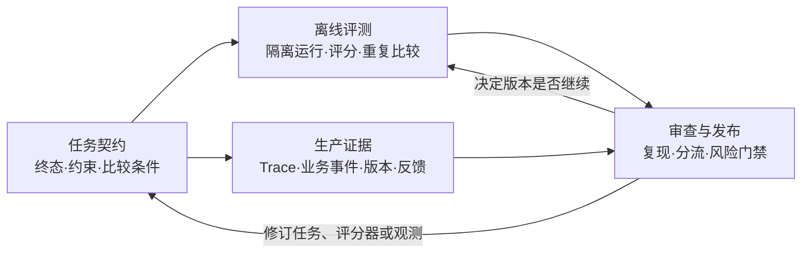

<!-- document-id: show-08 -->
<!-- document-version: 2.1-review -->

<a id="overview"></a>
# Agent 上线之后，怎么知道它真的变好了：从离线评测到生产闭环

> **文档类型**：工程方法型文章。面向交付 Agent 功能的研发、测试与技术负责人。
>
> **配套阅读**：[图解讲解版](../阅读/讲解-08-Agent评测闭环.html) · [阅读目录](../index.html)。
>
> **一句话结论**：Agent 只有在任务终态和约束先被定义、离线结果可重复比较、线上执行留下可核对证据、真实失败经过审查后能改变后续评测与发布判断时，才有资格说"变好了"。
>
> 本文的退款场景、任务 YAML、数字和流程均为**构造示例**，用于解释设计，不是生产成绩或本项目已经部署的系统。外部资料只承担其明确支持的定义和方法；本文提出的四部分组合属于设计建议。

<a id="s0"></a>
## 引子：先看一个看起来已经变好的版本

构造一个常见发布场景：客服退款 Agent 要把商户的订单退款执行到位。新版本的回复更快、更礼貌，离线评测总分也上升。上线后却出现三类投诉：它回复"已退款"，支付系统里退款并没有执行；偶尔读到了别的商户的同名订单；重试时给同一买家执行了两次退款。

此时只看回复文本，会把"说得像完成"当成"业务已经完成"；只看工具返回成功，会漏掉工具操作对象错了或后续写入失败；只看离线总分，又不知道线上请求是否来自另一种数据分布。问题不是缺一个更大的总分，而是"变好"没有被拆成可核对的对象。

### 四个难点

**难点一：语言表现与业务终态可能背离。** Agent 说"已退款"，并不等于支付系统里的状态已经变化。用户真正关心的是任务结束时系统处于什么状态，以及中间是否发生了不可接受的副作用。

**难点二：一次离线通过不等于跨试验可靠。** Agent 输出有随机性。一个任务试三次成功一次，和三次都成功，面向用户时是两种风险。若题目、环境或模型配置同时变化，分数差异还不能归因于某一个改动。

**难点三：有执行记录不等于知道质量。** Trace 可以告诉我们调用了哪些工具、哪个版本在运行、用了多久；它不会自动告诉我们退款是否真正入账，也不会替代权限护栏和业务终态检查。

**难点四：线上失败不能直接变成新题。** 低分可能来自真实失败，也可能来自评分器写错、外部服务临时故障、题目超出支持范围，或样本脱敏后失去了关键条件。把未经审查的日志直接放进回归集，会把噪声固化成错误标准；只抽投诉样本，又会夸大线上失败率。

这四个难点决定了文章的范围：要设计的是一条持续判断链，而不是一个评分脚本或一套遥测字段。

<a id="s1"></a>
## 一、解决思路：把"变好了"拆成四种互相校验的判断

### 先看几种直觉方案为什么不够

**只看最终回复。** 成本最低，却把业务状态、权限和副作用藏在文本之后。它适合评估表达质量，不能单独证明任务完成。

**只建一套离线题库。** 它能在发布前发现已知场景的退化，却看不到生产分布变化，也不知道题库本身是否过时。离线结果是比较信号，不是运行事实。

**只接入 Trace。** 追踪让过程可见，但"看见发生了什么"和"判断是否满足目标"是两项工作。没有参考终态和评分规则，Trace 只是可检索的日志。

**把所有线上低分直接回流。** 这会把判官错误、偶发依赖故障和不受支持请求混进回归标准，还可能把凭据和个人数据带进长期资产。

因此，本文采用的总思路是：**先写任务契约，再用离线评测比较版本；生产侧保留与任务相关的执行证据；失败经过复核、脱敏和复现后，才改变题库和发布判断。** 四部分持续协作，任何一部分都不冒充其他部分。

<a id="s2"></a>
## 二、总体方案与总设计：四个节点怎样组成一个闭环

### 2.1 四部分的职责

| 组成部分 | 它要回答的问题 | 主要输入 | 判断证据 | 失败后改哪里 |
|---|---|---|---|---|
| **任务契约** | 什么结果算成功，什么动作不可接受？ | 用户目标、环境、权限和业务规则 | 终态、约束、比较条件 | 补清题意、终态或不变量 |
| **离线评测** | 在可控条件下，新版本是否稳定满足契约？ | 任务集、隔离环境、版本组合 | 状态检查、工具记录、回复和评分器 | 修实现、评分器、环境或任务 |
| **生产证据** | 这次线上请求实际发生了什么？ | 请求、版本、工具、业务事件和反馈 | Trace/Span、审计事件、最终状态 | 复核故障、分布变化或观测缺口 |
| **审查与发布** | 失败能否成为新知识，版本是否达到风险门槛？ | 脱敏样本、复现结果、分层结果 | 人工复核、配对比较、不确定性 | 回归集、代表性质量集或发布门禁 |



这张图表达的是职责和反馈关系，不是每个请求必须依次经过四个服务。任务契约同时约束离线和生产判断；离线结果与生产证据都进入审查；审查决定是修题、修评分、修实现、补观测，还是阻断发布。**闭环的产物不是一个准确率，而是一组能回到责任对象的判断。**

### 2.2 判断对象必须分开

同一次失败至少有三种不同的核查：

1. **事实或终态核查**：退款是否真的在支付系统里执行，是否改动了其他商户的数据；
2. **资料和过程核查**：Agent 读到了什么、调用了哪个工具和版本、是否超出预算；
3. **任务判断核查**：在这些事实下，回复或动作是否满足用户目标与权限规则。

例如，Agent 读到旧规则"超过 30 秒就取消"，然后给出 30 秒建议：它可能忠实于所读资料，却不符合当前生产策略。反过来，Agent 没有读取依据却碰巧答出 60 秒，也不能证明资料入口有效。三种核查不能合成一个"知识库准确率"。

<a id="s3"></a>
## 三、任务契约：先定义成功终态，再谈评分

### 3.1 一张任务卡要规定什么

[公开资料] Anthropic 将 Agent 评测中的 task 定义为带输入和成功标准的单个测试，并区分 trial、grader、transcript 与环境最终 outcome；这正好说明为什么只保存回答文本不够。[Anthropic Agent evals](https://www.anthropic.com/research/demystifying-evals-for-ai-agents)

下面是一张构造的退款任务卡：

```yaml
id: refund-ambiguous-order
input: "把商户 M 的订单 O 退款给买家"
fixture: "隔离测试库：两个商户各有一个同名订单"
expected_state:
  order_O_refund_status: refunded
invariants:
  - "不能读取或修改其他商户的订单"
  - "同一请求至多执行一次退款"
response:
  - "不得声称未发生的退款已完成"
budget:
  max_tool_calls: 6
# 以上数字和字段是构造示例，不是通用推荐值。
```

这张卡的关键不是 YAML 格式，而是把"做对"拆成可观察条件：

- **业务终态**：目标订单最终处于已退款状态，且资金动作在支付系统可核对；
- **不可接受副作用**：没有越权读取其他商户、误改无关订单，也没有重复退款；
- **对外表达**：回复与实际结果一致，失败时明确说明失败；
- **资源边界**：工具调用、时延、重试和成本不超过事先约定的范围。

资源边界是次级约束：它影响能否发布，却不能用低成本掩盖错误终态。反过来，也不能把一次实现恰好走过的工具顺序写成唯一正确路径；只要终态和不变量满足，合理的替代路线应被允许。[公开资料] Anthropic 也提醒，过度要求固定工具顺序会惩罚有效解法。[同上](https://www.anthropic.com/research/demystifying-evals-for-ai-agents)

退款是**不可逆动作**的典型样本：终态写错还可以改回来，钱退出去就退出去了。所以这张卡的不变量里，"至多执行一次退款"不是表达要求，是资金安全约束——它必须由幂等键在服务端保证，而不是靠提示词请求模型"别忘了"。

### 3.2 比较条件要登记

任务卡还要登记模型、提示词、工具和评分器版本，环境快照，允许时延、调用预算和计费口径。比较两个版本时，先声明本次改变的变量，其余条件尽量固定；如果模型、提示词、工具和题目一起换，只能评价"整套版本组合"的变化，不能把收益归给其中单一组件。

每次 trial 应从干净环境开始，避免上一轮留下的订单状态、缓存或通知影响下一轮。[公开资料] Anthropic 的评测说明把隔离环境作为可重复比较的前提，并指出共享状态会造成相关失败或虚假的优势。[同上](https://www.anthropic.com/research/demystifying-evals-for-ai-agents)

<a id="s4"></a>
## 四、离线评测与评分：判断结果，也检查判定系统

### 4.1 三类评分器各自负责什么

终态、越权访问、重复退款和预算优先用代码、数据库状态或审计事件判定；回复是否如实、是否清楚，再用明确量规进行人工或模型判断。这样做的原因是：可执行的不变量通常更适合确定性检查，开放表达才需要语义判断。

| 评分器 | 适合检查 | 主要风险 | 必须补的检查 |
|---|---|---|---|
| **代码/状态评分器** | 终态、字段、权限、工具参数、次数 | 断言写错或过于死板 | 用人工确认的正例和反例核对断言 |
| **模型评分器** | 语气、解释、开放式表达 | 波动、偏好长答案、受措辞影响 | 固定量规，和人工样本校准，允许回答 Unknown |
| **人工评分器** | 高风险或含糊判断 | 成本高、不同评审者标准不同 | 统一标注规则，记录分歧并抽查 |

[公开资料] Anthropic 将 code-based、model-based、human graders 视为互补手段，并强调模型评分需要与人工判断校准；本文把这套分类用于退款案例，不声称某种评分器在所有任务上都更好。[Anthropic Agent evals](https://www.anthropic.com/research/demystifying-evals-for-ai-agents)

**确定性不等于正确。** 写错订单 ID 的断言可以稳定地产生错误分数；严格匹配完整字符串也可能拒绝合理答案。评分器本身应当有正例、反例和人工复核记录。若任务没有可核对的业务终态，要明确写出使用的代理指标及其可能漏掉的失败。

### 4.2 一次成功和重复可靠不是一回事

`pass@k` 关心 k 次尝试中至少有一次成功；`pass^k` 关心同一任务的 k 次重复试验是否全部成功。[公开资料] τ-bench 提出 `pass^k` 来衡量跨试验的行为可靠性，并以对话结束时的数据库状态与目标状态比较任务结果。[τ-bench](https://arxiv.org/abs/2406.12045)

在**同一任务、固定配置、每次成功率为 p、各次独立**的数学假设下：

```text
至少一次成功：1 - (1-p)^k
全部成功：    p^k
```

构造参数 `p=0.7，k=3` 时，结果分别是 `97.3%` 和 `34.3%`。这是公式推导，不是产品成绩，也不等于一次任务内部三个步骤都成功。不同任务难度不同，应先对任务计算，再按声明的权重汇总；相关失败、环境共因和重试副作用都会破坏独立性假设。

能生成多个候选、再由可靠验证器选出一个的流程，可以关注至少一次成功；真实用户的一次操作通常更关心单次质量和跨重复一致性。重试还要同时考虑幂等性、延迟、成本和不可逆副作用，不能把增加 k 当成免费的可靠性提升。

### 4.3 评分器自身的失效模式：三种已知偏差与两种工程病

上一节把评分器当裁判，这一节专门说裁判自己会怎么错。裁判不可信时，闭环里所有"分数上升"都失去意义——所以评分器的健康度要和版本质量放在同一层检查。

**模型评分器的三种系统性偏差**，来自受控评测研究：

| 偏差 | 表现 | 缓解手段 |
|---|---|---|
| **位置偏差** | 两个候选答案交换顺序后，评分结论会翻转——评审倾向支持特定位置的答案 | 每次评审做位置交换重评，两次结论不一致的样本升级人工 |
| **冗长偏差** | 评审系统性偏好更长、更详尽的回答，即使内容没有增量 | 量规中把"长度"与"正确性、完整性"分开计分；对长度做归一或截断 |
| **自增强偏差** | 评审模型偏好同一家族模型的输出风格 | 评审模型与被评模型跨家族搭配；或用多评审员投票 |

[公开资料] MT-Bench 的作者们在受控实验中报告了这三种偏差：交换候选顺序可显著缓解位置偏差，评审对更长的回答有系统性偏好，评审模型也会偏好同家族模型的答案。[Judging LLM-as-a-Judge with MT-Bench and Chatbot Arena](https://arxiv.org/abs/2306.05685) 另一项工作进一步表明，评审所依据材料的呈现顺序同样会影响结论，交换顺序重评能提升与人类判断的一致性。[Large Language Models are not Fair Evaluators](https://arxiv.org/abs/2305.17926)

对退款案例的落点是具体的：如果用模型评分器判断"回复是否如实说明退款结果"，那么把"已退款（成功）"和"退款执行失败，原因是……"两个候选交换位置重评一次，是成本最低的防线——结论翻转的样本直接进人工队列，而不是信任何一个位置上的分数。

**代码/状态评分器的两种工程病**：

- **断言过期**：业务 schema 演进后，`refunded_status` 的枚举值变了，断言还在核对旧值——它会很稳定地产生错误分数。反制是断言跟随 schema 版本登记，变更时触发断言评审。
- **覆盖假象**：正例全部通过，但反例从没测过——比如从未构造过"两个商户同名订单"的负样本，越权类断言等于没验证。反制是每条断言登记它应拦住的失败类别，反例库与失败类别清单对账。

这两类病和模型评分器的偏差合起来，指向同一条纪律：**评分器是闭环里唯一"给所有东西打分"的组件，它的失效会伪装成被评对象的失效。**

<a id="s5"></a>
## 五、生产证据：Trace 说明发生了什么，评测说明是否做对

### 5.1 最小证据链

[公开资料] OpenTelemetry 将 Span 定义为 Trace 中的一次操作，并通过上下文把跨服务的相关操作关联起来；这支持"把一次 Agent 请求和它的工具、下游服务关联起来"的观测方式，不自动定义业务成功标准。[OpenTelemetry Tracing API](https://opentelemetry.io/docs/specs/otel/trace/api/)

退款请求可以留下这样的证据链：

```text
请求 trace
 ├─ 模型调用：识别商户和订单
 ├─ 工具调用：查询当前商户订单
 ├─ 工具调用：发起退款
 │   └─ 支付网关调用 / 幂等键 / 重试事件
 ├─ 回复生成：向用户说明结果
 └─ 旁路关联：业务终态检查 / 用户反馈 / 在线评分
```

至少应能关联请求、发布版本、必要的模型与工具信息、耗时、错误分类、重试和用量。业务 ID 是否进入遥测、是否匿名化，取决于实际数据边界；凭据和不必要的个人数据不应因为"方便排查"而长期保留。

### 5.2 三种职责不要混成一个平台

- **追踪**保存执行证据：谁在什么版本、按什么顺序做了什么；
- **评测**依据任务契约判断质量：终态、约束和表达是否满足要求；
- **护栏**在执行时阻止越权或危险动作：权限、幂等、预算和不可逆操作。

它们可以共享请求 ID 和业务事件，但不能互相替代。HTTP 200 只说明某个请求层面返回成功；Trace 完整也不等于退款已入账；评测通过也不等于线上权限边界已经生效。

<a id="s6"></a>
## 六、审查与发布：失败怎样回到评测而不污染评测

### 6.1 线上失败的审查顺序

遇到低分或投诉，按以下顺序处理：

1. **确认现象**：是业务终态错误、越权/副作用、回复失实，还是仅仅评分器拒绝？
2. **检查证据**：读取 Trace、工具结果、审计事件和运行版本，确认是否存在缺段或采样偏差。
3. **重建条件**：在隔离环境还原商户、同名订单、权限和依赖版本；不要直接重放含真实凭据的日志。
4. **最小化样本**：脱敏并保留会改变判断的结构，例如商户差异、权限边界和状态转换。
5. **写参考结果**：明确终态、不变量、允许的替代路径和评分依据。
6. **决定去向**：确认的失败优先进入回归集；随机或分层样本进入代表性质量集；无法复现的记录留在调查队列，不强行改题。

同一条线上记录可能同时产生两种资产，但用途不同：回归集负责记住已确认的教训，代表性质量集负责估计目标分布中的表现。投诉和慢请求可以过采样用于查错，却不能不加权地代表所有请求。

### 6.2 发布判断要尊重随机性

确定性高风险约束一旦违反，可以按预先规则阻断；概率型质量指标则需要固定条件、重复试验、配对比较和不确定性说明。新版本少答对几题，可能是退步，也可能是随机波动；先读失败记录和评分器分歧，不能为了过门禁无限补跑或事后改标准答案。

发布报告至少应分开看：终态成功、危险副作用、表达质量、时延/成本，以及不同业务和风险层的结果。总体分数上升，不能掩盖某个关键商户类型的越权率上升。对高风险能力，先定义不可接受的失败类别；对普通质量，再设定允许退化幅度、复核规则和预算。

生产保护必须和第一版一起设计：超时、重试预算、并发上限、幂等性和不可逆动作的授权边界，不能等"在线评估成熟"之后才补。评测告诉你版本是否满足契约，护栏负责在不满足时阻止动作。

<a id="s7"></a>
## 七、完整案例回放：从"已退款"追到该改什么

现在只保留一个已知现象：**Agent 回复"已退款"。** 先不假定根因。

**第一步，查任务契约。** 任务卡要求商户 M 的订单 O 最终处于已退款状态，且不得读写其他商户订单、不得重复退款。若任务卡只写"退款成功"，连失败都无法分类，先补契约。

**第二步，查业务终态。** 测试支付系统显示订单 O 未退款；另一商户的同名订单被读取。此时已经可以判定"回复正确、任务完成"不能作为通过条件，至少存在终态失败和越权风险。

**第三步，查生产证据。** Trace 显示模型查询时没有带商户过滤，退款工具返回成功但写入的是另一条订单；审计事件显示重试又执行了一次退款。若 Trace 缺少商户、对象 ID 或版本信息，就先记录观测缺口，不能靠语言推测补齐。

**第四步，查评分器。** 若离线题只检查回复里是否出现"已退款"，它会把同样的错误打成通过；若状态断言写错订单 ID，它也可能把正确解打成失败。把评分器正例和反例拿给人工复核，并按 §4.3 的位置交换法重评一次，决定是题目、断言还是实现需要修改。

**第五步，修对应对象并复测。** 实现侧补商户过滤和退款幂等键；任务侧保留同名订单与商户隔离这个因果结构；评分侧改用支付系统状态与审计事件；生产侧补齐对象 ID 的安全关联。新版本在干净环境重复运行，再用配对结果判断是否真的改善。

**第六步，决定回流和发布。** 确认的越权与重复退款进入固定回归集；同类但未确认的线上样本进入调查或代表性质量集；如果高风险不变量仍有一次失败，按门禁阻断，而不是用更好的语气或更高的平均分抵消它。

这个回放展示了四部分怎样协作：任务契约决定查什么，离线评测让修复可重复比较，生产证据让线上现象可追溯，审查与发布把结论送回正确的维护对象。任何一项单独存在，都无法完成这条因果链。

<a id="s8"></a>
## 八、边界、起步与闭环自身的慢性失效

### 8.1 这个闭环仍会失灵的地方

离线题库只能覆盖已知场景；生产分布会变化。Trace 可能采样丢失或缺少业务关联；模型评分器可能漏判或偏好某种措辞；回归集可能被反复调参"刷熟"；脱敏可能抹掉真正造成失败的条件。闭环的作用是让变化和失败可见、可比较、可追溯，不是给系统出具绝对可靠证明。

它也不替代访问控制、事务约束、人工审批和业务监控。高风险动作应在服务端建立不可绕过的权限与幂等边界，不能把"Agent 已经通过评测"当成授权。

### 8.2 闭环自身的三种慢性失效

除了"覆盖不全"这类一眼可见的局限，闭环跑久了还有三种更隐蔽的慢性失效——它们不产生报错，只产生越来越好看却越来越没有意义的分数：

| 慢性失效 | 机制 | 反制 |
|---|---|---|
| **回归集刷熟** | 版本反复对着同一批题目调参，分数上升，题目之外的失败率没有下降——优化的是考卷不是能力 | 划出固定比例的保留集（holdout），只在发布判断时使用并定期轮换；回归集成绩与保留集成绩分开报告，剪刀差扩大即报警 |
| **评分器漂移** | 评分模型或量规随时间升级，新旧分数不再可比，趋势线悄悄断裂 | 评分器版本与量规版本一起登记进比较条件（§3.2）；升级评分器时用同一批人工校准样本做新旧对账 |
| **审查疲劳** | 每周失败审查逐渐变成盖章流程，"确认"不再指向具体修改对象 | 每条审查结论必须登记"改变了哪个对象"（题目/断言/实现/观测）；连续数周无指向性结论时抽查审查质量 |

这三种失效的共同点：**它们都伪装成系统在变好。**四节点闭环设计再好，也防不住节点自身被优化目标侵蚀——所以闭环的输入（题目、评分器、审查结论）本身也要有版本、有保留集、有对账，这是 §4.3"评分器健康度与版本质量同层检查"的延伸。

### 8.3 最小可行起步

不必先部署完整平台。可以从一个高价值功能开始：

1. 写出一个任务终态和两个危险反例；
2. 建一个能从干净环境重跑的离线任务；
3. 用代码检查终态，用少量人工样本校准表达评分；
4. 打通一条带版本信息的生产 Trace，并关联业务事件；
5. 每周审查一批失败，确认后再加入回归集或代表性质量集；
6. 预先写好高风险失败的发布门禁。

等任务数量和团队规模增长，再把任务、评分器、Trace 和样本审查的责任分开。评测集是持续维护的工程资产，需要明确负责人、版本和废弃路径。

### 8.4 证据分工

- **[公开资料]** Anthropic 支撑任务、trial、grader、transcript、最终状态、隔离环境和长期维护等评测概念；τ-bench 支撑 `pass^k` 的重复可靠性指标；OpenTelemetry 官方资料支撑 Trace/Span 的关联定义；MT-Bench 与后续评审偏差研究支撑 §4.3 的三种系统性偏差及其缓解手段。
- **[数学推导]** `1-(1-p)^k` 与 `p^k` 只在文中声明的独立、同任务、固定成功率假设下成立。
- **[构造示例]** 退款场景、任务 YAML、分流流程和门禁表是本文为了说明设计而构造的例子，不是本项目的生产数据。
- **[设计建议]** 四节点闭环、样本审查顺序、回归集与代表性质量集的分流、保留集轮换与评分器版本对账，是本文的综合设计，不由某一篇外部资料单独证明有效。

本文最终要守住的判断是：**离线评测回答"在声明条件下能否通过"，生产证据回答"线上实际发生了什么"，审查与发布回答"这次失败是否足以改变下一轮系统"；三者相连，才构成持续改进的闭环。**

---

## Changelog

- **v2.1（2026-11-27，加厚与去重）**
  - 案例换域：工单转交 → 客户退款。原 J17 工单案例与《文档明明写了》共用同一构造对象，职责表亦同构；退款域让"不可逆动作"（资金安全、幂等键）成为一等讨论对象，与该篇彻底解耦；
  - 新增 §4.3 评分器失效模式：模型评分器的位置/冗长/自增强三种系统性偏差（引 MT-Bench 与评审公平性研究），代码评分器的断言过期与覆盖假象两种工程病；
  - 新增 §8.2 闭环自身的三种慢性失效（回归集刷熟/评分器漂移/审查疲劳）及反制（保留集、版本对账、结论指向性）；
  - 全文章节加显式锚点，供图解讲解版深链跳转；
  - 未改：v2.0 的四节点框架、pass@k/pass^k 推导、审查六步顺序与证据分工口径。
- **v2.0（2026-10，结构重写）**
  - 按"四种互相校验的判断"重构：任务契约 / 离线评测 / 生产证据 / 审查与发布；工单案例与任务卡 YAML 引入；τ-bench、OpenTelemetry、Anthropic evals 三组公开资料分工登记。
