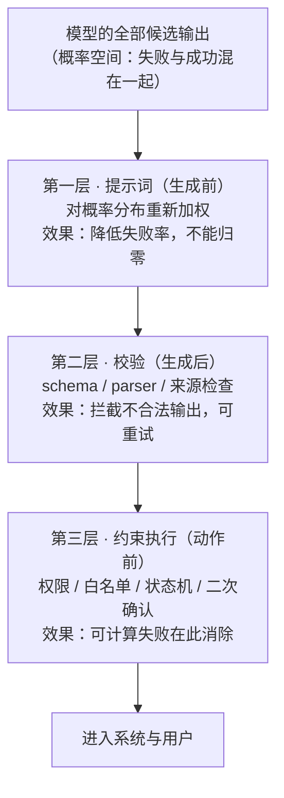

# Agent 系统可靠性：提示词、模型与代码的边界

> **讲解版入口**：配套图文版在 `阅读/讲解-04-提示词与代码边界.html`；参数分型对应本文 §一，三类问题分流对应 §二，两问矩阵对应 §三，三层漏斗对应 §四，改写示例对应 §五，检查清单对应 §七。

> **断言标注约定**：本文所有关键判断按三分法标注——`[经验]`（作者工程实践经验，样本有限）、`[推测]`（本文提出的机制假设）。无标注的为可直接核对的定义、流程描述或逻辑推演。本文为框架性方法论文章，不含外部研究引用；文中案例为构造的原型案例（见引子）。

## 引子：症状、一句话答案与一个原型案例

很多 Agent 系统的可靠性故障复盘，最后都会落到一句话 `[经验]`：

> 模型怎么又没听提示词？

于是团队继续加提示词：必须、一定、不要、严禁、务必、再次强调。短期看，测试样例可能过了；过几天换一种问法、换一个模型版本、上下文长一点、工具多一点，问题又回来。

这类问题的根因往往不是"提示词写得还不够狠"，而是**分工边界错了**：我们把本该由代码保证的确定性，交给了一个概率模型去"尽量遵守"。本文的一句话答案是：

> **提示词降低失败率，代码消除可计算的失败。**

围绕这句话，本文要回答五个问题：哪些事适合交给 LLM；哪些事只能交给代码；哪些事提示词可以改善但不能保证；哪些地方必须有不可绕过的硬闸门；怎样把一个看似模糊的问题，改写成代码能兜住的形状。

### 一个构造的原型案例

下面的客服 Agent 案例是**构造的原型案例**：它不是某次真实事故的复盘记录，而是从 Agent 系统的常见失效模式中归纳出的原型，用于展示错误的结构 `[经验]`。

一个客服 Agent 接了"查客户档案"和"查工单"的能力。用户说：

> 帮我看看张伟这个客户最近的工单情况。

系统里叫"张伟"的客户有三个。Agent 需要先定位是哪一个张伟，拿到他的 `customer_id`，再用这个 id 去查工单。

结果它按名字搜，撞上三条记录，挑了错的那个张伟。更糟的是，它拿着错人的空工单，生成了一段看起来很像真的总结：

> 该客户近期工单较少，暂无明显异常。

复盘时，很容易把问题归因成"模型不够聪明"。但把这一步拆开看，里面至少混了四种性质完全不同的动作：

| 动作 | 性质 | 更适合谁 |
|---|---|---|
| 从用户话里识别"他想查客户张伟" | 语义理解 | LLM |
| 在多个同名客户里确定目标记录 | 规则、权限、上下文约束 | 代码或明确交互 |
| 从目标记录取 `customer_id` 再查工单 | 确定性数据访问 | 代码 |
| 把工单结果解释成人话 | 表达、总结 | LLM |

Agent 出错，是因为第二步和第三步滑到了 LLM 那边。这就是很多 Agent 系统可靠性问题的原型：LLM 很适合做语义理解和表达，但它不适合承担"必须一字不差、必须唯一命中、必须可审计"的确定性搬运动作。

先拆动作、再定边界——"模型不听话"的表象下，往往是把不该给模型的动作给了它。

## 一、参数分型：生成型与搬运型

说"不要让 LLM 传参数"是过度简化。LLM 每天都在给工具传参数，而且很多时候表现很好。关键要分清两类参数。

| 参数类型 | 例子 | LLM 是否适合 |
|---|---|---|
| 生成型参数 | `name=张伟`、`city=上海`、`priority=high` | 通常适合 |
| 搬运型参数 | `customer_id=1000020698274`、`record_uuid=8f3a...` | 取决于风险维度 |

生成型参数来自语义理解。用户说"查上海的高优先级客户"，模型抽出 `city=上海`、`priority=high`——这是它擅长的。

搬运型参数不是理解，而是把上下文里已有的某个值**原样**搬到另一个地方。它看起来简单，其实很危险，尤其当这个值是不透明主键。判断链条是：搬运型错误的伤害不取决于出错概率，而取决于**错了之后系统有没有信号能发现**——下面五个维度衡量的正是这一点。

| 维度 | 相对安全 | 高风险 |
|---|---|---|
| 语义 | `ORDER-SH-2026-001` 有业务含义 | `1000020698274` 无语义 |
| 长度 | 短 | 长 |
| 唯一性 | 当前上下文只有一个候选 | 多个相似候选 |
| 距离 | 值就在上一行 | 埋在几步前的大段列表里 |
| 可校验性 | 错了格式或含义明显不对 | 错一位也可能命中另一条真实记录 |

这五个维度是风险方向标，不给"通过几项才安全"的量化阈值，也不覆盖"参数本身合法但取值时机错误"的情况（模型用了过期上下文里的旧值）。最终判断要回到具体业务里问一句：这个值错了，会伤到谁。

当一个参数同时满足"无语义、长、多个相似、跨上下文、错误难自检"时，它就不应该交给 LLM。一个订单号 `ORDER-SH-2026-001` 搬错了，至少看起来可能不对；一个 13 位纯数字 id 搬错一位，接口仍然可能返回 `success: true`，只是返回了另一个人的数据。这类错误最可怕的地方不是失败，而是"**成功地错了**"。

### 1.1 为什么把 id 暴露给 LLM 反而更危险

有人会说：那就把 `customer_id` 明明白白放进上下文，让模型照抄，不就行了吗？这恰好是更危险的一档。

- 如果 id 没进 LLM 视野，它最多按名字搜索，搜索失败或撞同名时，系统还有机会暴露出 `not_found`、`multiple_candidates` 这样的**可观察状态**；
- 一旦 id 进了 LLM 视野，模型就可能去"使用"它：抄错、截断、混淆，或在多个相似 id 里选错。错误 id 只要命中了另一条真实记录，接口会正常返回，后续链路会把这次错误**当成成功**处理。

所以，对不透明强主键，正确做法通常不是"让模型看清楚点"，而是"不要让模型碰它"。上下文里应该给 LLM 看到的是它作答需要的语义字段：

```text
姓名：张伟
城市：上海
客户等级：VIP
最近工单：3 条
```

而不应该为了省一段代码，把 `customer_id`、`internal_user_id`、`record_uuid` 这类字段交给模型搬运。强主键应该留在确定性代码里流转。这条可以当作一条反模式记住：**把主键当文本交给模型搬运**——只要主键无语义、长、候选多、错了难自检，就应该从模型上下文里拿掉。

### 1.2 代码路径在本地确定性路径上等价于 P=1

把"取 id 再查详情"交给代码，并不是因为代码更聪明，而是因为代码不用"猜"。LLM 路径里有两个不稳定动作：在多个候选中判断哪个是目标；把目标记录的 id 原样搬到下一次调用。代码可以把这两个动作改成零推理的数据访问：

```text
用户意图
  ↓
LLM 识别：用户想查"当前会话已选中的客户"
  ↓
代码：selectedCustomer.id
  ↓
代码：fetchTickets(customer_id)
  ↓
LLM：把工单结果解释成人话
```

代码路径不需要"记住"那个 id，也不需要"复述"那个 id，它只是从结构化对象里取字段：

```ts
const customerId = selectedCustomer.id;
const tickets = await ticketService.listByCustomerId(customerId);
```

这里的关键差异是：**LLM 在复制一个字符串，代码在引用一个值。**字符串复制有掉位、混淆、幻觉；字段引用没有。

需要立刻声明系统边界：这里说的"P=1"是**限定结论**——代码消除的是**本地确定性路径**上的不确定性（从结构化对象取字段、做比较、查白名单、执行状态机），在这类路径上它等价于 P=1。系统整体当然仍受下游接口、网络、并发、硬件故障影响，那些属于另一类可靠性问题（重试、超时、降级、幂等），有成熟的工程手段处理；本文讨论的是**模型引入的那一类不确定性**，它的特殊之处在于：既无法归零，又难以被传统手段检测。把这两类问题分开，才能避免"代码也不可靠，所以让模型试试也无妨"的滑坡论证 `[经验]`。

所以，可靠 Agent 的设计原则不是"让 LLM 更努力地抄对"，而是"**别让它抄**"。搬运型参数的危险不在出错概率，而在错误无信号；解法不是让模型抄得更认真，而是让强主键根本不经过它。

## 二、三类问题，三种处理方式

把动作按性质分成三类，每一类的处理方式不同。分流的判据是：这个问题的正确答案，是由**理解**产生、由**格式**约束、还是由**唯一事实来源**决定。

### 2.1 语义型：交给 LLM

语义型问题需要理解自然语言、归纳意图、组织表达。例子：用户到底想查什么；这段工具返回应该怎样解释；多个候选方案如何用人话对比；面向非技术用户如何解释错误原因。这些是 LLM 的强项，代码不应该试图用一堆正则完全替代它。

### 2.2 结构型：提示词加校验

结构型问题不是模型不愿意做，而是它偶尔会"漂"。例子：输出合法 JSON；字段名必须固定；列表最多 5 项；Markdown 表格不能缺列；函数参数必须符合 schema。

这类问题有三种时机不同的手段，缺一不可的是后两种：

- 提示词是在**生成前**请求它"尽量合法"；
- 校验（schema、parser、validator、retry）是在**生成后**检查"不合法就不过"；
- 约束解码（constrained decoding，指在生成过程中直接限制模型每一步只能产出符合语法的 token 的技术）是在**生成中**让非法 token 根本出不来。

如果只是内部草稿，提示词可能够；如果下游程序要消费，就必须校验。这一条单独列成反模式：**把 JSON 稳定性完全押给提示词**——只要下游程序要消费，就必须有 schema 校验，提示词不能替代 parser。

### 2.3 权威型：归代码

权威型问题有唯一事实来源，或者可以还原成确定性计算。例子：id 来自哪条记录；用户有没有权限；金额是否超过阈值；坐标是否在围栏内；是否已经查过必要数据；是否允许执行删除、支付、发消息等副作用动作。

这类问题不要让 LLM"判断一下"。正确设计是让 LLM 提出意图，让代码做授权、取值、校验和执行：

```text
LLM 说：用户想查看当前选中客户的工单。
代码决定：当前用户是否有权限；当前会话选中的是哪个客户；
         customer_id 是多少；是否需要二次确认；是否允许调用查询接口。
```

对应的反模式是**用更强提示词替代权限检查**：写"不要越权访问用户数据"不等于做了权限系统，权限必须在工具调用层检查，不能由模型自觉遵守。

这不是保守，这是工程边界。答案由理解产生的交给模型，由格式约束的交给校验，由唯一事实来源决定的交给代码——这一步分流是后续一切设计的前置分类。

## 三、分工原则：提示词是建议，代码是边界

### 3.1 提示词不是栅栏，而是建议

上面讲了"什么必须归代码"。接下来是另一个常见误区：把提示词当成硬约束。

比如有人发现 Agent 有时不查数据库，直接凭上下文回答，于是在系统提示词里加一句"回答前务必先调用查询工具"。测试几轮有效，于是上线。过一段时间，它又在某些问法下绕过了工具。

这不是偶然。提示词对 LLM 来说不是栅栏，而是**建议**：它能显著提高模型做某件事的概率，但不能把概率变成 100%。这点在 Agent 场景里尤其明显，因为 Agent 不是单轮问答，它同时有：长系统提示词、多个工具描述、多轮上下文、用户临时补充、工具返回内容、中间状态压缩、格式和业务约束叠加。约束越多，模型越容易漏；上下文越长，指令越容易被稀释；工具越多，模型越可能走捷径或选错。这里也有一条反模式：**工具越多越好**——主 Agent 只应看到当前任务必要的能力，复杂工具组可以用 skill、子 Agent 或延迟加载隔离。

因此，更准确的说法是那句全文金句：**提示词降低失败率，代码消除可计算的失败。**这句话里有一个重要限定——**可计算的失败**。不是所有问题都能被代码消除："这段内容是否有误导性""这个回复是否足够礼貌""这条信息是否相关"本质上是判断题，无法还原成确定性函数，只能用多层概率手段降低漏率。而"必须带某个字段""id 必须来自当前记录""没有查库结果就不能回答""输出必须是合法 JSON"是可以被代码检查或强制的，就不应该只靠提示词。

### 3.2 两问判断：提示词修，还是代码修

可以用两个问题判断一个约束该放在哪里。

**第一问：能不能容忍偶尔漏一次？**

- 能容忍：风格、措辞、优先级、偏好、解释方式，可以先用提示词。
- 不能容忍：权限、安全、强主键、金额、坐标、外部副作用、必须触发的动作，必须有代码兜底。

**第二问：这条约束是顺着还是逆着 LLM 的省力路径？**

先解释"省力路径"从哪来。LLM 是按概率分布逐个 token 生成的 `[推测→本文机制假设]`：对任何"下一步"，模型的训练分布里总有一些行为是高概率的——答案可以直接现编时，直接答是省力路径；可以用名字搜时，按名字搜是省力路径；输出自然语言永远比严格 JSON 省力。三种干预手段的作用点因此完全不同：**提示词是对概率分布重新加权**——提高目标行为的概率，但其他路径的概率仍在，只是变小，所以迟早会漏；**校验是在出口拦截**——不管模型走了哪条路径，不合格就不过；**代码是改变状态转移函数**——把"下一步做什么"从模型的概率选择，变成程序的确定性决定，这是唯一能把某条失败路径的概率真正归零的手段。这解释了为什么提示词在"顺水"时收益高（它只是在给本来的高概率行为再加权）、在"逆水"时靠不住（它在逆着整个训练分布持续做功）。

- 顺水：模型本来就容易这么做，提示词只是提醒。例："回答尽量简洁""先给结论再解释""如果数据很多，只总结最重要的三条"。
- 逆水：模型不这么做反而更省力，提示词就靠不住。例：明明答案可以现编，却要求它必须先查工具；明明可以按名字搜，却要求它必须使用权威 id；明明可以输出自然语言，却要求它严格匹配复杂 JSON；明明用户要求越权操作，却要求它拒绝并保持安全边界。这些约束只写"务必""严禁""一定不要"，迟早会漏。

把两问合起来，得到一个简单矩阵：

| | 能容忍偶尔漏 | 不能容忍漏 |
|---|---|---|
| 顺水 | 提示词通常够 | 提示词为主，代码兜底 |
| 逆水 | 提示词为辅，重点监控 | 必须代码或硬闸门 |

这个矩阵不回答"漏一次的实际代价是多少"（同一条约束在演示环境和支付链路上的容忍度完全不同），也不处理"顺逆会随模型版本漂移"的情况——补丁型提示词尤其如此，见 §六。

### 3.3 软层与硬层：单个约束的纵深防御

矩阵的右下角"必须代码或硬闸门"，展开来就是纵深防御的思路。很多团队追求"让模型 100% 听话"，这个目标本身就不对；更合理的目标是：**允许模型是不完美的，但系统在关键事项上不能被它的不完美击穿。**

以"回答前必须查库"为例，不应该只写一句提示词，而应该有两层：

```text
软层：提示词提示模型先查再答
硬层：返回前检查本轮是否存在对应查询结果
```

如果没有查询结果，系统可以：阻止最终回答、强制补查、要求模型说明无法回答、把状态标成未验证。这样一来，模型"想偷懒直接答"也没关系，因为硬层会接住。对应的反模式是**没有查到数据也允许模型生成事实性回答**——工具返回空、失败或未调用时，最终回答应该显式标注不确定，或被系统阻止。

再看安全类问题。提示词可以告诉模型"不要泄露敏感信息"，但真正的系统还需要：输入侧检测、工具权限控制、输出侧过滤、操作前确认、审计日志、失败后的降级策略。其中有些层是概率判断，有些层是确定性规则。

提示词与代码不是竞争关系，而是作用在不同的机制节点上——加权概率、拦截输出、决定转移，三层各管一段。

## 四、纵深防御与两条路线：叠软层，还是上硬闸

把上一节的软层硬层推广到整个系统，就是一张三层拦截漏斗：错误从模型的概率空间出来，每过一层，能漏下去的可计算失败就少一批。



图上要抓住的是每层的**作用时机**不同：提示词在生成前加权，校验在生成后拦截，约束执行在动作发生前做最后裁决。判断题类的失败（语义、质量）主要靠前两层叠概率手段降漏率；可计算类的失败（id、金额、权限、格式）必须在第三层归零。

漏斗不回答"每层该多厚"——校验规则枚举和拦截粒度取决于业务代价；它也不暗示三层都要有，纯内部草稿场景可能只需要第一层。

具体到路线选择，有两条路线：

| 路线 | 机制 | 适合什么 | 上限 |
|---|---|---|---|
| 叠软层 | 多个概率判断器互相补位 | 相关性、安全语义、内容质量 | 趋近 100%，但不是 100% |
| 上硬闸 | 确定性计算、schema、白名单、权限、状态机 | id、金额、权限、格式、范围、触发条件 | 可以做到系统层面的确定 |

选哪条不靠感觉，判据是问题能不能还原成确定性计算——很多争论正来自把这两条路混了。

如果问题本质是判断题，比如"这段话是否有诱导性"，通常只能叠软层：用规则、分类器、输出检查、人工审核降低风险，但很难宣称绝对不漏。如果问题可以还原成确定性计算，比如"这个 id 是否来自当前记录"，就不要叠一堆提示词和分类器，直接上硬闸：

```text
allowed_ids = current_record.related_ids
if requested_id not in allowed_ids:
    reject()
```

硬闸不是"更强的提示词"，而是把问题从概率空间移回程序空间。真正的手艺在这里：**把一个看似需要模型"更听话"的需求，改写成代码能检查的形状。**

漏斗的价值不在任何单层完美，而在各层抓的错误不同——软层降概率、硬层消可计算失败，谁也替代不了谁。

## 五、把模糊需求改写成可兜底需求

很多需求一开始长这样："Agent 不要乱编客户信息。"这句话太大，没法直接兜底。可靠性的设计手艺，就是把它拆成可执行的系统约束：

| 模糊说法 | 可兜底改写 |
|---|---|
| 不要乱编客户信息 | 回答中的客户字段必须来自查询结果 |
| 不要查错人 | 所有详情查询必须使用当前会话锁定的 `customer_id` |
| 不要越权 | 工具调用前统一做用户权限检查 |
| 不要没查就答 | 没有本轮查询记录时禁止生成事实性结论 |
| 输出要稳定 | 输出必须通过 JSON Schema 校验 |
| 不要误触发动作 | 有副作用操作必须二次确认并写审计日志 |

背后的思想是：不要要求 LLM"永远做对"，而要把"做错"变成系统能**观察、阻止、恢复**的状态。改写只给出"约束长什么样"，不回答"约束放在链路哪一环执行"——落点要回到 §三 的分工原则逐条判断。

以"不要查错人"为例，它不是靠提示词写"请务必选择正确的张伟"，而是靠交互和状态机：

```text
1. 搜索名字，发现 3 个候选
2. 如果没有额外上下文可以唯一确定，要求用户选择
3. 用户选择后，把 selected_customer_id 写入会话状态
4. 后续详情查询只能使用 selected_customer_id
5. LLM 看不到也不搬运内部 id，只解释查询结果
```

对照引子的原型案例：这套状态机在"挑错张伟"那一步就把错误拦住了——不是让模型选得更准，而是让"选"这个动作从模型手里回到交互与状态机手里。这才是可靠性设计。

模糊需求兜不住；可兜底需求的形状是：能观察、能阻止、能恢复。

## 六、为什么换模型会让提示词链路重新洗牌

很多团队还有一个误区 `[经验]`：既然新模型更强，原来的提示词约束应该更稳。不一定。

换模型不是把所有能力等比例提高，而是**行为分布重新洗牌**。新模型可能更会推理，但也可能更爱自作主张；可能格式更稳，但工具调用更懒；可能更安全，但误拒更多；可能更愿意遵守系统指令，但对旧 few-shot 的风格学习变弱。

对 Agent 来说，最容易漂的维度：工具调用积极性（该查不查，或不该查乱查）；输出格式（字段缺漏、额外包 Markdown、键名变化）；冗长度（多解释、多做一步、多触发副作用）；拒绝边界（误拒或误答）；长上下文注意力（旧约束被新消息稀释）；补丁型提示词（针对老模型缺陷写的纠偏句，在新模型上可能变成干扰）。

所以，关键路径不要绑定在"当前模型刚好听这句提示词"上。至少要做到：

- 生产环境钉模型版本，不静默使用 `latest`；
- 建小而真实的回归 eval。这里的关键是覆盖**失败路径**而不是 happy path——可靠性问题通常出现在同名、空结果、权限不足、工具失败、上下文很长、用户换说法、模型升级之后。这也是一个反模式：**测试只测 happy path**，只测最顺的一条路径等于没测边界；
- 换模型时比较工具调用率、格式失败率、拒答率；
- 重新审查旧提示词补丁；
- 把强主键、权限、安全、副作用交给代码。

模型可以升级，硬边界不能跟着漂。提示词的效果是"模型当前行为分布"的函数，只有硬边界是版本无关的。

## 七、一套落地检查清单

设计或评审一个 Agent 功能时，按下面的顺序问：

1. **这一步是在做语义理解、表达，还是在做权威事实搬运？**语义理解和表达可以交给 LLM；权威事实搬运优先归代码。
2. **这个值错了以后，系统能不能自检？**能自检，可以用校验和重试；不能自检，尽量不要让 LLM 生成或搬运。
3. **是否存在多个相似候选？**有，就不要让 LLM 靠名字或记忆选主键；要么让用户确认，要么用明确规则锁定。
4. **这条约束能不能容忍偶尔漏？**能，提示词通常够；不能，必须有硬兜底。
5. **这条约束是顺水还是逆水？**顺水，提示词收益高；逆水，提示词只能当辅助。
6. **能不能还原成确定性计算？**能，就写成代码、schema、状态机、权限检查或白名单；不能，再考虑多层概率防御和人工审核。
7. **失败是否可观察、可恢复？**不要静默失败；不要把未验证结果包装成确定结论；要记录关键工具调用、校验失败和拦截原因。

这是评审顺序，不是自动判分器：第 4、5 问的答案依赖业务代价判断，不同人会得出不同结论——分歧本身值得拿出来讨论，而不是各自默认。七问的分工是：前三问定"动作归谁"，中间三问定"约束放哪"，最后一问定"错了之后怎样"。

## 八、一个简化架构范式

可靠 Agent 往往不是"一个大模型直接管到底"，而是下面这种夹心结构：

```text
用户输入
  ↓
输入规范化与权限检查（代码）
  ↓
LLM：理解意图、选择下一步
  ↓
工具层：查询、计算、执行（代码）
  ↓
结果校验与状态更新（代码）
  ↓
LLM：解释、总结、提出下一步
  ↓
输出校验与安全闸门（代码）
  ↓
用户看到的结果
```

LLM 在中间做软活，代码在两端和关键节点做硬边界。这个结构并不是不信任模型，而是尊重模型：让模型做它擅长的事——理解、归纳、表达、提出候选方案；让代码做它擅长的事——取值、校验、授权、状态机、不可绕过的执行约束。

好的 Agent 工程，不是把 LLM 当成万能后端，也不是把 LLM 关进只能填空的笼子，它是在概率能力和确定性系统之间建立清晰契约。这张夹心图是前面所有原则的物理落点——每一条"归代码"的边界，都能在这里找到自己的位置。

## 九、总结

Agent 系统的可靠性，不来自"提示词足够严厉"，也不来自"模型足够聪明"，而来自正确分工。

LLM 适合做：意图识别、语义归纳、候选方案生成、面向人的解释和总结。

代码必须负责：权限、状态、主键、金额、坐标、schema、副作用、可审计的硬约束。

提示词的价值是把模型推向更好的行为分布；代码的价值是把关键错误挡在系统边界之外。所以，真正的工程判断不是"这句提示词怎么写得更强"，而是：

> 这件事到底应该被模型理解，还是应该被系统保证？

一旦能回答这个问题，很多 Agent 可靠性设计都会变得清楚。

---

## 证据边界声明

- 本文是**框架性方法论文章**：参数分型、五维度表、两问矩阵、三类问题分流、三层拦截漏斗、改写表、检查清单，均为作者从工程实践中归纳的框架，属于 `[经验]`，样本有限，未经系统化实验验证，读者应结合自身业务校准；
- 全文**不含外部研究引用、无真实事故复盘**；引子的客服案例为**构造的原型案例**，用于展示失效结构，不作为任何真实事故的复盘，案例中的 id、订单号均为虚构示例；
- "模型按概率分布逐 token 生成"是本文用于解释顺水/逆水的机制假设，标注为 `[推测]`：它符合自回归模型的公开工作原理，但"省力路径"的具体表现因模型与训练分布而异，本文未做受控实验验证；提示词"重新加权概率分布"是机制层面的定性描述，非量化断言；
- "本地确定性路径上等价于 P=1"是**限定结论**：仅指从结构化数据取值、比较、查白名单、执行状态机等本地路径；下游接口、网络、并发、硬件故障属于另一类可靠性问题，本文不覆盖；
- 原稿中"P=1"的无限定表述已按边界声明降级改写；除此之外无数据断言被删除。

## Changelog

- **v3（2026-10-27，按 SHOW v3.1 重写）**
  - 结构：九节次序不动（篇型 A：症状→分型→分流→分工→防御→改写→漂移→清单→范式→总结）；删去十处同句式的"本节本质"栏目，把收口句并入各节末尾正文——原写法在引子与 §一至§九 共十处使用同一句式，是本仓库里模板化最重的一篇（同 V-002 事故形态）；
  - 形式：六处内嵌的"（反模式：……）"括注改写为正文句，不再作为固定栏目出现；内容一条未删，§1.1／2.2／2.3／3.1／3.3／§六 各保留一条，并说明它防的是什么；
  - 边界：五处"这张表不能告诉你什么"引导语删除，边界内容改写进表后正文；
  - 入口：顶部改为讲解版入口并按 SHOW-P05 给出对应小节号。原 v2 记录的理由"讲解版 html 位于 gitignore 的 `阅读/` 目录"已过期（当前 `.gitignore` 只忽略 `.DS_Store`），本次不再以该理由偏离 P-2；
  - 未改：全部定义、判据、案例、矩阵、漏斗结构与 P=1 的限定结论保持原样；未新增未经核实的外部结论。
- **v2（2026-10-16，重写，任务卡 4）**
  - 可靠-1："P=1"限定为"本地确定性路径上等价于 P=1"（1.2 节），新增系统边界声明：区分模型引入的不确定性与下游接口/网络/并发等传统可靠性问题，堵住"代码也不可靠"的滑坡论证；
  - 可靠-2：张伟案例开头明确标注"构造的原型案例"（[M-8]），证据边界声明中同步声明全文无真实事故复盘；
  - 可靠-3：15 节收敛为 9 节——原二/三/四并为"一、参数分型"；原五/六/八并为"三、分工原则"；原九并入"四、纵深防御与两条路线"；原七"三类问题"独立成节；原十四节删除，六条反模式并入正文对应位置（反模式①→2.3、②→1.1、③→3.3、④→2.2、⑤→3.1、⑥→第六节 eval 段）；
  - 可靠-4："顺水/逆水"补机制解释（3.2 节）：模型按概率分布生成、倾向最高概率路径，提示词对概率重新加权、校验在出口拦截、代码改变状态转移函数——并标注为本文机制假设 `[推测]`；
  - 可靠-5：新增"三层拦截漏斗" mermaid 图（第四节），并给各表补"这张表不能告诉你什么"（[M-3]）；
  - 结构：按篇型 A 重组（症状→分型→分流→分工→防御→改写→漂移→清单→范式→总结），章节数 15→9（≤10，[M-1]）；开头新增断言标注约定与"一句话答案"（[M-2]/[M-7]）；每节末补"本节本质"句（[M-4]）；
  - **偏离记录**：偏离 [P-2]（md 顶部→html 讲解版入口链接），理由：讲解版 html 位于 gitignore 的 `阅读/` 目录、不推送公开仓库（拍板 D2），在推送的 md 中放相对链接会在 GitHub 上 404；两层互引改在本地核验流程中完成。（该理由已于 v3 失效）
- **v1（原稿）**：初始版本（status: draft，15 节）。
