<!-- document-id: show-16 -->
<!-- document-version: 1.6-review -->

<a id="overview"></a>

# Agent 记忆到底怎么来的：从会话记录到长期复用

> 文档类型：research｜版本：1.6-review｜更新：2026-11-20｜[图解讲解](../阅读/讲解-16-Agent记忆与长期复用.html) · [返回首页](../index.html)

**本文主题：** 智能体怎样把交流与任务经历形成可保存、可更新、可复用的记忆。全文沿“分类 → 原料 → 生成处理 → 存储与更新 → 简单使用 → 设计原因”展开，重点是记忆的生成和保存。

本文讨论六个问题：

1. 会话记录、当前上下文、持久指令、Memory分别保存什么，为什么需要。
2. 信息由谁处理：人编写、程序记录、主模型写笔记，还是独立记忆Agent提炼；何时触发。
3. 处理后产生哪些文件、目录或数据库记录，怎样新增、更正、合并和删除；实例表列出持久指令和Memory的具体文件、范围及读写方式。
4. 记忆的构建链和查找链怎样工作，向量、目录和关系表示分别解决什么问题。
5. Claude Code、Codex、OpenClaw、Hermes、AgentScope＋ReMe怎样实现，哪些相同、哪些不同，为什么；记忆处理的轻中重、额外模型成本是否值得。
6. 企业使用怎样沿用四类职责，按需接入团队共享资料／记忆；个人与团队内容冲突怎样判断，跨项目适用范围还有什么问题。

会话记录保存经过，当前上下文保存当前工作所需信息，持久指令保存约定，Memory保存以后值得复用的内容。前三项的基本分工比较接近；差异主要在记录是否完整持久化、指令如何组织，以及Memory由谁提炼、分几步、落到什么产物。

研究条件：2026-11-20补核五个实例的持久指令、Memory文件与设计理由；Claude Code和OpenClaw注明当前官方差异，Codex仍选择已启用的固定V2管线，Hermes及AgentScope/ReMe仍按文末固定源码。样例文件与文字为教学构造，并非产品抓包或费用实测。

<a id="s1"></a>
## 1. 四类记忆分别保存什么

四项按材料职责划分，方便解释真实实现。当前上下文是工作材料，不要求有独立的持久文件；同一条会话信息也可能被提炼进Memory，或直接作为可召回原文纳入记忆服务。文件数、数据库数和分类数不能直接画等号。

| 类别 | 保存什么 | 为什么需要 | 常见载体 |
|---|---|---|---|
| 会话记录 | 用户原话、模型回复、工具请求/结果及必要运行事件 | 追溯经过、恢复任务，给后续提炼提供原料 | JSONL、数据库消息表；大结果可能外置 |
| 当前上下文 | 当前问题、有效历史、指令、取回的记忆、必要摘要 | 支撑当前任务，在有限窗口内保留必要信息 | 活动对话/状态对象；部分恢复材料另外持久化 |
| 持久指令 | 全局、项目或目录下应遵守的工作约定 | 稳定表达要求，减少重复交代 | CLAUDE.md、AGENTS.md、规则文件、应用配置 |
| Memory | 以后值得复用的偏好、纠正、项目事实、事件或方法经验 | 跨任务复用，避免反复从长历史整理 | Markdown目录、精选文件、条目库及元信息 |

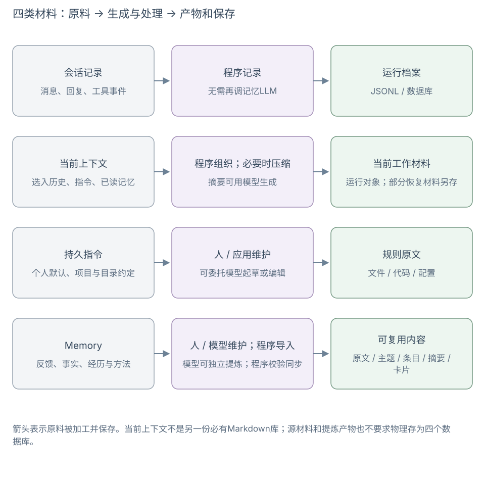

**图 1**　每行从原料走到产物与载体。程序记录、程序组织、人工维护和模型提炼是不同工作；当前上下文的运行对象不被强行画成磁盘文件。

<a id="s1-example"></a>
### 同一条信息可以产生不同记录

原话是：“订单服务修改SQL、迁移或驱动兼容性时，需要真实数据库证据；缺环境就报告尚未验收。”

| 位置 | 可能保存的内容 |
|---|---|
| 会话记录 | 完整原话、模型回复及实际工具经过 |
| 当前上下文 | 当前仍有效的原话；压缩后可能是“代码已改，真实数据库尚未验证” |
| 持久指令 | 经团队明确采纳的项目验收规范；说“记住”不必然修改指令文件 |
| Memory | “订单服务相关兼容性改动须有真实数据库证据”这条带范围的反馈 |

用户画像、反馈、项目动态是记忆内容；向量、目录和图关系是组织或查找内容的方法。

<a id="s1-memory-types"></a>
### Memory 里保存的内容也有不同形态

Memory 不是只有一种“要点”。常见内容可以分为三种：

| 内容形态 | 保存什么 | 本文实例 |
|---|---|---|
| 事实、偏好和决定 | 谁喜欢什么、项目采取了什么约定 | Claude 的 `user`、`feedback`、`project` |
| 事件和经历 | 某次任务发生了什么、做过哪些验证 | Codex 任务摘要、OpenClaw 日记、ReMe daily |
| 程序性经验 | 什么场景按什么步骤做、前提是什么、失败怎么办 | Hermes 的技能形式记忆、ReMe 的 `procedure` 笔记 |

这三种是**内容形态**，不是三种必须存在的存储层。压缩摘要、任务状态、standing intent 和技能包各有自己的生命周期；除非产品明确把它们作为长期记忆维护，不能统一塞进 Memory。

<a id="s2"></a>
## 2. 记忆怎样生成、保存和更新

<a id="s2-record"></a>
### 2.1 会话记录：程序保存已经发生的经过

**原料与生成：** 原料是用户消息、已生成的模型回复、工具事件等。模型生成回复，程序记录这些现成事件；保存档案通常不需要再调用一次记忆模型，也不必等窗口空闲。

**存储与更新：** 可以追加JSONL，也可以写数据库的会话/消息表。程序可能过滤字段、限制输出，或把大结果另存后记录位置。“会话记录”不保证保存所有信息，记录方式、保留期和归档规则以具体实现为准。

**为什么：** 经过便于追溯和恢复，却包含临时细节、失败尝试及旧要求，不能因为已落盘就当成长期结论。第9章的ReMe清洗交流归档，也不能冒充主会话完整备份。

<a id="s2-context"></a>
### 2.2 当前上下文：程序组织工作信息，必要时生成摘要

**原料与生成：** 程序选择当前问题、有效历史、适用指令和已取回内容，组成当前材料。普通组织是程序工作；窗口不足时，可另调模型生成压缩摘要。[Anthropic上下文工程][ANT-CONTEXT]

**保存与更新：** 当前材料通常存在活动会话/状态对象中，不要求生成context.md。历史、摘要或恢复状态可以另存；哪些能跨进程恢复，取决于持久化方案。不能统一说“只有内存”，也不能保证从日志逐字还原宕机前状态。

摘要可含目标、决定、进度和未完成事项；任务表、依赖或工具状态仍可单独保存。AgentScope的summary与tasks_context就是不同字段，完整运行状态也不等于全部发给模型的文本。[状态定义][AS-STATE]

**为什么：** 要在有限窗口内保住眼前任务的线索。压缩节省体积但会丢细节，因此当前摘要与原始档案、长期Memory各有用途。

<a id="s2-instructions"></a>
### 2.3 持久指令：人或应用维护的约定

**原料与生成：** 人、团队或应用提供个人默认、项目规范和目录要求，也可委托模型分析仓库、生成初稿或编辑文件。这是明确的文档维护，不是每次聊天自动提炼。

**存储与更新：** 完整产品常用全局/项目文件，路径规则可另拆；SDK应用也可以把指令保存在代码、配置或服务里。修改原文件/配置不必等后台经验整合。AgentScope本例由应用传system_prompt，不自动创建一套全局AGENTS目录。

**为什么：** 指令表达“应当怎么做”，Memory保留“经历后值得记什么”。明确维护稳定约定，可减少把一次临时选择误升为长期规则。指令仍是模型指导，重要操作的程序强制执行另有机制，本文不展开。[Claude指令][CC-MEMORY]、[Codex指令][CX-AGENTS]

<a id="s2-memory"></a>
### 2.4 Memory：从原料筛出以后值得复用的信息

**原料：** 用户纠正、偏好、任务经过、结果及项目动态等。实际输入可包含助手回复和工具材料，也可能过滤、限长；不能一概说“只看问题、不含输出”。

| 生成路径 | 谁决定内容 | 何时发生 | 保存什么 |
|---|---|---|---|
| 人直接维护 | 人；可委托模型编辑 | 明确编写或更正时 | 指定记忆文件或条目 |
| 程序直接纳入原文 | 应用按范围导入/索引合格记录，不调用提炼LLM | 明确导入、记录写入或配置的索引触发 | 原文/片段与来源，可供未来召回 |
| 主模型写笔记 | 主模型判断，工具执行写入 | 用户要求记住，或模型工作中判断需要 | 主题、精选条目、画像等 |
| 独立提炼与整合 | 程序选原料，额外记忆Agent调用LLM | 合格回复收尾、旧任务空闲后、定时或手动整理，依实现而定 | 单次摘要、每日卡、候选、综合笔记等 |

Memory不必先经过提炼。Mem0的infer=False就允许原文保存；原文是否值得纳入和是否会被正确使用仍需判断。[原文保存][MEM0-ADD]

“额外记忆Agent”不要求换模型型号，它可以用同一种模型处理不同输入。后台只说明调度位置，不说明每问必运行，也不说明前台一定不用等。

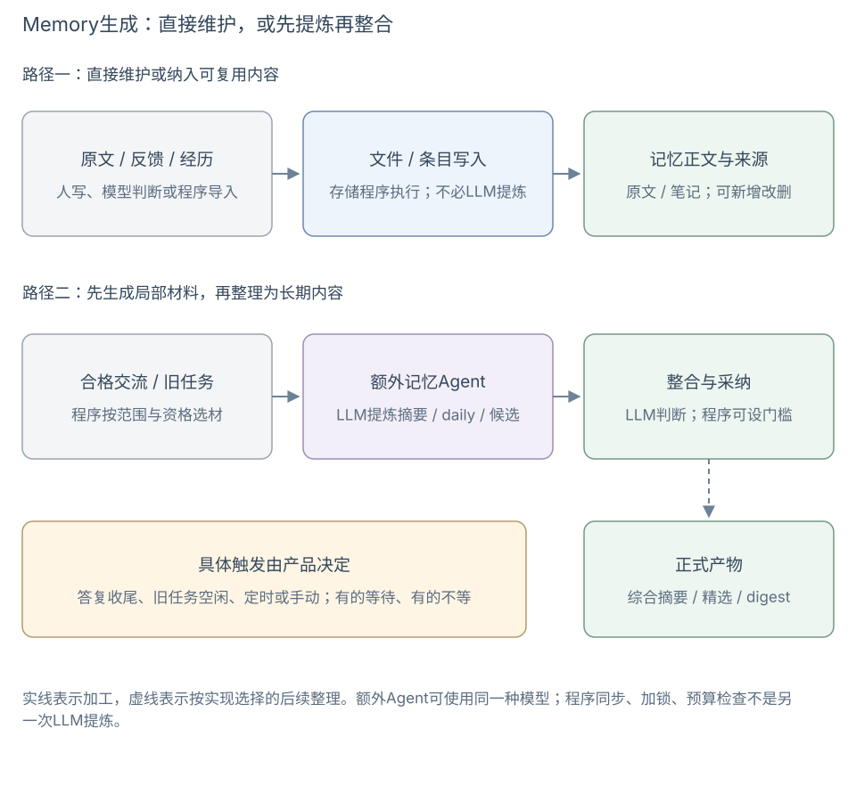

**图 2**　上路直接维护记忆，下路先提炼再整合。虚线表示按具体产品选择的阶段，不要求每家都有候选目录或固定两次模型调用。

**存储：** 可能是“入口＋主题”、两份短文本、“单次摘要＋综合摘要”或条目数据库。目录、正文、来源和维护状态共同组成实际机制；文件同叫MEMORY.md，不代表含义相同。

**更新：** 有的直接改原笔记，有的先新建更正便笺再整合，有的需候选采纳。新增、纠正、合并、失效和清理分别核对。过期隐藏、降低排名与物理删除不是同一动作。

**为什么：** 提炼能缩短内容、合并重复信息，但模型可能漏条件或记错；多阶段整理便于集中处理跨任务经验，却增加费用与发布延迟。不能只数层数或文件数评判效果。

<a id="s2-use"></a>
### 2.5 简要使用方式

当前任务使用整理后的上下文；继续旧任务可读已保存历史/摘要；适用指令和少量Memory入口可先提供，细节再按需读取或检索。文件写好不等于正在运行的会话已采用新版。后文重点比较生成和存储，仅简述读取。

<a id="s3"></a>
## 3. 记忆的构建链和查找链

第 2.4 节已经按生命周期解释 Memory 怎样产生和更新。本节只把它抽象成两条辅助链，避免把查找表示、内容形态和任务状态误当成新的记忆分类。

<a id="s3-index"></a>
### 3.1 构建链：从原料到正式记忆

**是什么：** 构建链决定哪些经历能从原料变成以后可复用的正式内容。它包括筛选、直接写入或提炼、去重与合并、范围和来源校验、采纳发布，以及后续更正或废弃。

**为什么：** 原始会话包含临时细节、失败尝试和互相修正的说法，不能直接等同于稳定结论。构建链把“发生过”变成“值得以后采用”的内容，同时保留范围和来源。代价是模型可能漏掉条件、误合并或延迟发布；简单个人笔记不必为了完整而强行增加多阶段管线。

| 阶段 | 谁做什么 | 可能产物 |
|---|---|---|
| 筛选 | 程序按范围、资格、时间或消息类型选原料 | 本轮增量、合格旧任务、候选记录 |
| 直接写入 | 人或主模型把已确认内容写入；程序负责权限、格式和落盘 | 主题文件、短条目、日记、原文记录 |
| 提炼与整合 | 记忆Agent调用LLM生成摘要、卡片或候选，再合并已有内容 | 任务摘要、daily、候选、综合摘要、digest |
| 校验与发布 | 程序检查格式/来源/范围，人或模型决定采纳与更正 | 正式Memory、版本、撤销或废弃状态 |

这条链可以在一次写入中完成，也可以跨答复收尾、旧任务空闲、夜间整理或手动维护多次完成。Claude 的官方文档确认 auto memory 由 Claude 维护、保存 learnings and patterns；它没有公开一个适用于所有版本的固定后台提炼次数。Codex、OpenClaw、ReMe 的阶段和触发以各自章节的实现为准。[Claude自动记忆][CC-MEMORY]、[Codex整合][CX-PHASE2]、[OpenClaw整理][OC-DREAM]、[ReMe提炼][AS-AUTO]

构建链的两条路径已在第 2.4 节图 2 展示；这里保留阶段表，避免重复画同一条链。

程序性经验属于构建出来的一种内容形态：Hermes 把任务方法和相关纠正优先写技能形式的程序性记忆，ReMe 把方法存为 `procedure` 笔记；这不等于所有 Agent 都会自动生成可执行技能。[Hermes程序性记忆][HM-SKILLS]、[ReMe方法笔记][AS-INTEGRATE]

<a id="s3-links"></a>
### 3.2 查找链：从正式记忆到当前上下文

**是什么：** 查找链解决“正式记忆已经存在，当前问题怎样找到它”。常见表示有四种：目录/文件路径、关键词索引、向量表示，以及带来源和时间的关系指针。它们都指向正文或原始证据，不能替正文承担事实责任。

**为什么：** 少量、主题明确的笔记适合目录和路径；语料变多、说法变多时，关键词或向量有助于缩小候选；只有查询依赖实体关系和事实何时成立时，时间图才值得增加。每增加一种表示，就增加编码、更新、误命中、失效链接或关系抽取的维护成本。

**怎样生成和保存：** 程序或模型为正文保存名称、路径、关键词、来源和版本；需要时再调用关键词、向量或关系查询，返回片段/位置，最后读取正文并装配进当前上下文。新增、更正、删除后派生表示可能滞后；重建索引不改写正文，也不清除已经进入旧会话的副本。

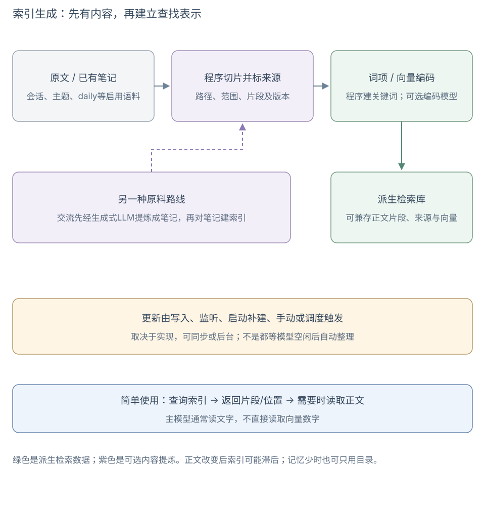

**图 3**　从上到下看原料、编码和派生检索库；紫色支线是可选的内容提炼。查询返回文字或位置，正文改变后索引另行更新。

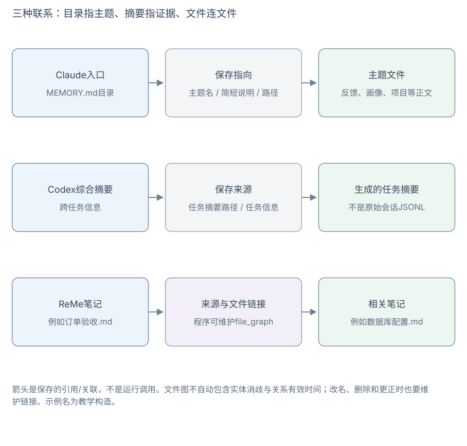

**图 4**　三行分别展示目录、任务来源和文件关联。箭头表示保存的引用，不表示运行调用；三种联系不等同于实体与时间图。

Claude 官方强调轻量入口和运行时按需读取；Letta 也把常驻文件与文件树按需读取分开。Graphiti/Zep 这类时间图是外接的专用方案，不是五个主例的共同默认层。[Anthropic上下文工程][ANT-CONTEXT]、[Letta][LETTA]、[Graphiti][GRAPHITI]

**五个实例的差别只在这里核对：** Claude 有入口和主题文件；Codex 有综合摘要与任务证据指针；OpenClaw 有笔记索引和可选会话检索；Hermes 用短文本预载、FTS5 查历史；ReMe 默认查 daily/digest，并维护来源和文件关系。是否有向量、关系图或额外 provider，以各自配置为准。[OpenClaw搜索][OC-MEMORY]、[ReMe配置][AS-CONFIG]、[Hermes历史工具][HM-SEARCH]

<a id="s4"></a>
## 4. 五种实现的分类与存储对照

<a id="s4-classes"></a>
### 4.1 四类是否具备，分别保存在哪

| 类别 | Claude Code | Codex V2 | OpenClaw主例 | Hermes | AgentScope＋ReMe本例 |
|---|---|---|---|---|---|
| 会话记录 | 有，程序写JSONL | 有，程序写Rollout JSONL | 有，运行会话在每Agent SQLite | 有，state.db | 有运行历史；主档案由应用保存，ReMe另存清洗归档 |
| 当前上下文 | 活动对话；恢复材料另存 | 内存历史/状态；恢复项另存 | 运行对象，历史/摘要有持久表示 | 历史及系统快照，部分另入库 | AgentState；跨进程保存由应用负责 |
| 持久指令 | CLAUDE及rules文件 | AGENTS及覆盖链 | 工作区规则/身份文件 | SOUL及项目指令 | 应用提供；本例不自动建指令目录 |
| Memory | 入口＋主题文件 | 启用V2后有便笺、任务摘要、综合摘要 | 日记、画像、精选、整理状态 | MEMORY/USER短文本；方法另存 | 装配后有daily/digest及索引 |

**相同之处：** 程序记录经过、人或应用维护指令、程序组织当前材料，基本分工接近。JSONL与数据库是不同落地；AgentScope本例尤其需要应用负责主状态，不能说五家都自动持久化全部聊天。

**实质差异：** Memory的原料、作者、触发、加工阶段和成品不同。未证实任何两套完整Memory只是换文件名；MEMORY.md在不同产品里可能是目录、精选正文或短条目文件。

<a id="s4-generation"></a>
### 4.2 Memory从什么原料变成什么产物

| 实例 | 原料与生成者 | 何时生成 | 产物与维护 |
|---|---|---|---|
| Claude Code | 纠正/偏好/项目动态；Claude选择、文件工具写，人可改 | 明确要求或工作中判断；不保证每会话都记 | 主题＋入口；程序补元信息/检查预算 |
| Codex V2 | 合格旧任务由模型提炼；明确维护请求由主模型写便笺 | 资格、空闲、配额等满足；便笺可先写 | 任务摘要和便笺两路整合，发布综合摘要 |
| OpenClaw | 前台记录；后台模型在程序门槛内整理 | 日常、明确要求、压缩前机会、定时整理分别触发 | 日记与精选分开；采纳后发布，报告/状态另存 |
| Hermes | 主模型记忆工具；条件复盘；人可手改 | 当下判断或review门槛满足 | 两份短文本按条目增改删；方法优先进技能 |
| AgentScope＋ReMe | 中间件交增量，额外记忆Agent提炼 | 合格收尾等待；夜间/手动再整合 | 同一增量分别归档和提炼daily，再整合digest；程序另建索引 |

<a id="s4-cost"></a>
### 4.3 哪些较轻，哪些较重，重在什么地方

这里的轻中重是对本文所选记忆机制的判断，不是同负载费用排名。文件多不一定贵；额外模型处理多少历史、执行几步、多久执行一次，以及记忆反复占用多少输入，才决定主要Token成本。向量编码和索引另有成本。

| 实例 | 本例的轻重 | 主要额外处理 | 为什么付出这笔成本 |
|---|---|---|---|
| Claude Code | 文件方案较轻；总费用待实测 | 主模型选材、维护入口与主题；后台细节未形成统一公开契约 | 用少量可编辑笔记复用经验，详细内容按需读 |
| Codex V2 | 中到重 | 合格旧任务提炼，再与维护便笺一起跨任务整合 | 多次工作的经历保留来源，统一吸收更正、组织项目经验 |
| OpenClaw Memory Core | 启用后台整理时中到重 | 来源与门槛检查、后台反思整合、索引维护；部分可选召回另用模型 | 长期运行时，将现场观察和已采纳经验分开，减少噪声进入精选 |
| Hermes | 两份短文本本身轻；条件复盘可到中或重 | 主模型直接写；条件满足再启动独立模型复盘，可多步改记忆和技能 | 兼顾即时记事和任务方法学习；短文件不代表复盘便宜 |
| AgentScope＋ReMe本例 | 自动提炼与后续整合偏重 | 合格答复收尾调用记忆Agent，之后再抽取整合；程序另维护索引 | 同时保留事件笔记和可追溯的长期抽象，不把每轮交流直接定成长期规则 |

**是否必要：** 少量明确偏好，用人工维护或主模型直接记笔记即可；跨次经历多、需要合并更正和回查来源时，多阶段整理才更有价值。Anthropic发表的上下文工程文章建议从能奏效的简单方案起步，并区分低开销笔记与额外子Agent处理。它不要求所有Agent都采用后台记忆管线。[Anthropic设计建议][ANT-CONTEXT]

下面每个实例按两组文件表展开：**持久指令、Memory**。表中“全局”指该用户或配置下可跨项目使用；局部直接注明项目、Agent工作区或应用工作区。存储共享不表示每条内容适用于所有项目。文件数量会增长，表列的是文件组。

<a id="s5"></a>
## 5. Claude Code：入口与主题文件组成自动记忆

Claude Code把自动记忆保存在可编辑的Markdown入口和主题文件里，便于查看、更正，也把长期笔记与完整聊天记录分开。

<a id="s5-materials"></a>
### 5.1 持久指令：哪些全局，哪些属于项目

| 文件或文件组 | 是什么 | 怎么来、什么时候更新 | 什么时候读、怎么用 | 全局还是局部 |
|---|---|---|---|---|
| `~/.claude/CLAUDE.md`；全局无路径条件的`rules/*.md` | 个人默认做法 | 人编写，可让模型编辑；不会每问后自动重写 | 启动时程序读入，指导本会话 | 全局：当前用户，跨项目 |
| 项目`CLAUDE.md`或`.claude/CLAUDE.md` | 项目约定、测试和构建方法 | 人/团队维护；`/init`可调用Claude分析仓库起草，已有文件则建议改进 | 启动读当前目录及祖先；子目录指令在涉及其中的文件时加载 | 局部：项目或子目录 |
| `CLAUDE.local.md` | 本项目的个人补充 | 人或受托模型维护，通常不提交团队 | 随所在目录层级加载 | 局部：本项目、本人 |
| 全局或项目的`.claude/rules/**/*.md`，带`paths`条件 | 只对匹配路径生效的规则 | 人/团队按文件范围编写；与普通规则维护方式相同 | 涉及匹配文件时加载，避免所有规则常驻 | 由所在目录决定：个人全局或项目局部 |

`@文件`导入会随所属CLAUDE文件加载。当前官方还支持按配置发现项目`AGENTS.md`；这是版本补充，其发现规则与Codex的override机制不同，不能套用同名文件的覆盖关系。[官方指令与加载规则][CC-MEMORY]

<a id="s5-files"></a>
### 5.2 Memory：入口和主题各做什么

默认目录是`~/.claude/projects/<仓库映射>/memory/`；同一Git仓库的子目录和worktree共用，机器间不自动同步。

| 文件或文件组 | 是什么 | 怎么来、什么时候更新 | 什么时候读、怎么用 | 全局还是局部 |
|---|---|---|---|---|
| `MEMORY.md` | 短入口：有哪些笔记、何时该读 | Claude选择值得记的信息后维护入口；人也可改；程序检查读取预算 | 新会话预载有限的入口内容；帮助模型选择主题 | 局部：默认按仓库共享 |
| 主题`*.md`，如`feedback_testing.md` | 某条反馈、偏好、项目动态或资料位置的正文 | Claude用文件工具新建、改、合并或删除；人可编辑；程序可补修改时间 | 启动不全读，模型需要时通过文件工具读取 | 与入口相同；`type: user`不代表跨仓库全局 |

可选子Agent持久记忆仍是入口加主题，读写机制接近；区别是配置可选跨项目的`~/.claude/agent-memory/<名称>/`、项目内`.claude/agent-memory/<名称>/`，或项目个人的`.claude/agent-memory-local/<名称>/`。它们与主会话自动记忆分开。[主会话自动记忆][CC-MEMORY]、[子Agent范围][CC-SUBMEM]

<a id="s5-generation"></a>
### 5.3 哪些信息会形成主题文件

原料是纠正、确认的做法、角色偏好、代码中看不出的项目动态及外部资料位置。Claude判断是否值得未来复用，再用文件工具维护主题和入口。官方要求跳过代码/git可推导内容和CLAUDE.md已有信息，也明确不是每个会话都会存笔记。

| type | 保存内容 | 例子 |
|---|---|---|
| user | 用户角色、专长、工作偏好 | 熟悉后端，前端需要多解释 |
| feedback | 纠正及确认的做法 | 数据库兼容性要有真实环境证据 |
| project | 代码中看不出的项目动态 | 当前期限、安排、决定 |
| reference | 外部信息在哪里 | 到指定看板核对进度 |

四种是Memory内部内容标签，不是本文四类材料，也不要求四个文件夹。同类可多篇，文件名可变。[官方自动记忆][CC-MEMORY]

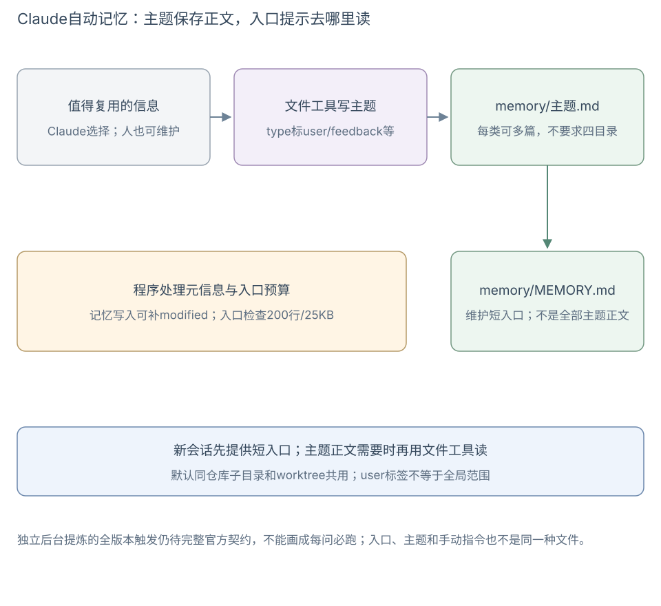

**图 5**　Claude选内容，文件工具维护同仓库的主题与入口；程序补时间戳和查预算。入口与主题不是两套互不相关的记忆。

<a id="s5-update"></a>
### 5.4 怎样更新，后台提炼能确认到哪里

模型或人可改、合并、删主题，再维护入口；程序会检查入口长度，过长时提醒精简。

记忆不随会话transcript保留期一并清理，直到人或Claude改/删。使用时目录有限预载、主题按需读；保存与当前会话采用新版仍是不同时间点。

小林专文描述答复结束后分出独立对话、模型提炼与选择笔记。当前官方未完整确认全版本的统一触发、模型选择和次数，不能写成“每答一问后台必生成”，也不能反过来断言绝无后台。[小林文章][XL-CC]、[官方范围][CC-MEMORY]

<a id="s5-example"></a>
### 5.5 一条反馈最终保存成什么

教学示例：Claude选择将验收要求存为feedback，新增主题并更新入口。

```text
memory/
  MEMORY.md                         入口新增一行
  feedback_db_acceptance.md          新建或更新主题
```

```markdown
---
name: 订单服务数据库验收
description: SQL、迁移和驱动兼容性改动时使用
type: feedback
---
订单服务相关兼容性改动须有真实数据库验证证据。
缺环境时报告“尚未验收”。原因：模拟测试不能证明实际数据库行为。
```

入口增加“订单服务数据库验收→feedback_db_acceptance.md”的说明。要求改变时修改主题和入口，不必改写全部旧聊天。

<a id="s5-design"></a>
### 5.6 为什么说文件方案较轻

官方把人工指令和自动学习分开，用短入口先提示“有什么”，详细主题再按需读。Anthropic发表的上下文工程文章也说明了“先提供少量指令，再用文件工具找细节”的设计，避免把所有资料都放进输入。[官方机制][CC-MEMORY]、[架构原则][ANT-CONTEXT]

本文判断：普通本地文件容易查看、更正，不必先部署独立记忆服务，因此组织方式较轻。代价是模型要选对主题并维护入口；写笔记和读取正文仍消耗Token。官方没有给出足以统一比较所有后台路径的调用账单，不能据此断言总费用最低。少量可复用经验适合这条路；需要大量跨来源整合时，才考虑额外管线。

<a id="s6"></a>
## 6. Codex V2：任务摘要与维护便笺共同形成综合记忆

指定Codex V2把旧任务先提炼成任务摘要，再与维护便笺一起整合发布，便于集中整理多次工作的经验，并保留任务来源。

本例采用已启用的Codex V2 Memory路线；不同版本的文件布局可能不同。[官方范围][CX-DOC]

<a id="s6-materials"></a>
### 6.1 持久指令：全局默认和项目覆盖

`$CODEX_HOME`默认是`~/.codex`，配置可改。

| 文件或文件组 | 是什么 | 怎么来、什么时候更新 | 什么时候读、怎么用 | 全局还是局部 |
|---|---|---|---|---|
| `$CODEX_HOME/AGENTS.md`或`AGENTS.override.md` | 个人跨项目工作约定 | 人或受托模型维护；不是后台提炼成品 | 启动构建指令链；非空override优先 | 全局：当前Codex配置 |
| 仓库根到启动目录各级`AGENTS.md`或`AGENTS.override.md` | 项目及子目录约定 | 人/团队维护；每层按规则选一份 | 启动按根到当前目录拼接，更具体的要求排在后面；不等于每次模型调用重扫 | 局部：项目或子目录 |

这部分仍是人工指令，基本目的与Claude相同；差异是文件发现及覆盖规则，不是多了一种记忆。[官方AGENTS规则][CX-AGENTS]

<a id="s6-generation"></a>
### 6.2 两路原料，两个不同阶段

**旧任务一路：** 新处理过程启动、环境就绪后，程序尝试派发，再查启用、资格、空闲与配额。对合格旧任务的筛选记录调提炼模型，产生单次摘要；原料可含用户、助手回复和工具材料，但会过滤、限量、去密。[输入筛选][CX-INPUT]

**维护请求一路：** 用户明确记住、更正或忘记时，若专用便笺工具已启用，主模型可用它新建ad_hoc文件；否则按V2允许的文件路径维护约定处理。便笺不先变任务摘要。

**整合阶段：** 整合模型结合所选任务摘要、便笺及已有记忆，发布memory_summary.md。无合格旧任务不等于永远不处理便笺，是否整合还看变更和维护输入；不保证每轮固定两次调用。[后台入口][CX-START]、[整合][CX-PHASE2]

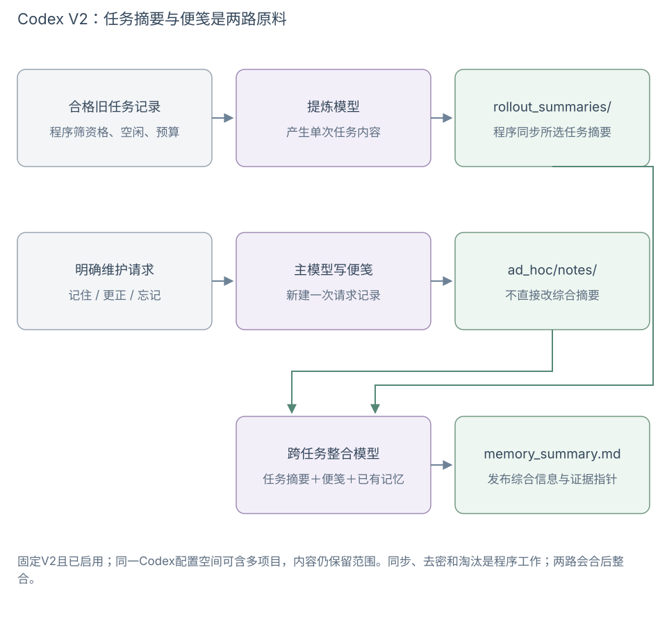

**图 6**　旧任务先产任务摘要，便笺从另一条路加入整合。不能画成“便笺→任务摘要→综合摘要”。

<a id="s6-files"></a>
### 6.3 Memory：便笺、任务摘要、综合摘要

以下相对路径均在`$CODEX_HOME/memories_v2/`下。同一配置的多项目任务共用这套空间，笔记中的项目限定仍要保留，不是每项目自动一套目录。

| 文件或文件组 | 是什么 | 怎么来、什么时候更新 | 什么时候读、怎么用 | 全局还是局部 |
|---|---|---|---|---|
| `extensions/ad_hoc/notes/*.md` | 明确记住、更正或忘记的维护请求 | 主模型按明确请求写新便笺；不直接改最终综合摘要 | 后台整合模型消费；保存后不代表综合摘要已更新 | 全局空间；每条可限定项目 |
| `rollout_summaries/*.md` | 一次任务的提炼摘要、来源与限制 | 合格旧任务交LLM提炼；程序同步所选摘要文件，可更新或淘汰 | 整合模型读取；主模型需要额外证据时再查 | 同一全局空间，内容按任务/项目限定 |
| `memory_summary.md` | 多次工作的综合信息与证据指针 | 整合模型结合任务摘要、便笺及已有摘要维护，无变化可不改 | 新任务开始由程序提供；普通第二问延续已有材料，不保证每问重新读盘 | 同一全局空间，内部按项目组织 |

整合前会先处理便笺和已有摘要的变化；这一步是后台整理，不是新增的记忆分类。

验收例子先落便笺：“订单服务相关兼容性修改须有真实数据库证据，缺环境为未验收。”旧任务可另产任务摘要，之后两路共同整合。新任务能读综合摘要，不代表其中每条项目规则都全局适用。

<a id="s6-design"></a>
### 6.4 为什么分两步，什么时候值得

固定整合模板要求保留来源、项目范围和后来的更正，避免把某次任务选择泛化为所有项目的偏好；它同时把多次经历组织成未来任务可用的短摘要。这是模板明确提出的目标。[整合要求][CX-CONSOLIDATE]

本文判断：先逐任务提炼，再集中整合，适合相关任务很多、需要吸收更正和找回旧证据的个人工作区。代价是额外模型调用、中间文件和发布延迟，所以本例是中到重；启动派发还要经过资格、空闲与预算等检查。少量明确笔记未必值得如此加工；需要的收益是少重复整理、少误用旧结论，而不是文件更多。

<a id="s7"></a>
## 7. OpenClaw：工作区规则、日记与精选分开维护

OpenClaw把规则、身份、日记、画像和精选保留为Agent工作区文件，用后台整理的来源与采纳门槛控制什么成为长期精选。

本章采用OpenClaw Memory Core文件路线，工作区可配置。

<a id="s7-materials"></a>
### 7.1 持久指令：规则、身份和首次设置

以下文件默认在`~/.openclaw/workspace`；实际以当前Agent配置的工作区为准。它是Agent自己的目录，可以服务多个项目，不等于当前执行项目。

| 文件或文件组 | 是什么 | 怎么来、什么时候更新 | 什么时候读、怎么用 | 全局还是局部 |
|---|---|---|---|---|
| `AGENTS.md`、`SOUL.md`、`IDENTITY.md` | 工作规则、性格边界、名称身份；工具环境说明在AGENTS的Tools段 | 初始化程序补模板；人或受托模型维护；首次对话确认身份 | 普通主会话按规则装入；子Agent通常只保留AGENTS。另一个执行项目可补自己的AGENTS | 局部：当前Agent工作区；另有项目指令 |
| `BOOTSTRAP.md` | 首次设置引导 | 新工作区程序生成，模型与人完成设置后删除 | 首次设置使用，不是每次新聊天重新执行 | 局部：新工作区，一次性 |
| 可选`BOOT.md` | 服务启动时要做的工作 | 人配置或委托模型编写 | 启用boot-md hook后，Gateway启动时另起临时Agent执行，可产生模型调用 | 局部：当前Agent工作区 |
| 可选`skills/.../SKILL.md` | 某项任务的方法和工具说明 | 安装、人编写，或相应技能学习功能维护；不是每次聊天自动生成 | 程序发现可用技能，相关时读正文；安装来源与启用配置决定可用性 | 工作区技能局部；个人/共享技能由各自安装目录决定 |


<a id="s7-generation"></a>
### 7.2 记录现场与发布精选是两种写入

工作过程可先写按日日记，临近压缩可另给一次模型保存现场的机会；明确要求可按资格直接维护精选。后台整理（dreaming）按配置调度，从合格日记、会话/召回信号等形成候选和整合判断；来源、门槛和写入校验由程序约束，不是每问结束必整理。

反思/整合有模型参与；机器检查、事务和实际应用写入是程序工作。未采纳不算正式精选，模型/校验失败也不当发布成功。机器候选状态由插件管理，不把所有阶段编成固定MD文件。[整理阶段][OC-DREAM]

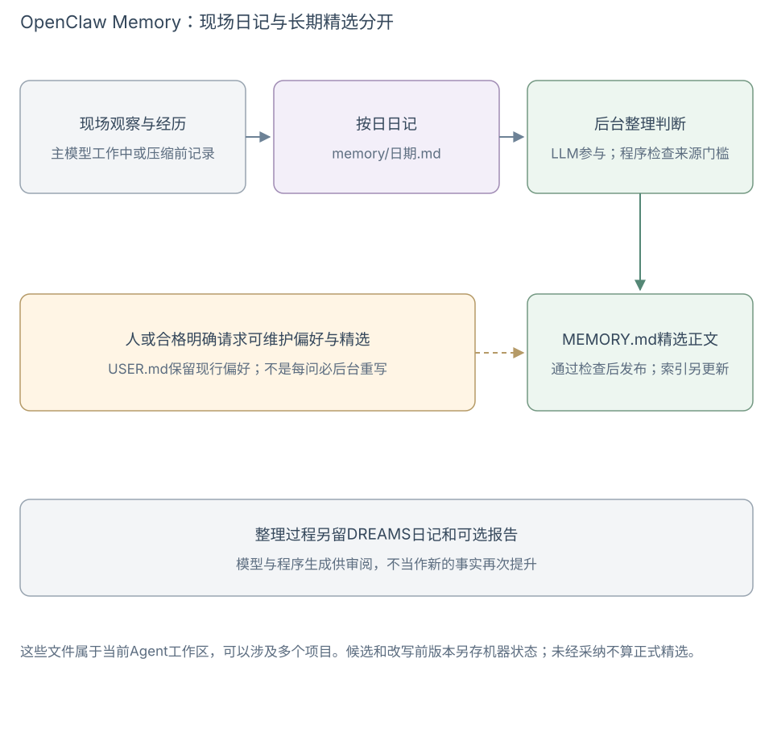

**图 7**　现场日记、现行偏好、精选发布和审阅报告用途不同。后台经门槛发布，合格明确请求可直接维护；审阅报告不再作为提升原料。

<a id="s7-files"></a>
### 7.3 Memory：偏好、日记、精选和整理报告

相对路径仍以当前Agent工作区为根。这里的`MEMORY.md`保存精选正文，不是Claude式主题目录。

| 文件或文件组 | 是什么 | 怎么来、什么时候更新 | 什么时候读、怎么用 | 全局还是局部 |
|---|---|---|---|---|
| `USER.md` | 当前有效的偏好、交流方式及有助协作的资料 | 人或受托模型维护；新偏好原位替换旧值，变化历史可留日记 | 会话开始读取；长会话后续轮次可采用更新，受资格与预算限制 | 局部：当前Agent工作区，可跨其任务项目 |
| `memory/YYYY-MM-DD.md` | 工作中发生的事、观察与待整理信息 | 主模型工作时记录，或压缩前保存现场时写；人可改 | 普通轮次按需搜索/读；仅输入/new或/reset可一次性补近期日记 | 局部：同一工作区，内容可涉及多项目 |
| 可选`memory/日期-时间.md`会话摘录 | 近期交流片段及来源，非LLM总结 | 启用session-memory hook后，在/new、/reset等事件捕获并由程序后台写；默认不调LLM，可选LLM只起文件名 | 保存后可供查找；与按日日记内容可能重叠 | 局部：工作区文件，来源是某次会话 |
| `MEMORY.md` | 精选事实、决定和短经验正文 | 人可编辑；明确维护请求可直接处理，后台LLM整合经程序门槛和校验后发布 | 适用私人会话按预算提供，后续轮次刷新；需要细节再查日记 | 局部：当前Agent工作区，多项目内容须标范围 |
| `DREAMS.md`、可选`memory/dreaming/<阶段>/日期.md` | 这次整理的结果与说明 | 后台模型和程序生成，没采纳也可记录结果 | 主要供人审阅，不作为新的事实再次提升；不是全部聊天都常驻的笔记 | 局部：当前Agent工作区 |

**辅助数据：** 程序另在SQLite等位置维护来源、候选、改写前版本和查找索引。索引可含关键词与向量；文件变化后还要更新，不把数据库状态当成新一类记忆正文。[用户模型][OC-USER]、[生成与检索][OC-MEMORY]、[整理产物][OC-DREAM]


<a id="s7-example"></a>
### 7.4 同一条验收反馈怎样保存

教学示意，文件名与文字不代表固定自动输出：

| 位置 | 可能保存的文字 | 由谁、何时写 |
|---|---|---|
| memory/2026-11-18.md | 本次仅跑模拟测试；用户要求订单服务兼容性修改提供真实数据库证据 | 前台模型记现场，或获准保存现场时写 |
| MEMORY.md | 订单服务SQL、迁移及驱动兼容性修改须有真实数据库证据；缺环境报告未验收 | 合格明确维护直接写，或后台整理通过门槛后发布 |
| USER.md | 此例不必写入 | 项目验收约定不自动升级为所有项目的用户画像 |

同一句反馈可能先只在日记中，也可能按资格直接维护精选，不能由“日记文件已出现”推断MEMORY已经更新。

<a id="s7-design"></a>
### 7.5 为什么保留日记，还要后台整理

官方的理由是：长期运行会产生临时观察、外部内容和重复召回，难点是决定什么值得写成长期事实。它把整理移出繁忙答复，用程序先检查来源和门槛，再让模型在合格候选中判断合并或替代；审阅报告不再循环当新事实。这是官方明确说明的设计原则。[Memory Core设计][OC-ARCH]

因此该路线比少量笔记重，额外模型工作主要在后台整理；普通读文件、固定门槛检查不等于再调一次提炼模型。本文判断：长期助手、交流多且来源混杂时，这种分工有价值；只有几条明确偏好时，不必为形式完整启用所有可选整理和召回。后台执行减少前台等待，但不免除Token费用，精选发布也可能滞后。

<a id="s8"></a>
## 8. Hermes：两份短文本记事实，方法经验另存

Hermes用一个配置目录的SQLite存会话，用两份短文本维护通用事实和用户资料，把较长任务方法与相关纠正优先沉淀为技能形式的程序性记忆。

默认配置目录为`~/.hermes`，profile可另选；本文按固定源码路线说明。

<a id="s8-materials"></a>
### 8.1 持久指令：profile身份和项目要求

`<配置目录>`默认是`~/.hermes`；可用独立配置身份（profile）分开助手设置与记忆，具名profile通常位于`~/.hermes/profiles/<名称>/`。

| 文件或文件组 | 是什么 | 怎么来、什么时候更新 | 什么时候读、怎么用 | 全局还是局部 |
|---|---|---|---|---|
| `<配置目录>/SOUL.md` | 当前助手的身份和风格 | 人、配置分发或受托模型维护；缺少时用默认身份 | 构建系统提示时加载，不从任意项目SOUL替代它 | 全局：当前profile内，跨项目使用 |
| 项目`.hermes.md`/`HERMES.md`，或适用的`AGENTS`、`CLAUDE`、Cursor规则 | 当前项目/目录的工作要求 | 人或受托模型维护，不是记忆工具自动提炼 | 按固定优先规则选一种项目指令来源；不是把所有同类文件一起读 | 局部：项目或目录 |

本快照优先找Hermes项目指令，再考虑AGENTS链、当前目录CLAUDE及Cursor规则；AGENTS链中同层override优先。区别在指令发现，基本用途与前两家相同。[固定发现规则][HM-PROMPT]

<a id="s8-generation"></a>
### 8.2 主模型写入与独立复盘分别触发

主模型从交流判断值得记，调用记忆工具选目的地，不是程序看到“记住”就写USER。程序校验、加锁、重读合并、原子写入；这些保存动作不再调用记忆LLM。

达到计数、资格和开关等条件后，可另起复盘任务，额外LLM看历史副本/摘要，判断是否改记忆或方法，也可能不写。它直接维护相应产物，不必先经过Codex式综合发布文件。计数门槛不等于到数必改文件。[固定review][HM-REVIEW]

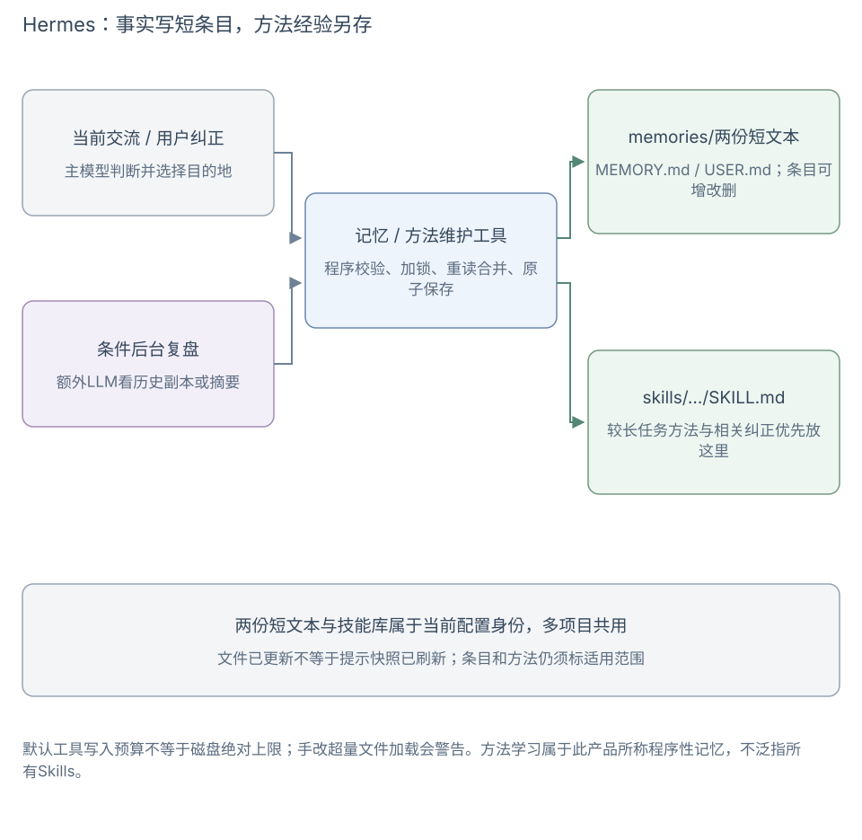

**图 8**　当下模型和独立复盘均可维护成品；短事实入两文件，任务方法优先进技能。锁、合并和落盘是程序工作。

<a id="s8-update"></a>
### 8.3 Memory：两份短条目和方法经验

| 文件或文件组 | 是什么 | 怎么来、什么时候更新 | 什么时候读、怎么用 | 全局还是局部 |
|---|---|---|---|---|
| `<配置目录>/memories/MEMORY.md`、`USER.md` | 前者存短事实，后者存用户资料；不是入口加主题 | 主模型调用记忆工具，人可手改；条件后台复盘也可维护；程序校验、加锁、重读合并后保存 | 构建时载入短文本提示快照；中途写盘不自动替换冻结快照，压缩后重建可重载，新会话再加载 | 全局：当前profile内，多项目共用；单条仍可限定项目 |
| `<配置目录>/skills/.../SKILL.md` | 可复用的任务方法、前提、步骤及相关纠正 | 人/安装、主模型skill_manage工具、条件后台复盘维护 | 可用技能列表入提示，相关时读正文；配置auto_load可固定预载 | 当前profile技能库；方法可限定适用项目 |

换工作项目不会自动各建一套MEMORY/USER。两份短文本的读写方式相同，内容分工不同，故合并一行；技能正文较长且读取不同，另列。

MEMORY/USER按短条目增、局部改、删；提示加载后形成快照，文件中途更新不会自动替换当前提示，压缩重建或新会话时才会重新读取。[固定条目存储][HM-STORE]、[提示快照及重载][HM-SYSTEM]

任务方法、坑和相关纠正优先入技能；稳定的协作偏好才适合USER。因此下面的验收案例不要求两份短文本也各写一份。

<a id="s8-example"></a>
### 8.4 同一条验收反馈怎样保存

教学示意：主模型当下判断，或条件复盘发现旧方法不足时，可维护skills/order-db-acceptance/SKILL.md，写成“适用于订单服务SQL、迁移和驱动兼容性改动；准备真实数据库→执行相关测试→保留证据；缺环境就报告未验收”。名称为示例，不是固定生成文件名。

这是任务方法，所以本例优先进程序性记忆，不因出现“记住”就给USER新增画像，也不要求MEMORY与USER同时各写一份。若原有方法错误，应更新旧技能的前提和步骤；程序负责实际保存，后台复盘也可能判断无需修改。

<a id="s8-design"></a>
### 8.5 为什么短文本很轻，复盘却可能不轻

固定提示把短事实和较长任务方法分开；存储实现冻结提示快照，以免中途改文件反复打破提示前缀。后台复盘则复制会话给独立模型处理，评估是否值得更新Memory或技能，可执行多步工具操作，不是简单的“把两份文件再保存一次”。[方法路由][HM-PROMPT]、[复盘实现][HM-REVIEW]

本文判断：短条目便于频繁使用，复杂方法按需读，适合个人助手持续学习做事方式。代价是条目预算小，可能要删并旧内容；开启复盘还增加历史重放、模型推理和工具循环成本。因此只能说短文本载体轻，不能据此把完整学习机制算成最便宜。少量偏好可直接记，确有反复复用的方法时再评估复盘收益。

<a id="s9"></a>
## 9. AgentScope＋ReMe：先形成每日卡，再整合长期笔记

AgentScope是搭建智能体的框架，ReMe是独立的记忆管理组件，帮助手整理、保存和找回长期笔记。例如你说“订单服务改数据库驱动要做真实验证”，接入ReMe后，助手可以记下这条要求，下次相关任务再查出来，减少反复交代。本例通过适配组件把两者接在同一个程序里；ReMe也能单独运行，AgentScope可按需选择是否接入。[官方接入实现][AS-MW]、[ReMe运行方式][AS-REME-SERVICE]

这是应用装配示例，不是裸AgentScope默认完整助手；ReMe负责记忆整理，AgentScope负责承载助手运行。

**先和OpenClaw对照：** 两者都先保留经历，再把值得复用的内容整理成长期记忆。OpenClaw更像“办事的人先记现场，后台再筛选进经验手册”；ReMe更像“每次交流后请笔记员整理事件卡，之后再把卡片汇编成长期知识”。

同一条要求“订单服务改数据库驱动必须用真实数据库验证”：OpenClaw先把现场写进日记，后台筛选后进入`MEMORY.md`；ReMe在答复后先形成`daily/日期/订单数据库验收.md`，后续再整理到`digest/procedure/订单数据库验收.md`。差别在第一笔由谁写、何时整理，不在于一个有记忆、另一个没有。

<a id="s9-materials"></a>
### 9.1 持久指令：应用提供，不强制生成MD

| 文件或配置 | 是什么 | 怎么来、什么时候更新 | 什么时候读、怎么用 | 全局还是局部 |
|---|---|---|---|---|
| 应用的`system_prompt`及配置；可由代码、配置文件或自选MD提供 | 主Agent角色和工作要求 | 开发者或应用维护；本例不自动生成AGENTS/CLAUDE文件体系 | 应用构建模型输入；中间件可附加记忆搜索工具说明 | 由应用决定：可全局复用，也可项目/Agent独立 |

因此，这里的差异是“框架让应用决定指令载体”，不是缺少持久指令。[固定中间件][AS-MW]

<a id="s9-generation"></a>
### 9.2 原料怎样经过过滤与模型处理

答复收尾时，中间件把本轮新增交流交给记忆模型；程序同时保留必要的来源记录并等待每日卡写回。记忆模型决定新建、修改或跳过，之后夜间或手动整理变化的daily，形成digest长期笔记；这不是每问立即完成最终整合。[清洗提炼][AS-AUTO]、[整合规范][AS-INTEGRATE]

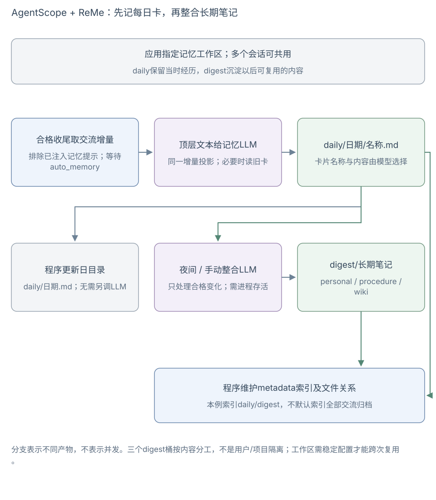

**图 9**　每日卡由记忆模型决定内容，日目录由程序更新；后续LLM再整合为长期笔记。收尾提炼需等待，夜间整理依赖进程存活。

<a id="s9-files"></a>
### 9.3 Memory：每日卡片、日目录和长期笔记

以下路径相对应用指定的记忆工作区`workspace_dir`。同一工作区可供多个会话共用；按项目分开必须由应用配置，不会因会话编号不同就自动隔离检索。

| 文件或文件组 | 是什么 | 怎么来、什么时候更新 | 什么时候读、怎么用 | 全局还是局部 |
|---|---|---|---|---|
| `daily/<日期>/<名称>.md` | 当次交流整理成的事件卡，含来源 | 合格答复收尾，额外记忆Agent用LLM判断新建、修改旧卡或跳过；文件工具保存 | 后续检索、夜间或手动整合读取，不在启动时全部预载 | 局部：指定记忆工作区，可跨其会话/项目 |
| `daily/<日期>.md` | 当天卡片的目录 | 卡片写入成功后，程序扫描元数据更新目录区块；不另调LLM写目录 | 浏览和整理时定位卡片，也可进入daily索引 | 与卡片相同 |
| `digest/{personal,procedure,wiki}/<名称>.md` | 分别保存画像/约定、方法经验、可复用知识 | 夜间或手动整合调用LLM，依据变化卡片和旧笔记合并、补证或纠正；名称由模型选择 | 后续记忆检索取回相关正文；不全量常驻 | 同一局部工作区；三个桶是内容分工，不是全局/项目隔离 |
| `daily/<日期>/interests.yaml` | 后续值得关注的主题列表 | 后续dream流程可由模型生成，不是每问都写 | 本例主问答不自动当作提醒执行；宿主应用可另接主动任务 | 局部：同一记忆工作区 |
| `metadata/`内的关键词、文件关系和可选向量索引 | 帮助查找上述笔记的派生数据 | 程序监听daily/digest变化后更新；配置embedding才有向量，显式reindex可重建 | 检索组件使用索引，主模型得到取回的文字；正文写好时索引可能尚未更新 | 同一工作区；不是另一份Memory正文 |

三种digest笔记生成和读取相同，合并一行即可。每日卡和日目录不能合成一种生成方式：前者有模型判断，后者由程序组织。[卡片写入][AS-DAILY]、[目录生成][AS-DAYINDEX]、[固定索引配置][AS-CONFIG]

`workspace_dir`要指向稳定目录才能跨次复用；官方demo默认临时目录，不能当成已经持久化的个人全局记忆。`personal`不自动隔离用户，`procedure`也不自动注册为技能工具。[示例装配][AS-DEMO]

读取简述：本例可用程序自动检索、主模型工具按需检索，或两者结合。自动检索与答复并行，结果在后续推理前就绪才注入，一次调用结束的答复可能赶不上；同会话第二问会再次按配置检索，不会全量重读daily/digest。[读取时机][AS-MW]

<a id="s9-example"></a>
### 9.4 同一条验收反馈怎样保存

教学示意，名称由记忆Agent选择，下面只展示可能的内容，不冒充固定文件格式：

| 位置 | 可能的记录 | 写入条件 |
|---|---|---|
| daily/2026-11-18/订单数据库验收.md | 本次测试只覆盖模拟环境；记录用户要求及订单服务范围 | 记忆Agent读本轮文本后判断新建；也可更新旧卡或跳过 |
| digest/procedure/订单数据库验收.md | 适用范围、真实环境验证步骤、证据要求、缺环境报告规则，附来源 | 后续整合把经验组织为方法笔记；不保证当问立即产生 |

这个例子主要形成方法知识，不要求另写personal画像。程序再按配置更新daily/digest的索引；已有JSONL或卡片，不代表digest和索引都已完成。

<a id="s9-design"></a>
### 9.5 为什么这条路径偏重，什么时候值得

**先明确对象：** 偏重的是本文装配的“AgentScope＋ReMe自动提炼与后续整合”路径，不是AgentScope框架天生必须多次调用模型。

ReMe官方把daily定位为浅加工：先留下当时的事情、决定及来源；digest定位为深加工：把多次经历整合成可复用事实、方法和知识。官方同时强调可读、可编辑、可追溯、可迁移，使用人和Agent都能操作的文件。这解释了为什么保留两种笔记，而不是每次直接覆盖一份最终摘要。[固定版本设计目标][AS-FILE-DESIGN]

| 多做的一步 | 解决什么问题 | 代价与必要性 |
|---|---|---|
| 收尾先提炼每日卡 | 及时把本轮交流组织为有来源的局部经历，避免只依赖主模型当时是否想起记笔记 | 增加记忆LLM调用；本例收尾还要等待写回，低价值交流也有处理开销 |
| 后续再整合长期笔记 | 多次任务之间归并事实、方法与更正；单次选择暂留卡片，不立即泛化成长期规则 | 再增加模型处理、合并错误风险和沉淀延迟；只处理变化输入可减少重复工作 |
| 正文之外维护索引与来源链接 | 记忆增加后仍可查找，并能从长期结论回到依据 | 程序维护成本，向量启用后有编码成本；索引与正文可短暂不同步 |

前两步有LLM参与，最后一项主要是程序及可选编码模型，不能按“几个文件”估算为固定几次LLM调用。[整合流程][AS-DREAM-DESIGN]、[实际中间件][AS-MW]

**是否值得：** 本文判断，持续交流、需要跨次归并和追溯依据的助手更适合这条路径；只有几条明确偏好时，简单笔记通常足够。Anthropic发表文章认可低开销结构化笔记，也强调按任务选更复杂架构。因此不能把两阶段整理写成所有Agent的必需品；是否增强，要看减少了多少重复说明、错记和旧结论误用，再扣除新增模型及维护成本。[Anthropic取舍原则][ANT-CONTEXT]

<a id="s10"></a>
## 10. 企业使用：个人记忆照常维护，团队共享按需接入

<a id="s10-enterprise"></a>
### 10.1 四类职责继续沿用，共享是一项可选扩展

**企业使用不要求重新划分前文四类职责。** 会话记录仍保存经过，当前上下文仍组织本次材料，持久指令仍表达约定，Memory仍保存可复用内容。生成、保存和取回的基本链路可以延续；是否换成云端日志、条目服务或其他后端，取决于实际部署。

需要团队共享时，可以复用现有项目文档、规则文件或知识库，以下统称**团队共享资料／记忆**。其中，明确规范按指令使用，经过确认的经验可作为Memory，普通资料按任务读取。没有足够共享收益时，可以暂不建设独立知识库。这些说法是本文的架构归纳，不是厂商发布的统一四类标准。

本章只增加三个讨论点：个人记忆与共享资料怎样分别保存；有价值的个人经验怎样进入团队维护范围；两边内容冲突及跨项目适用范围怎样判断。权限、任务系统和成果系统不扩写成另一套记忆架构。

<a id="s10-categories"></a>
### 10.2 AWS实际案例：共享企业资料，个人记忆仍各自保存

AWS在2026-11-16发表的员工助手案例采用如下组合。案例公司是教学构造，文章包含实现代码与演示轨迹，不是客户上线效果报告。[AWS工程案例][AWS-KB-MEM]

| 保存内容 | 实际承载 | 归属与生成 |
|---|---|---|
| 企业资料 | S3原件与共享知识库 | 团队维护资料，按文档权限读取 |
| 个人会话经过 | AgentCore Memory原始事件 | 程序按用户和会话保存问答 |
| 个人长期记忆 | 同一服务内的长期记录 | 后台提炼与整合，按用户范围保留 |

这个例子说明：共享知识来源与个人记忆可以分开维护，共用服务不等于共用每条记忆。原始事件和长期条目可对应前文的会话记录与Memory；它们进入本次上下文，也没有因此产生新的记忆类别。

AWS长期记忆深读进一步说明后台生成：LLM提炼新信息，再结合同一范围的相关旧记录决定新增、更新或忽略，程序应用结果。该内置路径没有人工审批必经步骤。因此，“个人经验提交团队后审核”应作为团队共享的一种流程，不能拿来概括所有个人记忆的生成。[AWS长期记忆深读][AWS-MEM-DEEP]

<a id="s10-build"></a>
### 10.3 共享经验怎样来：个人继续记，值得共享的内容再提交

**本文采用的团队协作方案：** 个人记忆继续按原Agent机制维护；人或AI发现可复用经验后提出更新，由有权维护者检查，再写入现有共享文档或知识库。它不要求复制个人全部聊天，也不要求换掉原来的四类存储。

| 时间点 | 谁处理 | 保存在哪里 |
|---|---|---|
| 工作中产生反馈、观察或经验 | 主模型、后台记忆模型或人，依原Agent实现 | 个人会话与个人Memory；生成方式见前文 |
| 发现内容值得团队复用 | 人提交，或AI整理为可检查的修改建议 | 现有文档修改稿、PR或知识库待审内容；注明依据和适用条件 |
| 采纳共享更新 | 有权维护者检查内容、范围和依据 | 团队维护的有效文档或经验版本 |
| 后续使用与纠正 | 成员或Agent按需读取；发现错误再提出修改 | 更新共享正文；采用索引时同步派生索引 |

正文可以直接是Markdown，也可以是知识库条目；PR和审核是协作方式，不是新增记忆层。成员需要同步或重新读取新版，保存成功不等于所有旧会话已经采用。

Anthropic在Managed Agents发表文章中也讨论工作中记经验、后台整理跨会话和跨Agent经验，并允许自动更新或先审查。**这里选择审核后共享，是本文的团队维护方案；官方没有要求每条Memory都由人审批。**[Anthropic平台文章][ANT-MA-NEWS]

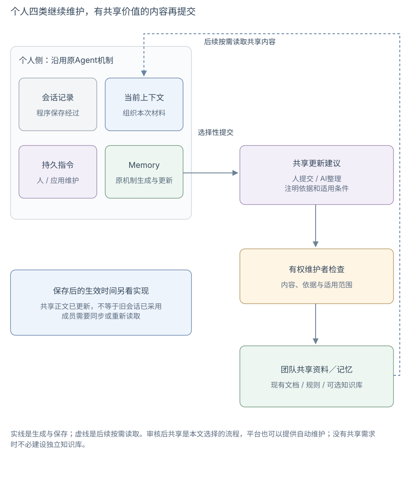

**图 10**　实线表示生成与保存，虚线表示按需读取。四类职责继续存在；图中审核链是本文选择的共享流程，个人记忆仍按原Agent机制生成和更新。

<a id="s10-change"></a>
### 10.4 内容冲突时，按内容性质判断谁优先

个人内容可能更新更快，团队资料也可能滞后；团队正式规范又不能被个人随手记的一句话取消。若个人材料含有较新证据且适用，可以先核对，**最终采用哪条结论仍按内容性质判断**。需要规范和验收条件的任务，仍应读取或核对有效要求，不能因为本地已有答案就跳过。

以下是本文判定建议，**没有查到Anthropic或AWS按个人／团队归属固定排序的统一规则**：

| 遇到的内容 | 优先依据 | 例子与边界 |
|---|---|---|
| 个人表达与协作偏好 | 本人最近明确的偏好 | 喜欢中文、先给结论；强制交付格式仍需满足 |
| 当前事实、进展和排障观察 | 同范围、证据充分的较新信息 | 刚复现的结果可纠正陈旧共享笔记；新猜测不因较新自动变真 |
| 可复用方法与技术经验 | 适用前提与验证结果，再比较时间 | 先看项目、组件、版本与环境，个人和团队经验均可能有效 |
| 正式规范与测试验收要求 | 有权制定且仍有效的规则，以及获准的例外 | 个人旧笔记不能自动取消项目当前要求的真实环境测试 |
| 规章与强制要求 | 有效的正式来源及适用范围 | 规范的新旧以来源和生效情况判断，不以文件在本地还是团队库判断 |
| 本次测试是否通过、任务是否完成 | 本次实际证据 | “以前通过”不能证明本次通过；验收要求与测试结果分开判断 |

例如：团队笔记仍说“旧驱动有兼容问题”，个人刚在当前版本复现并验证修复，可以先采用这份新证据，同时提出共享更正；但项目要求“兼容性改动必须用真实数据库验证”仍要满足。若个人保存的是有正式来源的新版规范，也应核对采用新版，而不是盲目相信共享库里的旧版。

AWS深读用新预算替代旧预算说明较新事实的整合；Anthropic研究区分猜测与已验证笔记。两者支持关注时效和依据，但都不能直接推出“较新的普通消息有权修改正式要求”。[AWS深读][AWS-MEM-DEEP]、[Anthropic记忆研究][ANT-MEM-COMP]

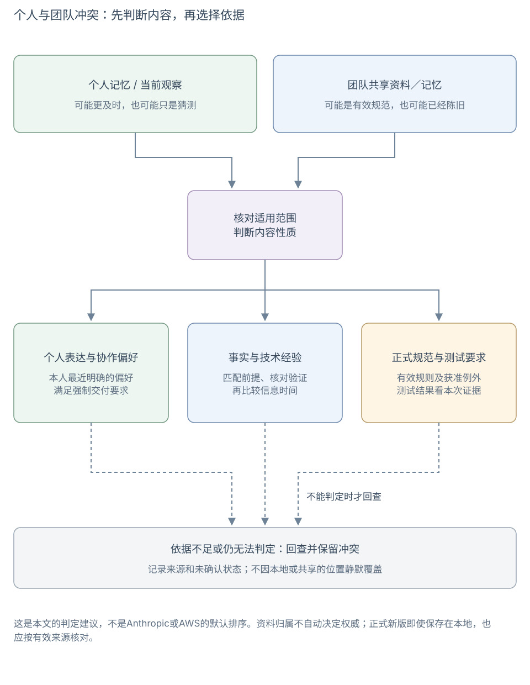

**图 11**　两份来源进入同一判定流程。规则看有效发布依据，事实与经验看适用条件、验证和时间；不能判定时保留冲突并回查。这是本文建议，不是平台默认优先级。

<a id="s10-official"></a>
### 10.5 待解决问题：一条记忆究竟适用于哪些项目

**这是值得记录的架构问题，目前不先选定解决模型。** 一条个人或团队经验可能通用、只适用一个项目，也可能只适用三四个相关项目。“属于谁”与“适用于哪些项目”不是同一个问题；跨会话复用也不自动等于正确的跨项目复用。

所查官方资料覆盖到这里：

| 资料 | 已有能力 | 仍没有替业务回答的问题 |
|---|---|---|
| Anthropic发表文章及存储接口 | 跨会话／跨Agent经验；不同会话可以复用同一store，一个会话也可组合多份store | 哪些项目相关，某条内容适用于哪些项目，以及关系变化后怎样维护 |
| AWS员工助手案例 | 按人保存并取回历史与长期记录，另读共享企业资料 | 案例没有项目字段和关联项目路由，不能宣称已验证跨项目适用判断 |
| AWS范围与元数据方案 | 自定义业务范围，按元数据筛选记录 | 表示和筛选能力不等于自动确认适用关系，也不等于业务已完成授权和内容维护 |

依据分别是[Anthropic文章][ANT-MA-NEWS]及[接口补证][MA-MEM]、[AWS实际案例][AWS-KB-MEM]、[AWS范围设计][AWS-MEM-NS]和[元数据说明][AWS-MEM-META]。团队资料并非受限于单项目／通用；缺口在于范围怎样正确声明、选择和维护。

一个教学例子：订单、支付、库存三个项目共用某旧鉴权组件，运营项目已换用新组件。一条迁移经验只对前三个适用。若其他项目只查自己的资料，又没有关联入口，容易漏掉同样适用的经验；按整个产品无差别使用，又可能误导运营项目。

| 实际痛点 | 对记忆管理的影响 |
|---|---|
| 范围过宽 | 经验被带入不适用的项目，给出错误建议 |
| 范围过窄 | 有关项目找不到已有经验，重复处理同类问题 |
| 给每个项目复制一份 | 内容更正后副本分叉，有的继续过期 |
| 个人与团队没写清前提 | 不同条件下都成立的经验，被误合并或误判为矛盾 |
| 项目拆分、迁移或退出共同组件 | 原适用关系变化，但旧记忆仍被继续使用或漏用 |

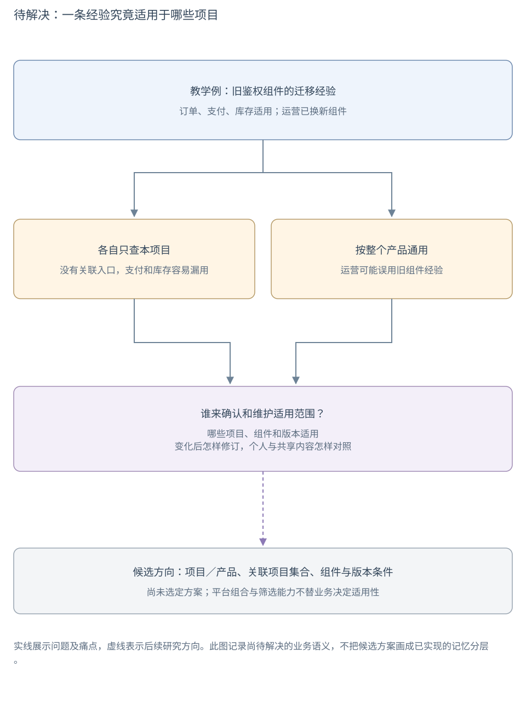

**图 12**　两条错误路线展示实际痛点；底部保留未解决的范围问题。例子为教学构造，不代表平台已实现或不能实现这种范围。

**问题记录：** 如何标明、确认和更新一条记忆的项目适用范围，并让个人记忆与团队共享内容正确对照？后续可考虑项目／产品维度、共同组件与版本条件、明确的关联项目集合。这些是候选方向，尚未选择；所查公开方案未给出能直接照搬的完整规则。

<a id="s10-adoption"></a>
### 10.6 为什么保持这套分工

个人继续按原机制积累经验，能及时利用新发现；团队只维护值得共同复用的内容，减少重复交代。项目规范、共享经验和个人偏好各按性质判定，可以避免陈旧笔记压过新证据，也避免普通经验擅自改变正式要求。

资料少、已有文档可用时，沿用现有维护方式即可。检索遗漏、重复整理或规模问题确实出现后，再评估索引、后台整合等机制；它们的原理见第3章，不另造企业专属分类。Anthropic研究也观察到wiki并非对所有任务有收益，因此知识库建设应根据任务验证。[记忆组件研究][ANT-MEM-COMP]

企业部分的结论是：**四类职责继续沿用；团队共享按需要接入，内容采用按性质和依据判断，跨项目适用范围作为明确的待解决问题保留。** 这是一套有公开实现依据的总体思路，不代表项目／产品范围及冲突判定已经自动实现。

<a id="s11"></a>
## 11. 设计取舍与总结

<a id="s10-design"></a>
### 11.1 为什么会有不同的生成与存储结构

| 需求 | 对应选择 | 好处 | 代价与边界 |
|---|---|---|---|
| 少量项目记忆易检查 | 入口＋主题、可编辑短文件 | 本地可看可改，部署简单 | 仍需组织、处理冲突漏记，不证明纯文件普遍最佳 |
| 多次任务统一整理 | 任务摘要/卡片再整合 | 分开局部经历与跨任务结论，留来源 | 额外LLM、遗漏误合并、发布延迟 |
| 现场信息不直接变长期规则 | 日记、候选、精选分开 | 可设采纳条件并留审阅线索 | 更多维护状态，门槛不保证绝对正确 |
| 事实短、方法长 | 短事实＋程序性方法产物 | 控制常驻内容，复用详细做法 | 路由验证复杂，错误方法也会复用 |
| SDK让应用组合 | 主状态与记忆组件分离 | 可选择存储、提炼和组织方式 | 应用承担保存、目录与生命周期 |

机制来自官方/固定源码，表中跨产品适用判断是本文分析。启动快只是一个目标，生成费用、保真、可更正、来源、维护和恢复责任同样重要。[Anthropic原则][ANT-CONTEXT]

<a id="s10-evidence"></a>
### 11.2 怎样判断生成的记忆确实有用

官方说明机制和明确理由，研究论文检验某类设计，本文推断讨论场景，分别看。LongMemEval的消融提示摘要/事实完全替代原文会损失部分信息；LoCoMo又在其长期对话设置发现精选观察有益。任务、模型、证据保留和预算不同，不能拼成“全部原文”或“全部提炼”的普遍结论。[LongMemEval][LONGMEM]、[LoCoMo][LOCOMO]

方法知识也要看反馈和验证。Voyager研究执行反馈、模型参与的完成判断、技能保存和复用；ReMe论文研究经验提炼维护，但论文设置不是本文file-native配置的第三方复现，均不能移植成五产品排名。[Voyager][VOYAGER]、[ReMe论文][REME-PAPER]

保存→以后取回是复用链；结果→更正/废弃→更新内容和索引→后续验证，才形成维护改进闭环。它改变应用记忆和做法，没有训练步骤就不是模型权重自训练。检查漏记、错记、范围误用、更正生效、证据保留和总成本，不只看文件变多。

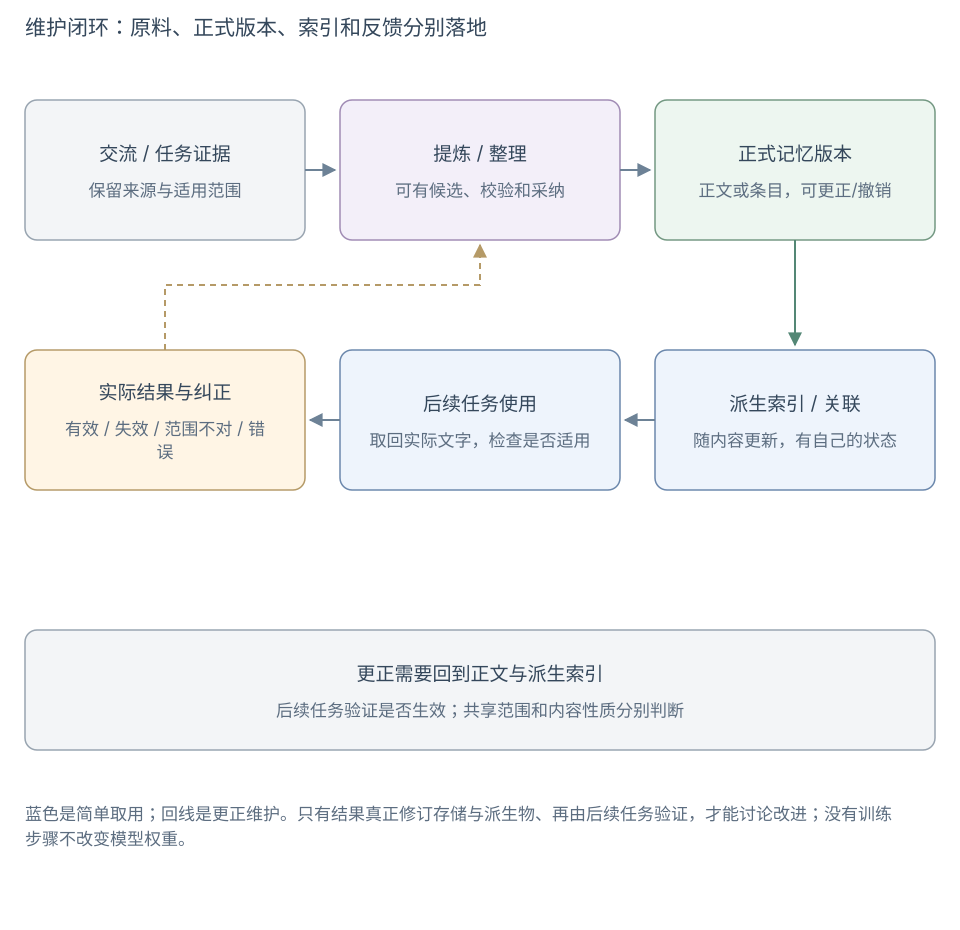

**图 13**　原料、候选、正式内容和索引分别维护；结果可回到更正与采纳。维护闭环改变应用的记忆与做法，后续效果仍须验证。

<a id="s10-sources"></a>
### 11.3 版本、来源与复核

| 对象 | 证据范围 |
|---|---|
| Claude Code | 2026-11-20补核指令、Memory文件与范围；小林后台链另标未确认范围 |
| Codex | V2固定cbd494409262f23c4d8534b993337a5b4e2f522e；当日官方补启用/客户端范围和sessions根目录 |
| OpenClaw | 2026-11-20补核官方Memory Core及会话专页，未固定commit，不反推旧版 |
| Hermes | 固定450ad5055eb3c4852d96676ee99287d618bd283a |
| AgentScope/ReMe | AgentScope e6c014f0be49b2a6f6f62a9453082a0b975484e1；ReMe 5a3450ddb36b1ab908ee434f45f7499aa9e74dcd |
| 企业差异 | 2026-11-20补核Anthropic发表文章与AWS实际案例；接口仅作落地补证，内容优先级为本文建议，项目适用范围列为待解决问题 |

小林文章用于寻找实现与解释；通用篇的感知、短期、长期、实体是教学分类，未核实统一承载项目叫“小林通用Agent模型”，不并列为第六套系统。实际机制以官方说明和固定源码为主。[小林通用篇][XL-MEM]、[Claude专文][XL-CC]、[Codex专文][XL-CX]

本文为静态研读，未做五产品端到端实验，也未找到覆盖本文五个固定实现、控制任务模型并隔离Memory贡献的统一独立对照。企业章节依据公开文档讨论机制与取舍，示例架构不代表某产品全部默认具备。

<a id="s10-next"></a>
### 11.4 下一步：从文件变化验证生成链

从空目录记录原料、生成调用和文件/库变化，再测更正、重复、失败及重启；分别检查四类产物，不把教学样例当实测。

[ANT-CONTEXT]: https://www.anthropic.com/research/effective-context-engineering-for-ai-agents
[CC-MEMORY]: https://code.claude.com/docs/en/memory
[CC-SESSIONS]: https://code.claude.com/docs/en/sessions
[CX-AGENTS]: https://learn.chatgpt.com/docs/agent-configuration/agents-md
[CX-DOC]: https://learn.chatgpt.com/docs/customization/memories
[CX-TROUBLE]: https://learn.chatgpt.com/docs/reference/troubleshooting
[CX-POLICY]: https://github.com/openai/codex/blob/cbd494409262f23c4d8534b993337a5b4e2f522e/codex-rs/rollout/src/policy.rs
[CX-INPUT]: https://github.com/openai/codex/blob/cbd494409262f23c4d8534b993337a5b4e2f522e/codex-rs/memories/write/src/rollout_input.rs
[CX-START]: https://github.com/openai/codex/blob/cbd494409262f23c4d8534b993337a5b4e2f522e/codex-rs/memories/write/src/start.rs
[CX-PHASE2]: https://github.com/openai/codex/blob/cbd494409262f23c4d8534b993337a5b4e2f522e/codex-rs/memories/write/src/phase2.rs
[OC-SESSION]: https://docs.openclaw.ai/concepts/session#where-state-lives
[OC-WORKSPACE]: https://docs.openclaw.ai/concepts/agent-workspace
[OC-MEMORY]: https://docs.openclaw.ai/concepts/memory
[OC-ARCH]: https://docs.openclaw.ai/concepts/memory-architecture
[OC-USER]: https://docs.openclaw.ai/concepts/user-model
[OC-DREAM]: https://docs.openclaw.ai/concepts/dreaming
[OC-INTENTS]: https://docs.openclaw.ai/concepts/standing-intents
[HM-STORE]: https://github.com/NousResearch/hermes-agent/blob/450ad5055eb3c4852d96676ee99287d618bd283a/tools/memory_tool_store.py
[HM-SESSION]: https://github.com/NousResearch/hermes-agent/blob/450ad5055eb3c4852d96676ee99287d618bd283a/website/docs/developer-guide/session-storage.md
[HM-PROMPT]: https://github.com/NousResearch/hermes-agent/blob/450ad5055eb3c4852d96676ee99287d618bd283a/agent/prompt_builder.py
[HM-REVIEW]: https://github.com/NousResearch/hermes-agent/blob/450ad5055eb3c4852d96676ee99287d618bd283a/agent/background_review.py
[HM-SKILLS]: https://hermes-agent.nousresearch.com/docs/user-guide/features/skills#agent-managed-skills-skill_manage-tool
[HM-SEARCH]: https://github.com/NousResearch/hermes-agent/blob/450ad5055eb3c4852d96676ee99287d618bd283a/tools/session_search_tool.py
[AS-STATE]: https://github.com/agentscope-ai/agentscope/blob/e6c014f0be49b2a6f6f62a9453082a0b975484e1/src/agentscope/state/_state.py
[AS-MW]: https://github.com/agentscope-ai/agentscope/blob/e6c014f0be49b2a6f6f62a9453082a0b975484e1/src/agentscope/middleware/_longterm_memory/_reme/_middleware.py
[AS-CONFIG]: https://github.com/agentscope-ai/agentscope/blob/e6c014f0be49b2a6f6f62a9453082a0b975484e1/src/agentscope/middleware/_longterm_memory/_reme/_config.py
[AS-AUTO]: https://github.com/agentscope-ai/ReMe/blob/5a3450ddb36b1ab908ee434f45f7499aa9e74dcd/reme/steps/evolve/auto_memory.py
[AS-INTEGRATE]: https://github.com/agentscope-ai/ReMe/blob/5a3450ddb36b1ab908ee434f45f7499aa9e74dcd/reme/steps/evolve/dream/integrate.yaml
[XL-CC]: https://www.xiaolinnote.com/claudecode/source/cc_memory.html
[XL-CX]: https://xiaolinnote.com/codex/source/codex-memory-mechanism.html
[XL-MEM]: https://xiaolinnote.com/ai/agent/8_memory.html
[MEM0-ADD]: https://docs.mem0.ai/core-concepts/memory-operations/add
[LETTA]: https://docs.letta.com/agent-sdk/memory
[GRAPHITI]: https://help.getzep.com/graphiti/getting-started/overview
[LONGMEM]: https://arxiv.org/html/2410.10813v2
[LOCOMO]: https://aclanthology.org/2024.acl-long.747/
[VOYAGER]: https://arxiv.org/html/2305.16291v2
[REME-PAPER]: https://arxiv.org/abs/2512.10696v2
[ANT-MEM-COMP]: https://www.anthropic.com/research/components-of-agent-memory
[MA-MEM]: https://platform.claude.com/docs/en/managed-agents/memory
[AWS-KB-MEM]: https://aws.amazon.com/blogs/machine-learning/build-memory-aware-ai-agents-with-agentic-retrieve-on-amazon-bedrock-managed-knowledge-base/
[AWS-MEM-DEEP]: https://aws.amazon.com/blogs/machine-learning/building-smarter-ai-agents-agentcore-long-term-memory-deep-dive/
[AWS-MEM-NS]: https://aws.amazon.com/blogs/machine-learning/organizing-agents-memory-at-scale-namespace-design-patterns-in-agentcore-memory/
[AWS-MEM-META]: https://docs.aws.amazon.com/bedrock-agentcore/latest/devguide/long-term-memory-metadata.html
[ANT-MA-NEWS]: https://claude.com/resources/articles/new-in-claude-managed-agents
[CC-SUBMEM]: https://code.claude.com/docs/en/sub-agents#enable-persistent-memory
[CX-LAYOUT]: https://github.com/openai/codex/blob/cbd494409262f23c4d8534b993337a5b4e2f522e/codex-rs/memories/write/src/lib.rs
[CX-READ]: https://github.com/openai/codex/blob/cbd494409262f23c4d8534b993337a5b4e2f522e/codex-rs/ext/memories/templates/memories/read_path_v2.md
[CX-CONSOLIDATE]: https://github.com/openai/codex/blob/cbd494409262f23c4d8534b993337a5b4e2f522e/codex-rs/memories/write/templates/memories/consolidation_v2.md
[OC-HOOKS]: https://docs.openclaw.ai/automation/hooks/bundled-hooks
[OC-PROMPT]: https://docs.openclaw.ai/concepts/system-prompt
[OC-SKILLS]: https://docs.openclaw.ai/tools/skills
[OC-TOOLS]: https://docs.openclaw.ai/reference/templates/TOOLS
[OC-HEARTBEAT]: https://docs.openclaw.ai/gateway/heartbeat
[HM-SYSTEM]: https://github.com/NousResearch/hermes-agent/blob/450ad5055eb3c4852d96676ee99287d618bd283a/agent/system_prompt.py
[AS-DAILY]: https://github.com/agentscope-ai/ReMe/blob/5a3450ddb36b1ab908ee434f45f7499aa9e74dcd/reme/steps/file_io/daily_write.py
[AS-DAYINDEX]: https://github.com/agentscope-ai/ReMe/blob/5a3450ddb36b1ab908ee434f45f7499aa9e74dcd/reme/steps/file_io/_daily_index.py
[AS-DEMO]: https://github.com/agentscope-ai/agentscope/blob/e6c014f0be49b2a6f6f62a9453082a0b975484e1/examples/long_term_memory/reme/reme_demo.py
[AS-FILE-DESIGN]: https://github.com/agentscope-ai/ReMe/blob/5a3450ddb36b1ab908ee434f45f7499aa9e74dcd/docs/zh/memory_as_file.md
[AS-DREAM-DESIGN]: https://github.com/agentscope-ai/ReMe/blob/5a3450ddb36b1ab908ee434f45f7499aa9e74dcd/docs/zh/auto_dream.md
[AS-REME-SERVICE]: https://reme.agentscope.io/en/overview#use-reme-with-your-agent
