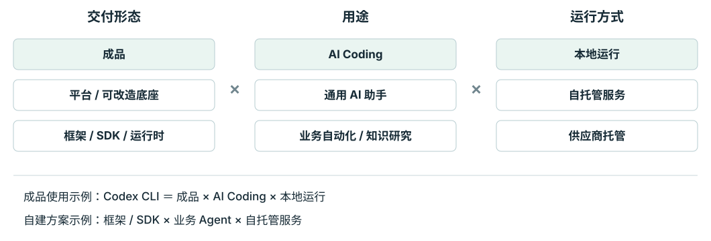
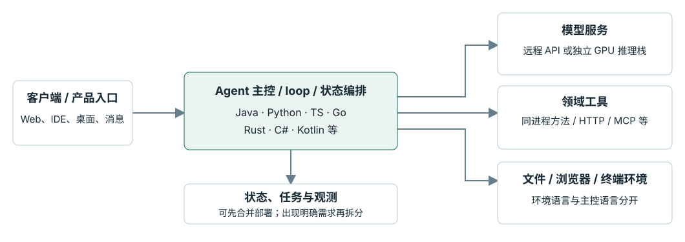
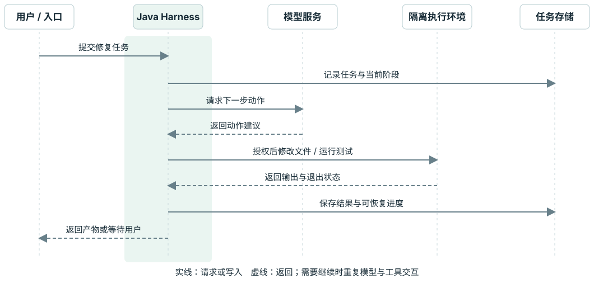
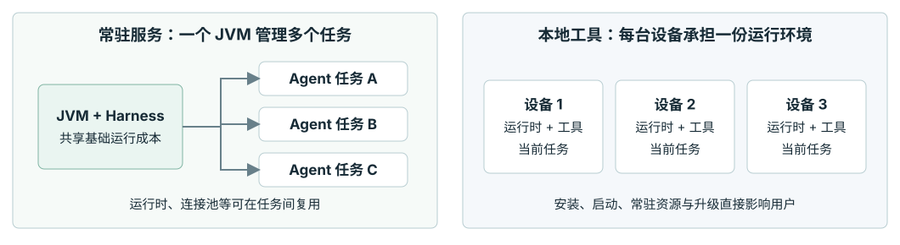
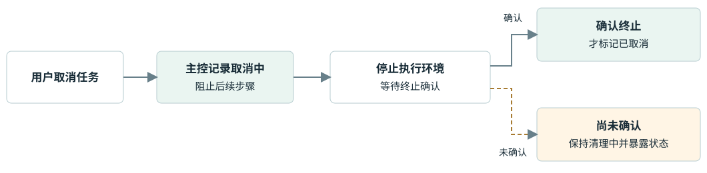
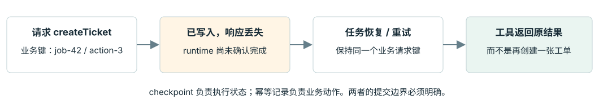

<!-- document-id: show-13 -->
<!-- document-version: 1.0-review -->

> 项目台账保留 2026-11-03 采集快照；公开副本于 2026-11-13 定点补核关键机制，没有重新采集全部仓库。

# Agent 赛道与语言选型：先决定交付方式，再选运行底座

[图解讲解](../阅读/讲解-13-Agent赛道与语言选型.html) · [返回首页](../index.html)

先决定直接使用、改造还是自建，再选择语言和框架。用一个完整任务解释 Java Harness 的收益与代价，项目数据和证据留在后面核查。

[从结论开始](#summary)

[查项目证据](#method)

[下载指标 JSON](../阅读/数据/Agent项目指标快照-2026-11-03.json)

## 架构结论：先选交付方式，再选语言

**先决定交付方式，再选择 Agent 主控语言。**直接使用成品、改造现有平台、自建运行底座，承担的是不同工作。AI Coding、助手与业务自动化是用途；本地运行和托管是另一项选择。

### 提高开发或办公效率

先比较 Coding / 通用助手成品，用真实任务判断完成质量、返工和费用。

产品核心语言只在你准备改造执行核心时成为直接维护约束。

[查看成品候选 →](#coding-products)

### 交付自己的业务应用

比较可视化平台、知识工作台或现成 Harness，重点看领域工具、状态、权限和升级。

现成系统可直接用，也可以是二次开发底座；“半成品”描述建设责任。

[查看平台候选 →](#platforms)

### 控制 Agent 如何执行

按运行方式和关键依赖选语言，再判断需要集成库、循环 SDK，还是持久运行时。

已有 Java 能力、目标为常驻服务时，Java 是优先候选。

[理解 Java Harness →](#java-harness)

**Java 可以直接承担完整 Harness。**在已有 JVM 能力、服务常驻、工具依赖可覆盖的条件下，并发、类型建模和长期诊断值得优先利用。本地工具若更重视原生交付、终端和系统隔离，应比较 Rust / Go；关键 SDK 或工具集中在 TS / Python 时，则把生态接入成本放进同一轮评估。[[21]](#src-harness-jvm) [[22]](#src-harness-delivery) [[24]](#src-harness-languages) [[18]](#src-java)

**这些是有条件的选型建议。**报告没有跨语言任务成功率实测，也不把 Stars 当稳定性分数。后半篇保留 8 组五候选、Java 五条路线和 52 个仓库快照，供核查与替换候选。

[**总**先看结论](#summary)

[**分**理解场景与机制](#landscape)

[**总**收束为行动](#decisions)

[**分**按需展开证据](#method)

## 赛道地图：成品、平台与框架各承担什么

Agent 不是一个可以直接按品牌排总榜的单一品类。要描述一个方案，至少说明它交付什么、用来完成什么任务，以及由谁运行。三个维度明确后，语言和框架才有可比较的上下文。

<figure><figcaption>图 1｜从每列选择一项来描述方案。成品也可以本地运行；自托管也不意味着必须从框架开始建设。</figcaption></figure>

| 用途与建设对象 | 本报告的五候选 | 先判断什么 |
| --- | --- | --- |
| AI Coding 成品 | Claude Code、Codex、Cursor、GitHub Copilot agents、Devin | 能否在你的代码库、构建与审查流程中完成真实任务。 |
| 通用助手成品 | ChatGPT、Claude / Cowork、Gemini agent、Microsoft 365 Copilot、Perplexity Computer | 能连接哪些工作资料与工具，结果是否可审查，目标组织能否使用。 |
| 通用开发框架 / 运行时 | LangGraph、OpenAI Agents SDK、Google ADK、Microsoft Agent Framework、Mastra | 需要普通执行循环，还是图、暂停审批和跨实例恢复。 |
| 可视化 / 业务自动化平台 | n8n、Dify、Langflow、Sim、Coze Studio | 现有连接器与执行语义能省掉多少建设工作。 |
| 可改造 Coding 核心 | Codex、OpenCode、Cline、OpenHands、Goose | 要维护哪个核心，是否需要控制文件、终端和隔离环境。 |
| 自托管常驻助手 | OpenClaw、nanobot、ZeroClaw、NanoClaw、PicoClaw | 谁管理运行环境、凭据、状态与恢复；个人信任模型能否满足业务。 |
| 浏览器 / 电脑执行 | Browser Use、Page Agent、Stagehand、Skyvern、Agent S | 区分工具 SDK、网页 Agent 与桌面研究 Harness。 |
| 知识 / 研究工作台 | RAGFlow、DeerFlow、AnythingLLM、Khoj、Onyx | 区分知识检索基础、研究执行底座与可使用的工作台。 |

这张表是进入验证的候选地图，顺序不代表市场或性能名次。商业产品的完整执行核心若未公开，报告标为未知；公开 SDK 或界面的语言不代替核心语言。具体证据见后半篇。

## 语言选择：运行方式与关键依赖改变推荐

**Harness 是把 Agent 动作执行下去的运行底座。**它管理模型循环、上下文、工具、权限和执行状态。做语言选择时，要判断你在维护哪个执行主体；客户端、工具和推理服务可以分别选择语言。

<figure><figcaption>图 2｜Java 可以是完整 Agent 主控。调用 Python 工具或 C++ / CUDA 推理服务不要求把整个系统改成对应语言；同样，Rust 编码 Agent 可以修改 Java 仓库。</figcaption></figure>

例如“修复 Java Bug 并运行测试”：主控用 Java 写，仍可以运行 Python 文档工具；主控用 Rust 写，也可以修改 Java 项目。主控语言决定的是这套控制逻辑如何开发、运行和维护，而不是它只能处理哪种代码。

| 语言 | 优先考虑的条件（建议） | 能减少的工作 | 需要承担的代价 |
| --- | --- | --- | --- |
| Java | 已有 JVM 能力；服务常驻；同时管理多任务 | 并发等待、明确的执行状态契约、既有领域工具和诊断可以组合使用。 | 本地分发、原生系统接口，以及非 JVM 专有工具的接入成本。 |
| Rust | 本地产品深度依赖终端、进程、系统隔离与资源控制 | 原生交付与资源管理适合执行核心；可直接围绕系统接口建设。 | 异步、共享状态和所有权增加开发成本；工具权限仍需独立设计。 |
| Go | 需要直接编译交付，并发执行服务或本地守护进程占主导 | 网络、并发与进程管理的路径较直接，便于形成一个运行单元。 | 仍有 GC；平台接口、cgo 与整个任务环境的取消 / 清理要验证。 |
| TypeScript | 关键 SDK、npm 连接器、浏览器能力与产品入口结合紧密 | 可以直接维护完整主控和后端，并复用现有工具与 schema。 | 不能让长 CPU 工作阻塞事件循环；模型与外部输入仍须运行时校验。 |
| Python | 执行系统依赖数据、解析、研究、评测与动态工具 | 工具可直接组合，实验反馈和修改路径短，也能部署为正式服务。 | 需要管理阻塞调用、CPU 工作、解释器构建及原生依赖。 |
| C# / .NET | 团队、服务和工具已有 .NET 积累 | 类型、async、服务与客户端交付体系可支撑完整 Harness。 | 按实际依赖评估动态能力、原生交付与工具覆盖。 |
| C++；Kotlin / JVM | 有成熟原生执行内核；或明确选择 Kotlin 的 JVM 生态 | C++ 可复用原生资源与接口；Kotlin 可复用 JVM 工具与运行能力。 | C++ 的内存 / 并发与构建维护；Kotlin 不能被当成另一套完全不同的 JVM 性能路线。 |

机制与项目依据：[[24]](#src-harness-languages) [[22]](#src-harness-delivery) [[20]](#src-runtime) [[18]](#src-java) [[10]](#src-codex) [[11]](#src-coding-open) [[15]](#src-platform)

先列出三个不可替代的工具 / SDK，再比较主控语言。如果它们已经在 Java 中，换语言可能新增边界；若都在 Python 或 TS，直接组合可能节省更多工作。收益来自具体依赖，不来自“AI 原生”标签。

## Java Harness：适用原因、代价与执行边界

**在 Java 团队建设常驻 Agent 服务时，Java 值得优先验证。**它可以直接拥有模型循环、上下文、工具策略和任务状态。下面继续用“修复 Java Bug、运行测试”的任务说明收益与代价；图是建议方案，不代表某个框架开箱即具备所有语义。

<figure><figcaption>图 4｜建议的责任分工。Java 直接拥有执行循环；工具环境可以运行 Maven、Python 或浏览器。可恢复进度指显式保存的任务状态，不是持久化线程栈。</figcaption></figure>

### 为什么服务端适合 Java：并发、状态契约和长期运行

任务会等待模型流、工具输出、数据库和用户输入。虚拟线程使这类等待能用较直接的顺序代码表达，并承载较多并发任务；JSON、策略判断等工作又可以利用多核。它降低的是等待时占用线程的成本，不增加模型配额，也不让单次推理更快。[[21]](#src-harness-jvm)

任务进入“等待工具”“等待审批”“取消中”等状态后，Java 的接口、泛型、record 和 sealed 类型有助于形成明确契约。工具接口或事件改变时，编译器能发现部分漏改；模型 JSON、旧状态版本和外部写入仍需要运行时校验与兼容设计。静态类型不专属于 Java，但可与现有 JVM 资产一起使用。

常驻服务还要诊断某个租户为何越跑越慢。Java 的堆、线程、GC 和 JFR 能帮助定位分配、等待与执行事件。代价是驻留状态和 GC 仍会消耗资源：每步复制完整对话、无界保存工具输出，会让低效数据管理抵消并发收益。[[21]](#src-harness-jvm)

示意计算：若一万个活跃任务各保留 200 KB 状态，仅状态就约 2 GB，尚未计算对象、连接、缓冲区与工具进程。这不是实测。换语言会改变表示开销，但不会让任务状态消失；应限制在途请求与上下文驻留。

### 为什么本地工具要另算：运行成本由谁承担

<figure><figcaption>图 3｜这是部署方式示意，不是性能测试。Java 的服务端收益与本地分发成本应分别验证；小型 Java 程序也不必加载整套 Spring 应用。</figcaption></figure>

Java 可以用 jpackage 把运行时一起交付，用户无需预装 JDK；也可评估 Native Image。前者要维护各平台产物，后者要验证反射、资源、JNI 等动态访问。Node / .NET 也有独立交付路线，因此应比较实际安装包、启动与运行内存，而不是把语言简单分成“能 / 不能独立分发”。[[22]](#src-harness-delivery) [[24]](#src-harness-languages)

本地 Coding Harness 若大量依赖 PTY（交互式伪终端）、进程控制和平台沙箱，Java 可以通过 pty4j、FFM 或其他原生适配实现，但需承担平台测试和依赖维护。Rust / Go 同样要处理操作系统差异；当这些接口构成产品核心时，它们值得更早进入比较。[[22]](#src-harness-delivery)

### 最容易误判的边界：取消等待不等于工具已经停止

<figure><figcaption>图 5｜建议的取消语义。取消 Future 不能证明 Maven、测试进程和浏览器均已停止；平台需要定义任务环境如何被回收。</figcaption></figure>

Maven 可能继续启动测试进程，浏览器工具可能持有其他子进程。取消 Java Future 不能证明整个任务环境已经终止；反过来，Go context 也不自动解决所有后代进程和管道。需要执行环境提供可确认的清理能力，并让主控暴露尚未清理完成的状态。[[21]](#src-harness-jvm) [[23]](#src-harness-isolation)

工具是否可信也决定运行边界。同一 JVM 中的类加载器不构成通用安全沙箱，JDK 24 起 Security Manager 已永久禁用。不可信命令应放在符合威胁模型的隔离环境中；Rust 的内存安全同样不能约束已经获权的 shell 动作。[[23]](#src-harness-isolation)

版本条件：虚拟线程在 JDK 21 已正式提供；JDK 24 通过 JEP 491 消除 synchronized 导致的 pinning。不要把 JDK 21 的某项限制套给所有新版本；这项改进也不替代超时、配额、状态恢复与进程清理。[[21]](#src-harness-jvm)

## 落地收束：默认路线与重新评估的条件

前面的选择可以收束成四条起步路线。默认建议绑定这里的条件；关键条件改变时，重新比较总建设成本，而不是永久绑定某种语言。

| 建设条件 | 建议的起步路线 | 代价与翻案条件 |
| --- | --- | --- |
| 团队先提高 Coding / 办公效率 | 直接验证成品；把真实代码库、资料和工具接进去。 | 若必须控制执行核心、特殊隔离或产品二次开发，再比较可改造 Harness。 |
| Java 团队，自建常驻服务，关键工具可覆盖 | 一个 Java 主控；Spring AI 或 LangChain4j 集成库先选一套，工具和观测沿用现有能力。 | 跨请求审批 / 跨实例恢复成为要求时，再比较持久运行时；关键非 JVM 工具的总体收益可能改变主控选择。 |
| 向开发者分发本地 Coding 产品 | 把 Rust / Go / TS 放入初选；权重由原生控制、资源、SDK 与维护者能力决定。 | 若 Java 实际产物满足预算、工具复用收益更大，Java 仍可胜出；不预设 Java CLI 一定失败。 |
| 执行系统深度依赖 Python / TS 工具 | 比较在相应语言直接组合，和 Java 主控复用独立工具两种方案。 | 只有收益覆盖额外发布、状态、取消和诊断成本才拆边界；一个 Python 工具不要求迁移整个系统。 |

### 第一版只要求走完一个任务，随后验证失败与恢复

先让一个明确任务从输入走到可审查产物：主控拥有动作策略，工具执行结果可追踪，需要恢复时显式保存阶段和动作标识。单体进程、数据库和隔离工具环境可组成第一版，不因跨语言就自动引入消息队列、MCP、A2A 或多个 Agent。

然后用固定模型、工具、环境和预算比较两三个候选：正确完成、人工返工、总耗时、总费用分别记录。至少验证进程中断、工具超时、取消、审批后重启和状态升级。已有功能说明只能支持入围，不能替代目标任务验证。

**什么变化会改变推荐：**从每人偶尔启动一次的 CLI，变成服务器长期承接许多任务，基础运行成本更容易分摊，Java 的并发与诊断收益会更突出。反过来，若交付核心变成多平台终端 / 沙箱执行器，则应提高原生接口、启动与资源预算的权重。

后半篇用于查证与替换候选：[方法与证据口径](#method)、[八组候选详表](#coding-products)、[Java 五条路线](#java)、[52 个仓库台账](#registry)。

## 证据阅读口径：名单、Stars 与成熟度分别看

**“成品 / 半成品 / 框架”是交付形态；“Coding / 助手 / 自动化 / 研究”是用途。**二者必须交叉。例如 Codex 既有可直接用的产品，也有可改造的 Rust 开源核心；Dify 是建设平台，用它可以交付某个业务的成品 Agent。将它们塞进一条不分层的总榜，会掩盖你究竟在买软件还是建设运行时。

| 交付形态 | 拿到什么 | 你主要承担什么 | 本报告对应 |
| --- | --- | --- | --- |
| 面向终端用户的成品 | 可直接用于工作的 Agent、运行环境与产品入口 | 配置工具、组织推广、任务验收和费用；自托管模式还需运营运行时 | Coding 成品、通用助手；部分开源助手也可直接用 |
| 应用建设平台 / 可改造底座 | 可运行的应用或 harness、默认工具与配置；作为业务成品建设的半成品 | 补充领域流程和工具、部署与状态 / 隔离验收；现成能力可直接复用 | 流程平台、可改造 Coding 核心、知识工作台等 |
| 框架 / SDK / runtime | loop、状态图、模型 / 工具适配等开发积木 | 业务产品、状态策略、部署与运维；具体负担随层次不同 | 框架五候选与 Java 专项 |

**部署方式是第三条独立轴：**托管、自托管、本地运行都不等于产品完整度。Codex CLI、OpenClaw 可以作为直接使用的成品，也可作为改造底座；本报告在对应章节说明比较的是哪个边界。

### Top 5 的明确口径

报告有 **8 组五候选**：两组成品名单，以及六组公开项目名单；另列 Java 五条路线。这里的“专业五候选”是可审查的研究短名单，**不宣称全球销量、收入、活跃用户或可靠性排名**。同组内顺序也不代表性能名次。商业名单没有可比的开源 Stars，因此提供产品 / 使用证据；六组公开项目另给候选集内按 Stars 降序的前五。

| 维度 | 这次看到了什么 | 能支持什么结论 / 不能支持什么 |
| --- | --- | --- |
| 关注度 | 52 个仓库的精确 Stars / fork / watcher 快照 | 说明累计关注；单次截面算不了增长率、装机量或稳定性。候选集是人工明确选择，未全网普查。 |
| 维护 / 版本 | 归档标记、默认分支 commit、release / commit Atom 条目 | 说明当前维护迹象；最近条目可能是 nightly / RC / 子包，不能直接叫最新稳定版本。 |
| 真实使用 | 使用者工程博客、具名客户案例、GitHub PR 研究数据 | 比 Logo 更强，但不能把试点写成多年生产，把供应商案例当独立可靠性审计。 |
| 工程能力 | checkpoint / interrupt、重试 / 取消、状态版本、工具边界、部署与观测文档 | 支持是否值得进入验证名单；功能存在不等于故障恢复语义、租户隔离已满足你的业务。 |
| 可持续交付 | 源码范围、许可证、升级路径、客户端 / 核心拆分与运维负担 | 用于估算采用成本；不将商业版能力、旧仓库热度、其他语言成熟度混入本版本。 |
| 任务效果与成本 | 公开材料不足以统一复现同模型、同工具、同环境的成功率 | 没有编造百分制总分或“最稳定”榜。最终用自己的任务与失败注入做验证。 |

**证据标签：**A＝使用者自己的工程公开说明；B＝供应商具名客户案例；C＝官方源码、发布与功能 / 运维文档；R＝研究或任务评测。它们描述证据来源，**不是稳定性分数**。本轮未实测这些项目的生产 SLO，也没有把“没找到公开案例”判成“不适合生产”。

仓库快照采集于 **2026-11-03 14:22–14:27（Asia/Shanghai）**。从 GitHub 官方页面嵌入的 sidebarAbout 数据提取完整计数，记录规范仓库地址、抓取时间、当前 commit 和原页摘要；维护条目另取官方 Atom feed。默认分支用于确定当前源码结构，准备部署时仍须锁定经验证 release。详细字段附在独立 JSON 中。

## AI Coding 成品：候选与使用证据

面向“让开发团队直接使用”的选型。选择下面五个作为主要成品候选，还因为 **AIDev 原始研究**对这五者识别到真实 GitHub Agentic PR：总计 932,791 个 PR、116,211 个仓库（**数据截止 2025-08-01，论文发表于 2026-02-09**）。这是历史公开开发活动证据，**不能推导截至今日的市场前五、各入口规模、各自成功率或企业稳定性**。本报告再用当前产品文档核对访问日的能力。[[09]](#src-aidev)

| 成品五候选 | 公开实现语言 / SDK 边界 | 选择理由与成本 | 使用 / 稳定性证据如何读 |
| --- | --- | --- | --- |
| Claude Code | **完整商业核心未公开**。公共仓库主要是反馈 / 扩展相关内容；Python / TS Agent SDK 不等于底层全栈语言。 | 终端、IDE、桌面 / 云等开发入口；工具、扩展与项目约束结合。选择它是购买模型 + harness + 产品体验，不能仅按 SDK 语言评判。 | AIDev 有真实 PR；官方有当前产品 / 管理文档。公共仓库 [Claude Code](https://github.com/anthropics/claude-code)：154,331 Stars，**不列完整开源核心榜**。[[08]](#src-coding-products) [[12]](#src-coding-caveats) |
| Codex | **公开 CLI / 执行核心 Rust**；产品其他服务、云端和客户端不据此推断。 | 可直接用于开发，也能研究 / 改造公开核心。语言不限定目标仓库；Java 的收益由理解构建 / 测试 / 工具链的效果决定。 | AIDev 有真实 PR；公开代码、维护者设计与发布可追溯。132,924 Stars 属开源仓库，不是 Codex 用户量。[[10]](#src-codex) |
| Cursor Agent | **完整 Agent 后端未公开**；基于编辑器生态不证明所有控制面或服务都用 TS。 | IDE 内连续迭代、Project 协调与云 Agent 等体验。适合把代码上下文、改动、执行与审查集中到编辑器的团队。 | AIDev 有真实 PR；当前官方明确文件编辑、终端、模型编排与项目能力。Stars 无统一可比值；用真实 Java 多模块工程验证。[[08]](#src-coding-products) |
| GitHub Copilot agents | **完整商业运行时语言未公开**；编辑器扩展、CLI 与托管服务不等价。 | 与 issue / PR / 组织开发平台结合的协作、异步任务和自动化入口；更容易纳入既有仓库审查流程。 | AIDev 有真实 PR；官方区分协作、异步与自动化模式。不要把历史补全采用量直接等同 Agent 模式稳定使用量。[[08]](#src-coding-products) |
| Devin | **核心 Agent 服务未完整公开**；不根据招聘信息反推主语言。 | 倾向委派较完整任务、并行工作环境、知识和组织集成；采购重点是任务完成 / 返工成本与环境适配。 | AIDev 有真实 PR；Cognition 有具名企业采用声明（B），不把其效率案例外推到全部工程任务。[[08]](#src-coding-products) |

**对 Java 团队的直接意义：**先用现有 JDK、Maven / Gradle、测试容器和内部依赖跑真实任务。比较“正确完成并通过审查”的比例、人工返工、总耗时与费用，而不是比较 Agent 自己用 Java、TS 还是 Rust 编写。只有准备自建或深改 Agent 时，主控语言才成为直接维护约束。

## 通用 AI 助手成品：能力与公开边界

面向通用知识工作与跨工具任务，下面是主要产品五候选，**不按装机量或稳定性排序**。它们的核心实现均未完整公开；报告不填写未经证实的“主语言”。对于成品，语言问题应转为：能接哪些工具、执行在哪里、状态由谁管理、组织能否长期运营。[[13]](#src-assistant-products)

| 通用助手五候选 | 成品能力 / 交付形态 | 实现语言与扩展边界 | 专业判断与稳定使用边界 |
| --- | --- | --- | --- |
| ChatGPT（任务 / 工具工作能力） | 面向用户的任务、多工具与文件 / 浏览器工作；文档包含跨会话任务与后台 Agent。 | 核心实现未完整公开。OpenAI 基础 API SDK、Agents SDK 和用户成品是三个对象。 | 已购买成品以当前计划、地区与组织功能验证；SDK 的语言列表不能证明成品后台实现，也不能替代产品可用性判断。[[13]](#src-assistant-products) [[01]](#src-sdk) |
| Claude / Cowork | 知识工作、文件和连接工具；官方当前正在把 Chat 与 Cowork 体验合并。 | 核心实现未完整公开。Agent SDK 可以在其他应用复用能力，不代表整套产品源码开放。 | 不要沿用“仅本地 Mac research preview”的旧结论。云会话与本地文件 / 浏览器访问仍有不同连接条件，灰度和团队开关需核对。[[13]](#src-assistant-products) |
| Gemini agent（工作场景） | Google 2026-10-08 提出统一工作 Agent，覆盖知识、媒体、代码与工作系统连接。 | 核心实现未完整公开；ADK 多语言是开发框架供给，不是 Gemini 成品的完整后端声明。 | Google 工作生态与连接范围是评估重点；新公告能力与已在目标租户可用分别核实，不能把全套 AI 产品客户数当该 Agent 功能用户数。[[13]](#src-assistant-products) [[03]](#src-adk) |
| Microsoft 365 Copilot（含 Researcher 等） | 把多来源研究 / 办公任务放进工作内容与组织权限体系；Researcher 面向复杂多步骤研究。 | 完整成品实现未公开；Microsoft Agent Framework 的 .NET / Python 支持不证明 Copilot 全栈语言。 | 已有 M365 的团队可重点验证权限继承与工作内容效果；本报告不把广义 Copilot 使用量当 Researcher 的独立生产指标。[[13]](#src-assistant-products) [[04]](#src-msaf) |
| Perplexity Computer | 研究、浏览器任务、产物制作、连接器与后台任务；供应商称其可组织子任务执行工作流。 | 核心实现未完整公开；未找到可据以判定主语言的官方完整实现。 | 研究 / 检索与长期任务的结合值得评估；“可运行数月”是产品能力声明，不是本轮实测可靠性记录。[[13]](#src-assistant-products) |

这五者与 OpenClaw 等自托管助手有交集，但交付责任不同：托管成品减少自行维护 runtime 的工作；自托管能让你控制运行环境与状态，也把部署、升级和恢复责任带回来。二者应在相同业务任务和权限条件下比较。

## 框架与运行时：五候选及扩展路线

面向自己开发 Agent 产品的团队。专业五候选按工程路径覆盖选择，表中顺序不表示性能或市场名次。与之并列提供候选集内 Stars 前五。

### 候选集内 Stars 前五

1. 01[langchain-ai/langchain](https://github.com/langchain-ai/langchain)Python；另有 JS 路线**148,924**
2. 02[crewAIInc/crewAI](https://github.com/crewAIInc/crewAI)Python**60,435**
3. 03[langchain-ai/langgraph](https://github.com/langchain-ai/langgraph)Python / TS（独立实现）**44,364**
4. 04[agno-agi/agno](https://github.com/agno-agi/agno)Python**43,025**
5. 05[langchain-ai/deepagents](https://github.com/langchain-ai/deepagents)Python 主仓；另有独立 TS 实现**30,927**

LangGraph 是底层持久 runtime，LangChain 的 create_agent 提供 Agent loop / 框架积木，Deep Agents 是装配好的上层 harness。三者都计入本候选集，但属于同一技术栈的不同层，Stars 不可相加当独立用户数。

### 专业五候选：适用路径与实际边界

| 专业候选 | Stars | 执行语言 / 子类型 | 为什么考虑它（架构判断） | 使用证据、成熟度与代价 |
| --- | --- | --- | --- | --- |
| **[LangGraph](https://github.com/langchain-ai/langgraph)**langchain-ai/langgraph | 44,364 | **Python；独立 TS / JS 实现**有状态图运行时 | 复杂分支、长任务、暂停审批、checkpoint。Python 便于组合模型/数据工具；TS 版本让同类控制能力可进入 Node 服务端。 | **A：LinkedIn、Uber 工程说明**；checkpoint 与持久执行文档完整。外部动作仍需业务幂等；OSS runtime 与托管部署分开核算。[[02]](#src-langgraph) |
| **[OpenAI Agents SDK](https://github.com/openai/openai-agents-python)**openai/openai-agents-python | 30,466 | **Python / TypeScript**运行在自己应用内的 loop SDK | 需要较直接的 tool loop、handoff、session、trace，再自行决定服务和存储。官方 SDK 供给与模型能力契合是选择理由。 | **C：官方 SDK / 运行文档**。部署、状态后端和审批由应用负责；基础 Java API SDK 不等于官方 Java Agents SDK。[[01]](#src-sdk) |
| **[Google ADK](https://github.com/google/adk-python)**google/adk-python | 22,086 | **Python / TS / Go / Java**各语言独立实现，成熟阶段不齐 | 希望沿 Google Agent 工具、评测与平台路线；也可在自有环境运行。多语言支持来自官方投入，不要求工具都改同一种语言。 | **B：PayPal / Geotab 公告**，未披露 SDK 语言。2.0 GA 含 Python/Go/TS；Java 仍 Preview，不能继承其他语言的 GA 结论。[[03]](#src-adk) |
| **[Microsoft Agent Framework](https://github.com/microsoft/agent-framework)**microsoft/agent-framework | 14,505 | **Python / C# .NET**Go 为 Preview | Agent、工作流、middleware 与微软企业生态的组合；也是 AutoGen / Semantic Kernel 用户应评估的后继路线。C# 是不能漏掉的正式后端选择。 | **C：.NET/Python 1.0 stable**；客户公告同时包含建设和 pilot。Go 不同阶段；旧 Semantic Kernel 支持 Java 不代表此框架支持 Java。[[04]](#src-msaf) |
| **[Mastra](https://github.com/mastra-ai/mastra)**mastra-ai/mastra | 29,301 | **TypeScript 服务端**Agent + workflow + memory / eval / storage | TS 团队要完整 Agent 后端、npm 工具与共享类型。可承担持久工作流和实际业务执行；并非仅用于 UI、BFF 或 SSE。 | **B：WorkOS 明确生产案例**；1.0 stable。需验证工作流/存储升级；主体 Apache-2.0，ee 目录另有许可。[[05]](#src-mastra) |

额外重点候选：CrewAI（角色任务 + Flows，Python）、Agno（agents / teams / workflows，Python）、Pydantic AI（类型校验 / DI / eval，Python）、Strands（Python / TS SDK 与 harness）、Deep Agents（装配好的长期任务 harness）。Stars 更高并不让任何一个成为所有架构的默认答案。

### 不能因为没进五选就忽略的候选

| 项目 | Stars | 类别 | 专业补充 |
| --- | --- | --- | --- |
| LangChain | 148,924 | Python；另有 JS / TS；create_agent 与集成 / middleware | C：当前是 Agent 框架。向上承接 Deep Agents，向下利用 LangGraph；与这两者是可组合的层次，不是只能三选一。 |
| CrewAI | 60,435 | Python；Crew / Flows | B：PwC 具名案例；IBM 案例明确 pilot。高层任务 / 流程抽象要与真实控制需求匹配。 |
| Agno | 43,025 | Python；agents / teams / workflows / AgentOS | B：Datai 生产测量案例有具体历史范围；不能据此断言产品今天仍同规模运行。SDK 与 AgentOS 分开。 |
| Pydantic AI | 21,002 | Python；typed output / DI / eval；durable 可组合 | B：Mixam 等具名案例；V2 stable 与版本政策可查。适合重视类型化应用与校验的 Python 团队。 |
| Strands | 9,033 | Python / TS；SDK + harness | A：AWS 自有 Q / Glue 等采用披露。较低 Stars 不抹去实际采用；旧语言仓库迁移后不要重复计数。 |
| Deep Agents | 30,927 | 长期任务 harness；当前基于 LangGraph 生态 | C：源码 / 工具与上下文装配。和 LangGraph 是上层装配与底层 runtime 关系，不应当作互斥框架选型。 |

补充依据：[[02]](#src-langgraph) [[06]](#src-python-frameworks) [[07]](#src-strands)

## 业务自动化平台：实现与运维代价

这类项目已有界面、运行引擎和连接器。你主要补领域流程、模型、数据与运维；它们可以交付成品应用。“半成品”描述交付边界，不是质量等级。

### 候选集内 Stars 前五

1. 01[n8n-io/n8n](https://github.com/n8n-io/n8n)TypeScript / Node.js**209,415**
2. 02[langgenius/dify](https://github.com/langgenius/dify)Python + TS；插件 daemon Go**160,288**
3. 03[langflow-ai/langflow](https://github.com/langflow-ai/langflow)Python + TS**156,276**
4. 04[simstudioai/sim](https://github.com/simstudioai/sim)TypeScript**29,979**
5. 05[coze-dev/coze-studio](https://github.com/coze-dev/coze-studio)Go + TS**21,798**

归档的 Flowise 仍有较高累计 Stars，但不列为活跃默认候选。

### 专业五候选：适用路径与实际边界

| 专业候选 | Stars | 执行语言 / 子类型 | 为什么考虑它（架构判断） | 使用证据、成熟度与代价 |
| --- | --- | --- | --- | --- |
| **[n8n](https://github.com/n8n-io/n8n)**n8n-io/n8n | 209,415 | **TypeScript / Node.js**执行后端与编辑器均主要在 TS 生态 | 大量 SaaS / 企业系统连接器，事件驱动自动化中嵌入 Agent。Python / JS Code 节点是工作负载，不改变核心后端语言。 | **B：Trendyol 具名案例**；queue mode 有 Redis / worker 扩展路径。Sustainable Use + 企业许可，不能写成普通 MIT 开源。[[15]](#src-platform) |
| **[Dify](https://github.com/langgenius/dify)**langgenius/dify | 160,288 | **Python 后端 + TS 前端**Flask / Celery；Go plugin daemon | 模型应用、RAG、Agent、工作流与运营界面组合较完整。Python 接模型/处理生态，TS 做产品界面；Go 插件进程属于另一执行边界。 | **B：Maersk 供应商案例**；案例的 Enterprise 运维不能直接归给 CE。许可证基于 Apache 并有附加条件，部署模式需核对。[[15]](#src-platform) |
| **[Langflow](https://github.com/langflow-ai/langflow)**langflow-ai/langflow | 156,276 | **Python 执行 + TS / React 前端**可视化组件与流程 | 面向需要画流程并扩写 Python 组件的团队。画布只是定义，执行仍落在 Python 组件与服务中。 | **C：生产部署 / API 鉴权文档**；本轮未找到足以量化持续生产规模的具名证据。最新 feed 包含 dev 版，不能直接当稳定版安装。MIT。[[15]](#src-platform) |
| **[Sim](https://github.com/simstudioai/sim)**simstudioai/sim | 29,979 | **TypeScript 全栈**Next.js / Bun；后台任务与状态存储 | 需要 TS 生态的流程平台、自托管和工具连接；平台后端不是“前端 demo”。执行状态、队列和运行历史是实际服务端能力。 | **C：自托管、扩容、升级文档**；本轮未找到同强度具名长期生产案例。Apache-2.0；服务能力按自托管版本验收。[[15]](#src-platform) |
| **[Coze Studio / 扣子开源版](https://github.com/coze-dev/coze-studio)**coze-dev/coze-studio | 21,798 | **Go 后端 + TS / React 前端**Hertz / Eino 执行生态 | Bot、插件、工作流与 Agent 应用平台；Go 已在执行业务控制流，而不仅做代理或基础设施。 | **C：源码 / 部署说明**。商业扣子的用户量不能当开源版生产采用量；当前 release feed 较久未更新，采购前核对分支与支持。Apache-2.0。[[15]](#src-platform) |

语言选择的可观察结果：同是可视化 Agent 平台，核心后端可以是 TS、Python 或 Go。产品能力来自执行状态、连接器、部署和维护设计，不能由网页界面反推主语言。

## 开源 Coding Harness：核心语言与边界

用来直接工作、接入 CI、私有部署，或者二次开发 Agent 产品。同一个项目可以同时是可用成品和可改造底座；此表专看可检查的执行核心。

### 候选集内 Stars 前五

1. 01[anomalyco/opencode](https://github.com/anomalyco/opencode)TypeScript / Bun**224,172**
2. 02[openai/codex](https://github.com/openai/codex)Rust 核心**132,924**
3. 03[google-gemini/gemini-cli](https://github.com/google-gemini/gemini-cli)TypeScript**108,690**
4. 04[OpenHands/OpenHands](https://github.com/OpenHands/OpenHands)TS Canvas；引擎另仓 Python**92,536**
5. 05[cline/cline](https://github.com/cline/cline)TypeScript**71,242**

Stars 榜保留仍活跃的 Gemini CLI；专业名单考虑官方迁移方向而选择其他候选。Claude Code 的公共反馈仓库另列，不能算完整开源执行核心。OpenHands 主仓与引擎仓库分别计数。

### 专业五候选：适用路径与实际边界

| 专业候选 | Stars | 执行语言 / 子类型 | 为什么考虑它（架构判断） | 使用证据、成熟度与代价 |
| --- | --- | --- | --- | --- |
| **[Codex 开源执行核心](https://github.com/openai/codex)**openai/codex | 132,924 | **Rust**npm 分发入口 ≠ TS 主执行核心 | 本地/CI 编码 Agent；原生沙箱与可分发二进制。维护者明确解释转 Rust：减少运行依赖、对接原生隔离、控制内存与运行开销。 | **C：公开实现与维护者设计说明**。云端服务实现未完整公开；Rust 不决定模型质量，也不限定只能修改 Rust 项目。Apache-2.0。[[10]](#src-codex) |
| **[OpenCode](https://github.com/anomalyco/opencode)**anomalyco/opencode | 224,172 | **TypeScript / Bun**Agent loop、会话与工具核心 | 希望可读可改的 TS 编码运行时、模型选择与多入口。TS 能承载完整编码 Agent，Bun 与 npm 生态影响打包和工具集成。 | **C：源码 / 发布记录**。本轮未找到同强度具名生产故障率证据；高 Stars 不能补上这个缺口。MIT。[[11]](#src-coding-open) |
| **[Cline](https://github.com/cline/cline)**cline/cline | 71,242 | **TypeScript**共享 core / SDK + 编辑器等入口 | 需要 IDE 中的文件编辑、终端、审批与可复用 Agent runtime。核心从 UI 中分离，方便多个入口复用同一 loop。 | **C：SDK 架构与运行文档**；具名企业采用属供应商披露。扩展、CLI、SDK 发布节奏不同；不要把 nightly 当所有组件稳定版。Apache-2.0。[[11]](#src-coding-open) |
| **[OpenHands 引擎](https://github.com/OpenHands/software-agent-sdk)**OpenHands/software-agent-sdk品牌主仓 [OpenHands](https://github.com/OpenHands/OpenHands)：92,536 Stars | 1,341 | **Python 执行核心**当前主仓 Canvas 为 TypeScript | 围绕工作空间、Agent Server、容器环境与编程工具二次开发。Python 运行时方便工具/实验编排，TS 负责另一层控制界面。 | **C：SDK / Server 架构**；引擎仓库与品牌主仓 Stars 分列。主仓高 Stars 不能写成新 SDK 的 Stars。MIT。[[11]](#src-coding-open) |
| **[Goose](https://github.com/aaif-goose/goose)**aaif-goose/goose | 56,159 | **Rust 核心 + TS 客户端**原 block/goose 已重定向 | 需要本地开发助手、工具扩展和可重用的执行底座。原生核心和桌面界面分层，适合单独比较交付与运行资源。 | **A：Block 自有工程披露**。不能把公司全部 AI 编码占比归因于 Goose；客户端 / TUI 与核心版本也不总相同。Apache-2.0。[[11]](#src-coding-open) |

额外候选 Aider 是 Python 路线。Gemini CLI 是 TypeScript，仍有发布活动，但 Google 已给出向 Antigravity CLI 的迁移方向。Roo Code 当前已归档；“曾经火过”不能替代当前维护判断。

## 自托管常驻助手：实现与信任模型

此表选五种代表性自托管助手。它们能直接运行，也可作为二次开发底座；和托管通用助手的主要差别在于谁运营运行时、持有状态与管理工具权限。

### 候选集内 Stars 前五

1. 01[openclaw/openclaw](https://github.com/openclaw/openclaw)TypeScript 主 runtime**393,785**
2. 02[HKUDS/nanobot](https://github.com/HKUDS/nanobot)Python**49,775**
3. 03[zeroclaw-labs/zeroclaw](https://github.com/zeroclaw-labs/zeroclaw)Rust**33,109**
4. 04[nanocoai/nanoclaw](https://github.com/nanocoai/nanoclaw)TypeScript + 容器**31,075**
5. 05[sipeed/picoclaw](https://github.com/sipeed/picoclaw)Go**30,088**

Stars 榜以这六个候选计算；专业五候选覆盖最受关注的五条自托管路线。IronClaw 作为强调 WASM 工具边界的补充。

### 专业五候选：适用路径与实际边界

| 专业候选 | Stars | 执行语言 / 子类型 | 为什么考虑它（架构判断） | 使用证据、成熟度与代价 |
| --- | --- | --- | --- | --- |
| **[OpenClaw](https://github.com/openclaw/openclaw)**openclaw/openclaw | 393,785 | **TypeScript 主运行时**另有原生客户端 / 其他语言组件 | 常驻个人助手、多消息渠道、工具和会话；TS 适合连接器与事件编排。不能因其连接桌面就说核心只能做 UI。 | **C：运行 / 权限文档**，累计 Stars 很高。官方信任模型面向单操作者或可信团队，不能直接当敌对多租户托管隔离。MIT。[[14]](#src-personal) |
| **[nanobot](https://github.com/HKUDS/nanobot)**HKUDS/nanobot | 49,775 | **Python**常驻助手 / 消息渠道 / 持久会话 | 希望较易检查、扩写 Python 工具与数据处理。精简实现利于改造，但“代码少”不能替代任务恢复和权限设计。 | **C：部署与安全边界文档**。官方说明不是具备每用户角色 / 私有工作区的完整 Web 多租户平台。MIT。[[14]](#src-personal) |
| **[ZeroClaw](https://github.com/zeroclaw-labs/zeroclaw)**zeroclaw-labs/zeroclaw | 33,109 | **Rust**本地 / 常驻助手 runtime | 重视原生交付、基础运行开销与模块化工具接入。Rust 的资源控制优势需放到相同会话 / 工具任务下测。 | **C：源码 / 发布 / 配置文档**。没有公开证据支持把项目宣传中的资源数字外推到所有工具和模型；MIT OR Apache-2.0。[[14]](#src-personal) |
| **[NanoClaw](https://github.com/nanocoai/nanoclaw)**nanocoai/nanoclaw | 31,075 | **TypeScript 主控 + Linux 容器**主控语言与隔离执行环境分开 | 希望围绕较小 TS 主控和每 Agent 容器构建助手。容器边界、挂载与凭据范围比“用 TS 还是 Rust”更直接决定工具权限。 | **C：容器架构 / 发布说明**。当前候选含 RC，部署要选已验证 tag；原仓库迁移不能另算两个项目。MIT。[[14]](#src-personal) |
| **[PicoClaw](https://github.com/sipeed/picoclaw)**sipeed/picoclaw | 30,088 | **Go**可编译部署的轻量助手 | 偏轻量设备与直接交付；Go 可作为完整模型 / 工具控制循环。不是只有网关角色，端到端任务仍受模型和工具依赖限制。 | **C：源码 / 部署说明**；发布 feed 新鲜度弱于若干同类。资源宣传和“AI 生成比例”不作为本报告性能 / 可靠性证据。MIT。[[14]](#src-personal) |

IronClaw（Rust）值得作为工具权限边界与 WASM 路线的补充候选。本轮公开材料主要是项目文档，缺乏能横向比较五者长期任务成功率、恢复率和多租户隔离效果的独立运行数据。

本组 Stars 很高，但长期任务的恢复率与多租户边界缺乏统一公开实测。若要把个人助手变成企业 SaaS，评估的工作会从“接模型 / 渠道”转向身份、状态、任务隔离和运维，不应只改个界面就继承“企业稳定”结论。

## 浏览器 / 电脑：组件与 Agent 的差别

浏览器自动化 SDK、能自主操作页面的 Agent、桌面视觉 harness 是不同子类型。本组展示五个重要候选，不把它们当成同功能端到端产品的性能排名。

### 候选集内 Stars 前五

1. 01[browser-use/browser-use](https://github.com/browser-use/browser-use)Python；另有 TS 路线**119,889**
2. 02[alibaba/page-agent](https://github.com/alibaba/page-agent)TypeScript**29,620**
3. 03[browserbase/stagehand](https://github.com/browserbase/stagehand)TS canonical；Python / Go**25,915**
4. 04[Skyvern-AI/skyvern](https://github.com/Skyvern-AI/skyvern)Python Agent + TS；驱动含 Rust**23,336**
5. 05[simular-ai/Agent-S](https://github.com/simular-ai/Agent-S)Python**12,860**

候选集还含 Magnitude（TypeScript）；其 Stars 低于表内五个。排行是关注度，不是浏览器任务成功率。

### 专业五候选：适用路径与实际边界

| 专业候选 | Stars | 执行语言 / 子类型 | 为什么考虑它（架构判断） | 使用证据、成熟度与代价 |
| --- | --- | --- | --- | --- |
| **[Browser Use](https://github.com/browser-use/browser-use)**browser-use/browser-use | 119,889 | **Python 主线**浏览器 Agent；另有独立 TS 路线 | 把页面状态、模型决策与浏览器动作连成 loop。Python 便于扩写任务工具；不能把独立 TS 包当 Python 核心已经换语言。 | **C：源码 / 发布文档**。开源库、浏览器基础设施和供应商云服务分别评估；网站变化与登录环境会影响同一模型结果。[[16]](#src-browser) |
| **[Page Agent](https://github.com/alibaba/page-agent)**alibaba/page-agent | 29,620 | **TypeScript / 浏览器内执行**页面 DOM 操作 Agent | 嵌入网页，利用页面结构和浏览器环境执行动作；接近页面运行环境是 TS 的具体优势，和后台批量自动化的交付方式不同。 | **C：源码 / 集成文档**。访问页面、可操作 DOM、授权与跨站范围受具体嵌入方式约束；不是完整桌面操作系统 Agent。[[16]](#src-browser) |
| **[Stagehand](https://github.com/browserbase/stagehand)**browserbase/stagehand | 25,915 | **TS canonical；v4 有 Python / Go**浏览器自动化 / Agent 执行 SDK | 需要确定性代码与模型动作组合。可把它作为 Agent 的工具执行层，而不必让它拥有整个业务计划。 | **B：Hamlet 供应商案例**。Java SDK 仓库已于 2026-10-22 归档；旧多语言公告不能当现行 Java 支持承诺。[[16]](#src-browser) |
| **[Skyvern](https://github.com/Skyvern-AI/skyvern)**Skyvern-AI/skyvern | 23,336 | **Python Agent + TS 界面**浏览器执行栈另含 Rust 组件 | 以视觉 / 页面理解处理表单和网页流程，并提供平台界面。Agent 主控和浏览器驱动分层，不能按某个组件语言给整个产品贴标签。 | **B：供应商披露客户流量实验**。其延迟改进仅限对应实验，不是所有网页任务的普适指标。AGPL-3.0。[[16]](#src-browser) |
| **[Agent S](https://github.com/simular-ai/Agent-S)**simular-ai/Agent-S | 12,860 | **Python**桌面 Computer Use 研究 harness | 关注视觉桌面操作与研究评测；可改造框架 / harness，不能直接视为多租户办公成品。 | **R：论文 / OSWorld 等评测**。当前研究主线与旧 release tag 时间并不一致；benchmark 不证明无人值守生产 SLA。Apache-2.0。[[16]](#src-browser) |

Java 仍可用 Playwright Java 做确定性浏览器动作，通过普通函数或 MCP 暴露工具。是否采用 Python 浏览器 Agent，取决于它提供的任务能力与维护成本，不取决于 Java 能不能控制浏览器。

## 知识 / 研究工作台：当前实现与范围

知识检索、带工具的问答、深度研究 harness、企业工作台经常组合。此组保留子类型：RAG 基础设施并不因“AI”二字就自动变成自主 Agent。

### 候选集内 Stars 前五

1. 01[infiniflow/ragflow](https://github.com/infiniflow/ragflow)Go 当前核心 + TS；含 Python**93,395**
2. 02[bytedance/deer-flow](https://github.com/bytedance/deer-flow)Python / LangGraph + TS**84,909**
3. 03[Mintplex-Labs/anything-llm](https://github.com/Mintplex-Labs/anything-llm)JavaScript / Node + React**67,879**
4. 04[khoj-ai/khoj](https://github.com/khoj-ai/khoj)Python**37,955**
5. 05[onyx-dot-app/onyx](https://github.com/onyx-dot-app/onyx)Python + TS**33,171**

Open Deep Research 当前已归档，保留为历史参考，不列活跃默认候选。DeerFlow 与 RAGFlow 分属不同交付范围，不能只按 Stars 二选一。

### 专业五候选：适用路径与实际边界

| 专业候选 | Stars | 执行语言 / 子类型 | 为什么考虑它（架构判断） | 使用证据、成熟度与代价 |
| --- | --- | --- | --- | --- |
| **[RAGFlow](https://github.com/infiniflow/ragflow)**infiniflow/ragflow | 93,395 | **当前主线 Go 核心服务**TS 前端；仍有 Python / 原生依赖 | 偏文档 / 检索 / 知识执行基础及应用。go.mod、cmd/internal 与服务启动路径确认当前主线 Go；不是从某个 SDK 语言推测。 | **C：默认分支源码 / 部署说明**。旧 tag 部署与当前主线可能不同；不能把“以前是 Python”的认知直接套到今天。Apache-2.0。[[17]](#src-knowledge) |
| **[DeerFlow](https://github.com/bytedance/deer-flow)**bytedance/deer-flow | 84,909 | **Python / LangGraph + TS 界面**2.x 长任务 harness | 研究、代码、产物制作等长期任务。现已超出早期“深度研究 demo”；状态 / 子任务 / 工具上下文是主要比较对象。 | **C：2.x 源码与迁移说明**；2.0 曾大幅重写，最新 feed 可含 RC。升级要验收状态和事件契约；MIT。[[17]](#src-knowledge) |
| **[AnythingLLM](https://github.com/Mintplex-Labs/anything-llm)**Mintplex-Labs/anything-llm | 67,879 | **JavaScript / Node.js 后端**Express / Prisma；React 界面 | 可直接使用的知识工作台与 Agent 功能。Node 在这里承担服务端 API、知识与工具协调，不应因有 RAG 就误判为 Python 产品。 | **C：服务端依赖与部署文档**。本轮未找到足够数据量化长期恢复率；桌面 / 容器 / 云产品分别验收。MIT。[[17]](#src-knowledge) |
| **[Khoj](https://github.com/khoj-ai/khoj)**khoj-ai/khoj | 37,955 | **Python**FastAPI / Django 等依赖 | 个人 / 团队知识助手、检索、研究与工具。Python 直接连接解析、模型与数据生态，但实际算力未必在 Python 解释器。 | **C：源码 / 自托管文档**；release feed 包含 beta 且更新较久。AGPL-3.0-or-later；按实际版本确认运营边界。[[17]](#src-knowledge) |
| **[Onyx](https://github.com/onyx-dot-app/onyx)**onyx-dot-app/onyx | 33,171 | **Python 后端 + TS / Next.js 前端**企业搜索 / 知识与 Agent 应用 | 希望整合企业连接器、权限与知识上下文。前后端分工并不意味着 Agent 只能写 Python；关键是连接器和索引 / 权限模型的完整度。 | **C：源码 / 部署文档**。CE 为 MIT，EE 目录另有许可；不能将 EE 管理能力和服务承诺写成 CE 默认能力。[[17]](#src-knowledge) |

这组能回答“现成知识系统怎么选”，但不能代替领域评测：文档引用能否回溯、检索权限是否同步、研究产物是否可验证，仍要由真实语料和任务确认。

## Java 五条路线：框架层次与成熟阶段

**Java 不是只能提供 tools，也不必只守在事务后端。**Spring AI / LangChain4j 可以直接把模型和领域工具放进 Java 服务；Spring AI Alibaba、AgentScope Java、ADK Java 又向 loop、图与运行时延伸。是否仍需要 Python / TS，取决于某个 SDK、工具或研究实现是否带来实质收益。[[18]](#src-java) [[03]](#src-adk)

| Java 五条路线 | Stars | 属于哪层 | 优先适用条件 | 成熟度和不能省略的判断 |
| --- | --- | --- | --- | --- |
| **[Spring AI](https://github.com/spring-projects/spring-ai)** | 9,615 | 模型 / tool / RAG / memory / MCP / 观测集成库 | 已有 Spring Web 服务，单 Agent 或确定性业务流程。Java 方法直接作为领域工具，减少为调用模型而单独拆服务。 | 官方有 Agent 模式实现；可以编写完整 loop。并不因此自带跨进程 checkpoint、任务调度和所有恢复语义。稳定集成库与持久 runtime 是两个选型问题。[[18]](#src-java) |
| **[LangChain4j](https://github.com/langchain4j/langchain4j)** | 13,346 | Java AI Services、tools、RAG；另有 agentic 模块 | 需要 Java 接口 / POJO 契约，或 Spring / Quarkus 等多框架集成。模型 / tool 逻辑可留在 JVM。 | core 已有 1.x；部分模块 beta。官方明确 langchain4j-agentic 为 experimental；不可由 core 稳定推导整个 Agent 编排 API 稳定。[[18]](#src-java) |
| **[Spring AI Alibaba](https://github.com/alibaba/spring-ai-alibaba)** | 11,100 | Spring AI 集成 + ReactAgent / Graph runtime + Admin | 在 JVM 内需要图、循环、checkpoint、interrupt/HITL 与平台管理，并评估国内模型和服务集成。 | 项目声明 production-ready，JManus 有供应商自身采用声明；不是独立 SLA 数据。Graph / runtime / Admin、release 与 milestone 需分别核对。[[18]](#src-java) |
| **[AgentScope Java](https://github.com/agentscope-ai/agentscope-java)** | 6,226 | JVM Agent runtime / harness；事件、权限、状态与恢复 | 希望用 Java 承担长期任务执行、事件流和多 Agent，并沿 JVM 平台交付。无需把主循环搬到 Python 才算 Agent。 | 官方称 2026-07 的 2.0 为首个 production-ready GA；1→2 有较大重设计。新 beta 不是 GA，本轮未找到具名终端客户规模数据。[[18]](#src-java) |
| **[Google ADK Java](https://github.com/google/adk-java)** | 1,762 | 官方 Java Agent SDK / loop / session / workflow | 已决定走 Google Agent 路线，希望 Java 原生定义和运行 Agent。它不是单纯给云 API 发请求的包装包。 | 仍标 Preview / Pre-GA；不在 ADK 2.0 GA 语言清单。不能用 PayPal / Geotab 未披露语言的案例证明 ADK Java 已规模化生产。[[03]](#src-adk) |

**JVM 额外候选：**[Embabel](https://github.com/embabel/embabel-agent)（4,543 Stars，Java / Kotlin，类型化领域动作与 GOAP 等规划）；[Koog](https://github.com/JetBrains/koog)（4,650 Stars，核心 Kotlin，Java 可接入）。这两者说明 JVM 生态不止 Spring，也提醒我们“Java 能用”和“核心用 Java 写”要分开。默认 SNAPSHOT 文档或 beta additions 不能当整体稳定承诺。[[18]](#src-java)

这里比较具体框架与模块；前文 [Java Harness 分析](#java-harness) 讨论语言与运行机制。框架 stable、单个模块 experimental 和某语言 Preview 是不同对象，不能互相继承成熟度。

## 机制与组件补充：深入核查入口

本节用于核对语言机制、已存在的实现和 Java 组件类别。前文的条件化建议在这里补充事实依据；表中适用理由仍属架构分析。

| 语言 | 已核实的 Agent 实现 / 生态 | 适用机制：为什么会选择它 | 边界：不能推出什么 |
| --- | --- | --- | --- |
| Java / JVM | Spring AI、LangChain4j、Spring AI Alibaba、AgentScope Java、ADK Java；Kotlin 的 Koog / Embabel 另标。 | 能作为完整 Agent 服务和高并发 Web / tool 控制主体。模型经远程接口推理时，复用现有 Spring、领域工具、鉴权、事务与运维，减少额外执行边界。 | 当前第一方 Agent SDK / 前沿 harness 的语言覆盖不如 Python / TS 齐；Java 内部也有 stable / experimental / preview 的差别。不能用 Java API 客户端冒充有状态运行时。 |
| Python | LangGraph、Pydantic AI、CrewAI、Agno；Browser Use、OpenHands 引擎、DeerFlow。 | 模型、解析、检索、评测与实验工具供给密集；从论文 / notebook 到自定义工具的路径短。也能做完整生产服务，不只训练或原型。 | 阻塞 SDK、CPU 工作与 async 的边界要明确。远程推理的吞吐受配额 / 工具 / 状态影响，不能用纯 Python 算术速度给所有 Agent 排名。 |
| TypeScript / JavaScript | Mastra、OpenAI Agents TS、LangGraph JS；OpenCode、Cline、OpenClaw、n8n、Sim、AnythingLLM。 | 完整生产 Agent 主控、工作流与服务端均已有项目。npm 连接器、浏览器工具、共享 schema 与多入口核心复用是具体优势；不是只有前端，也不是只有流式输出。 | TS 静态类型通常被擦除，外部模型 / 工具输出仍需运行时验证。Node/Bun 的事件循环、CPU 隔离与取消要设计，SSE 本身各语言都能做。 |
| Go | ADK Go；Coze Studio 后端、PicoClaw；RAGFlow 当前核心。 | 可承担 Agent runtime 和业务平台。编译交付、goroutine / context 取消、网络 I/O 与已有团队工具适配，可能降低一个部署单元的运维负担。 | Python 专有数据工具和最新 SDK 若必须使用，需承担跨进程成本；goroutine 不会替你限定模型配额或让外部动作自动幂等。 |
| Rust | Codex 核心、Goose、ZeroClaw、IronClaw；部分浏览器 / 工具执行组件。 | 原生二进制、系统隔离接口、资源与内存控制适合本地 harness。Codex 转 Rust 有明确维护者动机，其他项目的因果解释只能标架构分析。 | 语言不会提高模型推理质量。复杂工具依赖、异步代码、FFI 与维护者成本仍存在；是否节省整机成本需在相同任务与模型下测。 |
| C# / .NET | Microsoft Agent Framework 的正式稳定语言路线。 | 适用于完整 Agent 与工作流后端，能直接利用 .NET 类型、企业 SDK 与现有服务；并非因 Python 出名就必须另拆 Python。 | 区别旧 AutoGen / Semantic Kernel、新 Agent Framework 和各语言发布阶段；不要将旧生态的某项支持自动继承给新框架。 |
| Kotlin；C++ / CUDA | Koog / Embabel 为 JVM 路线；C++ / CUDA 常见于推理与硬件执行。 | Kotlin 可以直接写 Agent runtime；C++ 也能写 loop。底层模型执行常是其他语言或 GPU 栈，和 Agent 主控进程可分开选。 | Kotlin 能给 Java 调用不等于源码是 Java；Python 调原生 kernel 也不能按“Python 速度慢”归类。是否用 C++ 主控看具体库与交付收益。 |

机制来源与实例依据：[[20]](#src-runtime) [[18]](#src-java) [[03]](#src-adk) [[04]](#src-msaf) [[10]](#src-codex) [[11]](#src-coding-open) [[14]](#src-personal) [[15]](#src-platform) [[17]](#src-knowledge)

### 与既有 Java 组件的对应关系

| 类别 | Java 类比 / 现有能力 | Agent 增量及差别 |
| --- | --- | --- |
| 模型 / 工具集成库 | 类似客户端适配、类型转换、DI 集成 | Spring AI / LangChain4j 提供模型、tools、RAG 等；能写 loop，仍要自己决定停止、预算与副作用。 |
| Agent SDK / harness | 执行器 + 工具接口 + 会话 / 上下文 | SDK 运行模型→动作→观察循环；harness 再装配文件、终端、上下文压缩、审批与子任务。不是单纯 HTTP 客户端。 |
| 有状态 runtime | 工作流 / 状态机 / 持久执行 | LangGraph / SAA Graph 等管理 checkpoint、暂停和恢复。持久执行语义与外部写操作幂等分别设计。 |
| MCP | 工具 / 上下文互操作协议 | 让不同语言工具可被发现和调用。当前规范也有可选 Tasks；不自动提供业务计划、完整权限策略或恰好一次。 |
| A2A | Agent 之间的任务互操作 | 用于另一个 Agent 的能力与任务交互。和 MCP 的工具连接侧重点不同，普通单 Agent 不必为了完整而两者都加。 |
| OTel / Micrometer | 既有观测 API / SDK / 导出与后端 | 复用已有链路，再补模型 / 工具 / Agent 步骤、token / 成本、审批 / 产物。GenAI span 不是业务完成证明，语义约定与敏感上下文要按版本处理。 |

协议与观测依据：[[19]](#src-interop)

### 恢复语义补充：执行进度与外部副作用

<figure><figcaption>图 6｜示意故障推演，不是某框架的实测。换主控语言不会消除“写成功但没收到响应”的不确定性；需要由工具和业务状态契约处理。</figcaption></figure>

示意：工具已经创建工单，主控在保存下一阶段前退出。恢复后可能再次调用工具，因此要用稳定动作标识去重或查回结果。checkpoint 管执行进度，业务工具管外部动作；这项边界对 Java、Rust、TS、Python 都成立。[[02]](#src-langgraph)

**题目：**Spring 团队先做单 Agent 查询，之后增加“等待两天审批，再写入多个系统”；同时某个文档工具只有成熟 Python 实现。是否应把全系统改为 Python，并一次性引入消息队列、MCP、A2A 与多个 Agent？

**参考判断：**新增需求是持久等待、恢复和跨系统动作契约，首先补任务状态与幂等 / 审批语义。Python 文档工具可独立封装，Java 主控可以继续存在；也可以因某个成熟 runtime 的总体收益迁移主控，但理由须是能力与总成本。MCP / A2A、队列和多 Agent 各自需要独立触发条件，不因“跨语言”自动必选。

## 仓库台账：52 个项目的关注度与源码快照

以下为本轮 **52 个仓库**的完整候选与对照台账。Stars、归档状态、源码 commit 与 release 条目采用相同研究日；语言经过文件路径 / 官方架构核对，不按 GitHub 顶部语言百分比机械判断。搜索只影响台账，打印时会自动恢复全部条目。

横向滚动可查看发布与代码指纹。发布条目可能是 alpha / beta / RC / dev / nightly 或 monorepo 子包；不是推荐安装版本。

| 仓库 / 类别 | Stars | 主执行语言 / 结构 | 状态 / 许可范围 | 最近发布条目 / 更新日 | 源码快照 |
| --- | --- | --- | --- | --- | --- |
| [openclaw/openclaw](https://github.com/openclaw/openclaw)自托管助手 | 393,785 | TypeScript 主 runtime | 未归档MIT | [openclaw 2026.10.10](https://github.com/openclaw/openclaw/releases/tag/v2026.10.10)条目更新 2026-11-03 | [`9346376806`](https://github.com/openclaw/openclaw/tree/9346376806641d94ffd3954d2b2e4eacb2c8ee0a)main |
| [anomalyco/opencode](https://github.com/anomalyco/opencode)Coding | 224,172 | TypeScript / Bun | 未归档MIT | [v2.2.5](https://github.com/anomalyco/opencode/releases/tag/v2.2.5)条目更新 2026-10-30 | [`3ba597f776`](https://github.com/anomalyco/opencode/tree/3ba597f7769e19cc3b5f67e3d6667e7b6318f6a3)dev |
| [n8n-io/n8n](https://github.com/n8n-io/n8n)可视化平台 | 209,415 | TypeScript / Node.js | 未归档Sustainable Use / Enterprise | [v1: :rocket: Release 1.123.92 (#42872)](https://github.com/n8n-io/n8n/releases/tag/v1)条目更新 2026-11-02 | [`ed550ca2ef`](https://github.com/n8n-io/n8n/tree/ed550ca2efac28ba39a8a04e7692236588b7519d)master |
| [langgenius/dify](https://github.com/langgenius/dify)可视化平台 | 160,288 | Python + TS；插件 daemon Go | 未归档Dify（Apache 基础 + 附加条件） | [v1.18.0 — Smarter Agent Routing, Portable Apps, Deeper Workflow Visibility](https://github.com/langgenius/dify/releases/tag/1.18.0)条目更新 2026-10-23 | [`4b23482dd3`](https://github.com/langgenius/dify/tree/4b23482dd30b3f7bbc366714caea424c3b920bc3)main |
| [langflow-ai/langflow](https://github.com/langflow-ai/langflow)可视化平台 | 156,276 | Python + TS | 未归档MIT | [v1.14.0.dev14](https://github.com/langflow-ai/langflow/releases/tag/v1.14.0.dev14)条目更新 2026-11-03 | [`e63907b0f0`](https://github.com/langflow-ai/langflow/tree/e63907b0f05304f2de2dab3e19add7e2b6393fb2)main |
| [anthropics/claude-code](https://github.com/anthropics/claude-code)Coding | 154,331 | 完整商业核心语言未公开 | 未归档反馈 / 扩展仓库商业许可；非完整开源核心 | [v2.1.317](https://github.com/anthropics/claude-code/releases/tag/v2.1.317)条目更新 2026-11-03 | [`964d695659`](https://github.com/anthropics/claude-code/tree/964d69565952a176ac1975ed218362991db71433)main |
| [langchain-ai/langchain](https://github.com/langchain-ai/langchain)框架 / runtime | 148,924 | Python；另有 JS 路线 | 未归档MIT | [langchain-core==1.7.4](https://github.com/langchain-ai/langchain/releases/tag/langchain-core%3D%3D1.7.4)条目更新 2026-11-02 | [`2775506076`](https://github.com/langchain-ai/langchain/tree/2775506076baf2cba8126b21b9e63424fcd97ab9)master |
| [openai/codex](https://github.com/openai/codex)Coding | 132,924 | Rust 核心 | 未归档Apache-2.0 | [0.167.0-alpha.4](https://github.com/openai/codex/releases/tag/rust-v0.167.0-alpha.4)条目更新 2026-11-03 | [`29eed28082`](https://github.com/openai/codex/tree/29eed280828d498fead76c3c5dedd9642836b571)main |
| [browser-use/browser-use](https://github.com/browser-use/browser-use)浏览器 / 电脑 | 119,889 | Python；另有 TS 路线 | 未归档MIT | [0.13.14: Python agent and integration updates](https://github.com/browser-use/browser-use/releases/tag/0.13.14)条目更新 2026-10-26 | [`b49a68e406`](https://github.com/browser-use/browser-use/tree/b49a68e4060acb226da8f784194fef301c53a6d7)main |
| [google-gemini/gemini-cli](https://github.com/google-gemini/gemini-cli)Coding | 108,690 | TypeScript | 未归档官方已有迁移方向Apache-2.0 | [Release v0.67.0-nightly.20261103.g0ac57c029](https://github.com/google-gemini/gemini-cli/releases/tag/v0.67.0-nightly.20261103.g0ac57c029)条目更新 2026-11-03 | [`0ac57c029b`](https://github.com/google-gemini/gemini-cli/tree/0ac57c029b848d109eef940afe0db4b5a0c3dad0)main |
| [infiniflow/ragflow](https://github.com/infiniflow/ragflow)知识 / 研究 | 93,395 | Go 当前核心 + TS；含 Python | 未归档Apache-2.0 | [dev-20261103](https://github.com/infiniflow/ragflow/releases/tag/dev-20261103)条目更新 2026-11-03 | [`a916ee5776`](https://github.com/infiniflow/ragflow/tree/a916ee577684a2475321d78b0e7e17ac18c63300)main |
| [OpenHands/OpenHands](https://github.com/OpenHands/OpenHands)Coding | 92,536 | TS Canvas；引擎另仓 Python | 未归档Canvas；非引擎仓库MIT | [v1.23.0-r3](https://github.com/OpenHands/OpenHands/releases/tag/v1.23.0-r3)条目更新 2026-10-29 | [`dce9d017ab`](https://github.com/OpenHands/OpenHands/tree/dce9d017abe9ed3d362bc77e0cd3fff2e4931f22)main |
| [bytedance/deer-flow](https://github.com/bytedance/deer-flow)知识 / 研究 | 84,909 | Python / LangGraph + TS | 未归档MIT | [v2.2.0-rc0](https://github.com/bytedance/deer-flow/releases/tag/v2.2.0-rc0)条目更新 2026-10-29 | [`14abd9a28e`](https://github.com/bytedance/deer-flow/tree/14abd9a28eb035f277aa56098caab1b0600c6e8d)main |
| [cline/cline](https://github.com/cline/cline)Coding | 71,242 | TypeScript | 未归档Apache-2.0 | [desktop-nightly-20261030214224](https://github.com/cline/cline/releases/tag/desktop-nightly-20261030214224)条目更新 2026-10-30 | [`5b45416535`](https://github.com/cline/cline/tree/5b454165353ac1edc9a7db0ff416739044985908)main |
| [Mintplex-Labs/anything-llm](https://github.com/Mintplex-Labs/anything-llm)知识 / 研究 | 67,879 | JavaScript / Node + React | 未归档MIT | [AnythingLLM v1.19.0](https://github.com/Mintplex-Labs/anything-llm/releases/tag/v1.19.0)条目更新 2026-10-26 | [`f31b5adfdd`](https://github.com/Mintplex-Labs/anything-llm/tree/f31b5adfddb16f28071aa20e4e898079a524761b)master |
| [crewAIInc/crewAI](https://github.com/crewAIInc/crewAI)框架 / runtime | 60,435 | Python | 未归档MIT | [1.15.34](https://github.com/crewAIInc/crewAI/releases/tag/1.15.34)条目更新 2026-11-01 | [`86dca29b53`](https://github.com/crewAIInc/crewAI/tree/86dca29b536d700b69a97a3592857d5f9d4a8873)main |
| [aaif-goose/goose](https://github.com/aaif-goose/goose)Coding | 56,159 | Rust 核心 + TS 界面 | 未归档Apache-2.0 | [v1.57.0](https://github.com/aaif-goose/goose/releases/tag/v1.57.0)条目更新 2026-10-28 | [`cfb67d72f6`](https://github.com/aaif-goose/goose/tree/cfb67d72f6129ba3c9f68d4c225d8dfcaba18a87)main |
| [FlowiseAI/Flowise](https://github.com/FlowiseAI/Flowise)可视化平台 | 55,545 | TypeScript / Node.js | 已归档NOASSERTION | 归档项目；本轮未抓 feed | [`9291856d1e`](https://github.com/FlowiseAI/Flowise/tree/9291856d1ea4a4ceea9f8fef8ce14f4f6c81e8eb)main |
| [Aider-AI/aider](https://github.com/aider-ai/aider)Coding | 49,916 | Python | 未归档Apache-2.0 | [v0.86.3.dev](https://github.com/Aider-AI/aider/releases/tag/v0.86.3.dev)条目更新 2026-02-12 | [`5dc9490bb3`](https://github.com/aider-ai/aider/tree/5dc9490bb35f9729ef2c95d00a19ccd30c26339c)main |
| [HKUDS/nanobot](https://github.com/HKUDS/nanobot)自托管助手 | 49,775 | Python | 未归档MIT | [v0.4.0](https://github.com/HKUDS/nanobot/releases/tag/v0.4.0)条目更新 2026-10-28 | [`cc4dd1cebf`](https://github.com/HKUDS/nanobot/tree/cc4dd1cebfa96aadd44bc090db02c0a75a79fdb6)main |
| [langchain-ai/langgraph](https://github.com/langchain-ai/langgraph)框架 / runtime | 44,364 | Python / TS（独立实现） | 未归档MIT | [langgraph==1.2.19](https://github.com/langchain-ai/langgraph/releases/tag/1.2.19)条目更新 2026-10-30 | [`3c916d7505`](https://github.com/langchain-ai/langgraph/tree/3c916d750575b22c464790e9774494d810ccd322)main |
| [agno-agi/agno](https://github.com/agno-agi/agno)框架 / runtime | 43,025 | Python | 未归档Apache-2.0 | [v3.1.12](https://github.com/agno-agi/agno/releases/tag/v3.1.12)条目更新 2026-10-29 | [`b21807bb6d`](https://github.com/agno-agi/agno/tree/b21807bb6d86d2a62efeb42d492c04e566ee7f90)main |
| [khoj-ai/khoj](https://github.com/khoj-ai/khoj)知识 / 研究 | 37,955 | Python | 未归档AGPL-3.0-or-later | [2.0.0-beta.28](https://github.com/khoj-ai/khoj/releases/tag/2.0.0-beta.28)条目更新 2026-03-26 | [`ae229ca894`](https://github.com/khoj-ai/khoj/tree/ae229ca894c0b80ad84664afcfdde523b5e87057)master |
| [onyx-dot-app/onyx](https://github.com/onyx-dot-app/onyx)知识 / 研究 | 33,171 | Python + TS | 未归档CE MIT；EE 另许可 | [v4.9.7](https://github.com/onyx-dot-app/onyx/releases/tag/v4.9.7)条目更新 2026-11-02 | [`332b908f4a`](https://github.com/onyx-dot-app/onyx/tree/332b908f4a05090882ffaf7219d904c467bb7ce1)main |
| [zeroclaw-labs/zeroclaw](https://github.com/zeroclaw-labs/zeroclaw)自托管助手 | 33,109 | Rust | 未归档MIT OR Apache-2.0 | [v0.8.7](https://github.com/zeroclaw-labs/zeroclaw/releases/tag/v0.8.7)条目更新 2026-11-03 | [`71e68a0d63`](https://github.com/zeroclaw-labs/zeroclaw/tree/71e68a0d632c2b75814d960115e8aafcd8369259)master |
| [nanocoai/nanoclaw](https://github.com/nanocoai/nanoclaw)自托管助手 | 31,075 | TypeScript + 容器 | 未归档MIT | [v2026.10.1-rc.2](https://github.com/nanocoai/nanoclaw/releases/tag/v2026.10.1-rc.2)条目更新 2026-10-22 | [`acc2b1c8f5`](https://github.com/nanocoai/nanoclaw/tree/acc2b1c8f52a954368cfaf04b61c32f9a1efc280)main |
| [langchain-ai/deepagents](https://github.com/langchain-ai/deepagents)框架 / runtime | 30,927 | Python 主仓；另有独立 TS 实现 | 未归档MIT | [deepagents-code==0.2.4](https://github.com/langchain-ai/deepagents/releases/tag/deepagents-code%3D%3D0.2.4)条目更新 2026-11-02 | [`5829691de8`](https://github.com/langchain-ai/deepagents/tree/5829691de8f43d201f9534fb731643223c0bbccc)main |
| [openai/openai-agents-python](https://github.com/openai/openai-agents-python)框架 / runtime | 30,466 | Python；另有官方 TS SDK | 未归档MIT | [v0.24.0](https://github.com/openai/openai-agents-python/releases/tag/v0.24.0)条目更新 2026-10-15 | [`e355d69152`](https://github.com/openai/openai-agents-python/tree/e355d69152d4f4730dfb03b63dbce53e8d9f5d8c)main |
| [sipeed/picoclaw](https://github.com/sipeed/picoclaw)自托管助手 | 30,088 | Go | 未归档MIT | [Nightly Build](https://github.com/sipeed/picoclaw/releases/tag/nightly)条目更新 2026-07-02 | [`bbf6893ca7`](https://github.com/sipeed/picoclaw/tree/bbf6893ca7afad27f1d00a0f5a45982a549c6ed6)main |
| [simstudioai/sim](https://github.com/simstudioai/sim)可视化平台 | 29,979 | TypeScript | 未归档Apache-2.0 | [v0.9.41](https://github.com/simstudioai/sim/releases/tag/v0.9.41)条目更新 2026-11-03 | [`093ea9ddb2`](https://github.com/simstudioai/sim/tree/093ea9ddb2f3e47facbc2dc42d4e523ba050dedb)main |
| [alibaba/page-agent](https://github.com/alibaba/page-agent)浏览器 / 电脑 | 29,620 | TypeScript | 未归档MIT | [🌟v1.12.4](https://github.com/alibaba/page-agent/releases/tag/v1.12.4)条目更新 2026-09-06 | [`9eb6b66465`](https://github.com/alibaba/page-agent/tree/9eb6b6646500264d9034dd466a4270cb9fc1ef1e)main |
| [mastra-ai/mastra](https://github.com/mastra-ai/mastra)框架 / runtime | 29,301 | TypeScript | 未归档Apache-2.0 主体；ee 另许可 | [mastracode@0.48.2](https://github.com/mastra-ai/mastra/releases/tag/mastracode%400.48.2)条目更新 2026-10-30 | [`31efa3625f`](https://github.com/mastra-ai/mastra/tree/31efa3625ffb20668831c2315a818d9e6237e489)main |
| [browserbase/stagehand](https://github.com/browserbase/stagehand)浏览器 / 电脑 | 25,915 | TS canonical；Python / Go | 未归档MIT | [stagehand-python@4.4.0a0.dev1665: [chore]: remove preview workflow (#3366)](https://github.com/browserbase/stagehand/releases/tag/stagehand-python%404.4.0a0.dev1665)条目更新 2026-11-03 | [`9afa095245`](https://github.com/browserbase/stagehand/tree/9afa0952453e219f7164a0ea16cf293d3dcaddde)main |
| [RooCodeInc/Roo-Code](https://github.com/RooCodeInc/Roo-Code)Coding | 24,256 | TypeScript | 已归档Apache-2.0 | 归档项目；本轮未抓 feed | [`b867ec9145`](https://github.com/RooCodeInc/Roo-Code/tree/b867ec9145750d0ae1ff7f02d35406e9bf2a0b16)main |
| [Skyvern-AI/skyvern](https://github.com/Skyvern-AI/skyvern)浏览器 / 电脑 | 23,336 | Python Agent + TS；驱动含 Rust | 未归档AGPL-3.0 | [Release v1.0.56](https://github.com/Skyvern-AI/skyvern/releases/tag/v1.0.56)条目更新 2026-10-16 | [`cbcd7c8ad9`](https://github.com/Skyvern-AI/skyvern/tree/cbcd7c8ad9572b511c2da78e51b338bb15c11754)main |
| [google/adk-python](https://github.com/google/adk-python)框架 / runtime | 22,086 | Python；ADK 另有 Go / TS / Java | 未归档Apache-2.0 | [v2.13.0](https://github.com/google/adk-python/releases/tag/v2.13.0)条目更新 2026-10-23 | [`1a337ca6a5`](https://github.com/google/adk-python/tree/1a337ca6a58045304d86450b0f6b65e82efc4a15)main |
| [coze-dev/coze-studio](https://github.com/coze-dev/coze-studio)可视化平台 | 21,798 | Go + TS | 未归档Apache-2.0 | [V0.5.1](https://github.com/coze-dev/coze-studio/releases/tag/v0.5.1)条目更新 2026-02-05 | [`fefb05ff27`](https://github.com/coze-dev/coze-studio/tree/fefb05ff27be1da939612fbf9faf5db62583b8ae)main |
| [pydantic/pydantic-ai](https://github.com/pydantic/pydantic-ai)框架 / runtime | 21,002 | Python | 未归档MIT | [v2.65.0 (2026-11-02)](https://github.com/pydantic/pydantic-ai/releases/tag/v2.65.0)条目更新 2026-11-03 | [`6b3df9a7ba`](https://github.com/pydantic/pydantic-ai/tree/6b3df9a7ba0d3f36197df1b7ba6b59bf631cf879)main |
| [microsoft/agent-framework](https://github.com/microsoft/agent-framework)框架 / runtime | 14,505 | Python / C#；Go Preview | 未归档MIT | [python-1.24.0](https://github.com/microsoft/agent-framework/releases/tag/python-1.24.0)条目更新 2026-10-30 | [`4bb5ffa7da`](https://github.com/microsoft/agent-framework/tree/4bb5ffa7da18775bdd456d91c1313208e3363381)main |
| [langchain4j/langchain4j](https://github.com/langchain4j/langchain4j)Java / JVM | 13,346 | Java | 未归档agentic experimentalApache-2.0 | [1.19.5 and 1.19.5-beta29](https://github.com/langchain4j/langchain4j/releases/tag/1.19.5)条目更新 2026-11-02 | [`137d3ac83d`](https://github.com/langchain4j/langchain4j/tree/137d3ac83d91094662a7b6b37cecab5c421fe38f)main |
| [simular-ai/Agent-S](https://github.com/simular-ai/Agent-S)浏览器 / 电脑 | 12,860 | Python | 未归档Apache-2.0 | [v0.3.2](https://github.com/simular-ai/Agent-S/releases/tag/v0.3.2)条目更新 2025-12-16 | [`0fff0e6348`](https://github.com/simular-ai/Agent-S/tree/0fff0e634869dab72027435b4586e62300185d41)main |
| [nearai/ironclaw](https://github.com/nearai/ironclaw)自托管助手 | 12,708 | Rust | 未归档MIT OR Apache-2.0 | [1.4.1 - 2026-09-29](https://github.com/nearai/ironclaw/releases/tag/ironclaw-v1.4.1)条目更新 2026-09-29 | [`b0b999d967`](https://github.com/nearai/ironclaw/tree/b0b999d96781516ee05e6ba961d6f3ead900da96)main |
| [langchain-ai/open_deep_research](https://github.com/langchain-ai/open_deep_research)知识 / 研究 | 12,681 | Python | 已归档MIT | 归档项目；本轮未抓 feed | [`1b7d2e80db`](https://github.com/langchain-ai/open_deep_research/tree/1b7d2e80db9faa586165c60e09096dbbfd483a64)main |
| [alibaba/spring-ai-alibaba](https://github.com/alibaba/spring-ai-alibaba)Java / JVM | 11,100 | Java | 未归档Apache-2.0 | [v2.0.0-M1.1](https://github.com/alibaba/spring-ai-alibaba/releases/tag/v2.0.0-M1.1)条目更新 2026-06-25 | [`17e26ff6fe`](https://github.com/alibaba/spring-ai-alibaba/tree/17e26ff6fe951d605771c1845229ca3edb043634)main |
| [spring-projects/spring-ai](https://github.com/spring-projects/spring-ai)Java / JVM | 9,615 | Java | 未归档Apache-2.0 | [v2.1.0-RC1](https://github.com/spring-projects/spring-ai/releases/tag/v2.1.0-RC1)条目更新 2026-10-23 | [`317f6ef8a3`](https://github.com/spring-projects/spring-ai/tree/317f6ef8a367ae488dbda75a169d5aecf00e4263)main |
| [strands-agents/harness-sdk](https://github.com/strands-agents/harness-sdk)框架 / runtime | 9,033 | Python / TypeScript | 未归档Apache-2.0 | [typescript/v1.23.0](https://github.com/strands-agents/harness-sdk/releases/tag/typescript%2Fv1.23.0)条目更新 2026-10-30 | [`027cc1503a`](https://github.com/strands-agents/harness-sdk/tree/027cc1503a39ea2ebbb33baa9ee52b2a1f409c11)main |
| [agentscope-ai/agentscope-java](https://github.com/agentscope-ai/agentscope-java)Java / JVM | 6,226 | Java | 未归档Apache-2.0 | [AgentScope 2.1.0-BETA1](https://github.com/agentscope-ai/agentscope-java/releases/tag/v2.1.0-BETA1)条目更新 2026-10-08 | [`3ed55c5701`](https://github.com/agentscope-ai/agentscope-java/tree/3ed55c5701be625dfcc8200ac5f45d55652713d7)main |
| [JetBrains/koog](https://github.com/JetBrains/koog)Java / JVM | 4,650 | Kotlin 核心（Java 可用） | 未归档Apache-2.0 | [1.3.0](https://github.com/JetBrains/koog/releases/tag/1.3.0)条目更新 2026-09-24 | [`709079e4a3`](https://github.com/JetBrains/koog/tree/709079e4a34d6c9234583352550e6a2b88a0bb85)develop |
| [embabel/embabel-agent](https://github.com/embabel/embabel-agent)Java / JVM | 4,543 | Java / Kotlin（JVM） | 未归档Apache-2.0 | 未采到条目 | [`159c239a78`](https://github.com/embabel/embabel-agent/tree/159c239a787a6043f738fd22cbd1fb7453ce4dca)main |
| [magnitudedev/browser-agent](https://github.com/magnitudedev/browser-agent)浏览器 / 电脑 | 4,138 | TypeScript | 未归档Apache-2.0 | [magnitude-test@0.3.13](https://github.com/magnitudedev/browser-agent/releases/tag/magnitude-test%400.3.13)条目更新 2026-02-08 | [`f1b587c417`](https://github.com/magnitudedev/browser-agent/tree/f1b587c4173d8242bdb551991de54e70c4d2faf3)main |
| [google/adk-java](https://github.com/google/adk-java)Java / JVM | 1,762 | Java | 未归档Java PreviewApache-2.0 | [v1.14.0](https://github.com/google/adk-java/releases/tag/v1.14.0)条目更新 2026-11-02 | [`0bb7f4acfa`](https://github.com/google/adk-java/tree/0bb7f4acfa84848722108547c08d2a97bfc4450d)main |
| [OpenHands/software-agent-sdk](https://github.com/OpenHands/software-agent-sdk)Coding | 1,341 | Python 执行核心 | 未归档MIT | [1.49.5-r3](https://github.com/OpenHands/software-agent-sdk/releases/tag/1.49.5-r3)条目更新 2026-10-30 | [`b0789c7315`](https://github.com/OpenHands/software-agent-sdk/tree/b0789c73151a967fdd4a10f8383d2c0bc7109563)main |

没有匹配的仓库。可清空搜索或选择其他类别。

关键修正：Flowise、Roo Code、Open Deep Research 已归档；Goose、NanoClaw 与 Strands 有仓库迁移 / 合并；OpenHands 主仓与执行 SDK 已拆分；Stagehand Java SDK 已归档但不在本 52 个主体仓库计数内。维护与语言的判断必须绑定具体仓库和版本。[[12]](#src-coding-caveats) [[11]](#src-coding-open) [[14]](#src-personal) [[07]](#src-strands) [[16]](#src-browser) [[17]](#src-knowledge)

## 来源索引、版本条件与验证范围

全部为项目官方源码 / 文档、使用者工程博客、供应商具名案例或原始研究；访问 / 核验日均为 **2026-11-03**。仓库台账每行已链接官方项目、发布和 commit，下列来源补充机制、成熟状态与采用事实。段落中的选择理由若没有作者直接说明，一律属于本报告的架构分析。

当前官方文档；SDK 在用户应用内运行，官方 SDK 为 Python / TypeScript；基础 API SDK 是另一层。

[Agents SDK](https://developers.openai.com/api/docs/guides/agents/sdk)

[基础 API SDK](https://developers.openai.com/api/docs/libraries)

[托管 Agents API](https://developers.openai.com/api/docs/guides/agents-api/overview)

Python / JS 当前文档；使用者工程报告发表于 2025 年，证明具体采用，不构成通用 SLA。

[Python 概览](https://docs.langchain.com/oss/python/langgraph/overview)

[JavaScript 概览](https://docs.langchain.com/oss/javascript/langgraph/overview)

[持久执行](https://docs.langchain.com/oss/python/langgraph/durable-execution)

[LangChain / LangGraph / Deep Agents 分层](https://www.langchain.com/oss-overview)

[LinkedIn 工程报告](https://www.linkedin.com/blog/engineering/generative-ai/the-linkedin-generative-ai-application-tech-stack-extending-to-build-ai-agents)

[Uber Finch](https://www.uber.com/us/en/blog/unlocking-financial-insights-with-finch/)

ADK 2.0 GA 范围含 Python / Go / TS；Java 仓库仍标 Preview / Pre-GA。客户公告未给出 SDK 语言。

[语言入口](https://adk.dev/get-started/)

[2.0 及迁移](https://adk.dev/2.0/)

[Java 仓库](https://github.com/google/adk-java)

[具名客户公告](https://cloud.google.com/blog/products/ai-machine-learning/more-ways-to-build-and-scale-ai-agents-with-vertex-ai-agent-builder)

.NET / Python 1.0：2026-04-03；当前 Go 为 Preview；AutoGen / Semantic Kernel 后继路线。

[当前 overview](https://learn.microsoft.com/en-us/agent-framework/overview/)

[1.0 公告](https://devblogs.microsoft.com/agent-framework/microsoft-agent-framework-version-1-0/)

[采用与试点](https://devblogs.microsoft.com/foundry/introducing-microsoft-agent-framework-the-open-source-engine-for-agentic-ai-apps/)

1.0 稳定版公告：2026-01-20；WorkOS 为供应商具名生产案例；当前仓库 Apache-2.0 主体与 ee 目录分许可。

[文档](https://mastra.ai/docs)

[1.0](https://mastra.ai/blog/announcing-mastra-1)

[WorkOS 案例](https://mastra.ai/customers/workos)

[许可证范围](https://github.com/mastra-ai/mastra/blob/main/LICENSE.md)

当前能力与版本政策；CrewAI IBM 案例明确为 pilot；Datai 案例不等于截至今日持续大规模使用。

[Pydantic AI](https://pydantic.dev/docs/ai/overview/)

[版本政策](https://pydantic.dev/docs/ai/project/version-policy/)

[Pydantic Mixam](https://pydantic.dev/case-studies/mixam)

[CrewAI 文档](https://docs.crewai.com/)

[PwC 案例](https://crewai.com/case-studies/pwc-accelerates-enterprise-scale-genai-adoption-with-crewai)

[IBM pilot](https://crewai.com/case-studies/ibm-automates-federal-eligibility-with-agents)

[Agno](https://docs.agno.com/)

[Agno Datai](https://www.agno.com/blog/how-datai-turned-a-fragile-multi-agent-prototype-into-a-production-system)

Strands 已迁到 harness-sdk monorepo；AWS 文章为自有团队使用披露；Deep Agents 是装配好的 harness。

[Strands 当前仓库](https://github.com/strands-agents/harness-sdk)

[Strands 文档](https://strandsagents.com/latest/documentation/docs/)

[AWS 工程披露](https://aws.amazon.com/blogs/opensource/introducing-strands-agents-an-open-source-ai-agents-sdk/)

[Deep Agents](https://github.com/langchain-ai/deepagents)

访问日当前产品能力；闭源后端语言未获官方完整披露；不要把客户端、插件或 SDK 语言当后端全栈。

[Claude Code](https://code.claude.com/docs/en/overview)

[Cursor Agent](https://cursor.com/docs/agent/overview)

[GitHub Copilot agents](https://docs.github.com/en/copilot/concepts/agent-capabilities/about-agents/about-github-copilot-agents)

[Devin](https://docs.devin.ai/get-started/devin-intro)

[Devin 企业采用声明](https://cognition.com/blog/series-d)

论文发表于 2026-02-09，数据截止 2025-08-01；arXiv:2602.09185，932,791 个 Agentic PR。属于有选择偏差的历史 GitHub 数据集，不代表当前规模、市场份额或成功率。

[论文摘要](https://arxiv.org/abs/2602.09185)

[全文 §1：数据截止日期](https://arxiv.org/html/2602.09185v1)

源码当前为 Rust 核心；2025-05-30 维护者说明从 TS 转 Rust 的动机。仅说明开源 CLI / 相关核心，不推断全部云端实现。

[仓库](https://github.com/openai/codex)

[Going Native：维护者说明](https://github.com/openai/codex/discussions/1174)

[安装与构建](https://github.com/openai/codex/blob/main/docs/install.md)

[官方 Codex 资源](https://developers.openai.com/learn/codex)

当前源码/架构；OpenHands 当前主仓是 Canvas，Python SDK 才是执行核心；Goose 已迁 aaif-goose。

[OpenCode](https://github.com/anomalyco/opencode)

[OpenCode 贡献指南](https://github.com/anomalyco/opencode/blob/dev/CONTRIBUTING.md)

[Cline SDK](https://github.com/cline/cline/blob/main/docs/sdk/overview.mdx)

[Cline 架构](https://github.com/cline/cline/blob/main/sdk/ARCHITECTURE.md)

[Cline Enterprise 具名采用声明](https://cline.bot/blog/introducing-cline-for-enterprise)

[OpenHands 核心](https://github.com/OpenHands/software-agent-sdk)

[OpenHands 架构](https://github.com/OpenHands/docs/blob/main/sdk/arch/overview.mdx)

[Goose](https://github.com/aaif-goose/goose)

[Block 自用工程披露](https://block.xyz/documents/block-investor-day-2025-transcript-ai-and-engineering-excellence.pdf)

Claude Code 公共仓库不提供完整开源核心；Gemini CLI 有官方迁移方向；Roo Code 已归档。

[Claude Code 许可证](https://github.com/anthropics/claude-code/blob/main/LICENSE.md)

[Google I/O 2026 开发者公告](https://blog.google/innovation-and-ai/technology/developers-tools/google-io-2026-developer-highlights/)

[Roo Code](https://github.com/RooCodeInc/Roo-Code)

当前文档；Cowork 与 Chat 正在合并，Google 2026-10-08 公告；可用性按计划、地区、租户和灰度而异。

[ChatGPT 任务与记忆](https://learn.chatgpt.com/docs/dots/tasks-and-memory)

[ChatGPT 浏览器](https://learn.chatgpt.com/docs/browser)

[Claude / Cowork](https://claude.com/product/cowork)

[Cowork 当前帮助](https://support.claude.com/en/articles/13345190-get-started-with-claude-cowork)

[Gemini agent at Work 2026](https://cloud.google.com/blog/products/ai-machine-learning/welcome-to-gemini-at-work-2026)

[Microsoft Researcher](https://learn.microsoft.com/en-us/microsoft-365/copilot/researcher-agent)

[Perplexity Computer](https://www.perplexity.ai/products/computer)

当前仓库与安全模型；成品可运行和多租户服务成熟是两件事。许可证取 README / LICENSE，不只取 GitHub 自动识别。

[OpenClaw](https://github.com/openclaw/openclaw)

[OpenClaw 信任模型](https://docs.openclaw.ai/gateway/security)

[OpenClaw sandbox](https://docs.openclaw.ai/gateway/sandboxing)

[nanobot](https://github.com/HKUDS/nanobot)

[nanobot 边界](https://github.com/HKUDS/nanobot/blob/main/docs/guides/secure-local-ai-agent.md)

[ZeroClaw](https://github.com/zeroclaw-labs/zeroclaw)

[NanoClaw](https://github.com/nanocoai/nanoclaw)

[PicoClaw](https://github.com/sipeed/picoclaw)

[IronClaw](https://github.com/nearai/ironclaw)

当前后端依赖、部署与发布文档；可视化并不表示无执行引擎。

[n8n queue mode](https://docs.n8n.io/hosting/scaling/queue-mode/)

[n8n 许可证](https://github.com/n8n-io/n8n/blob/master/LICENSE.md)

[n8n Trendyol 案例](https://n8n.io/case-studies/trendyol/)

[Dify 后端](https://github.com/langgenius/dify/blob/main/api/pyproject.toml)

[Dify plugin daemon](https://github.com/langgenius/dify-plugin-daemon)

[Dify 许可证](https://github.com/langgenius/dify/blob/main/LICENSE)

[Dify 物流案例](https://dify.ai/solutions/logistics-and-supply-chain)

[Langflow 生产部署](https://docs.langflow.org/deployment-kubernetes-prod)

[Sim 部署](https://docs.sim.ai/platform/self-hosting)

[Sim 扩容](https://docs.sim.ai/platform/self-hosting/scaling)

[Coze Go 依赖](https://github.com/coze-dev/coze-studio/blob/main/backend/go.mod)

同表包含工具 SDK、浏览器 Agent、桌面研究 harness，子类型不可忽略；当前 Stagehand Java SDK 已归档。

[Browser Use Python 核心](https://github.com/browser-use/browser-use/blob/main/browser_use/agent/service.py)

[Browser Use 独立 TS 路线](https://github.com/browser-use/browser-use-pi)

[Page Agent](https://github.com/alibaba/page-agent)

[Stagehand v4](https://docs.stagehand.dev/v4/first-steps/introduction)

[Stagehand Java 归档仓库](https://github.com/browserbase/stagehand-java)

[Skyvern 核心](https://github.com/Skyvern-AI/skyvern/blob/main/skyvern/forge/agent.py)

[Skyvern 生产实验披露](https://www.skyvern.com/blog/deleting-rag-from-our-web-agent-made-it-2-3x-faster/)

[Agent S4](https://github.com/simular-ai/Agent-S/blob/main/agent_s4/README.md)

[Stagehand Hamlet 案例](https://www.browserbase.com/blog/case-study-hamlet)

[Playwright Java](https://playwright.dev/java/docs/intro)

针对访问日默认分支。RAGFlow 当前主线为 Go 服务；旧稳定部署可能不同。RAG 并不自动等于 Agent。

[RAGFlow go.mod](https://github.com/infiniflow/ragflow/blob/main/go.mod)

[RAGFlow README](https://github.com/infiniflow/ragflow)

[DeerFlow 2.x](https://github.com/bytedance/deer-flow)

[AnythingLLM 服务端依赖](https://github.com/Mintplex-Labs/anything-llm/blob/master/server/package.json)

[AnythingLLM 文档](https://docs.anythingllm.com/)

[Khoj Python 依赖](https://github.com/khoj-ai/khoj/blob/master/pyproject.toml)

[Khoj 文档](https://docs.khoj.dev/)

[Onyx](https://github.com/onyx-dot-app/onyx)

[Onyx 文档](https://docs.onyx.app/)

[Open Deep Research 归档](https://github.com/langchain-ai/open_deep_research)

按具体模块判断成熟度；框架 stable 不代表其 agentic / graph / preview 模块全部 stable。

[Spring AI reference](https://docs.spring.io/spring-ai/reference/)

[Spring 官方 Agent 模式](https://spring.io/blog/2025/01/21/spring-ai-agentic-patterns/)

[LangChain4j 版本](https://docs.langchain4j.dev/get-started/)

[LangChain4j agentic experimental](https://docs.langchain4j.dev/tutorials/agents/)

[Spring AI Alibaba](https://github.com/alibaba/spring-ai-alibaba)

[Java2AI / JManus 声明](https://java2ai.com/)

[AgentScope Java](https://github.com/agentscope-ai/agentscope-java)

[AgentScope Java 文档](https://java.agentscope.io/)

[Embabel](https://github.com/embabel/embabel-agent)

[Embabel 文档](https://docs.embabel.com/)

[Koog](https://github.com/JetBrains/koog)

MCP 2026-07-28 规范含可选 Tasks；A2A 1.0；这些协议不替应用决定计划、幂等和业务权限。GenAI 语义约定仍需按版本核对。

[MCP 规范](https://modelcontextprotocol.io/specification/2026-07-28)

[A2A](https://a2a-protocol.org/latest/)

[OTel GenAI conventions](https://opentelemetry.io/docs/specs/semconv/gen-ai/)

[Micrometer Tracing](https://docs.micrometer.io/tracing/reference/)

用运行机制解释选型，不由语言名称推导应用成功率或所有工作集的吞吐排名。

[Java 虚拟线程](https://docs.oracle.com/en/java/javase/25/core/virtual-threads.html)

[Node 事件循环](https://nodejs.org/en/learn/asynchronous-work/dont-block-the-event-loop)

[Go runtime / GC](https://go.dev/doc/gc-guide)

[Rust 所有权](https://doc.rust-lang.org/book/ch04-01-what-is-ownership.html)

[CPython free threading](https://docs.python.org/3/howto/free-threading-python.html)

JDK 21 / 24 / 25 的明确机制；2026-11-03 核对。用于解释适用条件，不作为跨语言吞吐或任务成功率实测。

[虚拟线程](https://docs.oracle.com/en/java/javase/25/core/virtual-threads.html)

[JDK 24 / JEP 491](https://docs.oracle.com/en/java/javase/24/migrate/significant-changes-jdk-24.html)

[Process API 与管道限制](https://docs.oracle.com/en/java/javase/25/docs/api/java.base/java/lang/Process.html)

[ProcessHandle 与快照竞态](https://docs.oracle.com/en/java/javase/25/docs/api/java.base/java/lang/ProcessHandle.html)

[GC 选择](https://docs.oracle.com/en/java/javase/25/gctuning/available-collectors.html)

[JFR API](https://docs.oracle.com/en/java/javase/25/docs/api/jdk.jfr/module-summary.html)

jpackage 可自带运行时；Native Image 动态访问需按实际构建验证；FFM 和 pty4j 证明原生接入可行，不能据此推定零适配成本。

[jpackage 自包含应用](https://docs.oracle.com/en/java/javase/25/docs/specs/man/jpackage.html)

[Native Image 动态特性](https://www.graalvm.org/latest/reference-manual/native-image/dynamic-features/)

[FFM API](https://docs.oracle.com/en/java/javase/25/core/foreign-function-and-memory-api.html)

[pty4j](https://github.com/JetBrains/pty4j)

JDK 24 起 Security Manager 永久禁用；Go exec 文档也说明取消、进程退出与管道生命周期不是同一件事。方案图为建议，不是某个框架的实测行为。

[Security Manager 永久禁用](https://docs.oracle.com/en/java/javase/25/security/security-manager-is-permanently-disabled.html)

[Go os/exec：Cancel / WaitDelay](https://pkg.go.dev/os/exec)

语言机制用于分析成本，非语言总榜。Python free-threaded 与普通构建分开；Node、.NET 也有独立交付路线。

[Rust 所有权](https://doc.rust-lang.org/book/ch04-01-what-is-ownership.html)

[Go GC](https://go.dev/doc/gc-guide)

[Node 事件循环](https://nodejs.org/en/learn/asynchronous-work/dont-block-the-event-loop)

[Node 单可执行文件](https://nodejs.org/api/single-executable-applications.html)

[Python 3.14 free threading](https://docs.python.org/3.14/howto/free-threading-python.html)

[.NET Native AOT](https://learn.microsoft.com/en-us/dotnet/core/deploying/native-aot/)

规范基线：ARCH v3.1；主类型 decision（对比选型），既有系统研究为支撑。版本 2.0 调整结论与证据顺序，并补充 Harness 语言分析；项目数字沿用 2026-11-03 的原始快照，未冒充重新采集。

验证范围：结构、锚点、离线资源、桌面 / 手机呈现与打印由工具检查；机制与取舍按官方材料复核。未执行各候选的目标业务性能 / 恢复测试，不将文档校验结果写成生产验收。

[回到顶部 ↑](#top)

## 公开副本的关键机制补核

- Roo Code 官方仓库已标明 2026-05-15 归档，只读，按历史参考处理，不列为活跃默认候选。[官方仓库](https://github.com/RooCodeInc/Roo-Code)
- ADK Java 的 README 仍标 Preview / Pre-GA，不能继承其他语言实现的 GA 状态。[官方 README](https://github.com/google/adk-java#preview)
- 节点重试与 checkpoint 不会使外部副作用自动 exactly-once；恢复设计仍需幂等边界。[LangGraph 官方说明](https://docs.langchain.com/oss/python/langgraph/fault-tolerance#retry-boundaries-and-idempotency)
- 虚拟线程主要降低等待型并发的线程占用成本，不直接降低单次推理延迟，也不扩大下游配额。[Oracle 说明](https://docs.oracle.com/en/java/javase/25/core/virtual-threads.html)
- 工具隔离须独立设计，不能把当前 Java 的类加载器或已失去原有作用的 Security Manager 当通用执行沙箱。[JDK 25 API](https://docs.oracle.com/en/java/javase/25/docs/api/java.base/java/lang/SecurityManager.html)
