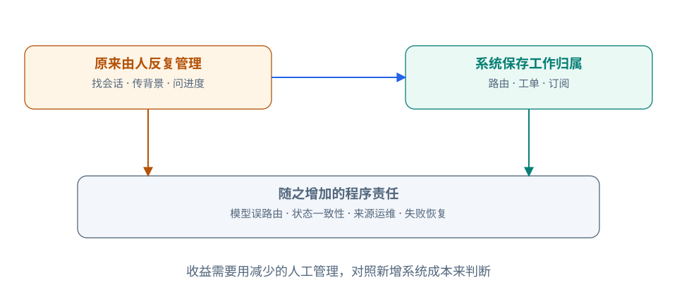
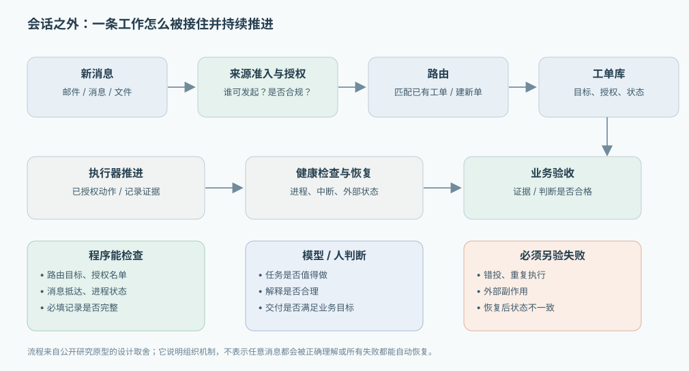
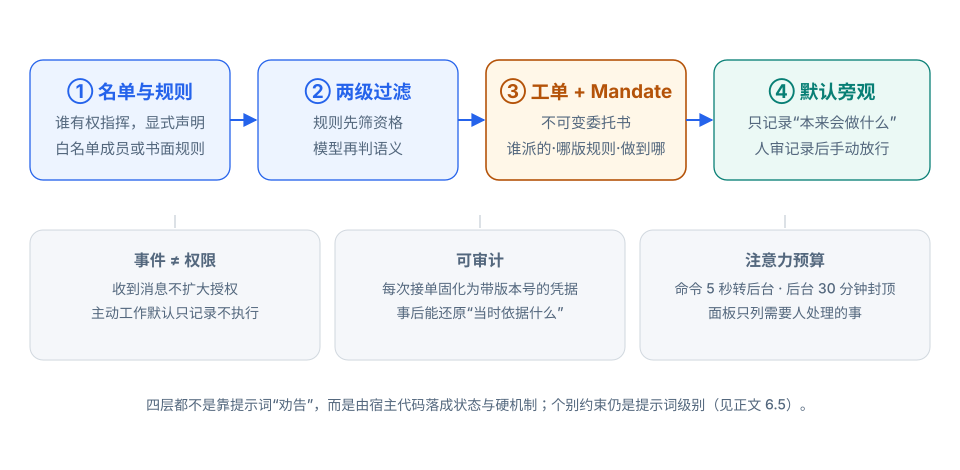
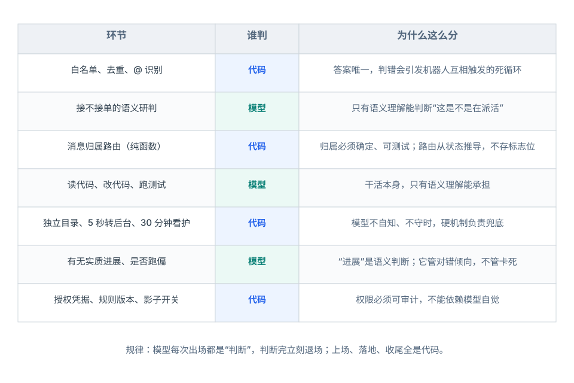
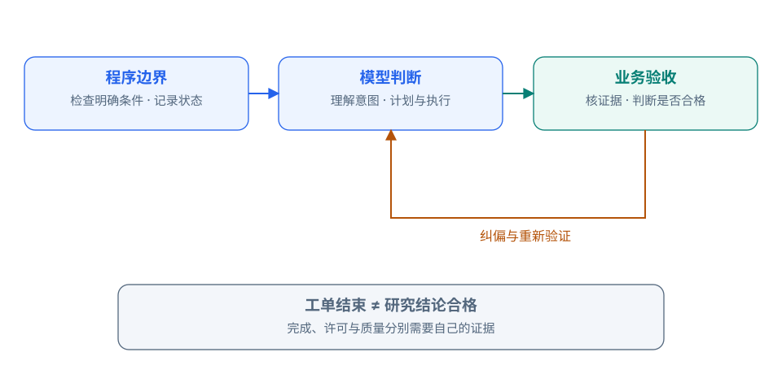
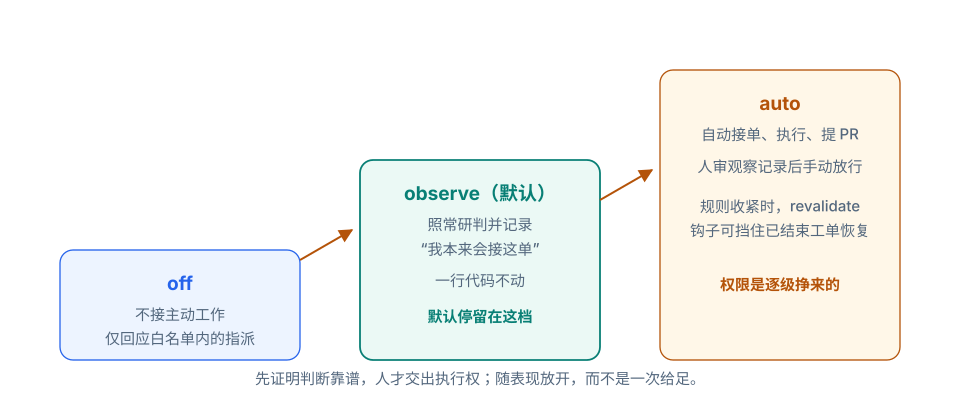
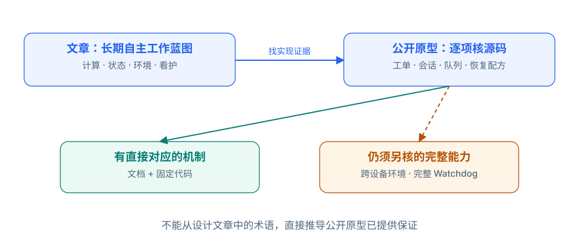

<!-- document-id: show-15 -->
<!-- document-version: 2.1-review -->

# DeepSeek Super-Agent 的设计取舍

[图解讲解](../阅读/讲解-15-会话之外的工作组织.html) · [返回首页](../index.html)

**先给三个判断：其一，Super-Agent 试图减少人管理会话和推进任务的负担，代价是系统要承担路由、授权、持久化与恢复的复杂度；其二，它的权限设计把"能不能做"这个静态开关，换成了"在什么情境、为了哪个已同意的目标、做到哪一步"的合同，这是本原型最值得借鉴的原创；其三，它解决了"少打扰"，没有解决"不干错"，还新引入了多会话账单（缓存读取约为单会话 3.8 倍）与末期集中验收的责任——注意力是被搬家，不是被消灭；这是一份未来设计的蓝图，不是今天能上手的产品。**

本文以公开研究原型与官方设计文章为据，结合公开源码解读说明权限设计与代码-模型分工。原型不是正式 DeepSeek 产品，与内部实例不完全相同；具体采用仍须按任务验证。

## 一、总：为什么需要会话之外的组织

### 1.1 模型能做事以后，瓶颈可能转到人

一次对话中，模型能调用工具完成复杂工作；若同时开多个会话，每个都要人记背景、传新要求、判断是否结束，就把协调责任留给了人。官方文章将目标概括为连续交互、并行产出、主动响应和持续在线。[官方文章][ARTICLE]

**人的注意力**是这里优化的资源，不是一个已经测得的省时比例。普通进度少一点可能让界面更安静，也可能掩盖卡住的工作，所以静默要与可查询状态和健康检查一起设计。

<figure><figcaption>图 1｜左边列出原来要人反复做的协调，箭头指向系统台账和路由；下方列出随之增加的程序责任。负担转移有收益，也有维护成本，不能仅凭界面消息少就认定总体更省事。</figcaption></figure>

### 1.2 反响：数据很响，口径要分清

原型发布约一个月内积累了可观的关注度，但各渠道数字的证据等级不同：

- 媒体转述官方 API 统计口径：日活跃用户约 154 万、日耗 token 约 92 万亿、第三方插件约 3.5 万、约 60% 活跃用户装过或做过插件。[Tech星球][TECH] 其中 token 数字未见于官方英文渠道的一手发布，按媒体报道口径对待。
- Super-agent 原型仓库三天内收获约 1.4 万 star，且期间没有新的代码提交；同期 Reddit 讨论热烈、Hacker News 相对冷淡。[deniz.in][RECEPTION] star 数说明关注度，不说明质量。
- 第三方 Harness Leaderboard（固定模型、只换外壳）将 DeepSeek Harness 列入后，五项评测与榜首统计意义上并列第一；但 Terminal-Bench 2.1 仅排第 6/10，原因是一个行为默认值：任务结束会把自启的后台服务全部杀掉，而有三道题要求服务在 Agent 退出后继续存活。[Leaderboard][LEADERBOARD]

这些数字合起来说明：路线引起了真实关注，也暴露了行为默认值层面的瑕疵。它们都不构成"业务收益已验证"的证据。

### 1.3 它是什么：工作组织方案，质量仍需另验

**路由器**（Router）负责让来件找到工作，**执行器**（Executor）推进已授权任务。独立工作会话可以减少不同任务互相干扰，但上下文更干净不代表事实必然更准；新的路由也可能分错任务、漏传约束。

运行底座（Harness）承载模型、会话与工具；来源（Source）将外部消息译成触发事件（Trigger），执行会话（Worker）围绕工单做事。类比流水线时要划边界：程序能管理"先登记后执行"，但模糊意图的理解和结果是否满足人要求，都不完全等于流水线合格判定。

<figure><figcaption>图 2｜从事件到交付的组织流程。程序能检查路由、授权和状态；任务价值和业务合格仍需模型或人判断，失败分支要单独设计。</figcaption></figure>

## 二、分：五组设计取舍（概要）

五组取舍的完整分析见上一版本；这里保留结论，展开集中在第四节（权限）、第五节（复盘）与第七节（分工）。

**主会话与执行会话分层**：长任务不再与所有新消息挤在同一会话里。收益是新来件与原任务可并行组织，代价是多一次路由理解、多个会话与结果汇总。[执行][D3]

**先准入再研判**：程序先查来源、身份与模式，模型再判断语义。原型默认观察推断工作，记录"本来会接单"而不派工；观察模式仍会调用模型，有费用，且只验证接单行为。[授权][D2]

**订阅直送**：同一讨论的补充材料投给原执行器，省去重复归属判断；订阅只传上下文，不扩大授权范围，执行器仍会接触未必可信的输入。[领域模型][D1]

**显式状态**：工单、授权、输入、决定与回执持久化，外部动作在事务后执行。代价是数据库迁移、历史增长与外部重复动作的管理。[架构与持久化][D7]

**业务要求留文字**：自动合并要求写进交付提示词；原型程序没有合并专用判定逻辑，强制审批应依赖分支保护等执行边界。[合并规则][D3]

## 三、总：权限从"门禁"换成"合同"，这是真正的原创

### 3.1 此前的权限方案都是"防贼"思路

主流方案回答的都是同一个问题："AI 能不能做这件事？"——弹窗确认（每次操作请人批准，烦到用户想全关）、容器沙箱（先假定它危险，圈起来跑）、只读模式（一刀切）。这些方案防范的是"它干坏事"，代价是把有用的事也拦住了；它们是静态的、开关式的。

### 3.2 Super-Agent 换成"管家"思路

它的权限不是一堵墙，而是**一张跟着任务走的合同**：写明在什么情境下、为了哪个已经同意的目标、可以做到哪一步；而且默认方向是"少要权限、非必要不动手"，不是"先给够、不够再要"。

对照着看更清楚：

| 维度 | 传统权限方案 | Super-Agent 的做法 |
| --- | --- | --- |
| 回答的问题 | 能不能做（二值开关） | 什么情境、哪个目标、做到哪步（情境化） |
| 默认方向 | 先给权限，出事再收 | 默认旁观，逐级挣授权 |
| 权限的载体 | 系统级配置或会话级开关 | 跟工单走、不可更改的凭据 |
| 事后追溯 | 难以还原当时依据 | 带规则版本号，可精确还原 |

别人做的是门禁系统，它做的是**委托代办制度**——这是维度差异，不是精度差异。

### 3.3 判断的边界

"原创"指的是：系统化地把权限设计的第一性原理从"防 AI 做坏事"换成"少花人的注意力"，并且每一层都有对应实现。但理念的硬化尚未完成：部分约束还是提示词级别的"劝告"，运行时权限仍依赖操作系统账户隔离（见第八节）。

## 四、分：权限设计的四层展开

<figure><figcaption>图 3｜权限设计的四层流水线。下层三个方框是贯穿全程的三条底线：事件不等于权限、判决可审计、注意力有硬预算。</figcaption></figure>

### 4.1 第一层：名单与规则——显式声明"谁有权指挥"

白名单的本意**不是区分团队和个人，而是因为输入渠道与世界共享**：群聊里有别人，邮箱里有陌生人，GitHub 上任何人都可以评论。哪怕个人助理盯着邮箱和日历，一封钓鱼邮件也是"环境事件"。如果不显式声明"谁的话算数"，就会变成"谁碰巧能给它发消息，谁就算数"。

团队只是让这个问题最尖锐的场景：原型面向一个 GitHub 仓库、可选接入飞书，只有名单上的人派的活才被接；"没人 @ 也主动干活"必须由团队写好的规则授权，不能由模型临场决定。这好比一个只认工牌的驻场员工：谁有权派活写在制度里，不是看谁喊得响。

### 4.2 第二层：事件 ≠ 权限——听到不等于能动

消息、评论、CI 结果都会流进它的耳朵，但**收到不等于能动**。两级过滤先由程序筛掉资格不符的绝大多数，剩下的再交模型研判语义；就算判出"这里有个 bug"，主动修复默认停在 observe 模式——只在后台记录"我本来会做什么、怎么修"，一行代码不动。

这里有个容易忽略的设计判断：**它把"热情"和"权限"拆成了两个东西**。热情可以很高（什么都研判），权限默认很低（什么都不动）。观察模式的错误方向是"宁漏勿滥"——漏掉的活没有直接损失，误触发也只留下一条记录。这是用覆盖率换安全，不是解决了覆盖问题（见第八节）。

### 4.3 第三层：工单与不可变 Mandate——一张带理由的委托书

名单上的人派了活，系统签发一个工单，附带一份**不可更改的授权说明（Mandate）**：谁派的、依据哪个版本的规则、允许动的范围、授权强度（明确指派还是主动推断）。干活过程中这份文书不许改。

打个比方：你让实习生"修登录页的 bug"，他路上发现数据库密码明文存储——按委托书，他不能顺手重构数据库，超出范围就得回来重新申请。这堵住了 Agent 最经典的失控方式：干着干着"顺手"扩大战场。

### 4.4 第四层：注意力预算——用机制而不是承诺保证"不打扰"

权限克制之外，连"说话频率"都有硬约束：确认一次请求，干活期间静默，只在出结果、有疑问或失败时开口；shell 命令 5 秒不返回自动转后台，后台任务每轮 30 分钟封顶；面板只列需要人处理的事。这些是代码机制，不是"尽量少打扰"的承诺。

"少打扰"要辩证看：一个不吭声但干对了的 Agent，比每步都汇报的更有价值——前提是状态可查询、失败可发现。静默的价值依赖第八节讨论的那些前提。

## 五、总：设计复盘——解决了什么，又带来了什么

先把定位说死：**Super-Agent 是下一代 Agent 的架构蓝图，不是今天能上手的产品。**官方口径是"架构思路探讨，不是产品功能介绍"，公开原型 README 写明与内部实例不完全相同，部署文档把隔离责任交给使用者另开的操作系统账户。[README][D0] 今天真实落地、在跑着的是 dsh 主框架（官方披露日活约 154 万、第三方插件约 3.5 万）[TECH]；Super-agent 这套"路由 + 工单 + 默认旁观"的组织方式，还停在原型阶段。

### 5.1 三个清单：解决了什么、没解决什么、新引入了什么

| 解决了什么 | 没解决什么 | 新引入的问题 |
| --- | --- | --- |
| "少打扰"被做成机制：确认一次、干活静默、出结果才开口 | "干得对不对"：漏执行不可审计，看门狗只查卡死、不查对错 | 注意力被搬家：从"随时被打断"变成"末期集中验收"，验收人不认真，整套克制设计等于白搭 |
| 闯祸半径被物理限制：独立工作目录、默认 observe、Mandate 划定边界 | 提示注入与凭证泄漏：官方自列为开放问题 | 多会话更贵：官方实验单轮缓存读取约 2,323 万 token，为单会话基线（约 605 万）的 3.8 倍[ARTICLE]；行业对照，Anthropic 自报其多智能体系统约为普通对话的 15 倍 token[ANTHROPIC]。注意这是缓存读取口径，不等于总账单同倍数上涨 |
| 判断可审计：Mandate 带规则版本号，事后可精确还原当时依据 | 覆盖率：observe 档"宁漏勿滥"，漏了多少真活没人知道 | observe 档有真金白银的模型调用费用，且只验证接单行为，不验证执行质量 |
| | | 复杂度转移：路由、状态机、数据库迁移、恢复逻辑，从"人操心"变成"系统要维护的东西" |

一句话：**它把"打扰"这一栏的问题真的解决了，把"干错"这一栏的问题只是关小了，同时自己新开了一栏账单。**

### 5.2 做得好的四点

1. **权限哲学原创**：默认方向从"先给够、出事再收"倒成"少要、逐级挣"，权限从开关换成跟任务走的合同——连批评者都承认值得抄。
2. **代码与模型的分工铁律**：模型只判决，代码负责固化、记账、拦截，判决可测试、可审计（见第六节）。
3. **信任坡道**：off → observe → auto 三档，权限逐级挣，不一步到位；团队可以先看几天"本来会做什么"的记录再放行。
4. **内部实战背书**：官方自述内部实例持续运行，群聊里有人报 bug，它后台自己复现、找到修法才出声，有时 PR 已提好（官方自述口径，未独立核验）。

### 5.3 两句反思

站在设计者角度：这套设计证明了"省注意力可以做成机制"——热情和权限被拆开、善意被写成代码；但"可靠执行"那一格还是空的，理念跑在工程前面。站在使用者角度：它的启发不限于 Super-agent——设计任何 Agent，先问的应该是"少花人多少注意力、错了损失多大"，而不是"能多做多少事"；把默认方向倒过来这件事，任何团队都学得走。

## 六、总：代码设计的铁律——模型当法官，代码当书记员

原型实现遵循一条可检验的分工铁律：**凡是"答案唯一、错了会出事、需要可审计"的事用代码；凡是"需要语义理解"的事用模型——而且模型的每次判断，都要被代码落成不可更改的记录。**模型是法官，只管判决；代码是书记员加法警，负责记账、递纸、拦人。

<figure><figcaption>图 4｜七个环节的分工速查。代码承担所有"答案唯一、需要可审计"的环节；模型只出现在语义判断和干活本身；判决结果由代码固化。</figcaption></figure>

这条铁律与既有的三方责任划分相容：程序边界检查明确条件，模型理解意图并执行，业务验收核对最终价值——三者协作，但任何一方都不能自动推导另外两方已经正确。

<figure><figcaption>图 5｜程序边界、模型判断与业务验收的责任区。箭头表示协作与反馈，不表示任一责任区能自动推导另外两方已经正确。</figcaption></figure>

## 七、分：四个实现场景展开

### 7.1 进门判断：Eval 两级过滤

**谁判**：第一级 Gate 是纯代码——发送者在不在白名单、是不是机器人自己的消息、有没有明确 @、是否重复投递（按事件 id 幂等去重）、仓库在不在监听范围；被拦掉的事件只进审计，不通知任何人。第二级 Assessment 才是模型：对幸存者做语义研判，从 accept（接单）、stop（叫停）、ignore（忽略）、unavailable（干不了）四个固定选项里挑一个。

**为什么这么分**：最直接的是成本与延迟——公开解读按官方模拟负载估算，300 条消息里约 280 条在第一级就被挡掉，不进模型；同线程消息攒批研判后，摊到单个决策的推理时间从 6.4 秒降到 1.6 秒。[源码解读][IMPL] 更根本的是稳定性："这条消息是不是我自己发的"用代码判永远正确，用模型判偶尔出错，而错了就是两个机器人互相触发的死循环。

### 7.2 跟帖归属：路由是纯函数，模型只当替补

一条人类跟进消息进来，可能有三个归属：归正在干这单的执行器、送模型研判、或直接丢弃。公开源码用一个纯函数（followupOwners）依次过五道门回答：必须人类触发、非重排队、排除已交还与仅上下文的工单、评估未占用、工单存活且输入未消费。**函数返回空，消息才轮到模型；返回了归属，消息直通执行器，模型完全不参与。**

**为什么路由必须用代码**：路由错了会"两头都不管"或"两头都管"。实现原则是路由结果永远从当前状态推导，不存标志位——没有 flag 就没有"标志位说归 A、实际归了 B"的状态不同步；纯函数只有三个入参，可以脱离系统单独测试。[REPO-EXP]

### 7.3 执行现场：模型干活，代码当监工

**模型的活**：读代码、复现、修改、跑测试、拆步骤做计划——全是运行底座现成的能力。**代码的活**：每个工单独立的执行会话与独立工作目录（物理隔离，不是靠提示词请求）；shell 命令 5 秒不返回自动转后台；后台任务 30 分钟被强制终止；调度器周期扫描待处理工单；结果由发件箱按事件携带的回写地址送回原对话；状态存 SQLite，确定性 ID 保证同一事件重投只记一次；看门狗是混合的——进程死活、是否超时由代码查，"有没有实质进展、是否跑偏"由独立巡检会话用模型判断。

**为什么这么分**：代码管"不会出格"，模型管"能不能干成"。独立目录消灭两类经典事故（改 A 时串进 B 的方案、两个任务改同一文件）——这类事靠提示词拦不住，物理上不共享才是真隔离；5 秒转后台与 30 分钟终止是给模型的行为兜底：模型不知道自己卡死了，代码知道。

### 7.4 授权记账：判决由代码落成不可变合同

模型研判"该接"之后，接下来全在代码手里：签发不可变 Mandate（规则版本、范围、强度、触发者身份）；规则文件版本化、支持热更新，但改规则**不撤销在跑的工单**——老规则跑到结束，新规则从下一单生效；授权分 off / observe / auto 三档，默认 observe；已结束的工单想恢复，先过 revalidate 钩子重核授权，期间规则收紧则恢复被挡。

<figure><figcaption>图 6｜授权三档的信任坡道。权限是逐级挣来的：先在 observe 档证明判断靠谱，人才交出执行权；规则收紧时，已结束工单的恢复会被代码挡住。</figcaption></figure>

**为什么**：权限必须是可审计的状态机，不能靠模型自觉。提示词里写"不要动 CI 配置"是劝告，劝告可以商量；Mandate 里的范围是边界，边界不行。规则变更不溯及既往，是为了避免执行器前半段按 A 规则、后半段按 B 规则干出个无法验收的结果。

### 7.5 一处诚实边界

公开源码解读同时指出：**"路由会话不读代码"这条约束，在原型里是提示词规则，不是工具层限制。**也就是说，铁律描述的硬边界里，个别关键处仍是"劝告"级别。这不是否定整套设计，而是提醒：读到"约束"两个字时，要区分它是宿主代码强制，还是提示词请求。[IMPL]

## 八、总：局限——注意力被搬家，不是被消灭

### 8.1 漏执行与执行偏离没有解决

第四节的机制保证了"少打扰"和"闯祸半径小"，保证不了"该干的都干了、干的都是对的"：

- **漏执行**：两级过滤筛掉的消息里可能混着真该干的活，无人能审计"它漏听了多少"；看门狗只管"是否卡死循环"，不管"判断对不对"——它是看门狗，不是质检员。observe 模式的"宁漏勿滥"是用覆盖率换安全。
- **执行偏离**：Mandate 在开工时签发，不随中途变化自动更新；提示注入与凭证泄漏被官方列为开放问题；偏离往往要到人类验收那一刻才被发现。窄窄的兜底是独立目录限制了偏离的爆炸半径——这是止血，不是治病。
- **注意力的去向**：省注意力机制的另一面，是把责任从"随时被打断"搬到"末期集中验收"。活少但责任重；验收人不认真，整套克制设计等于白搭。公开研究也提示多智能体协作本身有质量折损：一项 2026 年初的研究报告协作场景成功率比单智能体低约 30%[COOPER]。

DeepSeek 自己的口径与此一致：官方称本次发布是架构思路探讨，不是产品功能介绍；公开原型 README 明确与内部实例不完全相同。[README][D0]

### 8.2 蓝图、公开原型和实验分别说明什么

设计文章解释想建立怎样的系统；公开代码提供可核对的具体实现；实验只回答某个任务设定里的比较。三者不能叠成"所有能力已实现"的清单。

| 文章方向 | 公开原型可核对应 | 仍须单独核查 |
| --- | --- | --- |
| 分层与并发 | 主会话、工单执行会话、后台工作 | 路由质量与负载表现 |
| 事件驱动 | Source、Trigger、准入、订阅 | 新来源完整契约和规则 |
| 执行中继续交互 | 输入队列、后台完成事件、优先槽 | 延迟、工具能否及时停止 |
| 状态与环境分离 | 显式工单库、Harness 会话、工作目录 | 跨设备迁移和环境一致性 |
| 独立看护 | 另一 profile 中的定时状态检查配方 | 完整看护的进展判断与偏离纠正 |

<figure><figcaption>图 7｜从蓝图向公开实现逐项找证据，虚线表示仍需核查的能力。文档里出现一个术语，不足以证明相同系统边界和恢复保证已经存在。</figcaption></figure>

### 8.3 实验口径

官方文章第 7 节使用合成负载与简化环境，每种方案运行 5 次，编程工作以只消耗时间的工具模拟；报告 Super-Agent 完成时间 p95 为 15.7 分钟，中性提示的单会话加子代理为 29.5 分钟。[原文与口径][ARTICLE] 这证明该设定中的调度比较，不证明实际代码更正确，也不能与未跑同样输入的框架作业务质量排名。本篇没有复现实验。

### 8.4 优缺点必须对着替代做法说

| 替代安排 | 显式工作组织的收益 | 增加的代价 |
| --- | --- | --- |
| 人工管理多个会话 | 减少找背景与问归属 | 路由、状态与渠道维护 |
| 单一模型循环 | 可分别组织多件持续工作 | 多一层模型研判与协调调用 |
| 固定脚本 | 能理解中途变化的自然语言要求 | 不确定性与语义验收成本 |

收益要同时看人和系统：少发几条通知不等于少了人工工作，执行器变多不等于完成更快。重试、纠偏和最后验收都要算进去。

## 九、分：落到业务，哪些设计值得验证

### 9.1 适用场景和三个反场景

跨天研究、多次补材料、多个独立议题并行，符合持续工作组织的约束；可先用工单保存范围、用订阅连接新证据、用结构化问题请求裁决。三个反场景：一次短问答不必加路由层；固定统计报表交给脚本调度；高影响自动发布不能只凭模型报告放行，应外置审批。

### 9.2 采用条件与信任坡道

建议先验证"原来人在哪些步骤反复管理"，再决定引入哪层；若实际只需要保存范围和引用，先做单执行器的任务记录，出现大量跨事件纠偏时再评估路由与多会话。权限上沿信任坡道走：先以 observe 档运行一段时间，人工审阅"本来会做什么"的记录，判断靠谱后再逐档放行；规则收紧的预期也要预先写进策略文件，因为已开工单不会中途换规则。

### 9.3 追问树与坦白表

**A1：为何把任务从会话分出来？** 减少人手工管理归属。**A2：会不会只是把成本转移给程序？** 会，所以要量化维护与调用费用。**A3：怎样判断值得？** 看相同任务的总人机成本与质量。依据：1.1、2、8.4。

**B1：观察模式证明什么？** 接单判断在回放中的表现。**B2：能证明持续运行可靠吗？** 不能。**B3：还缺什么？** 并发、交付与恢复的故障实验。依据：4.2、8.2。

**C1：权限设计原创在哪？** 从静态开关换成跟任务走的合同，默认方向从"多给"换成"少要"。**C2：合同能挡住一切偏离吗？** 不能，Mandate 不随中途变化更新，提示注入未解。**C3：哪条约束还是软的？** "路由不读代码"目前是提示词规则。依据：三、四、五、7.5、8.1。

**D1：漏执行有人审计吗？** 没有，两级过滤的漏听不可审计。**D2：验收责任变轻了吗？** 变重了，注意力被集中搬到末期。**D3：多执行器协作的质量折损解了吗？** 没解，公开研究报告约 30% 的成功率下降。依据：8.1。

已核官方文章、固定原型与公开源码解读；未复现实验，也未测实际业务节省时间或质量。文中取舍是有证据的分析，迁移建议仍待验证。

## 下一步

采用前把每项取舍转换为故障检查：权限上先走 observe 档并抽审记录；给长任务写清"什么算做完"；只在可丢弃环境放开执行权限。用同一起点的实际任务，比较人工协调、恢复与最终质量，再决定引入哪一层。

[ARTICLE]: https://x.com/DeepSeekHarness/status/2116857257245987236
[ANTHROPIC]: https://www.anthropic.com/engineering/multi-agent-research-system
[D0]: https://github.com/deepseek-ai/dsh-superagent-prototype/blob/8c32a9dc5d72c033816c6a8110b37f40cf94fba4/README.md
[D1]: https://github.com/deepseek-ai/dsh-superagent-prototype/blob/8c32a9dc5d72c033816c6a8110b37f40cf94fba4/docs/001-domain.md
[D2]: https://github.com/deepseek-ai/dsh-superagent-prototype/blob/8c32a9dc5d72c033816c6a8110b37f40cf94fba4/docs/002-authorization.md
[D3]: https://github.com/deepseek-ai/dsh-superagent-prototype/blob/8c32a9dc5d72c033816c6a8110b37f40cf94fba4/docs/003-execution.md
[D7]: https://github.com/deepseek-ai/dsh-superagent-prototype/blob/8c32a9dc5d72c033816c6a8110b37f40cf94fba4/docs/007-architecture.md
[IMPL]: https://mp.weixin.qq.com/s?__biz=MzkxNjQyNTQxOQ==&mid=2247485191&idx=1&sn=4b409c9720aaa2fd9b5776b56d99ee3c&chksm=c0f4344bcff49397d882f9c4c29c31303be518855c3c9aeb04c9d70c6cfe727f7932440868b
[REPO-EXP]: https://repo-explainer.com/deepseek-ai/dsh-superagent-prototype
[RECEPTION]: https://deniz.in/deepseek-s-dsh-superagent-racked-up-14k-github-stars-with-zero-code-changes
[TECH]: https://finance.sina.com.cn/money/fund/jjzl/2026-11-19/doc-inizhrsf0891781.shtml
[LEADERBOARD]: https://aitecharchive.com/articles/deepseek-harness-dsh-open-source-coding-agent-leaderboard
[COOPER]: https://hackeruna.com/en/post/deepseek-super-agent-agente-codigo-open-source-mit

## 公开版本与补核范围

公开原型固定在 `8c32a9dc5d72c033816c6a8110b37f40cf94fba4`。2026-11-13 定点核对 README、执行规则、部署看护配方及官方设计文章；2026-11-24 依据公开源码解读与第三方评测补充权限设计、代码-模型分工与局限分析，并补充设计复盘节：多会话 token 开销（3.8 倍缓存读取）转引自官方实验表，15 倍行业对照引自 Anthropic 多智能体系统工程博客（厂商自报口径）；反响数据（1.2）为媒体转述与社区口径，按证据等级标注；官方实验未复现，合成调度结果不代表真实编码质量。
