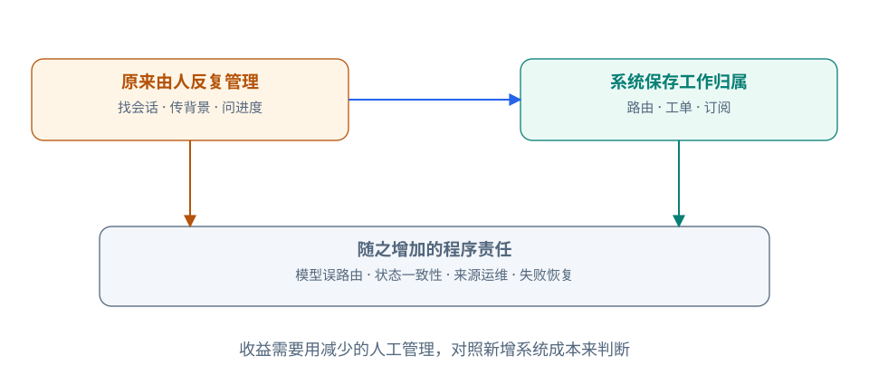
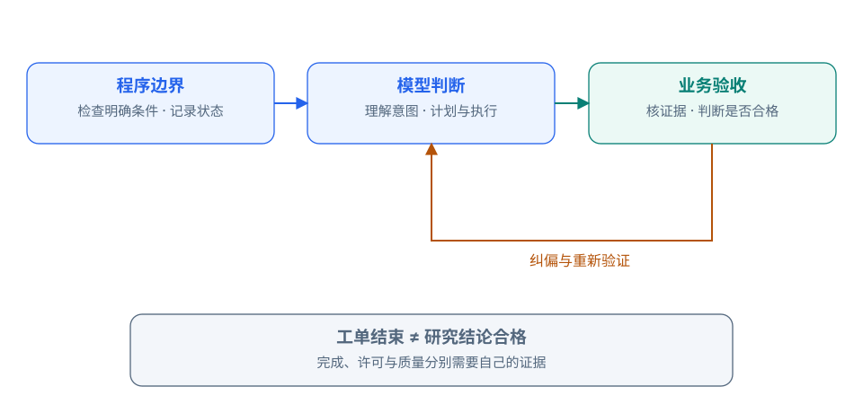
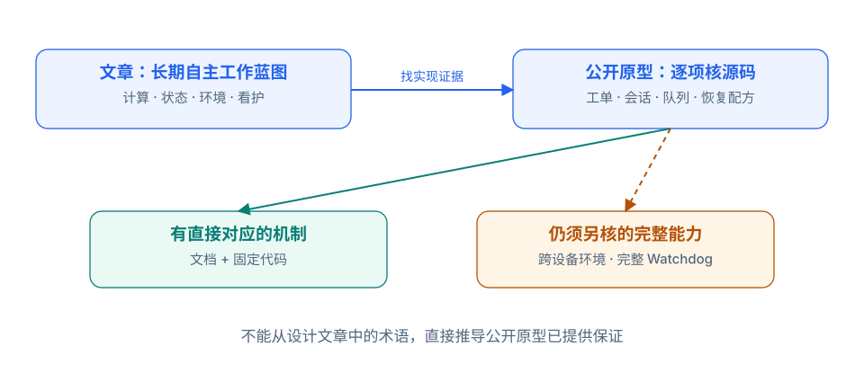

<!-- document-id: show-15 -->
<!-- document-version: 1.0-review -->

# 为什么 Agent 需要会话之外的组织：DeepSeek Super-Agent 的设计取舍

[图解讲解](../阅读/讲解-15-会话之外的工作组织.html) · [返回首页](../index.html)

**先给判断：Super-Agent 试图减少人管理会话和推进任务的负担，代价是系统要承担路由、授权、持久化与恢复的复杂度。** 是否有收益，取决于任务是否跨事件持续变化，以及系统省下的人工管理能否抵过新增协调成本。

本文以公开研究原型说明持续工作组织的取舍。该原型不是正式 DeepSeek 产品，也不等同于官方蓝图中的全部能力；具体采用仍须按任务验证。

## 一、总：原来卡在哪，设计想改变什么

### 1.1 模型能做事以后，瓶颈可能转到人

一次对话中，模型能调用工具完成复杂工作；若同时开多个会话，每个都要人记背景、传新要求、判断是否结束，就把协调责任留给了人。官方文章将目标概括为连续交互、并行产出、主动响应和持续在线。[官方文章][ARTICLE]

“更少打扰”在原型中有具体表现：只在有授权时工作，只在结果可用、需要决定或无法继续时发消息；面板突出待人工处理项。普通进度留在工单，不等于不留记录。[工作原则][D00]、[面板][D5]

**人的注意力**是这里优化的资源，不是一个已经测得的省时比例。普通进度少一点可能让界面更安静，也可能掩盖卡住的工作，所以静默要与可查询状态和健康检查一起设计。

<figure><figcaption>图 1｜左边列出原来要人反复做的协调，箭头指向系统台账和路由；下方列出随之增加的程序责任。负担转移有收益，也有维护成本，不能仅凭界面消息少就认定总体更省事。</figcaption></figure>

### 1.2 它是什么：工作组织方案，质量仍需另验

**路由器**（Router）负责让来件找到工作，**执行器**（Executor）推进已授权任务。独立工作会话可以减少不同任务互相干扰，但上下文更干净不代表事实必然更准；新的路由也可能分错任务、漏传约束。

后文用到的运行底座（Harness）承载模型、会话与工具；配置档（profile）组织一组运行配置。来源（Source）将外部消息译成触发事件（Trigger），执行会话（Worker）围绕工单做事。这些只是职责名称，不各自承诺新的质量或安全保证。

类比流水线时要划边界：程序能管理“先登记后执行”，但模糊意图的理解和结果是否满足人要求，都不完全等于流水线合格判定。因此业务验收仍需要题目、证据与人类责任。

## 二、分：五组设计取舍怎样形成

### 2.1 主会话与执行会话分层：保交互，增加协调

长任务如果与所有新消息挤在同一会话里，新要求会打断执行，或者排队等很久。原型让主会话路由，具体工单由执行会话做事；长命令转后台，人类追问有优先槽。[执行][D3]

收益是新来件和原任务执行可以并行组织，代价是多了一次路由理解、多个会话和结果汇总。原型 Router 仍有短时 shell；“分层”描述职责与工具差别，不能简化为一个无工具大脑指挥所有工作。

### 2.2 先准入再研判：降低无关工作，也要维护规则

程序先查来源、身份和模式，模型再判断语义。这样可以拒绝明显无资格的新工作，不把每条话都当任务。原型默认观察推断工作，记录“本来会接单”而不派工。[授权][D2]

观察模式**仍会用模型研判**，因此有调用费用；它主要验证接单行为，不能证明后续执行、重启和交付都可靠。规则写得太宽会误接，太窄会漏掉有价值工作，这是业务校准问题。

### 2.3 订阅直送：省掉重复归属判断，也保留不可信输入

同一讨论的补充材料投给原执行器，可以减少用户重复解释。**订阅**（Subscription）只传上下文；原工单的授权范围并不扩大。是否超出范围需要执行器理解，程序保存交回与归属。[领域模型][D1]

代价是执行器会接触未必可信的评论、检查结果和引用材料。需要将输入当数据，并在工具侧限制可执行动作；不能把“来源已接入”当成防注入或材料真实性保证。

### 2.4 显式状态：方便恢复，增加数据与事务问题

若“做没做、等什么”只在模型上下文，进程重启会失去可靠线索。原型把工单、授权、输入、决定、待办和回执持久化，外部动作在事务后执行。[架构与持久化][D7]

代价是要管理数据库迁移、历史增长和外部重复动作。工单库、Harness 会话和工作文件还不是一个存储；要恢复一项工作，需要知道哪些状态在库里、哪些在环境中。仅保存对话，或仅保存一份 SQLite，都不能代表完整恢复。

### 2.5 业务要求留文字：适应团队，也留下强制性差别

自动合并要求写进交付提示词，改动容易，适应不同团队。官方却明确，原型程序没有合并专用判定逻辑。需要强制审批时，应依赖仓库分支保护或其他执行门。[合并规则][D3]

这解释了为何不能把“提示词有规定”写成“代码已经保证”。接单身份由程序校验，是否值得做和怎么交付有模型判断；高影响动作还需要外部强制边界。

<figure><figcaption>图 2｜并列看三个责任区：程序检查可判条件，模型理解意图和执行，业务验收核结果。箭头表示协作与反馈，不表示任一责任区能自动推导另外两者已经正确。</figcaption></figure>

## 三、总：蓝图、原型和实验分别证明什么

### 3.1 文章蓝图比公开原型范围大

原型 README 明确：公开代码经过调整，与内部系统及文章并不完全相同，部分设计尚未实现。原文的计算、状态、环境分离，与公开部署中的数据库、会话、工作目录，不能不加条件地画等号。[README][D0]

| 文章方向 | 公开原型可核对应 | 仍须单独核查 |
| --- | --- | --- |
| 分层与并发 | 主会话、工单执行会话、后台工作 | 路由质量与负载表现 |
| 事件驱动 | Source、Trigger、准入、订阅 | 新来源完整契约和规则 |
| 执行中继续交互 | 输入队列、后台完成事件、优先槽 | 延迟、工具能否及时停止 |
| 状态与环境分离 | 显式工单库、Harness 会话、工作目录 | 跨设备迁移和环境一致性 |
| 独立看护 | 另一个 profile 中的定时状态检查配方 | 完整 Watchdog 的进展判断与偏离纠正 |

**看护者**（Watchdog）是官方文章中独立于主系统的监督会话，会判断基础设施和工作推进。公开配方检查服务状态并按结果恢复，且尊重人工停止；这有借鉴价值，却不能当成整个蓝图已实现。[官方文章第6节][ARTICLE]、[部署][DEPLOY]

<figure><figcaption>图 3｜从左边蓝图向右边公开实现逐项找证据，虚线表示仍需核查的能力。文档里出现一个术语，不足以证明相同系统边界和恢复保证已经存在。</figcaption></figure>

### 3.2 实验支持调度比较，不支持业务质量排名

官方英文文章于 2026-11-01 发布，注明为中文原文的机器翻译。第7节使用合成负载与简化环境，每个方案运行5次，编程工作以只消耗时间的工具模拟。报告中 Super-Agent 完成时间 p95 为15.7分钟，中性提示的单会话加子代理为29.5分钟。[原文与口径][ARTICLE]

这个实验中，两层安排所列的完成时间p95更低。它不能证明实际代码更正确、研究更准确，也不能与没有跑同样输入的 Hermes、AgentScope 作性能排名。官方设计文章的公开来源与固定原型分别列在文末；本篇没有复现实验。

### 3.3 优缺点必须对着替代做法说

| 替代安排 | 显式工作组织的收益 | 增加的代价 |
| --- | --- | --- |
| 人工管理多个会话 | 减少找背景与问归属 | 路由、状态与渠道维护 |
| 单一模型循环 | 可分别组织多件持续工作 | 多一层模型研判与协调调用 |
| 固定脚本 | 能理解中途变化的自然语言要求 | 不确定性与语义验收成本 |

所以收益要同时看人和系统：少发几条通知不等于少了人工工作，Worker 变多不等于完成更快。要把重试、纠偏和最后验收都算进去。

## 四、分：落到研究任务，哪些设计值得验证

### 4.1 适用场景和三个反场景

跨天研究、多次补材料、多个独立议题并行，符合持续工作组织的约束。可先用工单保存研究范围，用订阅连接新证据，用结构化问题请求裁决；这属于迁移建议，不是原型现成的情报功能。

一次短问答不必先加路由层；固定统计报表不必每轮交模型决定流程；高影响自动发布不应只凭模型报告放行。这三个反场景分别更适合简单调用、脚本调度和外置审批。

### 4.2 采用条件与失败例子

构造场景：系统已有两条独立议题，一个研究部署变化，一个整理产品资料。材料更新同时命中两者，订阅可以分别投递；但是否应合并结论、是否属于独立证据，仍需分析方法和来源治理。并发改善组织，不自动解决证据相互依赖。

建议先验证“原来人在哪些步骤反复管理”，再决定引入哪层。若实际只需要保存范围和引用，先做单执行器的任务记录；出现大量跨事件纠偏时，再评估路由与多会话。是否迁移已有系统，还需比较接入成本与实际收益。

### 4.3 追问树与坦白表

**A1：为何把任务从会话分出来？** 减少人手工管理归属。**A2：会不会只是把成本转移给程序？** 会，所以要量化维护和调用。**A3：怎样判断值得？** 看相同任务的总人机成本与质量。依据：1.1、2.1、3.3。

**B1：观察模式证明什么？** 接单判断在回放中的表现。**B2：能证明持续运行吗？** 不能。**B3：还缺什么？** 并发、交付和恢复故障实验。依据：本篇 2.2 与公开原型 README。

加分题：原文实验快了一些，能推出研究结论更准确吗？不能，试验任务与质量指标不同。

已核官方文章、固定原型与相关源码，未复现实验，也未测本文涉及的实际业务节省时间或质量。因此文中取舍是有证据的分析，迁移采用建议仍待验证。

## 下一步

采用前应把每项取舍转换为故障检查，并用同一起点的实际任务比较人工协调、恢复与最终质量。

[D0]: https://github.com/deepseek-ai/dsh-superagent-prototype/blob/8c32a9dc5d72c033816c6a8110b37f40cf94fba4/README.md
[ARTICLE]: https://x.com/DeepSeekHarness/status/2116857257245987236
[DEPLOY]: https://github.com/deepseek-ai/dsh-superagent-prototype/blob/8c32a9dc5d72c033816c6a8110b37f40cf94fba4/docs/006-deployment.md
[D00]: https://github.com/deepseek-ai/dsh-superagent-prototype/blob/8c32a9dc5d72c033816c6a8110b37f40cf94fba4/docs/000-philosophy.md
[D1]: https://github.com/deepseek-ai/dsh-superagent-prototype/blob/8c32a9dc5d72c033816c6a8110b37f40cf94fba4/docs/001-domain.md
[D2]: https://github.com/deepseek-ai/dsh-superagent-prototype/blob/8c32a9dc5d72c033816c6a8110b37f40cf94fba4/docs/002-authorization.md
[D3]: https://github.com/deepseek-ai/dsh-superagent-prototype/blob/8c32a9dc5d72c033816c6a8110b37f40cf94fba4/docs/003-execution.md
[D4]: https://github.com/deepseek-ai/dsh-superagent-prototype/blob/8c32a9dc5d72c033816c6a8110b37f40cf94fba4/docs/004-prompts.md
[D5]: https://github.com/deepseek-ai/dsh-superagent-prototype/blob/8c32a9dc5d72c033816c6a8110b37f40cf94fba4/docs/005-panel.md
[D7]: https://github.com/deepseek-ai/dsh-superagent-prototype/blob/8c32a9dc5d72c033816c6a8110b37f40cf94fba4/docs/007-architecture.md
[D8]: https://github.com/deepseek-ai/dsh-superagent-prototype/blob/8c32a9dc5d72c033816c6a8110b37f40cf94fba4/docs/008-cookbook.md
[PKG]: https://github.com/deepseek-ai/dsh-superagent-prototype/blob/8c32a9dc5d72c033816c6a8110b37f40cf94fba4/package.json
[H0]: https://github.com/deepseek-ai/deepseek-harness/blob/fcc0ad462172522aaf5c93a7b2e01f6b9f0b0159/README.md
[INTAKE]: https://github.com/deepseek-ai/dsh-superagent-prototype/blob/8c32a9dc5d72c033816c6a8110b37f40cf94fba4/src/core/intake.ts
[SOURCE]: https://github.com/deepseek-ai/dsh-superagent-prototype/blob/8c32a9dc5d72c033816c6a8110b37f40cf94fba4/src/sources/kind.ts
[ADMISSION]: https://github.com/deepseek-ai/dsh-superagent-prototype/blob/8c32a9dc5d72c033816c6a8110b37f40cf94fba4/src/admission.ts
[POLICY]: https://github.com/deepseek-ai/dsh-superagent-prototype/blob/8c32a9dc5d72c033816c6a8110b37f40cf94fba4/src/policy.ts
[ENGINE]: https://github.com/deepseek-ai/dsh-superagent-prototype/blob/8c32a9dc5d72c033816c6a8110b37f40cf94fba4/src/core/engine.ts
[TICKETS]: https://github.com/deepseek-ai/dsh-superagent-prototype/blob/8c32a9dc5d72c033816c6a8110b37f40cf94fba4/src/core/tickets.ts
[ASSIGN]: https://github.com/deepseek-ai/dsh-superagent-prototype/blob/8c32a9dc5d72c033816c6a8110b37f40cf94fba4/src/core/assignments.ts
[BUNDLE]: https://github.com/deepseek-ai/dsh-superagent-prototype/blob/8c32a9dc5d72c033816c6a8110b37f40cf94fba4/cordis.patch.yml
[EXECUTOR]: https://github.com/deepseek-ai/dsh-superagent-prototype/blob/8c32a9dc5d72c033816c6a8110b37f40cf94fba4/src/executor/dsh.ts
[BACKGROUND]: https://github.com/deepseek-ai/dsh-superagent-prototype/blob/8c32a9dc5d72c033816c6a8110b37f40cf94fba4/src/executor/background.ts
[EFFECTS]: https://github.com/deepseek-ai/dsh-superagent-prototype/blob/8c32a9dc5d72c033816c6a8110b37f40cf94fba4/src/app/effects.ts
[OUTBOX]: https://github.com/deepseek-ai/dsh-superagent-prototype/blob/8c32a9dc5d72c033816c6a8110b37f40cf94fba4/src/app/outbox.ts
[MEMORY]: https://github.com/deepseek-ai/dsh-superagent-prototype/blob/8c32a9dc5d72c033816c6a8110b37f40cf94fba4/src/core/memory.ts
[PORTS]: https://github.com/deepseek-ai/dsh-superagent-prototype/blob/8c32a9dc5d72c033816c6a8110b37f40cf94fba4/src/core/ports.ts
[TESTS]: https://github.com/deepseek-ai/dsh-superagent-prototype/tree/8c32a9dc5d72c033816c6a8110b37f40cf94fba4/tests

## 公开版本与补核范围

公开原型固定在 `8c32a9dc5d72c033816c6a8110b37f40cf94fba4`。2026-11-13 定点核对 README、执行规则、部署看护配方及官方设计文章。官方文章的合成调度实验不代表真实编码质量；本文没有复现实验，也不把它与未跑同样任务的产品作性能排名。
