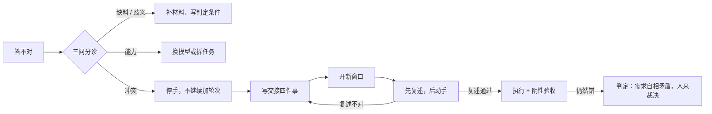
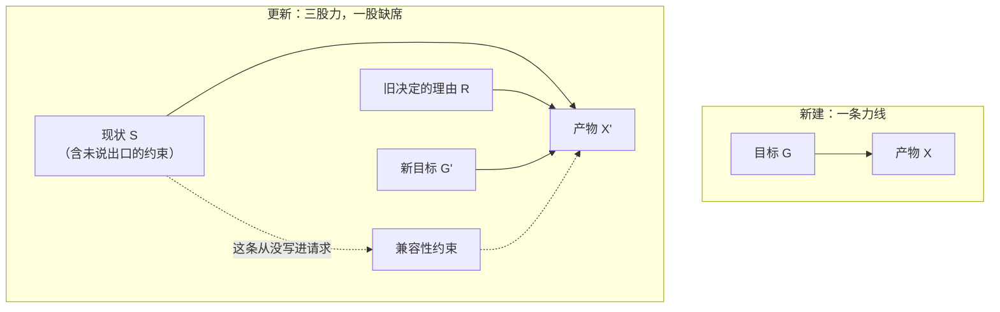

# 为什么和 AI 越聊越乱

> **文档类型**：机制拆解型文章。不是产品说明书，也不是操作手册。全文回答一个问题：为什么"改"比"新建"容易乱，什么时候该换一个窗口。
>
> **体例说明**：不套《文档规范》的八节主干，那套骨架是给"梳理一个对象"用的。全文四层：结论层（分诊、四步、重开）→ 机制层 → 展开层（三场景）→ 附录层（场景速查、证据边界）。规范的硬条款照做：每个数字带口径与日期，因果链写成"约束 → 取舍 → 代价"。
>
> **断言标注**：`[论文]` 公开受控实验；`[官方文档]` 厂商一手操作指引；`[工程博客]` 一手实践经验，未受控；`[经验]` 作者实践观察；`[综合推断]` 多类间接证据共同支持但无直接实验；`[推测]` 本文提出的机制假设，附证伪方式。无标注的为可直接核对的定义或事实。
>
> **与第 01 篇的分工**：[第 01 篇](为什么编码%20Agent%20越聊越浅：上下文腐烂、自我纠错盲区与交接成本.md) 讲"信息变多、变旧之后，哪一份算权威版本变得不确定"，那是**噪声**轴。本文讲"同一件事在窗口里有两个以上互相矛盾的版本"，那是**冲突**轴。两篇症状像，机制不同，本文不重述腐烂、自我纠错盲区、交接成本那三套。

## 太长不看

**现象**：让它从零写一个东西往往顺利，让它改一个已有的东西却容易越改越歪。乱的来源是上下文里"同时有效的版本数"在涨，不是信息总量在涨。

**机制一句话**：更新请求天然携带三股力（现状、旧决定的理由、新目标），外加一条从没写进请求的约束；矛盾进入上下文后，模型不会举手报告，它挑一个版本，然后为这个选择编一套解释。

**怎么判断（三问分诊，一分钟）**：
1. 它能不能准确复述当前目标、已否决的方案、完成判据？
2. 纠正第二次之后，是改对了，还是换了个错法？
3. 把它的上一轮回答删掉、只留原始材料，它还这么答吗？

任一踩中 = 冲突型，该重开；三问全过还是乱 = 需求自相矛盾，人来裁决。

**怎么解（四步，与 Claude Code 官方 Explore → Plan → Implement → Commit 对齐）**：① 裁决输入，先定"什么算数" → ② 定目标，目标必须带验收 → ③ 沟通对齐，先复述再动手 → ④ 混乱了就重构，/clear 并重写任务书，不做第四次纠正。

**重开时交接四件事**：不能变的结果 / 已经证明走不通的路 / 现在客观是什么 / 怎么算完成。重开两次还错，问题在需求侧，出口不在上下文里。

全文分四层：**第一部分**给结论（分诊、四步、重开），**第二部分**讲机制，**第三部分**拿三个场景把四步走一遍，**附录**收场景速查表与证据边界。要动手，读第一部分加附录 A 就够；要理解为什么，读第二、三部分。

## 引子：三种乱法，同一个共同点

**第一种。** 让模型改一个报错。它改了一处，报错换了个地方；再让它改，又换回原处；第三轮，它开始改测试，让测试通过。

**第二种。** 让它把一段文字"改得口语一点"。稿子回来了，语气确实口语了，但论证顺序变了，中间两个数字没了。

**第三种。** 给一个四百行的函数加个开关。它把整个函数重写了，顺手把错误处理也换成了它更喜欢的那种。

三次都不是"它不会"。三次都是"它改的不是你要改的那一处"。

新建的时候，它很少犯这个错。让它从零写这个函数，它会老老实实问你要什么行为；让它改这个函数，它会把整个函数当成一份可重写的材料。

**一句话答案**：新建时，上下文里只有一个方向的力，就是目标。更新时，上下文里至少有三股力：现状、旧决定的理由、新目标。这三股力经常互相打架，而模型不会举手说"这里有两个版本"，它会挑一个，然后为这个选择编一套解释。你看到的是它很自信地答错。

所以"越聊越乱"的乱，更多来自**同时有效的版本数**在涨。信息总量是次要变量。

### 你在经历这个的时候，会看到这些

- 它引用一个已经不存在的函数名、行号或段落 `[经验]`；
- 你纠正第二次之后，它没有改对，换了一种错法 `[经验]`；
- 你问"这样对吗"，它回答"对，因为……"，但不去跑一次测试 `[经验]`；
- 它开始推荐你上周已经否掉的方案，理由和当时一模一样 `[经验]`；
- 最费人的一个：你开始替它记事情——记住哪条约束还没被推翻，哪个方案已经死了，哪一版才是最新的。

最后一条是真信号。当人开始充当版本管理器，说明上下文里的版本已经管不住了。

---

# 第一部分 · 结论：怎么判断，怎么解

## 一、先把"答不对"分成四种

不是所有"答不对"都值得重开。混着治，会把"你没说清"误诊成"上下文有病"，然后每开一个新窗口都重复同一个错误。

| 类型 | 症状 | 该怎么办 |
|---|---|---|
| **缺料** | 第一轮就答偏，多问两句才发现关键信息你没给 | 补材料，不用重开 |
| **歧义** | 答得对，但不是你要的那个对 | 把要求改写成可判定的条件 |
| **冲突** | 前几轮对，某一轮之后开始反复错，越纠越偏 | 重开，并且重写任务书 |
| **能力** | 任务超出模型当前能力（长链路推理、超大范围重构） | 换模型或拆任务 |

只有第三种该重开。分诊靠三个问题，一分钟能做完：

```text
1. 它能不能准确复述当前目标、已否决的方案、完成判据？——不能，就是冲突
2. 纠正第二次之后，它是改对了，还是换了个错法？——换错法，就是冲突
3. 把它的上一轮回答删掉、只留原始材料，它还这么答吗？——答法变了，就是冲突
```

三个问题里任何一个踩中，就是冲突型。三问全过还是乱，那多半不在上下文里，在需求本身自相矛盾（见第三节：重开两次还错，是需求自相矛盾）。

第一个问题里的"准确复述"，标准要写死，否则三个人三个判法。合格线是三条同时答对：当前要达成的结果（一句话，可判定）、已经死掉的方案（至少一条）、完成判据（怎么验）。答错一条就算复述失败。

厂商那边给了一个更粗的阈值，可以直接抄：

> If you've corrected Claude more than twice on the same issue in one session, the context is cluttered with failed approaches. Run `/clear` and start fresh with a more specific prompt that incorporates what you learned. `[官方文档]`（Claude Code 官方文档，取数 2026-10-23，页面未标发布日）

后半句是重点，也是本文第三节的全部内容：重开时要带着"你学到的东西"重写 prompt，不是把同一个问题再问一遍。

**本节要落的一句话**：分诊决定要不要重开，重开的质量取决于任务书，不取决于窗口有多空。

### 冲突型的四种形态（细分诊断）

冲突不是一种东西。四种形态的处理动作完全不同，混着治会把该删的留着、该留的删了。

| 形态 | 窗口里发生了什么 | 你看到的信号 | 一句话检测 |
|---|---|---|---|
| **版本叠加** | 同一对象有 ≥2 个版本并存：原版、你粘贴进来的新版、它自己改过的中间版 | 它引用一个已经不存在的函数、行号、段落 | 问它"你现在依据的是哪一版"，答不出就是叠加 |
| **决定复活** | 已被否决的方案重新成为建议 | 它推荐你上周否掉的东西，理由和当时一样 | 问"这个方案之前为什么没走"，它给不出理由就是复活 |
| **解释固化** | 它上一轮的解释变成了这一轮的前提 | 你问"这样对吗"，它答"对，因为……"，不跑测试 | 要求它先跑验证再解释，顺序反了就是固化 |
| **约束缺席** | 没人说过"不许动" | diff 里出现你没要求的文件、格式化、重命名 | 数一下改动文件数，多于你点名的就是缺席 |

四种形态对应四个动作，不通用：

- **版本叠加** → 新窗口里只放一个版本。其余让新窗口自己去文件系统或 git 读，不要由旧窗口转述。
- **决定复活** → 把否决理由写成一条显式约束，附证据。"不许用方案 A"没用，"方案 A 因事务边界不成立被否"才有用，因为后者给了模型判断同类方案的能力。
- **解释固化** → 把"你的结论"降格成"一份待审材料"。让它对着 diff 和测试输出找反例，而不是解释设计意图。
- **约束缺席** → 先出"改动点清单"（文件、位置、改什么、为什么必须改），人确认后再执行。

`[经验]` 四种里最常见的是约束缺席，最容易被误诊的也是它：破坏范围大，看起来像"模型能力不行"，实际是"边界没给"。

## 二、通用解法：四步流程，与 Claude Code 官方工作流对齐

不同任务各有各的乱法，解法是同一条流程：裁决输入 → 定目标 → 沟通对齐 → 混乱就重构。它不是本文的发明：Claude Code 官方最佳实践的工作流 Explore → Plan → Implement → Commit 与它逐级对应 `[官方文档]`，官方理由是 "Separate research and planning from implementation to avoid solving the wrong problem"（把调研规划与实现分开，避免解决错的问题）。

| 步骤 | 做什么 | 容易做错的地方 | Claude Code 对应 |
|---|---|---|---|
| ① 裁决输入 | 输入里全是冲突信息：日志、旧猜测、过时文档、互相矛盾的说法。先裁决"什么算数"，每类任务有自己的权威来源（见第三部分） | 不裁决就开工，模型替你裁决，按最先读到的算 | Explore：plan mode 只读探索，"Claude reads files and answers questions without making changes" |
| ② 定目标 | 要解决什么、现状是什么、要做成什么样子、为什么。目标要带验收：怎么算修好、怎么算调研完、怎么算架构合格 | 只写"要什么"不写"怎么算对"，模型只能靠"看起来对" | Plan："create a detailed implementation plan"；验收："Give Claude a check it can run: tests, a build, a screenshot to compare." |
| ③ 沟通对齐 | 动手前先让它复述目标、约束、已否决项、完成判据；然后小步走，看到跑偏马上纠正，不攒到第四次 | 一次说完全部要求就放手不管，纠偏成本随轮次涨 | Implement："Course-correct early and often... Correct Claude as soon as you notice it going off track." |
| ④ 混乱就重构 | 不做第四次纠正，回到①–③重新来。同一个窗口里能做就叫重写任务书；窗口堆死了就开新窗口，只带结论不带过程 | 把"再想想""再试一次"当第四步，那是在原地加轮次 | /clear + 重写更具体的 prompt；Esc Esc 或 /rewind 回到出错前。"A clean session with a better prompt almost always outperforms a long session with accumulated corrections." |

`[官方文档]` 官方还给了阈值：同一问题纠正超过两次，就该 /clear 并带着学到的东西重写 prompt。如实交代：官方没有给"这套流程提升成功率"的量化数字，四步与 Explore → Plan → Implement → Commit 的对应关系是本文标注的，不作为实验结论引用。

## 三、重开不是清空

官方文档给了两个动作，大部分人只做了前半个：

- **动作一**：`/clear`，重开。
- **动作二**：带着你学到的东西，重写一个更具体的 prompt。

只做动作一，就是把同一个问题重新问一遍。第五次还是错，因为任务书没变。

### 3.1 交接四件事

```markdown
## 不能变的结果
一句话，能判定对错的那种。

## 已经证明走不通的路
方案 + 否决理由 + 证据。只留结论，不留十二次试错的过程。

## 现在客观是什么
不要转述。让它自己读代码、读 diff、读文件。

## 怎么算完成
可执行的验证方式，不是"看起来对"。
```

顺序有讲究：先"不能变"，再"走不通"，最后才是"要做什么"。反过来写，模型会先形成一个方案，再拿约束去迁就它，这时约束已经变成了事后装饰。

### 3.2 三条容易搞反的做法

**第一条：要删的是过程，不是证据。**
Manus 的工程博客写过一句很硬的话："erasing failure removes evidence" `[工程博客]`。把失败痕迹擦干净，模型就失去了从失败里学习的材料。所以要留"方案 A 因事务边界不成立被否"，删掉"我们试了 12 次，每次的报错是……"。判断标准：这条信息还能不能约束未来的选择。

**第二条：重开后的第一条消息不该是"帮我改 X"。**
该是"先复述：目标、约束、已否决项、完成判据"。复述错了，说明任务书错了。这时候改任务书，比改完一版代码再回滚要省得多。复述这一步不能省，它是一次廉价的一致性检查。

**第三条：重开两次还错，就别再重开了。**
那不是上下文问题，是需求内部自相矛盾，得人来裁决。这条边界很重要：把重开当万能药，会掩盖真正的问题在需求侧。一个需求如果同时要求"极致简单"和"支持任意扩展"，任何窗口都答不出来，换十个窗口也一样。

### 3.3 重开的成本

重开不免费。

- Manus 的工程博客给了具体差价：用 Claude Sonnet 时，缓存输入 0.30 美元/百万 token，未缓存 3 美元/百万 token，差 10 倍。新窗口意味着前缀缓存失效，首轮按全价算 `[工程博客]`。
- Claude Code 官方文档也承认这件事：新开会话需要重新读文件，"which would be slower and more expensive" `[官方文档]`。

所以判据不该是"感觉有点乱"。用一个可判定的标准：**它还能不能准确复述任务模型**。复述得出，留着继续；复述不出，重开。

### 3.4 一图收口



图里最值得看的是最后那个分岔：重开之后仍然错，出口不在上下文里，回到需求侧。这条出口如果不画出来，"重开"就会变成一个无穷循环。

---

# 第二部分 · 机制：为什么会这样

## 四、机制一：新增与更新的信息结构不对称

同一句"帮我做一个 X"和"帮我改一下这个 X"，看起来只差两个字，实际上请求里装的东西差了三倍。

先把这条主张的强度说清楚，免得它被当成一个已经证过的能力断言。

- **本文主张的是结构版本**：更新请求天然携带更多冲突源（现状、旧决定的理由、缺席的约束），所以更容易在窗口里攒出互相矛盾的版本。这条属 `[综合推断]`：第五节的多轮实验支持"冲突会被积累并锚定"，第六节 Aider 的实验支持"格式能救走一大块，剩下没法用格式解释的部分才归结构"。
- **本文不主张能力版本**："同一模型在等价任务上，更新必然比新建差"。这个强版本没有直接对照实验支撑，本文也没做，原因写在"本文没做的事"里。
- 两者差别不小。结构版本能推出"先查表达、再查冲突"的排查顺序；能力版本只能推出"别让它改"，而这句话在工程上没法执行。

### 4.1 值个数：一个目标，还是三个值

新建的请求可以写成：目标 G → 产物 X。

更新的请求要写成：现状 S + 旧决定的理由 R + 新目标 G' → 产物 X'，并且 X' 必须与 S 里"没被提到的那部分"保持兼容。

兼容性是隐式约束。命名习惯、错误处理风格、兼容版本、性能假设，这些都在 S 里，从没被写进任何一次请求。模型只能从现状推断，推断错了就是**改动溢出**（collateral change）：你只要一个开关，它给了你一次重构。



图里那条虚线是全图的关键：它不在请求里，只在现状里。新建时它不存在，更新时它一直在。

### 4.2 缺席约束：没提的就是不变，但模型没有这个默认

人写更新请求时会把不变的部分省掉，因为重复对称信息没意义。这个省略对人是成立的，对模型不成立：它拿到的不是"一份只许改这一处的材料"，是"一份可以被重写的材料"。

推论很直接：更新请求里，写清"不许动什么"的价值，通常高于把"要改什么"写得更细。这条在代码场景里当场可验——你说"只改这个函数"，它仍然可能重排 import、重命名局部变量、顺手格式化整个文件。

写作场景同理。你说"改语气"，它可能连结构一起改；你说"只改语气，段落顺序和数据一律不动"，改动范围立刻收窄。

### 4.3 验收是阴性证明

新建的验收是阳性命题：能跑、能满足需求、测试能过。
更新的验收是否定命题：改对了，而且没改坏别的地方。

证明一个否定命题更贵，也更容易漏。这解释了为什么更新场景里"看起来对"的破坏力更大：它顺利通过了你能想到的检查，破坏的是你没想到的那部分。

所以更新场景的验收清单至少三条：目标行为变了、相邻行为没变、构建与测试全绿。注意中间那条，它最容易被省掉，也最容易出事。

阴性证明没有便宜做法，只有笨做法，三步：

1. **列相邻行为清单**：谁在调它、边界输入是什么、错误路径怎么走。清单从代码里搜，不要凭记忆写。
2. **逐条跑**：有测试跑测试；没有测试就跑一次构建，再手动验三条边界。
3. **把清单和结果写进交接材料**。下一次改动时，这份清单就是新的"不许动"。

**本节要落的一句话**：更新的难度不来自"改"，来自同时维护三个值，其中一个还没人说出口。

## 五、机制二：冲突不会暴露，它会被解释成自洽

矛盾进入上下文之后，模型很少主动报告矛盾。它通常会选一个版本继续，然后给这个选择配一套理由。这一节是全文的核心，三份证据。

### 5.1 早期的错误会变成后续的前提

Laban 等 2025-05-09 的实验把同一份完整提示拆成多轮对话，六个生成任务上，多轮比单轮平均低 39%；分析 20 万多条模拟对话后，退化主要不是能力下降，而是不可靠性上升。原文两句值得原样抄下来 `[论文]`：

> LLMs often make assumptions in early turns and prematurely attempt to generate final solutions, on which they overly rely.

> When LLMs take a wrong turn in a conversation, they get lost and do not recover.

第一句是机制，第二句是后果。"过早给出最终答案"意味着：在信息还不全的时候，模型已经在窗口里写下了一份方案。这份方案不会消失，它变成了后续推理必须相容的前例。

同一组实验里，把一份完整提示拆散，o3 的分数从 98.1 掉到 64.1（同论文，2025-05-09）。信息一个字没少，只是分了几轮说。

### 5.2 这个失效有名字，但名字和成因对不上

Breunig 在 2025-06-22 把长上下文的失效分成四类，其中一类叫**上下文冲突**（context clash）："when you accrue new information and tools in your context that conflicts with other information in the context" `[工程博客]`。

有意思的是他正文里的归因：他先写"The answer is Context Confusion"，小标题却是 Context Clash。这个混用恰好说明两件事挨得太近——多余的信息让模型分心，矛盾的信息逼它裁决，而裁决失败的样子，和分心一模一样：它答了一个看起来相关、实际不对的东西。

这套四分类没有被 Anthropic、LangChain、Manus 的官方框架采纳，主要在一手工程圈和二手博客里流通。它的价值是给现象起了名字，不是给出了量化结论。用它的时候要清楚这一点。

### 5.3 顺着错走之后，就回不来了

TRUTH DECAY 2025-02-04 测的是另一件事：用户持续施压时，模型会不会改口。结论比预期严重 `[论文]`：

- Claude 在 TruthfulQA 的静态反馈场景里，第 1 次追问准确率 76.74%，第 7 次是 30.23%；
- Llama 3.1 8B 在 MMLU 上从 29.33% 崩到 5.11%；
- 论文给的解释是模型把连贯性排在真实性前面："once an inaccuracy is introduced, subsequent responses become constrained by prior mistakes rather than being verified against ground truth"。

注意 30.23% 这个数低于随机猜。它已经不处在"被说服了一半"的中间态，而是稳定地站到了错的一边。

### 5.4 拼起来是什么

三份证据说的是同一件事的三个面：

| 面 | 证据 | 说清了什么 |
|---|---|---|
| 冲突怎么产生 | Laban 2025 | 信息不全时的早期答案会留在窗口里，成为后续前提 |
| 冲突叫什么 | Breunig 2025 | 上下文内部互相矛盾，这一类失效被命名为 clash |
| 冲突为什么改不回来 | TRUTH DECAY 2025 | 模型会锚定已经写下的结论，越纠越顺着走 |

合起来就是"越聊越乱"的机制：每一轮都在给下一轮加一条"必须与之相容"的前例。轮次越多，可回退的空间越小。到某个点，推翻一条结论的成本高于绕开它，模型就选择绕开。

`[推测]` 本文补一个机制假设：冲突之下，模型的行为更接近"维持已有解释"而不是"重新裁决"，因为前者只需局部一致，后者要推翻已经写进上下文的结论。验证方式：同一冲突场景分两组，一组要求它在回答前先列出"上下文里互相矛盾的条目"，一组直接回答，比较正确率。若两组无差异，这个假设被削弱。

**本节要落的一句话**：冲突的危险不在它存在，在它安静——模型会把矛盾消化成一套自洽的解释，然后自信地给你。

## 六、边界：改本身没那么难，难的是版本数

如果"改比新建难"成立，最容易的反驳是"把编辑格式做对就行了"。这个反驳有数据。

Aider 的做法是给同一批任务换"怎么表达这次修改"，模型不动。89 个 Python 重构任务上，GPT-4 Turbo 用旧的 SEARCH/REPLACE 块格式通过率 20%，换成 unified diff 后是 61%，"偷懒注释"从 12 个任务降到 4 个 `[工程博客]`（2023-12-21，作者 Paul Gauthier）。

一个模型，一批任务，只换了表达方式，通过率翻三倍。这说明"改"里有一大块是接口问题：只要说清改哪里、改成什么、边界在哪，改并不比写难多少。

所以排查顺序必须摆正：

```text
改不对
→ 先怀疑表达：改哪一处、改成什么、什么不许动，说清了没有
→ 表达没问题仍然乱：怀疑冲突（窗口里有几个版本）
→ 冲突也排除：才是能力问题
```

顺序反了会付代价。跳过第一步直接重开，等于每开一个新窗口都把同一个没说清的要求再问一遍，第五次还是错。

`[经验]` 我的观察是反过来的：绝大多数"改了三次都不对"，第一次就说了要改什么；没说清的是"什么不能变"。这也是 4.2 节那条缺席约束值得单独成节的原因。

### 还有一个反方向的坑

有人从这条边界推出"那就不该重开，应该把要求写清楚"。这个推论只在表达能说清的前提下成立。当窗口里已经堆了两个互相矛盾的版本，写多清楚都没用：清楚的新要求会和旧版本并存，冲突照样在，只是换了个位置。

一条可操作的区分：**不看对话历史，你能不能把要求写清**。能，就别重开，去改任务书；不能——你必须翻回去看"上次为什么否掉 A"才写得出来——说明历史里存着决定，那就重开，并且把那条决定搬进新任务书。

---

# 第三部分 · 展开：三个场景，把四步走一遍

三个场景难的方式不同，第一步裁决的"权威"也不同：修 bug 信数据源和主流程，调研信来源分级，架构信核心原则。每个场景按四步给要点，机制依据见第二部分。

## 七、三个场景的完整展开

### 7.1 修复杂 bug：权威是数据源 + 主流程

难点在定位：症状、日志、脑中架构图三者互相矛盾，耦合和依赖链让"改这里影响哪里"不可直读。第一步的权威是**数据源 + 主流程**：真实执行的代码路径和数据流向；报错的字面位置、上一轮的猜测、"我觉得这里没依赖"，全降为待验证材料。四步要点：让它先画执行路径、列"已排除原因"清单；验收写"复现用例必须过，且相邻行为不变"；小步改，每步跑用例；同一根因纠正两次还错就重开，新任务书带三样：现象 + 已排除原因 + 验收方式。

### 7.2 调研：权威是来源分级 + 去伪存真

结论会被拿去做决策（选型、立项、架构），错代价大；信息来源多且互相冲突，很多已过时。第一步的权威是**来源分级**：官方文档与发布说明 > 源码本身 > 官方 issue 与变更记录 > 一手实践博客 > 论坛与 AI 生成内容。AI 时代多一步去伪存真：旧设计有的还有效、有的正被推翻，概念本身在重新定义，每条关键结论标"截至何时、依据哪个版本"，没标的当待验证材料。四步要点：先做冲突清单、人裁决后再给模型；写清要回答的问题清单与结论形态；结论必须附来源和日期；发现混版本就重开，新窗口只放已裁决的材料。

### 7.3 架构设计：权威是核心原则 + 不可能三角

目标不是"最优架构"，是平衡：让成本、性能、复杂度（可维护性）维持在可控范围，得到可控可用的系统。类似"便宜、好用、快速"的不可能三角：医疗系统取"可靠可维护 + 够快"，为它付成本；demo 工具取"便宜 + 快"，接受难维护。第一步的权威是**核心原则 + 权威来源**：先定哪条优先、什么不可妥协，取舍才有依据；再核对约束的真实性（流量、预算、团队能力）。照搬五年前的"最佳实践"，可能正撞上正被推翻的那一批。四步要点：定原则与收集信息分开做；写清约束与"可控"的验收（哪些指标不许越界）；让它出 A/B 方案、各自列三角上的取舍，人对照原则裁决；讨论五六轮开始自相矛盾就重开，新窗口只带原则 + 约束 + 已否决方案及否决理由。

## 八、通用核心观点

从八个场景里抽掉领域细节，剩下六条。

1. **乱的来源是同时有效的版本数，不是信息总量。** 一个窗口里同一件事有三个版本，比三万字无关材料更致命。无关材料让它分心，互相矛盾的版本让它必须裁决，而裁决它不擅长。

2. **更新请求的隐性成本在没说出口的约束上。** 说清"要改什么"只解决了三分之一，另外三分之二是"什么不能变"和"原来为什么那样"。第二项是显式信息，第三项藏在现状里。

3. **冲突不会自己暴露，它会被解释成自洽。** 所以检测手段是复述和对照证据，不是让它"再想想"。让它再想想，等于让它在同一套解释里写得更长、更自信。

4. **重开的交付物是一份更好的任务书，不是一个更空的窗口。** 空窗口配旧问题，只是把失败重放一遍，还多付一次冷启动的钱。

5. **判据不是 token 数，是任务模型还稳不稳。** 三个抽查问题：目标是什么、哪条路已被否决、完成需要什么证据。答错任何一个，就不该让它继续扩大改动面。

6. **有些乱不在上下文里，在需求里。** 重开治不了自相矛盾的需求。承认这一点，比多开十个窗口有用。

一句收尾：

> 新建是"照着目标造一个东西"，更新是"在三份互相打架的材料之间裁决，再造一个东西"。前者模型擅长，后者它只能装作擅长。

---

# 附录

## 附录 A：八个场景，按优先级排

排序依据三条：发生频率、单次代价、后果可逆性。越靠前，越值得先改习惯。修复杂 bug、调研、架构设计三个场景的完整展开见第七节。

三条打架时按这个顺序取舍：频率优先，其次不可逆，最后才是单次代价。理由是前两条决定"你会不会反复踩"，代价只决定"踩一次多疼"。P7 就是按这条排的：单次代价低、后果可逆，但几乎每天都在踩，所以排在 P6 前面。

| 优先级 | 场景 | 为什么排这里 |
|---|---|---|
| P1 | 同一问题纠正两次以上 | 频率最高，且已有官方阈值可抄 |
| P2 | 已有代码上做最小修改 | 改动溢出最容易发生，回滚成本中等 |
| P3 | 已定稿产物上追加需求 | 旧决定与新增要求正面冲突，返工代价高 |
| P4 | 长文改稿 | 写作场景里最常见，边界最模糊 |
| P5 | 方案被否后重做 | 频率中等，但对抗性最强 |
| P6 | 多来源材料合并 | 冲突在材料之间，模型会替你裁决且不告知 |
| P7 | 一个窗口干多件事 | 后果可逆（开新窗口即可），但极常见 |
| P8 | 你自己给了错前提 | 频率低，一旦发生整条链路作废 |

### P1 同一个问题纠正两次以上

**例子**：一个报错改了三轮。第一轮改错位置，第二轮改到副作用上，第三轮它在改测试。

**冲突在哪**：前两次的错解还在窗口里，而且它已经为"为什么会报错"写过一套解释。第三轮它维护的不是代码，是那套解释。

**重开时怎么重排**：不要重述问题。写"现象（报错原文）+ 已排除的三个原因 + 验收方式"。官方原话就是"start fresh with a more specific prompt that incorporates what you learned"，把"学到的东西"写进去，把"试过的过程"留在外面。

### P2 已有代码上做最小修改

**例子**：给四百行的函数加一个开关。它把整个函数重写了，错误处理也换了风格。

**冲突在哪**：约束缺席（风格、兼容、边界条件都没说）叠加版本叠加（它重写出来的版本和原版并存，后续它自己都分不清哪版是基线）。

**重开时怎么重排**：先只读不改，让它输出改动点清单，四列写死：文件、位置、改什么、为什么必须改。人确认后按清单执行。清单本身就是"不许动"的显式化。

### P3 已定稿产物上追加需求

**例子**：PRD 定稿后要加一个角色。它把整个权限模型重写了，因为"加角色"和"原来为什么不做多角色"在文档里同时存在。

**冲突在哪**：决定复活（旧决定还在文档里，但没人重申它是否仍然有效）叠加约束缺席。这是三种信息源的正面冲突：旧文档、旧理由、新要求。

**重开时怎么重排**：把"新增要求"和"因此作废的旧决定"分成两栏写。第二栏是关键，不写这一栏，模型会试图同时满足两套互相矛盾的结论，然后给你一个折中产物。

### P4 长文改稿

**例子**：让它"改得口语一点"。语气改了，论证顺序也变了，两个数字没了。

**冲突在哪**：目标从"风格"漂到"重写"。原因是"改风格"没有可判定的边界，模型只能自己划一条，划得比你宽。

**重开时怎么重排**：先只标注，不动笔——哪几句该改、往哪个方向改、改完大概什么效果。你圈定范围后，再让它按圈定的范围改。写作场景里，先标注后改写通常比"直接重写一版我看看"少两轮返工。

`[经验]` 这条还有一层：改稿时人对"好"的判断也在漂。第一轮你觉得太正式，第二轮改完你觉得太油。这时候问题不在模型，在你没先定下标准。定标准这件事，只能人做。

### P5 方案被否后重做

**例子**：方案 A 被否，让它出方案 B。B 里一半是 A 的旧论证，只是换了措辞。

**冲突在哪**：解释固化叠加决定复活。它要维护自己上一版的立场，因为那套立场已经写进了上下文。

**重开时怎么重排**：新窗口只给"否决理由"和"约束"，不给旧方案全文。给全文等于给它一份需要维护的立场；给否决理由，等于给它一份需要避开的地形图。

### P6 多来源材料合并

**例子**：三份材料对同一件事说法不同。它按最先读到的那份写结论，另外两份被当成补充细节。

**冲突在哪**：材料之间的矛盾没有被裁决。模型替你做了一次隐式裁决，而且不会告诉你它裁决过。这类问题在情报整理、调研汇总、合同比对里最常见，也最危险，因为结论看起来毫无瑕疵。

**重开时怎么重排**：先单独做一轮"冲突清单"，只产出矛盾不产出结论：哪几条互相矛盾、各自出处、材料时间。人裁决完，再让它写。这一轮的输出物是一张表，不是一段话。

### P7 一个窗口干多件事

**例子**：先查日志，再改代码，再写周报。写周报时它带着日志里的结论，把一次偶发超时写成了系统性问题。

**冲突在哪**：无关信息进入上下文，就变成了"必须被考虑"的材料。官方文档管这叫"什么都往里倒的会话"（kitchen sink session），给的解法是一句：`/clear` between unrelated tasks。

**重开时怎么重排**：一个窗口一件事。切换前先把结论落盘（写进文件或工单），不要靠对话历史传递状态。文件是可检索的，对话历史是会腐烂的。

### P8 你自己给了错前提

**例子**：你说"这个接口是幂等的"，其实不是。后面所有设计都建在这个前提上，包括重试策略和去重逻辑。

**冲突在哪**：错的假设被当事实，而且是你给的，模型更不敢质疑。这是谄媚（sycophancy，指模型倾向于附和用户说法，哪怕用户说错了）最容易触发的条件：你的陈述越肯定，它越倾向于配合。

**重开时怎么重排**：不要只纠正那一句。要显式写"此前基于 X 的判断全部作废，重新评估受影响的部分"，并让它先列出受影响清单，你确认范围后再改。只改那一句，等于在错的架构上加一块对的砖。

## 附录 B：证据边界与参考资料

**这份声明管什么**：正文所有带标注的判断，以及未标注但涉及模型行为的描述。

- **主命题的强度**：本文主张的是结构判断（更新请求天然携带更多冲突源，所以更容易攒出矛盾版本），不是能力判断（更新必然比新建差）。结构判断由多轮实验间接支持；Aider 那个实验划出的是"格式能救走多少"的边界，不是难度差本身。能力判断没有直接对照实验，本文不主张；
- `[论文]` 三项均为英文公开研究，实验在受控或半受控条件下完成，能支持"多轮显著差于单轮""错误会被锚定"这类机制判断，不能直接给出某款编码 Agent 在真实仓库中的失败率；
- `[官方文档]` 是厂商操作指引，证明"官方建议两次就重开"，不证明"两次是最优阈值"；
- `[工程博客]` 是一手经验，未受控，样本有限；
- `[经验]` 是本文作者的实践观察，不可外推为普遍规律；
- `[推测]` 目前只有一处（5.4 节），已附证伪方式，在获得直接证据前应视为未定；
- 第八节六条观点、附录 A 的场景优先级排列，都是经验判断，没有统计支撑，换技术栈或任务类型，顺序会变。

### 这些来源分别能支持什么

| 来源 | 能支持的判断 | 不能直接证明的判断 |
|---|---|---|
| LLMs Get Lost（arXiv 2505.06120，2025-05-09） | 同一信息分多轮给出，六个任务平均掉 39%；早期假设会被后续过度依赖 | 所有长会话都该重开；真实工程任务的退化幅度 |
| How Long Contexts Fail（2025-06-22） | 上下文内部矛盾是一类独立失效，有明确现象描述 | 四分类的完整性与量化结论；厂商是否采纳这套命名 |
| TRUTH DECAY（arXiv 2503.11656，2025-02-04） | 持续施压下模型会顺着错误走并锚定，Claude 第 7 次追问降到 30.23% | 真实协作里用户压力的分布；其他模型的具体衰减曲线 |
| Aider 编辑格式实验（2023-12-21） | 表达方式能把同一模型的编辑通过率从 20% 拉到 61% | 2026 年模型上的同类效果；新建与更新的难度差 |
| Manus 上下文工程博客 | 缓存命中率直接影响成本，缓存与未缓存差 10 倍；失败证据应保留 | 所有产品的定价结构；该倍数长期成立 |
| Claude Code 官方文档（取数 2026-10-23） | 官方建议同一问题纠正两次后重开，且要重写 prompt | 该阈值的实验依据 |

### 本文没做的事

- 没有做"同一任务、新建 vs 更新"的对照实验。这类实验需要控制需求等价性、采样数量与评分口径，做了也未必比公开论文可信。想自己跑的话，最小方案是：同一需求分别用"从零写"和"改已有实现"两条路径，各采样 10 次，只比"首次通过率"和"改动溢出率"两个指标，并把提示词原文一起存档。
- 没有覆盖多 Agent 协作下的冲突传播。那是另一个机制，需要单独的失败模式分析。

### 参考资料清单

- [LLMs Get Lost In Multi-Turn Conversation（arXiv 2505.06120，2025-05-09）](https://arxiv.org/abs/2505.06120)
- [TRUTH DECAY: Quantifying Multi-Turn Sycophancy in Language Models（arXiv 2503.11656，2025-02-04）](https://arxiv.org/abs/2503.11656)
- [How Long Contexts Fail — Drew Breunig（2025-06-22）](https://www.dbreunig.com/2025/06/22/how-contexts-fail-and-how-to-fix-them.html)
- [Unified diffs make GPT-4 Turbo 3X less lazy — Aider（2023-12-21）](https://aider.chat/2023/12/21/unified-diffs.html)
- [Context Engineering for AI Agents: Lessons from Building Manus](https://manus.im/blog/Context-Engineering-for-AI-Agents-Lessons-from-Building-Manus)
- [Claude Code best practices（官方文档，取数 2026-10-23）](https://code.claude.com/docs/en/best-practices)
- [Effective context engineering for AI agents — Anthropic](https://www.anthropic.com/engineering/effective-context-engineering-for-ai-agents)

## 下一步

- **想动手**：只读第一部分加附录 A。从两个成本最低的动作开始：每次更新请求写清"什么不许动"；同一问题纠正第二次时停下来做三问分诊，而不是纠正第三次。
- **想核对**：正文每个数字的口径、来源与"能支持什么、不能证明什么"，全在附录 B 的表里。
- **想快速讲给别人**：用同目录的讲解版 html（`阅读/讲解-06-越聊越乱.html`），六张图承载全部骨架。

## Changelog

- **v1.2（2026-10-23，结构重排）**
  - 四层重排：结论层（分诊+四形态、四步流程、重开）前置，机制层随后，三个场景独立成第三部分，八个场景速查与证据边界降为附录 A/B；新增"太长不看"块。
  - 冲突四形态并入第一节，作为冲突型的细分诊断；修复章号顺延后遗留的小节编号（7.1–7.4 → 3.1–3.4）与全部交叉引用。
  - 讲解版 html 同步删除页首施工注释，版本指针更新为 v1.2。
- **v1.1（2026-10-23，回填）**
  - 新增第六节"通用解法：四步流程，与 Claude Code 官方工作流对齐"：四步表（含完整官方引文与"容易做错的地方"列）+ 三个场景的第一步裁决依据（修复杂 bug / 调研 / 架构设计）。内容先落地在讲解版 html v2–v3，按"砍掉的内容必须回到深入版"回填至此；原六七八节顺延为七八九节，交叉引用已同步。
- **v1（2026-10-23，初稿）**
  - 结构：引子 → 四种答不对的分诊 → 两个机制 → 边界（Aider 反例）→ 四种冲突形态 → 八个场景 → 重开与交接 → 六条观点 → 证据边界。
  - 与第 01 篇的分工写在文首：那篇走噪声轴，本篇走冲突轴，不重述腐烂、自我纠错盲区、交接成本。
  - 数字口径全部标注到日期与来源；`[推测]` 一处，附证伪方式；未做的实验写在"本文没做的事"里。
