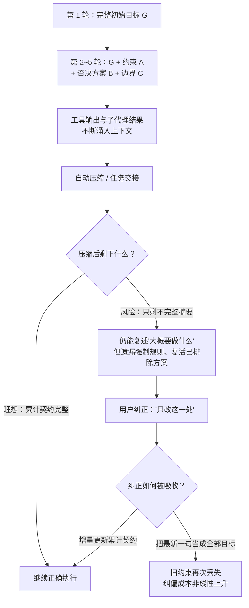

# 为什么最好用的是 Claude Code：分数打平之后，赢在协作可靠性

> **讲解版入口**：本文有配套的 10 分钟图文讲解版（含类比与图）→ [在线阅读](https://zhouxiaohei.github.io/show-something/阅读/讲解-05-为什么最好用的是%20Claude%20Code.html) ｜ 本地文件位于 `阅读/` 目录。

> **断言标注约定**：本文所有关键判断按证据类型标注——`[模型证据]`（公开研究在统一框架下直接测得）、`[框架与模型混合证据]`（模型与代理框架同时变化的对比研究）、`[产品案例]`（具体产品 issue/日志/复现，只证明失败模式存在）、`[用户侧调查证据]`（开发者自愿应答的调查，有自选偏差）、`[综合推断]`（多类证据共同支持但尚无直接完整实验验证）。无标注的为可直接核对的定义或公开事实。

## 一、执行摘要

**问题**：面对模糊、口语化、依赖上下文并持续变化的真实需求，Claude/Claude Code 与 GPT/Codex 哪个更容易建立正确目标、减少人工纠偏，并在失败后继续迭代？

**答案**：`[综合推断]` 现有公开证据初步支持 **Claude/Claude Code 在模糊意图理解、多轮目标保持、较低用户纠偏成本和失败后持续协作方面优于 GPT/Codex**。Codex 并不缺少执行与解题能力，但更容易在长任务、连续纠正、上下文压缩和自动续跑中损坏内部任务模型；一旦损坏，其较强的执行倾向会加速混乱。

### 先回答最刺眼的矛盾：Codex 解决率略高，为何仍判 Claude 更好？

TraceProbe 的数据里，Codex + GPT-5.4 的解决率是 78.4%，Claude Code + Opus 4.6 是 77.4%——差 1 个百分点，统计上几乎不可区分。但同一个数据集还显示：**Codex 的失败动作占比是 8.0%，Claude Code 是 3.3%（约 2.4 倍）；有害动作比例 0.10 对 0.07；工具成功率 91.9% 对 96.7%** `[框架与模型混合证据]`。

这三组数字合起来解释了矛盾所在：

- **单次通过率衡量的是终点对不对；协作可靠性衡量的是到达终点的路上你要付出什么、以及失败后爬出来的成本。**
- 78.4% 的解决率背后，是更多的失败动作、更多的回滚和重试——这些成本不会出现在排行榜上，但会出现在你的等待时间、token 账单和"再检查一下它到底改了什么"的焦虑里。
- 解决率相同不等于分布相同：一个稳定通过，一个靠更多试错撞过去，长期体验完全不同。这正是 TraceProbe 论文标题"What Resolve Rate Hides"（解决率掩盖了什么）的直接含义。

### 证据不能证明什么（先立边界）

- 不能根据 GitHub issue 数量计算两者真实失败率——公开 issue 没有总使用次数这个分母；
- 不能把 Claude 模型在统一 OpenCode 框架中的优势，直接等同为 Claude Code 产品优势；
- 不能把 Codex 在 Terminal-Bench 或明确 issue 修复上的高分，外推为它更擅长模糊需求和长期协作；
- 不能用开发者调查证明所有项目、模型版本和权限配置下都如此。

完整的边界讨论见第七节。

## 二、评价框架：比较的不是"简单与复杂"，而是协作不确定性

传统评测把任务分成简单和复杂，但这个分类信息量有限：一个跨几十个文件的机械迁移可能很长却几乎没有业务判断；一个只改五行的需求可能依赖隐含产品语义、历史否决方案和接口契约，反而更难。真正决定协作难度的变量包括：初始表达完整度、上下文依赖、需求歧义、约束累积方式、反馈可观察性、路径长度、人类干预频率、恢复难度、上下文压缩损失和失败透明度。

由此，本报告用三条主线评价真实协作可靠性：

1. **任务模型的建立与持续稳定性**；
2. **总人类协作成本**——至少包含四类：需求显式化成本（你要把意图改写得多像规格书）、过程监督成本（要不要盯）、纠偏成本（指出错误后几轮才被吸收）、恢复成本（混乱后能否修复还是只能重开）；
3. **失败的可解释性与可恢复性**。

**任务模型**指代理在执行时实际依赖的内部工作表示，至少包含：用户真正想要的结果、当前代码和环境事实、已确认与未确认的假设、必须保留的约束、明确排除的范围、后续消息修改了旧目标的哪一部分、当前完成状态与验证标准。真实协作链条是：

```text
理解模糊、口语化表达
→ 结合代码和历史对话恢复真实意图
→ 把新纠正合并进累计目标
→ 长会话和压缩后保持完整约束
→ 依据同一个目标持续执行和验证
→ 在已有结果上继续迭代
```

其中任何一环损坏，后续步骤都可能高度自洽却整体错误——每一环单独看都合理，连起来却离目标越来越远。

## 三、证据一：SWE-Together——用户纠正首次成为主要指标

SWE-Together（arXiv 2606.29957，2026-06-29 提交）从 11,260 条真实用户—代理会话中筛出 109 个可复现的仓库级任务（转化率约 0.97%），用 LLM 用户模拟器按原始会话的意图锚点逐步释放澄清、纠正和新增要求，统一使用 OpenCode 框架、每模型两次独立运行，并同时测量最终正确性与**用户纠正度**（明确纠正记全权重、软性提醒记 0.2 权重）。`[模型证据]`（预印本）

因为评分门槛建立在"能力越强 → 用户纠正越少"这一强负相关上（pass@1 与纠正量的 Pearson 相关系数 −0.92，稳定解决率与纠正量 −0.84），这张表同时回答了"谁做得多对"和"谁让人陪跑得少"两个问题：

| 模型（统一 OpenCode 框架） | pass@1 | 两次均成功 pass² | 稳定解决率 SSR | 平均质量 | 用户纠正（越低越好） |
|---|---:|---:|---:|---:|---:|
| Claude Opus 4.8 | 63% | 52% | 59% | 0.801 | 1.38 |
| GPT-5.5 | 58% | 48% | 55% | 0.763 | 1.59 |
| Claude Opus 4.6 | 58% | 46% | 58% | 0.755 | 1.59 |
| GLM-5.2 | 55% | 42% | 48% | 0.735 | 1.53 |
| GLM-5.1 | 52% | 35% | 49% | 0.729 | 1.54 |
| DeepSeek V4 Pro | 48% | 29% | 38% | 0.679 | 1.76 |
| MiniMax 2.7 | 40% | 26% | 34% | 0.630 | 2.17 |

这张表不能告诉你什么：它不能直接比较 Claude Code 与 Codex 两个产品——实验统一使用 OpenCode 框架，属于**模型层**证据；它基于模型组层面的相关性（−0.92），不是受控因果比较；且 0.97% 的筛选转化率意味着任务集偏向"有可恢复仓库状态、目标清晰、结果可观察"的会话，对真实协作全谱系是有偏样本。

解读时要克制三点：

1. Opus 4.8 与 GPT-5.5 的平均纠正差距是 0.21 次，并非数量级差距；真正重要的是 Claude 在更少纠正的**同时**取得更高质量和更高稳定成功率。
2. Opus 4.6 与 GPT-5.5 的纠正量相同（1.59），说明"Claude 系列必然更少纠正"不成立——版本和能力水平仍然重要。
3. 论文同时报告了效率维度：GPT-5.5 每任务约 29.9k token、10.7 分钟，是全场最省；Opus 4.8 约 74.0k token、23.3 分钟。**纠正更少伴随 token 消耗更高**——"协作成本"必须同时算纠偏劳动和运行成本，这是选型时真实的权衡。

## 四、证据二：TraceProbe——过程诊断揭示解决率掩盖的东西

TraceProbe（arXiv 2607.06184，2026-07-07 提交）把 2500 条轨迹（SWE-Bench Verified、五个生产设置，横跨 Claude Code/Codex/OpenCode 三个 scaffold 与 Opus 4.6/GPT-5.4/GLM-5 三个模型骨干）规范化为九类动作，用确定性规则检测搜索循环、验证遗漏、重复读取、修改回滚等反模式。数据与代码公开（Zenodo DOI 10.5281/zenodo.20789918）。`[框架与模型混合证据]`（审稿中预印本）

| 指标 | Claude Code + Opus 4.6 | Codex + GPT-5.4 |
|---|---:|---:|
| 解决率 | 77.4% | 78.4% |
| 每任务中位步骤 | 27 | 24 |
| 工具调用（中位） | 25 | 41 |
| 工具成功率 | 96.7% | 91.9% |
| 保留动作占比 | 27.6% | 36.2% |
| 失败动作占比 | 3.3% | 8.0% |
| 有依据动作占比 | 36.9% | 32.0% |
| 范围外探索 | 17.6% | 14.3% |
| 有害动作比例 | 0.07 | 0.10 |

这张表不能告诉你什么：它不能分离模型与框架的各自贡献——模型和 scaffold 同时变化，属于混合证据；研究自身也未能完成 Claude Code × GPT 与 Codex × Claude 的完整交叉实验；它测的是过程结构，不测用户纠偏的认知成本和失败解释质量。

解读时同样要克制：TraceProbe 论文自己指出，Codex 解决率最高且保留动作占比也最大——"过程更不稳"应限定在**失败动作更多、有害动作更多、工具成功率更低**这三个可测维度上，而不是笼统的"Codex 更乱"。同时，工具调用中位数 41 对 25，与解决率略高放在一起看，支持的是"Codex 用更多试错换到同等结果"这一幅画面。

## 五、证据三：GitHub 失败模式——累计约束碎裂是真实存在的

GitHub issue 可以证明：某类失败确实发生过、发生在哪个产品层、是否有复现步骤、多个用户是否独立描述相似症状、官方是否承认修复。它**不能**证明：真实发生概率、哪个产品整体更稳定。所以本报告把 GitHub 用作"失败模式证据"，不用作"失败率排行榜"。

### Codex 相关失败模式聚类（7 例均已逐一打开核实，2026-10-16 复核）

| 失败模式 | 代表案例 | 能支持的结论 |
|---|---|---|
| 累计约束丢失 | openai/codex #33262 | 长会话压缩后可能保留不完整任务契约 |
| 重复读取 | #33498 | 上下文利用可能退化为重复搜索 |
| 交接后提前停止 | #33398 | task handoff 未必可靠恢复执行状态 |
| 需要原子化 rollover | #33310 | 社区认为长任务交接缺少稳定契约 |
| 长会话上下文失控 | #33769 | 用户需要主动控制进入上下文的内容 |
| 过期消息重新执行 | #33819 | 会话队列错误可能导致旧意图重新生效 |
| Goal 恢复不执行 | #33829 | 声称继续与实际继续可能不一致 |

其中 #33262 的报告者在长仓库任务中不断增加明确约束，并声明后续消息只修改指定部分、其余规则继续有效；上下文压缩后，Codex 可以近似描述任务，却遗漏"先文档后代码"等强制规则、重新引入明确排除的工作，把完整交付任务缩减成几个通用步骤。用户多次重述完整契约后，后续执行仍像只保留了最新消息或不完整摘要。`[产品案例｜无分母]`（#33398 的后续讨论另有报告者自报的量化统计——94 个长任务、27.8% 的压缩事件呈"丢失继续"模式——但那是单用户自报、未经官方裁定，只作案例背景，不进本文数字体系。）

**Claude Code 也存在同类问题**：`/compact` 崩溃或重复执行、resume-from-summary 保护未触发、context thrashing、中途切换模型后压缩窗口错误、hooks 未加载、模型忽略指令、后台会话恢复异常等报告同样可以找到（搜索入口见附录 C）。因此本文立场不是"Claude Code 稳定、Codex 不稳定"，而是：**两者都会失败，当前研究和使用面证据更支持 Claude 的协作错误分布较温和、纠偏成本较低；Codex 更容易出现隐式任务模型损坏并继续执行**。`[综合推断]`

## 六、证据四：交互侧的新证据——把用户放进实验，把调查摆上桌面

这一节是 2026-10-21 更新版新增的，补上一版缺失的两块：交互实验的新进展，和使用面的调查证据。

### 1. SWE-Journey：用户是谁，比模型多强更能决定成败

SWE-Journey（arXiv 2610.11559，2026-10-08 提交）把"对面坐的是谁"变成了实验变量：合成 30 个长任务实例（594 个子任务，对照补丁平均 10.2 个文件、768 行，约为现有专业基准的两倍文件、四倍行数），再用四种用户人设驱动多轮会话——非开发者、产品经理、新人开发、架构师，会话平均 18.28 轮，远长于旧基准的 5~9 轮。`[模型证据]`（预印本，未见公开代码）

13 家模型、四种人设的均值里：

| 用户人设 | 终点失败转通过率 |
|---|---:|
| 架构师 | 78.50% |
| 新人开发 | 35.57% |
| 产品经理 | 30.48% |
| 非开发者 | 23.00% |

同一批模型，用户从架构师换成非开发者，通过率掉 55.5 个百分点；最强一档模型配架构师能到 93.59%，而**多数模型的主动提问轮次占比不到 20%**。这张表对所有编码 Agent 都成立（不是 Claude vs Codex 的对比），但它证实的正是本文第二条主线：**协作可靠性由"代理能不能从能力弱的表达里恢复意图"决定，而现有主流 Agent 在这一维度上集体不及格**。谁在澄清与纠偏上做得更好，谁就握住了真实协作的主要矛盾——这正是 Claude Code 的强项所在。

论文自己也承认局限：用户智能体只是近似真人，任务可能带着仓库与模型偏好，成本把规模卡住了。

### 2. 开发者调查：75% 的活跃用户选了 Claude Code，理由分布说明了什么

ZDNet 对 138 名正在使用 AI 编码工具的开发者的调查（2026-10）显示：约 75% 使用 Claude Code，约 1/3 使用 Codex，22% 两者都用。`[用户侧调查证据]`（自愿应答样本，有自选偏差，只看分布不看绝对值）

被问及为什么选 Claude Code 时，理由按提及频率排序：

1. 大代码库跨文件改动保持连贯（14%）——对应本文的"任务模型稳定性"；
2. 先计划再动手，复杂重构中需要更少纠正（9%）——对应"纠偏成本"；
3. 同任务代码质量与推理更好（9%）；
4. 在终端里对真实仓库和真实基础设施执行，而不是编辑器里的自动补全（7%）；
5. 先发者的 skills、集成与工作流生态已成规模，切换成本实打实（5%）。

这张表不能告诉你什么：它是自愿应答的调查，不是随机抽样；"理由分布"反映的是感知而非实测；且调查时间点两侧模型都在快速更新。它的价值在于**方向印证**——开发者自发给出的理由，恰好按顺序落在了 SWE-Together 和 TraceProbe 测出的那几个维度上。另外调查中同样有人指出 Codex 的优势：单位任务成本更低、PR review 更强、最难的单题推理更深——这与本文"执行器强、协作弱"的画像一致，而不是矛盾。

## 七、证据不能证明什么

综合前四节，以下外推全部不成立：

1. **失败率排行**。GitHub issue 无使用量分母；SWE-Together 只有 109 个经 0.97% 筛选的高精度任务；两者都支撑"失败模式存在"而非"多久失败一次"。
2. **模型优势 = 产品优势**。SWE-Together 的 Claude 优势在统一 OpenCode 框架下测得，属于模型层证据；Claude Code 产品自己的框架层（压缩策略、上下文管理、权限流）是另一套变量。
3. **解决率 = 协作质量**。TraceProbe 已展示同解决率下失败动作、有害动作可差 2~2.4 倍。
4. **明确的 benchmark 高分 = 擅长模糊协作**。Terminal-Bench 类任务目标明确、验收清晰，恰好绕开了本文的三条主线。
5. **调查分布 = 因果证明**。开发者调查有自选偏差，方向印证可用，比例不可引用。
6. **本文的综合推断 = 已验证结论**。"Claude 更适合协商型协作"是多类证据共同指向的当前最优假设，尚无同时覆盖模糊意图、纠正吸收、失败解释与多轮迭代的成对实验直接验证。

## 八、综合结论

### 1. 已有证据支持的结论

1. 明确、静态任务 benchmark 不能代表真实编码协作。`[强证据]`
2. 多轮真实会话中，用户纠正量是独立且重要的能力指标。`[强证据]`
3. SWE-Together 中 Claude Opus 4.8 相比 GPT-5.5 取得更高质量、更高稳定成功率和更少用户纠正（纠正量与 pass@1 相关 −0.92）。`[中强证据｜预印本]`
4. TraceProbe 中 Codex 最终解决率略高（78.4% vs 77.4%），但失败动作（8.0% vs 3.3%）和有害动作（0.10 vs 0.07）高于 Claude Code。`[中等证据｜模型与框架混合]`
5. Codex 长会话丢失累计约束、重复读取和交接失败是真实存在的产品失败模式（7 个已核实 issue）。`[案例证据]`
6. Claude Code 也存在上下文压缩、恢复和指令失效问题。`[案例证据]`
7. 用户人设显著影响所有 Agent 的成功率，主动澄清是普遍短板（SWE-Journey）。`[中强证据｜预印本]`
8. 活跃开发者的自选调查与上述维度方向一致（75% 用 Claude Code，理由集中于一致性与纠偏）。`[用户侧调查证据]`

### 2. 任务模型如何随时间碎裂

把全文机制压成一张图——第三至五节的统计证据，对应的正是下面这条退化路径：



上图的要害在最后一个分叉：碎裂之后的每一次纠正都有 50% 的概率在"修复"与"覆盖"之间掷骰子（此处的 50% 是修辞性说法，不是测量值）——这正是 GitHub issue #33262 报告的现象。`[综合推断]`

### 3. 最终判断

如果把编码代理理解为"从完整规格到代码的执行工具"，Codex 与 Claude Code 的差距可能有限，且 Codex 在部分终端任务中很强（且更省 token）。如果把编码代理理解为"与人共同发现目标、吸收纠正并持续演化软件的协作者"，四类证据——受控评测、过程诊断、失败案例、使用面调查——都更支持 Claude/Claude Code。真正决定体验的不是峰值能力，而是：

```text
自然意图理解 × 任务模型稳定性 × 低人工纠偏成本 × 失败透明度 × 恢复和持续迭代能力
```

这也是未来编码代理测评应当从"任务通过率"转向"协作可靠性"的原因——SWE-Journey 已经开始这么做了。

### 4. 复核方式

本文的数据性断言均可独立复核：SWE-Together 论文与公开代码（github.com/Togetherbench/SWE-Together）、TraceProbe 轨迹数据（Zenodo DOI 10.5281/zenodo.20789918）、SWE-Journey 论文（arXiv 2610.11559）、7 个 Codex issue 原文链接（附录 B）均公开可查。本文所有数字于 2026-10-16 逐项核对过一次、2026-10-21 增补证据后复核；复核发现或论文改版导致的出入，以原始来源为准。

## 附录 A：权威研究与公开评测

1. [SWE-Together: Evaluating Coding Agents in Interactive User Sessions](https://arxiv.org/abs/2606.29957)（2026-06-29 提交；预印本，方法与代码公开）。支持：多轮真实会话、用户纠正量、稳定重复成功率、统一框架下的模型对比。不支持：Claude Code 与 Codex 产品的直接对比。
2. [SWE-Together GitHub](https://github.com/Togetherbench/SWE-Together)：公开实现，可复现任务构造、模拟用户与评价方法。
3. [What Resolve Rate Hides: Trajectory Structure Diagnostics for Coding Agents](https://arxiv.org/abs/2607.06184)（2026-07-07 提交；审稿中预印本，数据公开）。支持：搜索循环、失败动作、回滚、范围漂移、验证遗漏等过程诊断。不支持：模糊需求下的完整用户纠偏成本；模型与框架完全解耦。
4. [TraceProbe 开放数据](https://doi.org/10.5281/zenodo.20789918)：公开轨迹数据，可用于复核。
5. [SWE-Journey（arXiv 2610.11559）](https://arxiv.org/abs/2610.11559)（2026-10-08 提交；预印本，作者称流水线后续开源）。支持：用户人设对成功率的影响、长会话（均值 18.28 轮）、主动澄清普遍不足。不支持：Claude Code 与 Codex 的直接对比；真实人类用户。
6. [METR Task-Completion Time Horizons](https://metr.org/time-horizons/)（页面最近更新 2026-09-08，已声明不再活跃更新）。支持：任务长度与成功概率、50%/80% 可靠性口径。不支持：固定产品正面对比；模糊业务协作。
7. [ZDNet 开发者调查：75% of developers I surveyed prefer Claude Code](https://www.zdnet.com/article/why-most-developers-prefer-claude-code-over-codex/)（2026-10；138 名自愿应答的开发者）。支持：使用分布与选择理由的方向。不支持：随机抽样结论、实测性能。

## 附录 B：Codex 产品案例（均于 2026-10-16 逐一打开核实）

1. [#33262：长会话丢失累计操作约束](https://github.com/openai/codex/issues/33262)
2. [#33498：代理重复读取上下文中未变化文件](https://github.com/openai/codex/issues/33498)
3. [#33398：task handoff 后提前停止](https://github.com/openai/codex/issues/33398)
4. [#33310：请求原子化上下文 rollover](https://github.com/openai/codex/issues/33310)
5. [#33769：长会话主动排除上下文](https://github.com/openai/codex/issues/33769)
6. [#33819：旧用户消息被再次投递并执行](https://github.com/openai/codex/issues/33819)
7. [#33829：声称恢复计划但未真正继续](https://github.com/openai/codex/issues/33829)

这些来源用于证明失败模式存在，不用于估计实际发生率。

## 附录 C：Claude Code 产品案例入口

1. [Claude Code context / compaction issues](https://github.com/anthropics/claude-code/issues?q=is%3Aissue%20%28%22loses%20context%22%20OR%20%22context%20drift%22%20OR%20%22forgets%20instructions%22%20OR%20%22compaction%22%29)（搜索入口，未逐条编号核实）
2. [Claude Code Plan Mode issues](https://github.com/anthropics/claude-code/issues?q=is%3Aissue%20%22plan%20mode%22)
3. [Claude Code 官方概览](https://code.claude.com/docs/en/overview)

这些来源说明 Claude Code 也存在压缩、恢复、权限和指令失效问题，不支持"Claude Code 天然稳定"的绝对判断。

---

*版本：v3（2026-10-21，换血式重写：更名、压缩叙述、新增第六节交互侧证据；v2 于 2026-10-16 完成全量数据核实，v1 于 2026-07-17 初版）。*
