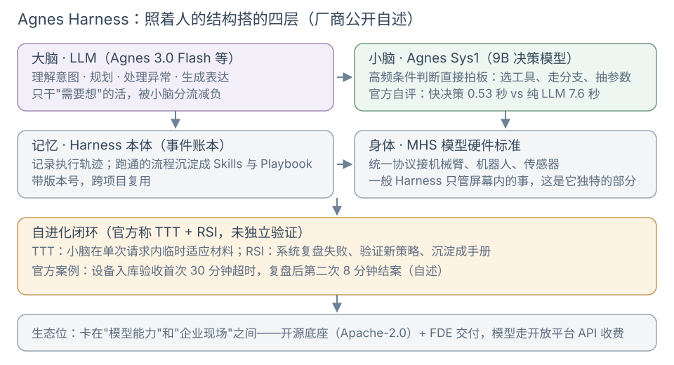
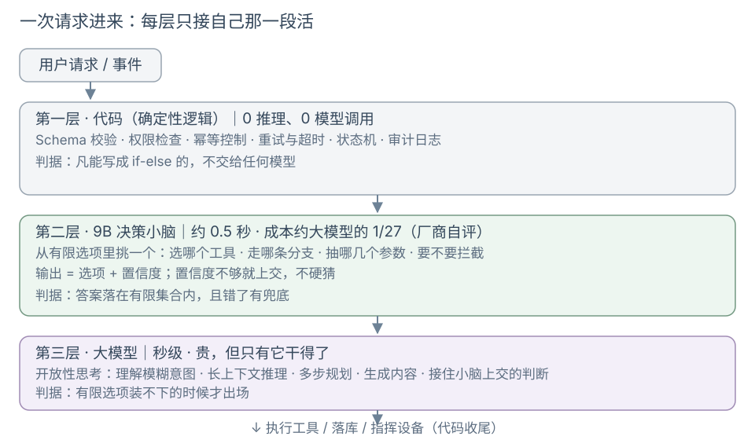
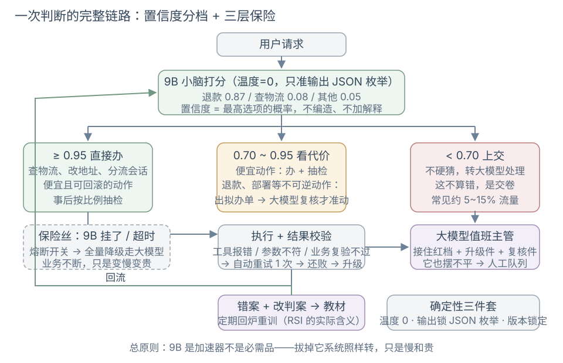
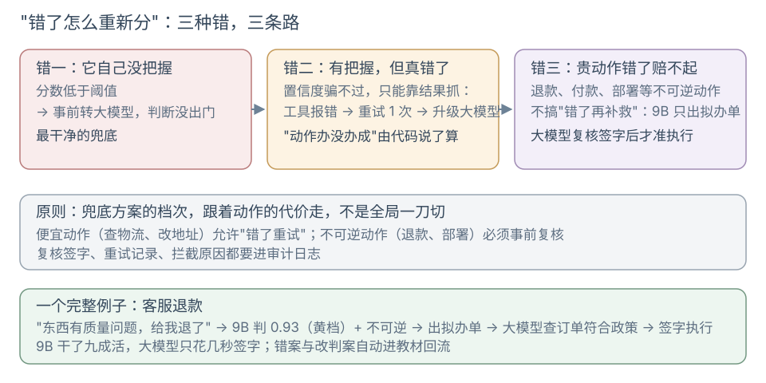
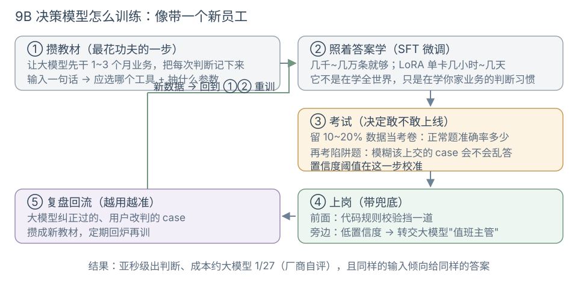
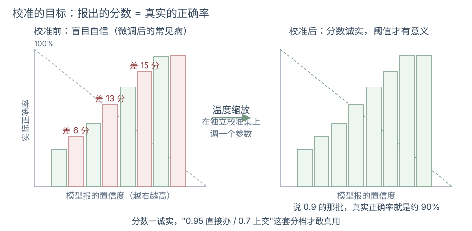
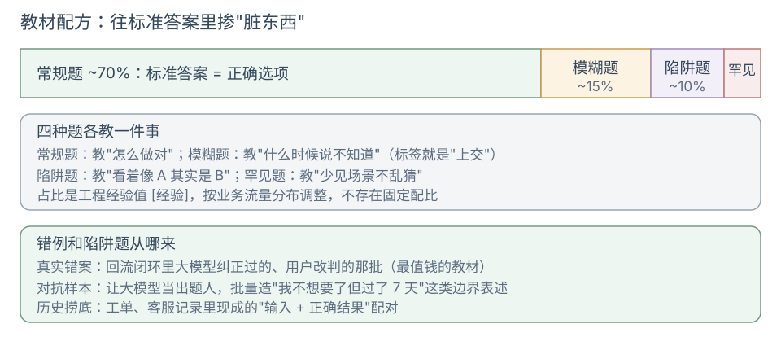
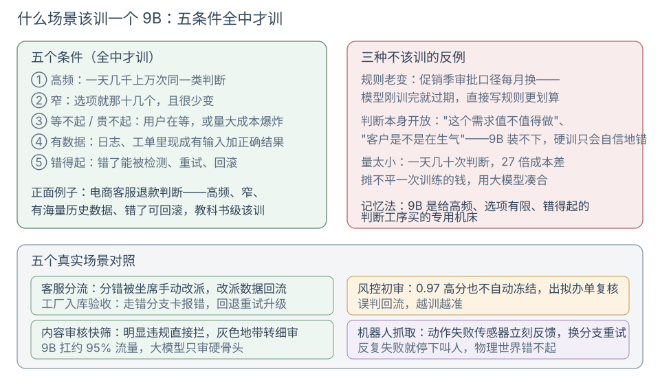

# 把判断从思考里剥出来：9B 决策模型的分工、链路与训练——以 Agnes Harness 为例

<a id="overview"></a>

> **讲解版入口**：配套图文版在 `阅读/讲解-10-决策小脑.html`；三层分工对应本文 §二，Agnes Harness 结构对应 §一，决策链路对应 §四，训练闭环对应 §五，校准难点对应 §六，该训不该训对应 §七。

> **断言标注约定**：本文框架性判断按三分法标注——`[经验]`（作者工程实践经验与行业常见做法归纳，样本有限）、`[推测]`（本文提出的机制假设）。凡来自 Agnes 官方或媒体的数据均标注"官方自评"，未经独立验证，汇总依据见文末证据边界声明。

<a id="s0"></a>
## 引子：一句话答案与一个真实产品

大模型越来越强之后，一个自然的追问是：还要小模型干什么？过去两年的主流答案是"不用了，一个模型管到底"。但 2026 年下半年，一个叫 **Agnes Harness** 的开源智能体运行底座把另一个方向做成了产品：**在 LLM 旁边放一个 9B 参数的"决策模型"，专管高频、机械的判断**。官方给出的一组数字是：快决策 0.53 秒 vs 纯大模型 7.6 秒，单次决策成本差约 27 倍——均为官方自评，未独立验证。

这组数字真假暂且不论，它背后的思路值得认真对待，本文的一句话答案是：

> **9B 决策模型不是更小的大模型，而是把"判断"从"思考"里剥出来的专用件——80% 的机械判断用 1/27 的成本和 1/15 的延迟消化掉，大模型只处理真正需要"想"的 20%。**

围绕这句话，本文回答六个问题：Agnes Harness 到底是什么；代码、9B、大模型三者的分工判据；9B 的原则和能力边界；一次判断的完整链路（置信度怎么用、错了怎么重新分、可用性怎么保）；9B 怎么训练、难点和训练点在哪；什么场景该训、什么场景不该训。

需要先声明阅读姿态：本文与仓库内其他文章不同，**没有核对 Agnes 的源码**——它的框架 2026 年 11 月才开源，本文依据公开报道与厂商自述写成，所有性能数字都按"官方自评"处理；本文的价值在方法论框架，不在为该产品背书。

<a id="s1"></a>
## 一、Agnes Harness：一家公司把"判断"做成了产品

先交代背景。Agnes AI 是一家中国的 AI 公司（GitHub 组织 AgnesAI-Labs），产品线有三块：对话模型 Agnes 3.0 Flash、9B 参数的决策模型 Agnes Sys1、以及 2026 年 11 月开源的智能体运行框架 Agnes Harness（Apache-2.0 协议，可商用）。创始团队与融资情况无公开报道，这是信息缺口，不编。公开的合作方包括心玮医疗、埃斯顿、天创机器人等，覆盖医疗、制造、具身智能场景——商业模式是典型的"开源底座 + 模型 API 收费 + FDE（前线部署工程师）交付"。

Harness 本义是"马具"——套在马身上、让马拉车的整套装置。社区把 Codex、Claude Code 这类"套在模型外面、负责调度工具和执行流程"的层戏称为"爱马仕"，缘由即此。所以先分清三个容易混的东西：**Codex 是一个具体产品（OpenAI 的编码 Agent）；Harness 是这一层的技术类目；AgentScope 是阿里开源的多智能体开发框架（Python 库）**。Agnes Harness 选择的赛道，就是 Harness 这一层。

它照着人的结构搭了四层：

| 层 | 对应 | 职责 | 备注 |
|---|---|---|---|
| 大脑 | LLM | 理解意图、规划、处理异常、生成表达 | 只干"需要想"的活 |
| 小脑 | Agnes Sys1（9B） | 条件明确的高频判断直接拍板：选工具、走分支、抽参数 | 官方自评：0.53 秒 vs 7.6 秒 |
| 记忆 | Harness 本体 | 事件账本记执行轨迹；跑通的流程沉淀成 Skills 与带版本号的 Playbook | 跨项目复用 |
| 身体 | MHS 硬件标准 | 统一协议接机械臂、机器人、传感器 | 一般 Harness 不做这层 |

外加一个自进化闭环：官方称 TTT（小脑在单次请求内临时适应材料）与 RSI（复盘失败、验证新策略、沉淀成手册），并给出"设备入库验收首次 30 分钟超时、复盘后第二次 8 分钟结案"的自述案例。**这些能力听起来性感，但都没有第三方验证，本文只把它当作"该产品宣称的设计意图"来引用。**



**图 1**　四层是按职责分的讲解框架，不等于代码里恰好四个模块；自进化闭环的效率数字均为厂商自述。

Agnes Harness 真正值得拆的，是"小脑"这个位置——它是 9B 决策模型这类思路的完整样本。下文就从它展开，但框架本身不绑定这家产品：任何团队都可以用大模型 + 微调过的小模型自己搭这套结构。

<a id="s2"></a>
## 二、三分法：代码、9B 小脑、大模型各干什么

一次请求进来，活儿分三层。分层的判据只有一句话：**凡能写成 if-else 的交给代码，答案落在有限集合内的判断交给 9B，有限选项装不下的思考交给大模型。**

| 层 | 干什么 | 典型工作 | 延迟 | 成本 | 判据 |
|---|---|---|---|---|---|
| 代码 | 确定性逻辑 | Schema 校验、权限检查、幂等控制、重试超时、状态机、审计日志 | 0 | 0 | 能写成 if-else |
| 9B 小脑 | 有限选项内的判断 | 意图分类、工具选择、流程分支、参数抽取、敏感内容拦截、请求路由 | 亚秒级 | 约大模型 1/27（官方自评） | 答案在有限集合内 + 错了有兜底 |
| 大模型 | 开放性思考 | 理解模糊意图、长上下文推理、多步规划、内容生成、接住小脑上交的判断 | 秒级 | 高 | 有限选项装不下 |



**图 2**　三层是按"动作性质"分的，不是按部署位置分的；9B 和大模型可能部署在同一台机器上，边界也依然存在。

分流时问三个问题 `[经验]`：① 答案是不是从有限选项里挑？② 挑错了能不能被代码兜住？③ 需不需要世界知识和长上下文理解？——①②成立给 9B，③成立或①不成立给大模型。

三层的优缺点各自对应：

**代码**——优点是零成本、零延迟、行为完全确定、可审计；缺点是只覆盖"答案可枚举、规则可枚举"的问题，语义理解完全缺位。它是对抗不确定性的地基，不是全部。

**9B 小脑**——优点是快、便宜、窄域内可微调到高准确率、行为可锁定（详见 §四）；缺点是**只会收敛不会发散**：遇到训练分布之外的输入，它会"自信地错"，而且不会像大模型那样表达不确定——所以置信度阈值和回退机制不是可选优化，是它的生命线（§四、§六）。

**大模型**——优点是开放推理、知识广、没有"没见过"的硬边界；缺点是慢、贵、同输入两次跑可能给不同答案（采样随机性）、行为随版本升级悄悄漂移。它的贵不只在单价，还在"每次判断都要过一遍全部参数和长上下文"。

这段分工与仓库另一篇《Agent 系统可靠性：提示词、模型与代码的边界》一脉相承——那篇论证了"提示词降低失败率，代码消除可计算的失败"的边界划分；本文在其"代码层"和"模型层"之间插入了第三个位置：**窄域判断层**。旧文讲边界怎么划，本文讲插进来的这一层怎么建、怎么训、怎么兜。

<a id="s3"></a>
## 三、9B 小脑的原则与能力边界

### 3.1 大模型能做 9B 的一切吗

能——**能力上覆盖，工程上不等价**。差异不止时效，有五层：

| 维度 | 大模型 | 9B 决策模型 | 差异本质 |
|---|---|---|---|
| 时效 | 秒级，受排队限流影响 | 亚秒级 | 最表层的差异 |
| 成本 | 每次判断都过全部参数 + 长上下文 token | 约为 1/27（官方自评口径） | 高频场景账单差两个数量级 |
| 确定性 | 同输入两次跑可能不同答案；行为随版本漂移 | 任务窄、输出空间被约束，同样输入倾向同样输出，可回归测试 | 工程上最要紧的差异 |
| 可控性 | 会自由发挥：编造不存在的工具、给出选项外的答案 | 被训练成只会从给定 N 个选项里挑，越界输出可压到极低 | 大模型是"能做对"，小模型是"被锁死做不错" |
| 可专精 | 通用，窄域未必精——容量被几千个任务摊薄 | 单一窄任务微调后，准确率可反超通用大模型 | 专精碾压通用是常态 `[经验]` |

另有一个方向相反的差异：**部署形态**。9B 量化后单卡甚至笔记本就能跑，数据不出域、断网可用；大模型要么走云 API（数据出域），要么重金私有化部署。

### 3.2 四条原则

把上面五层差异收敛成设计 9B 小脑时的四条原则 `[经验]`：

1. **只做选择题，不做问答题。** 输出是有限集合里的一个选择（选哪个工具/走哪条分支/要不要拦截）加结构化参数槽位。一旦任务要求生成内容或开放推理，就出了它的管辖范围。
2. **输出必须带置信度。** 没有回退机制的 9B 是定时炸弹；有回退机制的 9B 是省钱加速器。
3. **窄而深，不广而浅。** 一个场景微调一个版本，用复盘回流持续喂数据。它的价值在"越用越准"，不在"天生什么都会"。
4. **错误可兜底。** 交给 9B 的判断，错了要能被代码检测、重试或回滚；兜不住的高风险判断（付款、部署）不给它——这直接决定 §四 的链路形状。

### 3.3 能力边界：它管不了什么

9B 小脑装不下三类东西 `[经验]`：**需要世界知识的判断**（"这个需求值不值得做"）、**需要长上下文理解的判断**（跨三十轮会话归纳矛盾点）、**答案开放的判断**（生成一段话、设计方案）。硬塞给它的结果是"自信地错"——比大模型的错更危险，因为大模型错得犹疑、可追问，小模型错得斩钉截铁。

所以能力边界的正确画法不是"9B 是弱化版大模型"，而是：**9B 管的是"大模型降级去干纯属浪费"的那一段**。让一个几百 B 参数的模型花 7 秒回答"这句话该路由到退款组还是物流组"，不是能力浪费，是结构性浪费。

<a id="s4"></a>
## 四、一次判断的完整链路：置信度分档与三层保险

这一节回答三个具体问题：置信度怎么"看"出来；错了怎么重新分；可用性和确定性靠什么保障。

### 4.1 置信度不是玄学，是概率本身

9B 做的是选择题，每个选项都有一个概率。用户说"帮我退了昨天的订单"，模型内部打分：

```text
退款   0.87
查物流 0.08
其他   0.05
```

它选中"退款"的同时，把 0.87 一起吐出来——**置信度就是最高选项的分数，不是额外算出来的指标**。工程上有个关键设计：**训练时专门加一个"我不知道"选项**，教材里故意放进模糊 case、标准答案就是"上交"，让模型自己学会什么时候交卷（这个设计如何做出来，见 §六）。

### 4.2 分档：阈值把流量切成三段

阈值不是一刀切，而是按**动作代价**分三档 `[经验]`：

| 档位 | 处理 | 适合的动作 |
|---|---|---|
| ≥ 0.95 | 直接执行，事后按比例抽检 | 查物流、改地址、分流会话——便宜且可回滚 |
| 0.70 ~ 0.95 | 便宜动作办了加抽检；**贵动作出"拟办单"，大模型复核后才准动** | 介于两者之间 |
| < 0.70 | 上交大模型——这不算错，是交卷 | 一切拿不准的；常见约占 5~15% 流量 |

**兜底方案的档次跟着动作的代价走，不是全局一个数。** 查物流分错了重新分就是了；退款分错了是真金白银。所以退款、付款、部署这类不可逆动作，哪怕 9B 打出 0.97 的高分，也只准出拟办单——事前复核永远比事后补救便宜。

### 4.3 错了怎么重新分：三种错，三条路

**错一：它自己没把握。** 分数低于阈值，事前转大模型——判断根本没出门，这是最干净的兜底。

**错二：它有把握，但真错了。** 置信度骗不过，只能靠**执行结果校验**抓：工具返回报错、参数不符、业务复验不过 → 代码自动重试 1 次 → 还败 → 升级大模型 → 大模型读上下文办完 → **这条错案自动记进教材**。判断对不对模型自己说了不算，"动作办没办成"是代码说了算——这就是每个判断后面必须跟结果校验的原因。

**错三：贵动作，错了赔不起。** 不搞"错了再补救"，直接改流程：出拟办单，大模型复核签字后才准执行（见 4.2 黄档）。



**图 3**　三档处理 + 结果校验 + 大模型值班主管 + 熔断降级 + 错案回流，构成完整闭环；三条错误路径见图 4。



**图 4**　三种错的兜底手段完全不同：没把握靠阈值、有把握错了靠结果校验、贵动作靠事前复核。

### 4.4 可用性：9B 是加速器，不是必需品

链路里最容易被忽略的是"9B 自己挂了怎么办"。答案是**熔断降级**：GPU 宕机、超时 200 毫秒没回话，熔断开关自动弹开，全量流量降级走大模型——业务不断，只是慢 7 倍、贵 27 倍，用户无感。大模型 API 也挂时，再降级到排队重试、写死的规则、人工队列。

**设计哲学一句话：把 9B 拔掉，系统照样转。** 这是整套架构敢上生产的前提 `[经验]`——任何"加速器"型组件，都必须在失效时不阻塞主链路。

### 4.5 确定性三件套

确定性不靠口号，靠三个可执行的机制：

1. **温度设 0**——模型不"发挥"，同输入永远同输出；
2. **输出锁死 JSON 枚举**——只准从给定清单里挑，想编造"第 21 个工具"都编不出来；
3. **版本锁定**——模型文件和它的考卷成绩单一起归档，升级新版必须先过全部考卷（回归测试），防止"悄悄变笨"。

这与仓库《Agent 系统可靠性》一文"生产环境钉模型版本，不静默使用 latest"的结论完全同构——只不过 9B 把这条从"运维纪律"变成了"物理可能"。

<a id="s5"></a>
## 五、9B 怎么训练：像带一个新员工的五步闭环

9B 决策模型不是买来就能用的——**通用 9B 直接拿来当决策模型，效果未必比一段写死的 if-else 好**，它的全部本事都在业务数据喂出来的那一层。训练流程五步，就像带新人：

**第①步：攒教材（最花功夫，但不用手写）。** 最常见的做法是"大模型当老师，边干边留作业答案"：上线初期先让大模型带着长 prompt 干业务，把每次的判断记进日志——用户说了什么、上下文是什么、它选了哪个工具、抽了什么参数。跑一两个月，几千到几万条"输入→标准答案"自动攒出来；工单系统、客服记录里的历史数据也能捞一批。**训练本身便宜，攒干净数据才是真成本** `[经验]`。

**第②步：照着答案学（SFT 微调）。** 工程上已高度成熟：拿现成开源 9B（如 Qwen 系），LoRA 方法微调，单卡几小时到几天，成本几千到几万块级。窄任务几千条就能教会——它不是在学全世界，只是在学"你家业务的判断习惯"，就像新人不必通晓百科，只需背熟你们公司的 SOP。

**第③步：考试（决定敢不敢上线）。** 留一成数据当考卷测准确率——这不够，**关键是考"陷阱题"**：故意出模糊的、边界外的输入，看它是老实说"我不确定"，还是瞎猜一个。9B 的毛病是错得自信，所以置信度阈值在这一步校准：正常题准确率 98% 以上、陷阱题知道上交，才准上岗。

**第④步：上岗带兜底。** 不是替换大模型，是大模型降级当"值班主管"：9B 高置信度直接办，拿不准的转交，前面再挡一道代码校验。用户无感，账单腰斩以上。

**第⑤步：复盘回流（越用越准）。** 每天把"大模型纠正过的""用户改判的"案例攒成新教材，每两四周回炉重训一次。这就是 Agnes 官方所说 RSI 的实际含义——**不是模型自己进化，是训练闭环在转** `[推测→对官方机制的解释]`。三个月后你会得到一个比初始大模型还懂你家业务的判断器。



**图 5**　五步是一根循环链，不是流水线；第⑤步的回流箭头指回第①②步，闭环转起来模型才持续变准。

<a id="s6"></a>
## 六、核心难点与核心训练点：置信度的"诚实度"

你可以把准确率调高，但如果**置信度分数本身不诚实**，整套分档机制都是摆设。这一节是全文最要紧的一节。

### 6.1 先把"准"定义清楚：要调的不是准确率，是校准

校准（calibration）的定义非常朴素：

> **模型报 0.9 的那些判断里，真实正确率就得是 90%。**

注意这和"准确率高"是两码事。一个准确率 95% 的模型，可能报 0.95 的判断实际只有 80% 对——它答得不错，但它**不知道自己什么时候会错**。而"0.95 直接办 / 0.7 上交"的分档全押在分数诚实上：分数虚高，阈值就是摆设，错案全从"直接办"那档漏出去。

**9B 微调后最常见的病恰恰是"盲目自信"**：SFT 教材里几乎全是标准答案，模型从头到尾没见过"答错是什么体验"，学成了永远拍胸脯。像一支永远显示 36.5 度的体温计——不是它准，是它坏了。



**图 6**　左图红柱是模型报的分、蓝柱是实际对的比例，差距就是盲目自信；右图校准后两者对齐。图示为示意分布，非实测数据。

### 6.2 四个核心难点

**难点①：教材太干净——"好学生病"。** 训练数据全是"输入→正确答案"，模型学到的不是判断，是"永远自信地选 A"。这是最大的坑，且校准动作只能缓解、不能根治——根治要靠教材里主动掺"脏东西"（见 6.3 第①招）。

**难点②：分数从来没被"校零"。** 模型的训练目标从头到尾是"选对"，从来不是"把把握度报准"。新体温计有出厂偏差，上线前必须拿一批数据对零点——这步很多团队直接跳过，然后奇怪为什么错案专挑高分段漏。

**难点③：考卷和教材是一家人。** 校准用的数据和训练数据高度重合，模型在"见过的题"上当然又准又自信——校准测出来漂亮，上线就露馅。校准集必须是从头到尾没参与训练的独立数据，且要专门构造业务里"难而少见"的题。

**难点④：业务会漂移（分布漂移）。** 校准做得再好也是"上线那天"的好。三个月后新促销、新话术、第六条流程分支上线——教材外的输入悄悄变多，高分段盲区扩大，系统毫无察觉，直到客诉爆炸。**校准不是一次性动作，是持续监控。**

### 6.3 五个核心训练点

**第①招：改数据配方（治本，最重要）。** 教材不能全是标准答案，按比例掺四类题：

| 题型 | 占比（示例） | 标准答案 | 教会什么 |
|---|---|---|---|
| 常规题 | ~70% | 正确选项 | 怎么做对 |
| 模糊题（表述含糊、缺上下文） | ~15% | **"上交"** | 什么时候说不知道 |
| 陷阱题（看着像 A 其实是 B） | ~10% | 正确选项 B | 不被表面相似骗到 |
| 罕见题（长尾场景） | ~5% | 正确选项或上交 | 少见场景不乱猜 |

占比是工程经验值 `[经验]`，按业务流量分布调整。错例和陷阱题的来源：**真实错案**（回流那批，最值钱）+ **对抗样本**（让大模型当出题人，批量造"我不想要了但过了 7 天"这类边界表述）+ **历史捞底**（工单、客服记录里现成的"输入+正确结果"配对）。



**图 7**　四种题各教一件事；占比是起点不是教条。

**第②招：温度缩放（性价比之王，先做这个）。** 模型吐分数前除一个温度参数 T，T 在独立校准集上搜出来——**就调一个数字**，通常能把校准误差砍掉一半以上 `[经验]`。不用改体温计内部结构，只要出厂时对零点。代价几乎为零，永远先做它。

**第③招：训练时直接教"不知道"。** 把"上交"做成第 N+1 个正式选项参与训练，配合 label smoothing（正确答案的标签打成 90% 而非 100%，留一点不确定的余地）。比温度缩放重，但治"盲目自信"的根。

**第④招：考卷按"分桶"验收。** 校准不是看总准确率，是把判断按报分分桶、逐桶对账：报 0.9~1.0 的那批实际对了多少？报 0.7~0.8 的呢？每桶"报分 vs 实际"的差距就是校准误差（行话叫 ECE）。验收线举例：0.95 分桶实际正确率 ≥ 93%、漏网率（该上交却自信答错的占比）< 1% `[经验]`。

**第⑤招：线上持续对账（防漂移）。** 上线后每周统计"报分分布 vs 实际正确率"，某一档实际正确率掉 3 个点就报警——要么重新校零（几分钟），要么攒新数据重训（回流闭环第⑤步）。**校准是仪表盘上的仪表，仪表本身也要定期校。**

### 6.4 一个例子串起来

客服退款模型上线前：拿 5000 条从未参与训练的历史会话当考卷，分桶对账发现"报 0.9 分桶实际只有 0.77"——典型盲目自信 → 先做温度缩放，误差从 13 分压到 6 分 → 再掺 15% 模糊题重训，压到 2 分 → 上线后第 8 周监控报警："0.9 分桶实际正确率掉到 0.85"，一查是大促新话术涌入 → 快速重新校零 + 新话术进教材 → 下周恢复。

**一句话总结**：准确率靠"多喂好数据"，置信度的诚实靠"喂错的和模糊的 + 给分数对零 + 持续对账"。好学生是天生的，知道自己在什么时候会错的学生是教出来的——教法就是往教材里掺失败。

<a id="s7"></a>
## 七、何时该训、何时不该训

### 7.1 五个条件，全中才训

| 条件 | 大白话 | 反面即信号 |
|---|---|---|
| 高频 | 一天几千上万次同一类判断 | 一天几十次，摊不平训练成本 |
| 窄 | 选项就那十几个，且很少变 | 选项常增删，模型刚训完就过期 |
| 等不起 / 贵不起 | 用户在盯着屏幕等，或量大成本爆炸 | 离线任务，慢点无所谓 |
| 有数据 | 日志、工单里现成有"输入+正确答案" | 冷启动无积累，标注要手工 |
| 错得起 | 判断错了能被检测、重试、回滚 | 错了赔不起且无法事前复核 |

**正面例子**：电商客服里"我要退款"→ 判断是否符合 7 天无理由、选退款工具、抽订单号。高频、窄、有海量历史数据、错了可回滚——教科书级的该训场景，训完每次判断从约 0.5 元降到约 0.02 元（按典型 API 价目估算 `[推测]`）。

### 7.2 三种不该训的反例

**规则老变**：促销季审批口径每月换——模型刚训完就过期，直接写规则或 prompt，改起来比重训快。**判断本身开放**："这个需求值不值得做""客户这句话是不是在生气"——需要长上下文理解和世界知识，9B 装不下，硬训只会自信地错。**量太小**：一天几十次判断，27 倍的成本差都摊不平一次训练的钱，直接用大模型凑合。

### 7.3 五个真实场景对照

| 场景 | 9B 判断什么 | 错了怎么办 |
|---|---|---|
| 电商客服分流 | 会话归退款/物流/投诉/咨询哪组 | 坐席手动改派——改派数据自动回流当教材 |
| 工厂设备入库验收（Agnes 自述案例） | 扫码后走哪条 SOP 分支（带质检单/不带/进口件） | 走错分支卡在"缺少质检单"报错 → 重试失败升级大模型；官方称复盘后 30 分钟超时变 8 分钟结案（自评） |
| 金融风控初审 | 交易标不标可疑 | 0.97 高分也不自动冻结——拟办单给大模型/风控员复核；误判回流 |
| 内容审核快筛 | 明显违规（0.99）直接拦，灰色地带转大模型细审 | 漏网的被复审抓到 → 进教材；9B 扛约 95% 流量 |
| 机器人/机械臂 | 抓取动作选哪个分支（吸盘/夹爪/视觉引导） | 动作失败传感器立刻反馈 → 换分支重试 → 反复失败停下叫人——物理世界错不起，重试上限卡得极死 |



**图 8**　五条件全中才训；三个反例覆盖了最常见的冲动立项。

**记忆法**：9B 决策模型是给"高频、选项有限、错得起"的判断工序买的**专用机床**——活儿又多又固定才值得开一台模具；活儿杂、活儿少、规矩常改，就继续用通用大模型这台"万能但贵的手"。

<a id="s8"></a>
## 八、术语表

| 术语 | 一句话解释 |
|---|---|
| Harness | "马具"。套在模型外、负责调度工具和执行流程的那一层；Codex、Claude Code 都属于这一层 |
| 9B 决策模型 | 约 90 亿参数、经业务数据微调、只做有限选项判断的小模型 |
| SFT | 监督微调。拿"输入→标准答案"的教材直接教模型照着学 |
| LoRA | 低秩适配微调方法。不重训全部参数，单卡可跑，成本几千到几万块级 |
| TTT | Test-Time Training。模型在单次请求内临时适应材料，官方称 Agnes 小脑具备此能力（自评） |
| RSI | 复盘-验证-沉淀的自进化机制；本文认为其实际含义是"错案回流 + 定期重训"的工程闭环 |
| 置信度 | 模型输出中最高选项的概率，不是额外算的指标 |
| 校准（Calibration） | 让报分与真实正确率对齐：报 0.9 的那批判断，实际正确率就是约 90% |
| 温度缩放 | 校准手段之一：报分除一个在独立校准集上搜出的参数 T |
| ECE | 期望校准误差。把判断按报分分桶、逐桶比较"报分 vs 实际正确率"的差距 |
| 幂等性 | 同一操作执行一次和多次效果相同；代码层重试兜底的前提 |
| FDE | 前线部署工程师。替企业现场装 AI 的交付角色，Agnes 的商业模式一环 |

<a id="s9"></a>
## 九、总结

回到引子那句话：**9B 决策模型不是更小的大模型，而是把"判断"从"思考"里剥出来的专用件。** 全文可收敛成四条带判断的结论：

1. **三分法是这套架构的地基**：能写成 if-else 的给代码，有限选项内、错得起的判断给 9B，装不下的思考给大模型。多数"要不要上 9B"的争论，源于没先做这一步分流。
2. **置信度链路是 9B 敢上岗的全部底气**：三档分档跟着动作代价走、结果校验抓"自信的错"、不可逆动作加复核、熔断降级保可用——9B 随时可以拔掉，这才是它敢进生产的前提。
3. **训练的难点不在调参，在数据配方和分数的诚实度**：教材里掺失败（模糊题、陷阱题、真实错案），上线前给分数对零，上线后持续对账——好学生是天生的，知道自己什么时候会错的学生是教出来的。
4. **对 Agnes Harness 本身，态度应当是"框架值得学，数字待验证"**：它的评测是厂商自评、公司很年轻、RSI 沉淀能力未经时间检验；但"9B + LLM 分层"这个方向，与仓库一贯的"把确定性还给代码、把概率留给模型"立场同构，值得任何团队在自己的业务里做一次 §七 那张五条件表的核对。

延伸阅读：《Agent 系统可靠性：提示词、模型与代码的边界》讲边界怎么划（本文的三分法是它的下游）；《Agent 赛道与语言选型》讲买、改、自建怎么定（本文的"训一个 9B"属于自建路线里最重的一档投入，先过那张五条件表再动手）。

---

## 证据边界声明

- 本文与仓库其他文章的**关键差异**：未核对 Agnes Harness 源码、未复现其评测、未部署实测。Agnes AI 的公司背景、四层架构、TTT/RSI 机制、合作方名单均来自 2026 年 11 月的官方公众号、媒体报道（新智元、量子位等）与技术社区文章的汇总，属**厂商自述与二手报道**；文中所有性能数字（0.53 秒、7.6 秒、1/27 成本、30 分钟→8 分钟）均标注"官方自评"，**未独立验证**，读者不应直接引用为结论；
- 三分法判据、四条原则、置信度三档分档、确定性三件套、训练五步闭环、教材配方占比、五个训练点、五条件表，均为作者归纳的**框架性方法论** `[经验]`，样本有限，未经系统化实验验证，应结合自身业务校准；
- "专精碾压通用""盲目自信是 SFT 的常见病"为工程共识的定性表述 `[经验]`；温度缩放的量化效果（"砍掉一半以上"）来自业界常见报告量级 `[推测]`，具体数字因模型与任务而异；
- 客服退款的成本估算（0.5 元→0.02 元）按 2026 年典型 API 价目量级推算 `[推测]`，非实测；
- 8 幅配图为讲解示意，其中图 6 的校准曲线为示意分布，非实测数据；
- 本文不含真实事故复盘，§七 场景表中除 Agnes 自述案例外均为常见行业做法的归纳，个别细节（如重试上限、抽检比例）为构造示例。

## Changelog

- **v1（2026-11-24，初稿）**
  - 初版：以 Agnes Harness 为案例的 9B 决策模型方法论长文；九节 + 术语表；8 幅配图（配图/17/fig01~08.svg）；
  - 证据姿态：全文数字按"官方自评"处理，与仓库源码核对型文章明确区分（见证据边界声明第一条）；
  - 与《Agent 系统可靠性》（show-04）交叉引用：三分法作为其"代码/模型"边界的下游扩展。
