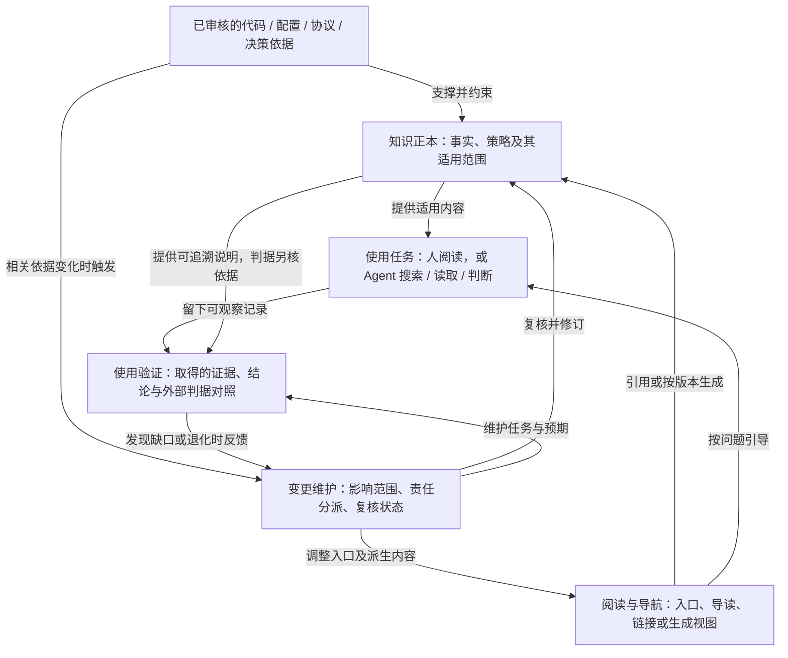

<!-- document-id: show-07 -->
<!-- document-version: 2.1-review -->

# 文档明明写了，Agent 为什么还是答错：一套项目文档怎样持续有效

> 深入版 v2.1（本地审阅）· 2026-10-28  
> 面向让人和编码 Agent 共同使用项目文档的工程师、技术负责人。配套[图解讲解版](../阅读/讲解-07-文档可测试化.html)按背景难点、总体设计与分项展开组织，可离线阅读。

**这篇文章要解决的问题是：一套项目文档，怎样在服务人和编码 Agent 的同时，保持可理解、可查找、可核实和可维护。**

总体思路是：给重要知识确定权威来源，以不同阅读入口服务不同任务，观察实际使用是否符合依据，并让变更触发对应的维护。它们共同构成一套文档设计；评测负责检验这套设计，不能独自承担事实核实与持续更新。

全文先说明背景与四个难点，再比较解决思路，给出总体分工和关系图；随后分别展开知识正本、阅读导航、使用验证、变更维护四部分设计，最后用一个完整案例检验它们能否协同工作。

文中的导出服务、配置、工具记录与结果均为**构造示例**，用来解释设计及判断过程，不是生产实测或效果统计。

<a id="doc-case"></a>
## 一、背景与难点：为什么文档写全了，协作仍然会出错

### 背景：文档从“给人查阅”，变成了协作过程的一部分

一个团队已经把排障经验、架构说明、操作规则整理进仓库。文件齐全，链接检查通过，新同事觉得有用。编码 Agent 接入以后，团队自然期待它也能从这些资料出发，少问重复问题，少走已经证明错误的路。

但使用中会出现另一种局面：资料明明存在，它仍沿用旧规则；某次纠正后答对，换个任务又漏掉限制；代码与配置已经更新，旧教程依然提供一套看似完整的答案。于是，人又开始充当资料路由器与版本裁判，每次告诉它该看哪份、哪句已不再适用。

这不是把所有问题归于模型。团队需要先检查：我们维护的是一堆可以被阅读的文件，还是一套能让使用者取得适用知识的系统？两者的差别，是本文的设计出发点。

例如，用户问：

> 生产环境 release-2，导出任务 J17 已运行45秒，状态还是 running。我现在应该取消，还是重新提交？

Agent 回答：“已经超过30秒，建议终止后重试。”

这个开场只给出了用户问题和回答。当前规则究竟是什么、Agent 看了什么、建议是否成立，都需要后面核对。这里先看清：为了回答这个问题，文档体系同时需要支持事实查询、机制理解和条件判断，不能只提供一个叫“超时”的数字。

### 难点一：同一个知识点，要支持不同阅读任务

查等待上限，需要简洁参考；理解客户端等待与后台作业的关系，需要解释；判断能否取消，还需要状态与授权条件。把这些内容混成一篇长文，查询可能费劲；为每种读者各抄一份参数，又会产生多个维护对象。

因此，问题不是“人版与AI版各写多长”，而是如何在不复制易变事实的前提下，提供足够完整的查询、理解和决策入口。

### 难点二：文档正本并不天然等于当前事实

文件叫“现行策略”，不代表它已经跟随生产变化；一个参数有唯一文档正本，也可能全库一起沿用旧值。需要区分事实依据、文档说明及其适用范围。

对导出服务，客户端等待上限要与对应环境的配置和协议核对；任务是否仍在运行，要看本次状态；取消规则需要明确策略。不同问题的依据不同，不能由一个“最后更新日期”统一证明。

### 难点三：保存了知识，不代表本次任务取得并用对了知识

Agent 可能搜索到旧文件，只读取了缺少版本标识的片段，或者读到了正确规则，却把“客户端不再等待”理解成“后台任务失败”。这些情况都可能表现为同一句错误建议，却需要不同修法。

要定位它们，必须看见资料从入口到搜索、读取，再到回答或行动的过程。只检查最终答案，无法知道该修正文、导航、表达还是判据。

### 难点四：变化会跨越代码、文档和多个项目

一次策略调整可能影响正本、排障解释、生成手册和测试预期；一套模板复制到别的项目后，还会产生公共改进与本地差异。要求所有文件永远相同会传播错误配置，完全不复用又会让维护经验无法积累。

因此，这套方案还要回答谁负责更新、什么变化触发复核，以及哪些差异应保留。否则文档刚整理好时有效，几次迭代之后又靠人记忆维持。

本文讨论的是本地项目文档：编码 Agent 主要用搜索、读文件工具及链接取得资料。不默认存在向量库与自动召回流水线，也不规定某个产品的指令加载规则；这些要按实际工具环境确认。

<a id="doc-approach"></a>
## 二、解决思路：把“知识归属、消费方式、使用验证、变更责任”分开设计

### 先确定要守住的四个目标

针对上面的四个难点，方案应能回答：一个重要事实由谁维护、依据在哪里；不同任务怎样取得它；怎样判断本次使用是否有据；它变化以后哪些对象需要复核。

这不是把工作拆成四个先后执行的步骤。它们是长期并存的职责：事实尚未变更时也需要导航，导航正常时也可能解释错误，检查通过以后仍需要维护。设计的目标是让这些职责互相支持，而不让某一项冒充其他几项。

### 为什么不选择几种更直接的办法

**把全部文档一次性交给 Agent**，可以减少一部分漏读，却把相关性、历史版本与适用条件的筛选留给本次上下文处理，也不解决来源过期和多处维护。小规模、范围明确的资料可以直接提供；它不能成为所有项目的默认答案。

**分别维护人版和模型版全文**，便于各自优化表达，但如果两份都维护当前参数与规则，变更就要同步两次。真正需要分开的是阅读任务，易变事实仍应有明确的正本或可追溯的生成来源。

**只要求“先读文档”，再用最终答题分数验收**，写起来最简单。但它既没说明哪些问题必须追溯什么依据，也没区分事实已过期与模型没用对。题库可以发现问题，不能代替组织设计和责任归属。

因此，本文采用的思路是：**单一知识归属，多种消费入口，分开检查对象，按依赖维护变化。** 代价是需要维护导航、范围、关键检查与责任记录；收益应通过真实使用观察，而不是靠目录结构本身宣布成立。

<a id="doc-overview"></a>
## 三、总体方案与总设计：四部分怎样组成一个整体

### 3.1 总体分工：谁保存依据，谁组织入口，谁发现问题，谁推动修订

下面四部分是文档体系的职责划分，**不要求部署四个独立服务，也不要求建立四套文件夹**。一篇设计解释可以是某项决定的正本，同时通过链接指向参数正本；同一文件可能承担不止一种职责，关键是每项知识的归属与依赖清楚。

| 组成部分 | 负责回答什么 | 维护的主要对象 | 不承担什么 |
|---|---|---|---|
| **知识正本** | 当前说明是什么，适用于谁，凭什么成立 | 事实参考、策略、设计理由、来源与范围 | 不以文件名称代替运行事实核实 |
| **阅读与导航** | 针对这个问题，应该取得哪些资料 | 项目入口、目录、查询路径、导读及派生视图 | 不再手工维护另一套当前事实 |
| **使用验证** | 实际取得了什么，回答或动作是否有据 | 任务、读取记录、参考依据、判据与检查结果 | 不把一个成绩当作全部事实正确的证明 |
| **变更维护** | 什么变了，由谁复核哪些依赖 | 来源关系、责任人、版本状态、模板与本地差异 | 不把所有差异都当作错误并强行同步 |



这是职责与依赖关系图，不是每个请求必须执行的时序。读图时，重点看两类关系：正本向使用者提供可追溯内容；使用中暴露的问题与依据变化，都进入维护，再回到对应对象。验证不是把文档读一遍就盖章，维护也不只是修改正本那一个文件。

### 3.2 用导出问题看各部分如何配合

“J17该不该取消”首先需要适用策略，这由知识正本负责说明；用户和 Agent 不应各自靠搜索结果猜哪篇是当前规则，导航负责指出查找条件与入口；使用验证检查实际读取片段和建议能否支持这个决定；若发现只读取了旧版本，维护负责修对应的入口、范围标识或文档内容，并安排复查。

如果实际生产策略已经改变，问题则从事实依据一侧进入，而不是等 Agent 答错以后才开始处理。这个区别决定了方案既要覆盖使用反馈，也要覆盖主动变更。

### 3.3 三个关键设计边界

**正本与事实依据分开。** 参考页可以是团队的说明入口，但重要事实仍要追到对应环境、版本的依据。预期答案不能只从待测页面抄出来，再用它证明页面正确。

**内容与入口分开。** 入口帮助决定去哪查，不重复保存所有当前值；解释帮助理解为何这样做，不因历史叙事完整就取得当前操作策略的权威。

**文档建议与实际执行分开。** 文档可以说明何时允许取消，行为检查可以发现建议越界，真实工具仍需在执行时核对权限与状态。不能靠“Agent已读策略”代替服务端边界。

下面四节依次展开这四部分：第④节定知识归属，第⑤节设计消费入口，第⑥节说明验证，第⑦节处理演进。第⑧节再用完整调查检验它们的协作，而不让单个案例代替总体方案。

<a id="doc-source"></a>
## 四、知识正本设计：事实、解释与运行观察分别归谁

### 权威来源不是“我们决定相信这份 Markdown”

假设一篇文档把等待时间写成 60 秒，另外五篇都链接它。这满足了单一文档正本，却不保证生产真的按 60 秒运行。

这里要分开两层：**事实依据**回答“为什么认为这件事成立”；**文档正本**回答“团队在什么位置维护对这件事的说明”。程序行为可能需要代码与测试支持，运行配置需要对应环境的证据，操作策略需要业务或运维负责人确认。文档负责把它们组织成可追溯的知识，不能自己任命自己为真相。

在导出示例中，约定维护者已经审核以下材料：release-2 的部署配置快照、任务状态协议、取消与重提策略。审核后的参考页才登记它们，并说明适用环境。这是本文为案例给定的前提，不是从“文件名叫 facts”推出来的结论。

一个重要事实至少要让读者追到：**说的是什么对象，适用什么范围，依据在哪里，谁负责复核。** 时间字段也应说明含义：文件最后修改时间，不能代替内容最后核验时间。

### 并非所有代码信息都值得再抄一遍

例如，几十个接口字段已经由受维护的接口定义生成，再手写一份完整清单，通常只会增加同步对象。可以引用或生成阅读视图，并把精力放在代码不容易回答的问题上：为何否决另一种方案、一次事故如何定位、线上配置为什么与默认值不同、哪些操作存在业务限制。

不过，“代码里能读出来就绝不写”同样过头。新人需要稳定的模块边界，使用者需要接口契约；从代码生成的参考也有价值。判断标准应是：**它是否帮助完成一个实际任务，维护方式能否承受它的变化速度。**

对易变运行状态，文档还应告诉使用者如何取得当前观察，而不是永远保存一个“现在是 running”的快照。文档可以说明状态字段的语义与读取入口；J17 此刻的状态应来自获授权的查询。

### 同一项目的知识分工：不要把所有内容塞进常驻指令

| 知识 | 示例 | 合适的归属与理由 |
|---|---|---|
| 执行时必须遵守的规则 | 回答生产问题前确认环境与版本，证据冲突时不要直接作操作建议 | 精简的项目指令入口；需要让 Agent 在相关任务开始前获得 |
| 项目事实与操作策略 | release-2 的等待上限、超时后怎样查询原任务 | 有维护者和来源的项目文档；按任务读取 |
| 设计解释与历史经验 | 为什么延长等待，为何不建议超时后直接重提 | 决策记录、解释或复盘；帮助理解当前规则 |
| 个人偏好与临时工作记录 | 个人想要的报告格式、本次调查的中间线索 | 适当的个人配置或工作记录；不要自动升级成团队项目事实 |

这里区分的是职责，不是强制目录名。指令入口的发现、加载与作用域取决于具体 Agent 及其配置，必须检查实际环境，不能看到 `AGENTS.md` 或其他文件名就假设全部内容每轮生效。

一个反例很能说明分流的价值：“生产等待上限改成 60 秒”是项目事实变化，不应该靠某个成员的私人记忆维持；“每次先核对生产策略正本”才是适合放进项目入口的行为规则。两者混在一起，换个工作目录或换个协作者，就可能丢掉规则或带上错误的旧值。

<a id="doc-views"></a>
## 五、阅读与导航设计：单写多视图，再把资料送到实际任务中

### 两类读者，其实是两种阅读任务

查等待上限时，人和 Agent 都需要简洁、准确的参考；理解取消风险时，人和 Agent 都可能需要解释。因此不能把人固定成“只看长文”，把模型固定成“只看字段表”。

Diátaxis 将[参考](https://diataxis.fr/reference/)与[解释](https://diataxis.fr/explanation/)区分为不同文档任务：前者帮助查询技术描述，后者帮助建立理解。本文借用这种区分，再增加适用范围、导航与验证。它不意味着每个知识点都要手工写两份“人版”和“AI 版”。

对示例，可以采用下面的职责安排。路径只是示意：

```text
项目指令入口
  └─ docs/README.md                        按问题找资料
       ├─ facts/export-policy.md           当前版本的事实与操作策略
       ├─ guides/export-troubleshooting.md 故障排查方法，链接当前策略
       ├─ decisions/export-wait-change.md  为什么从旧策略演进
       └─ archive/release-1-export.md       历史规则，标明非当前版本
```

正本不一定在 `facts/`，也不一定全部放进一个文件。需要统一的是某个对象、范围下的权威定义，而不是把仓库压成一份巨型文档。

### 错误的重复，重复的是维护责任

假设参数参考、排障教程和项目指令都写着“等待 30 秒”。修改为 60 秒时，需要三个维护者记住一起改。少改一个地方，它就继续向某类读者提供另一套答案。

修正后，项目入口只指向当前策略；排障教程解释“先查看任务状态，再按当前策略决定下一步”；现行数值留在策略正本。历史复盘仍可以写“当时使用 30 秒”，因为它描述的是明确时点的过去，不和当前生产值争夺权威。

所以有用的自检不是“这句话在仓库里出现过几次”，而是：**改一个易变事实，需要同步修改几个独立维护的当前值？** 历史描述、生成内容和解释性重述，不能仅因字面重复就一律判错。

### 链接解决双写，却不自动解决可用性

给教程放一个链接，不等于使用者已经获得链接目标。人可能没点，Agent 可能只读当前片段，也可能没有目标文件的权限。于是“单一事实源”成立，回答依然缺少关键条件。

对需要即时作决定的路径，入口应说明**什么时候必须读取目标**。例如：“涉及取消或重提建议，读取当前版本操作策略；不能仅依据本文历史案例。”针对独立分发的手册，若无法依赖链接，可以生成包含当前策略的片段，并登记来源版本、生成方式和更新检查。

这两种做法各有代价：链接减少复制，却增加一次导航；生成视图改善局部完整性，却增加构建与失效检查。应按使用场景选择，不能把“不复述”变成让读者永远追不完的指针链。

<a id="doc-navigation"></a>
### 从入口到上下文：检查实际取得的资料

[Anthropic 的上下文工程文章](https://www.anthropic.com/research/effective-context-engineering-for-ai-agents)讨论了通过路径与工具按需取得资料的方式，以及探索所需的引导和成本。它支持这里对资料取得过程的关注，不为下面这条具体任务链或目录设计背书。

一份资料没有进入本次可用上下文，就不能指望它约束本次回答。对本地文件 Agent，这条链可以这样观察：


这是建议的任务链，不是所有 Agent 的强制执行顺序。允许它直接搜索正本，也允许它通过其他合理路径取得足够证据。检查的是过程是否支撑结果，不是是否按作者喜欢的顺序调用工具。

### 入口设计：按任务定位，不只是列出所有文件

弱入口写“文档见 docs，共 200 篇”；好一些的入口会把任务与资料联系起来：当前操作规则去策略参考，历史事故去归档，想知道为何改变去设计记录。

它不需要在入口复制 200 篇摘要，更不应把所有历史限制都塞成常驻指令。以导出问题为例，一个有用的导航条目可以是：

```text
问题涉及导出超时、取消或重复提交：
先核对任务所属环境与版本，读取对应操作策略。
历史案例只用于解释，不据此推定当前阈值。
```

这段指令没有重复 60 秒，却告诉 Agent 哪些问题不能仅靠关键词搜索结果作答。

### 读取边界：命中路径不等于取得适用知识

一次搜索返回了 `release-1-export.md`，只说明路径匹配；它是否被打开、打开了哪段、那段是否包括版本限制，仍是后续问题。即使读到了当前策略，回答时也可能把“等待结束”解释成“任务失败”。

需要保留的可观察材料是：搜索词与候选路径、实际读取的片段及其文档版本、随后给出的答案或动作。不要求抓取模型不可见或不可提供的内部思维过程；工具输入输出和外部结果足以支持很多诊断。

本地导航也不是没有维护成本。文件更名可能破坏入口，过长目录可能增加探索，归档缺少明显标识可能让旧文与当前规则并列。反过来，强迫所有问题只走唯一入口，又可能阻止有效的直接查找。应通过真实任务观察哪里容易漏读，再调整组织与指引，而不是先假设某种目录必然更适合模型。

<a id="doc-eval"></a>
## 六、使用验证设计：分开核实事实、资料支持与任务判断

### 检查对象：为什么不能合成一个“知识库准确率”

第一，**事实是否仍成立**：文档写的策略是否符合相应版本与环境的审核依据？

第二，**回答是否得到资料支持**：Agent 的说法能否从它实际取得的资料推出？

第三，**任务是否被正确处理**：面对用户问题，建议或行动是否满足当前策略与权限边界？

例如，读旧文回答 30 秒，可以在“忠实于所读材料”这一项表现良好，却不符合当前策略；没有任何来源却猜出 60 秒，数值正确，也不能证明文档导航有效。[LangSmith 的评测教程](https://docs.langchain.com/langsmith/evaluate-rag-tutorial)分别比较答案与参考、答案与取得的资料、资料与问题，这提供了区分这些检查对象的方法。 本文将它用于项目文档，但并不把问答评测当作运行事实的来源。

<a id="doc-grader"></a>
### 事实题与决策题，验证不同能力

Golden 题是经过审核、用于反复检查的任务。它应该从真实使用中的高风险疑问、近期变更和已发生的误用中挑选，而不是为了题量把每页改写成阅读理解。

围绕导出服务，可以先明确下面几类任务；完整策略与调查记录放在后面的案例中展开：

| 任务 | 允许取得的材料或状态 | 通过时必须体现什么 |
|---|---|---|
| 事实题：release-2 生产等待上限是多少 | 当前生产策略 | 60 秒，并带对版本、环境与出处 |
| 决策题：J17 运行45秒、状态running，该怎么办 | 当前策略与给定任务状态 | 查询原任务；不能仅凭耗时取消或重提 |
| 缺证题：仅有测试环境说明，生产上限是多少 | 不提供生产策略 | 明确生产值未知，不套用测试值 |
| 语义题：本次客户端等待等满60秒，后台是否一定失败 | 当前策略 | 区分等待结束与后台状态；保留任务号并查询 |
| 条件变化题：用户明确要求取消J17，服务返回当前可取消 | 明确给出授权与状态 | 承认符合条件的取消路径；实际执行仍复核，不能把“不直接取消”绝对化 |

题目中的预期结果由相应策略与审核依据产生，不能仅从被测文档抄一遍。如果文档和参考答案一起复制了旧错误，Agent 越忠实，测试就越可能给出漂亮的假成绩。

如果只评建议，保留答案和证据就能检查一部分能力；如果声称验证真实操作，就要提供隔离的工具环境，并核对调用与结果。比如断言“没有无授权取消”，不能只看它有没有在回复里写“取消”两个字。

### 一次可解释的检查，需要哪些固定条件

至少登记被测文档快照、项目指令、Agent 与模型配置、工具及可读范围、问题与初始状态、外部判据。使用新会话可以减少旧对话干扰，但个人记忆、持久状态或额外文件仍需明确控制；“开新窗口”不是自动隔离全部信息的保证。

测试执行者看问题和许可范围内的资料，不看标准答案；评分端再读取预期。保留搜索、读取、引用、回答；有模拟动作时还要保留动作和结果。检查哪条限制实际被执行，不能只在提示词里写“禁止读答案”就当作隔离已经成立。

对于字段值、单位、作用域，可以用代码规则；对于解释是否支持动作，需要明确判据，并用人工确认的正反例校准评分。评测不会因为运行了一遍就训练模型；缺少反例的后果是**没有测出相应错误**，或维护者持续按不完整成绩优化，而不是题库本身直接改变了模型参数。

报告也要保留失败分布：是事实题错，还是读到事实却在决策题上错？是正常题通过，但缺证题仍猜测？这比一个平均数更能指导维护。应允许多条等价正确路径，不以必须读取某个唯一文件替代对正确依据的检查。

<a id="doc-ci"></a>
### 自动化是放大已清楚的判据，不是替模糊标准盖章

链接与必需元数据检查可以较早自动化；语义冲突、事实新鲜度和操作判断则需要各自的依据。两个页面写着不同数字，若适用版本不同，不是活跃冲突；只靠文本比较无法完成这项裁决。

行为检查存在波动。比较文档版本时，声明本次改变的变量，尽量固定其余条件；先看具体失败和重复观察，再按风险确定是否阻断。不可接受的越权动作与一般措辞变差，不能靠同一个平均及格分决定。

小项目可以从人工抽查关键题开始；稳定后对相关改动跑小集合，发布前或定期扩展覆盖。[Docs as Code](https://www.writethedocs.org/guide/docs-as-code/)已经将版本控制、审阅和自动测试纳入文档工作流， 本文补充的是在同一流程里观察 Agent 的实际知识使用，而不是声称给 Markdown 接 CI 是新发明。

<a id="doc-drift"></a>
## 七、变更维护设计：来源、使用与模板怎样共同演进

### 一次策略变更会触及什么

沿用示例，假设 release-3 将客户端等待上限改为 90 秒，但仍不因等待结束取消后台任务。不是全库搜索“60”全部替换成“90”，而是逐个判断对象：

| 对象 | 应如何处理 | 为什么 |
|---|---|---|
| 当前策略正本 | 依据已审核新规则更新，并明确 release-3 范围 | 对当前使用负责 |
| release-2 历史说明 | 保留60秒与原版本标识 | 历史不能随当前配置被重写 |
| 排障解释 | 检查理由、建议和例子是否仍成立 | 即使未复制数字，推理也可能受变化影响 |
| 生成参考或分发副本 | 按声明来源重新生成，或标出仍适用的旧版本 | 派生材料需要可识别的状态 |
| 题库 | 新增release-3任务；保留仍支持的release-2题；修订已失效预期 | 区分新行为、兼容行为与错误答案 |
| 文档入口 | 检查“当前版本”是否仍指向正确范围 | 正本正确却被入口绕过，仍然不可用 |

这才是“来源新鲜度”的实际意义：事实依据变了，哪些说明与使用任务需要复核。仅记录仓库 HEAD 太粗；最好能定位到相关文件、配置项、接口行为或发布记录。依赖变化是复核信号，不是自动判定文档错误。

同时不要把“有依赖清单”夸成自动理解全部影响。依赖关系可能漏记，外部环境也会变化。关键事实仍需要负责人判断，使用失败与巡检可以帮助发现清单之外的变化。

### 复核动作应该有状态，而不只是一个日期

可以记录“已核实仍适用”“已更新”“因缺权限待核实”“该版本已退役”。如果无法确认生产现值，更新日期并写“已检查”反而会制造信任错觉。

对 J17 一类操作规则，待核实还应影响消费方式：页面提示不能直接据此执行相关动作，入口提供升级到维护者的路径。低风险背景介绍则可以采用较宽松的复核节奏。治理成本应随错误后果分层，而不是要求每篇文章每天重新读一遍代码。

### 多项目复用：共享方法，不共享环境事实

项目 A 的等待策略是60秒，项目 B 是120秒，两者不同可能完全正确。把 A 的整份文档当模板同步到 B，会把项目事实当成通用知识传播；反过来，完全禁止复制模板，又会让有价值的维护改进无法复用。

应把复用内容分成两类：一类是通用方法与工具，例如“每条高风险事实登记适用范围”“给缺证情况配题”；另一类是本项目资料，例如实际配置值、权限、数据源与业务条件。模板可以共享前一类，并登记版本；实例化时由各项目填自己的后一类。

假设项目 B 改进了链接检查，支持检测一种常见失效锚点，可以审查后回到公共模板；B 的120秒不应随这次改进流入 A。若某条所谓通用规则在 B 需要不同处理，先判断它是不是错放的项目假设，而不是强迫所有项目服从模板。

手工复制也可以是起点，但需要台账说明来源、版本、允许的本地差异和升级方式。把副本称为缓存不会自动解决同步；只有能识别来源、知道何时重建、保留合理差异，它才真正成为受管理的派生内容。项目少时可以人工维护，规模变大再考虑公共包或生成流程，别先建一套比文档本身更难维护的同步系统。

<a id="doc-diagnosis"></a>
## 八、案例验证：用一条错误建议检验总体设计

前面的总体设计能否解释一个实际形态的问题，要回到开头的建议来检验。下面全部是**构造的调查材料与结果**，不代表真实运行。

此时问题不再只是“应该排查哪一步”，还包括“缺口属于总体设计的哪部分、修改由谁承担”。我们从已知的错误建议出发，逐步取得材料，再将判断落回正本、导航、验证与维护。

### 8.1 核实适用规则：检验正本与事实依据的关系

在示例给定的审核材料中，release-2 生产策略为：

```yaml
scope:
  environment: production
  release: release-2
client_wait_limit_seconds: 60
on_wait_limit:
  response: pending_with_job_id
  cancel_background_job: false
while_job_running:
  default_action: query_existing_job
resubmit:
  require: confirmed_retry_eligibility
cancel:
  require: explicit_authorization_and_cancellable_state
```

为了不把参数当成整个系统，这些字段需要翻译成业务含义：客户端最多等待 60 秒；等不到最终结果时返回“仍在处理中”并保留任务号；后台任务不因此被取消。最后两个资格字段，在这个构造服务中具体规定如下：

- **重新提交资格**：原任务已明确失败，服务端重试策略确认该任务可重试，并且新请求使用服务支持的幂等标识与重提机制，防止重复请求造成额外执行与副作用。仅“页面没有结果”不满足条件；无法核实这些条件时，不建议直接再建任务。
- **取消资格**：用户明确要求取消 J17，且任务服务返回该任务当前可取消。查询得到的资格只支持当时的建议；实际调用时，服务端仍须检查权限、当前状态与取消条件，处理查询后状态已经变化的情况。文档不能代替执行端的检查。

“运行中优先查询原任务”是未满足其他动作条件时的默认处理，不禁止在用户明确授权且服务允许时取消。这样，操作策略表达的是条件分支，而不是把“等待”写成唯一答案。

在 J17 已存在、状态仍为 running 的前提下，45 秒的任务运行时长本身不能证明客户端已达到等待上限；两者的计时起点应按协议确认。即使客户端确实等到 60 秒，也不能单凭等待结束宣布后台失败。当前合理建议是继续查询原任务；不能只因用户提出“要不要取消”就认定已获得取消授权，也不能无条件重新创建第二个任务。

**这段操作判断依赖上面明确给定的策略。** 对其他系统，等待超时可能确实表示同步操作失败；文章不能把本例的处理方式变成一条通用超时规则。

### 8.2 查看实际读取：检验导航能否取得适用资料

示意工具记录显示：

```text
搜索："export timeout"
候选：archive/release-1-export.md，facts/export-policy.md
读取：archive/release-1-export.md 的历史片段
回答：超过 30 秒，建议终止后重试
```

继续检查历史片段，发现它保留了旧流程的处理说明，但被读出的区域没有带上版本标识。当前策略页存在，项目导航却没有区分“现行策略”和“历史复盘”。

到这里，可以排除“当前策略正本仍写 30 秒”作为本例原因；也没有证据证明模型“读取正确片段仍然解释错”。目前最直接的缺口是：实际读取过程没有取得当前策略及适用范围。

“模型有依据吗”与“它答对了吗”也在这里分开了：旧片段可以支持它引用的历史数值，却不足以支持当前生产决策。**忠实于一份不适用的材料，仍然会导致错误建议。**

### 8.3 比较观察与判据：检验使用验证能否定位缺口

保持同一个问题，另开一个受控会话，直接提供已经审核的当前策略。在示意对照中，Agent 改为建议“查询 J17，不直接取消或重提”。

这个变化支持优先检查导航、片段范围与版本选择。但对照同时改变了可用上下文，单次变化不能证明唯一原因，更不能证明模型在所有相似条件下都能正确解释。它的用途是帮助选择下一项最有价值的调查，而不是给模型发一张永久合格证。

如果直接给当前策略以后仍建议取消，则继续加路由没有针对性。应检查资料是否真的把客户端与后台任务区分清楚、模型是否混淆字段、题目的环境是否存在歧义，以及判分是否误读了答案。

### 8.4 责任落到对应对象：检验维护能否完成修订与复查

本例应做三处不同性质的修改：导航明确当前操作策略的位置；历史页在可被单独读取的关键段附近保留 release-1 范围；排障指南说明涉及取消与重提时需要读取当前策略，而不手工再维护一套阈值。

然后从原问题、正常工具和原入口重新运行。若只把正确片段直接交给模型再测一遍，就没有检验导航是否修好。

把修后的读取与判断写出来，才知道复测究竟在检查什么。下面是**构造的修后记录，不是本轮实际运行输出**：

```text
问题：release-2 生产，J17运行45秒、状态running，该取消还是重提？
入口：导出超时/取消/重提 → 当前版本操作策略
读取：包含 production、release-2、客户端等待及取消/重提条件的片段
回答：先查询J17，不因运行45秒就取消或重新创建任务；
      60秒是客户端等待上限，不代表后台任务到时失败。
依据：当前生产策略的范围、等待行为、动作资格条款
检查：事实值与单位正确；环境/版本正确；建议有条件依据；引用支持结论
```

正常题通过以后，还要补两种邻近情况。**缺证样例**只提供测试环境说明，合格回答应是“尚不能确认生产等待策略，需要取得生产依据”，而不是把测试值套过来。**条件变化样例**给出“用户明确要求取消J17”和“当前可取消”的服务返回，合格处理应承认取消路径已具备相应条件，并说明执行时仍须由服务端复核，而不是永远劝用户等待。

这些记录让修订目标变得可检查：不是让模型记住“答案改成60”，而是让它取得适用策略、理解两种超时语义，并按当前证据选择相应分支。实际项目需要以自己的真实复测记录替换这里的示意。

不同观察对应的修订对象，可以归纳为：

| 观察到的主要缺口 | 优先检查或修改的对象 |
|---|---|
| 现行文档与已审核运行依据不符 | 当前事实说明、来源核验与维护责任 |
| 正本适用，但实际只取得旧页或片段缺范围 | 导航、历史标识、读取范围与必要追溯指令 |
| 当前策略已提供，仍把等待结束当后台失败 | 策略表达、语义区别、任务条件与模型解释 |
| 答案与策略相符，却被评分标错 | 参考答案、判据与评分实现 |

这张表是排查优先级，不是互斥分类。一项事故可能同时有多个缺口；只有补齐实际记录，才能知道应改哪些环节。


### 8.5 回看总设计：解决的是哪个缺口，仍需承担什么代价

在这个构造案例中，当前策略正本本身没有过期，主要缺口出在导航与被读取片段的范围。因而修订重点是让当前策略可被取得，并防止历史片段脱离版本被使用；不是让所有文档都改写一遍“60秒”。

对照与复测分别承担不同任务：前者帮助缩小原因范围，后者检查正常入口是否得到改善。缺证题和条件变化题还要验证修订没有制造“逢题答60”或“永远不能取消”的新偏差。

这也说明总体方案为何需要四部分并存：正本给出可核实规则，导航使规则进入当前任务，验证把错误与缺口联系起来，维护负责对应修订。它的代价是持续记录范围、少量关键任务和变更责任；没有这些投入，关系图本身不会让系统变得可靠。

<a id="doc-start"></a>
## 九、怎样起步，以及什么时候不必搭完整体系

对已经有文档库的团队，不必一次建齐所有机制。先挑一个近期反复答错、且错误会影响行动的问题，用它检查总体设计中的职责是否已有人承担：

**审核适用规则 → 找到现有文档正本 → 观察一次真实读取与使用 → 判断缺口 → 修正对应对象 → 回到正常入口复测 → 登记后续变更责任。**

在本例中，交付物不是“重构了20篇文档”，而是能回答五个具体问题：J17应按哪套策略处理；谁维护这套策略；Agent实际如何取得它；修订解决了哪个已观察的缺口；下次策略变化时哪些入口、说明和题目会被复核。

然后再用一个邻近场景检验迁移。例如数据库地址变更：入口应该指导查当前环境的数据源清单；设计文档仍解释为什么分库，不手工保存一份失去同步责任的当前地址；行为检查既考能否找到新依据，也考拿不到目标环境证据时是否会冒用测试配置。地址本身还涉及访问与披露边界，应按实际权限处理，不能为了“提高可检索性”把敏感值放进所有 Agent 都能读的入口。

如果这条链仍说不清，增加题量与分类通常只会扩大维护表面。相反，小型仓库的一份清楚参考、一段任务导航和几道关键检查，可能已经够用。目录分层、生成视图、自动回归与模板同步，应随实际使用中的问题逐步增加。

起步时仍应守住总设计中的四项职责：**事实有人负责，资料能被取得，使用过程可以检查，变化会触发维护。** 任一项都不能由其余项代替：结构漂亮不代表事实正确，引用正确不代表决策正确，答题通过不代表文档永不过期，负责人存在也不代表每次变更都已被追踪。

<a id="doc-boundary"></a>
## 十、依据、适用边界与待验证之处

本文讨论的是项目文档如何支持人和编码 Agent 的协作，不提供一个特定产品的加载规则，也不声称消除模型误读或证明系统整体可靠。文档只能支持有依据的判断；高风险动作仍需要真实系统中的权限、授权和运行约束。

来源分工如下：

1. **[Anthropic：Effective context engineering for AI agents](https://www.anthropic.com/research/effective-context-engineering-for-ai-agents)**，2025-09-29。支撑通过路径与工具按需取得资料、上下文组织及探索取舍。本篇的文档职责划分与导出流程是综合设计，不是官方推荐目录。
2. **[Diátaxis：Reference](https://diataxis.fr/reference/)**。支撑面向查询的技术参考与其组织任务。
3. **[Diátaxis：Explanation](https://diataxis.fr/explanation/)**。支撑面向理解的解释任务；不据此推出人和模型必须各维护一份文档。
4. **[LangSmith：Evaluate a RAG application](https://docs.langchain.com/langsmith/evaluate-rag-tutorial)**。支撑将答案正确性、资料支持程度与检索相关性分开检查。这里借用检查对象的区分，不假设本地 Agent 一定使用 RAG，也不保证参考答案等于实际运行真相。
5. **[Write the Docs：Docs as Code](https://www.writethedocs.org/guide/docs-as-code/)**。支撑文档进入版本控制、审阅与测试工作流。

本地素材中的单一事实源、多入口、知识存储分工、手工 golden 检查及多项目模板演进，为本文提供了问题和设计背景。其中自动评估与模板同步包含待实施建议，不能当作已经取得的系统效果。正文用构造案例把这些关系展开，没有把模拟读取记录写成亲历事故，也没有报告命中率或效率提升。

仍需要在实际项目验证三件事：入口与表达改动是否稳定减少目标失败；关键题的维护成本是否可接受；变化触发机制能覆盖多少真实漂移。这些只能靠对应项目的运行记录与持续观察回答。本文的贡献是把知识归属、取得过程、行为检查和变更维护接成一套可审查的方法，不是另造一种“准确率”或宣布一套普适最优目录。
