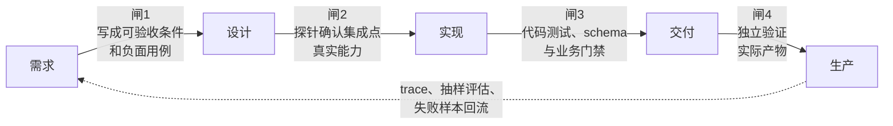

# AI 让“看起来正确”变得廉价：从似真产出到证据化工程

> **断言标注约定**：本文关键判断按三分法标注——`[复盘证据]`（作者真实项目复盘，已匿名化，属单案例经验）、`[官方方法]`（厂商或社区公开的工程方法论，属经验性证据）、`[经验]`（作者实践观察，样本有限）、`[推测]`（本文提出的判断，附验证思路）。无标注的为可直接核对的定义或流程描述。

## 引子：一句话答案

先修正一个容易走偏的立论：**似真产出不是 AI 发明的**。装饰性的工作汇报、听起来专业实则空洞的方案、靠口才过关的验收演示，人类时代一直存在；针对它们的工程纪律——测试、评审、验收标准——也早已存在。AI 改变的不是问题的有无，而是**比例与速率**：过去"做出来"本身就是高成本信号，一个能运行的功能默认意味着有人投入了数天，产出与正确之间的距离通常不远；现在产出边际成本趋零，"做出来了"不再携带"大概率做对了"的信息量，而验证成本没有同比例下降。两条成本曲线张开剪刀差，工程重心随之从"生产结果"移向"建立证据链"。

**一句话答案**：AI 让"看起来正确"变得廉价，却没有让"证明正确"变得廉价；于是最危险的失败不再是明显报错，而是**成功地产出了一个错误结果**——它可能通过 schema 校验，接口返回 `success: true`，页面正常展示，直到有人用真实数据、真实链路或真实业务边界去核对，才发现整个结论建立在错误前提上。

对实际团队而言，这不是抽象的"AI 幻觉"问题，而是三个直接消耗工程时间的问题：集成点的能力靠猜、批量产出用数量冒充质量、Agent 用完成声明替代可复核结果。本文不讨论如何让模型更会写，只讨论如何让错误结果无法只凭外观过关。

### 读完可以直接拿走什么

- 一个判断集成点是否真的可用的最小探针；
- 一组区分 raw、valid、grounded、useful 的产出指标；
- 一条从需求、实现到生产抽检的证据链，以及每层断掉时的典型症状；
- 一个决定何时用代码、模型判别或人工抽检的门禁分层，含误杀度量思路。

## 一、案例：一个总结卡功能为什么两次推倒重来

考虑这样一个功能：Agent 完成一轮任务后，自动给用户生成一张总结卡。下面的复盘来自真实项目，业务名称、内部接口与可识别数据已移除`[复盘证据]`。

**第一版**把生成逻辑挂在一个工具调用完成后的 hook 上。这个位置名字合理、触发稳定，也确实能拿到工具返回，于是系统很快"成功出卡"。真正抓取运行轨迹后才发现：这个 hook 只能看到当前工具的结果，看不到整轮任务的最终回答，也看不到同一轮其他工具的完整信息。它生成的不是总结，而是"电影演到一半写出的影评"。第一版整体作废。

**第二版**把生成位置移到一轮结束之后，终于能拿到完整结果。批量运行时，系统产出了 14 张卡。单看数量，功能已经完成；但按时间范围、数据充分性、证据一致性和展示价值筛选后，真正适合给用户看的只有 5 张。其余结果包括：

- 把旧数据写成近期变化；
- 把一批明细描述成趋势；
- 查询失败后仍然生成一张"暂无异常"的卡；
- 数据不足，却用流畅语言补出结论。

两次翻盘表面上分别是集成点选错和质量不足，底层却是同一个问题：

> 团队在关键节点接受了一个"足够像真的替身"，没有继续追问真实能力和真实证据。

这个案例值得先记住，因为第二节会从它提炼出四种替身的分类，第六节会回到它做一次证据链复盘——两次翻盘各自断在哪一层，届时可以逐层对号。

**本节本质**：似真产出不靠运气出现，它精确落在系统"用外观代替证据"的接缝上；案例已经包含了后面全部机制的种子。

## 二、四种"正确替身"：从案例提炼的分类

先定义术语。**似真产出**：结构完整、语气自信、状态看起来成功，但真实性未经验证的结果。**正确替身**：在某个关键节点上被当作"真"来接受的那份似真产出。替身不是随机出现的，在 AI 系统里它经常藏在四类位置——下面每一类都能在案例里找到对应画面。

### 1. 状态字段替代真实成功

最外层的 `success`、`done`、`completed` 很容易被当成结论。但一个多层系统可能出现这样的返回：

```json
{
  "status": "success",
  "data": {
    "tool_result": {
      "message": "upstream timeout"
    }
  }
}
```

外层只表示"流程走完了"，内层才表示"业务动作是否成功"。异常可能被捕获，工具调用可能正常结束，HTTP 也可能返回 200，但这些都不能证明用户要的结果已经成立。案例里那张"暂无异常"的卡，正是查询失败被层层吞掉后，由最外层状态字段盖出的假章。

因此，状态字段只能作为线索，不能独立充当业务事实。判断成功必须深入到产生价值的那一层：数据是否存在、时间范围是否正确、关键动作是否真正执行、结果是否满足业务约束。

### 2. 原始产出替代有效产出

"生成了 14 个结果"描述的是吞吐量；"其中 5 个可用"描述的才是质量——这正是案例第二版给出的数字。

生成系统天然倾向于把"我产生了一个对象"当成"我完成了任务"。如果验收指标只统计原始产出数，系统会被激励去制造更多形式完整的垃圾。更合理的指标至少要区分：

```text
raw output      原始产出
valid output    通过确定性规则
grounded output 有足够证据支撑
useful output   对用户确实有价值
```

这几个数字之间的差距，比总产出数更能说明系统质量。

### 3. 名称和先验替代真实能力

`post_tool_use`、`after_action`、`on_complete` 之类的名称，会让人自然推断它们"应该"能拿到完整上下文。LLM 也会根据见过的其他框架，生成一个听起来合理的能力说明。案例第一版的 hook 方案，赌的正是这个"应该"。

但集成点的能力是经验问题，不是语言推理问题。"整个系统里存在这份数据"不等于"这个回调会把数据传给你"；"大多数框架这样设计"也不等于"当前仓库如此实现"。答案只能来自：

- 派发代码；
- 函数签名和真实载荷；
- 一次最小探针；
- 一条完整运行轨迹。

在一个未经验证的 hook 上继续设计，后续方案越精致，沉没成本越高。

### 4. "做完了"替代可验证完成

AI 很擅长生成任务结束时应有的语言：修改完成、问题已解决、测试应该通过。这类表述可能描述的是"它执行了修改动作"，也可能只是"它认为方案足够合理"，两者都不等于功能真的工作。

同样，PRD 里的"生成一张高质量总结卡"读起来人人都懂，却没有定义：什么情况下不应该生成；多长算过长；什么数据足以支撑趋势判断；哪些结论必须带时间和来源；失败时应该沉默、降级还是提示。"完成"和"理解"如果没有可观察的下落，都只是漂亮的状态描述。

### 替身与证真机制的对应关系

四个替身不是四个孤立的现象，它们各自对应一种把"证真"变成机制的解法，对应关系如下：

| 正确替身 | 案例中的画面 | 对应证真机制（详见第四节） |
|---|---|---|
| 状态字段替代真实成功 | 查询失败仍出"暂无异常"卡 | 质量门禁（结构与证据层） |
| 原始产出替代有效产出 | 14 张里只有 5 张可用 | 产出分级指标 + 门禁 |
| 名称先验替代真实能力 | hook 拿不到整轮结果 | 探针先行 |
| "做完了"替代可验证完成 | "生成高质量总结卡"无法验收 | 可检验完成条件 + 独立验证 |

这张表不能告诉你什么：它给的是"最对症的起点"，不是一一映射——一个替身往往需要多个机制叠加才能拦住（"暂无异常"卡既要证据层门禁，也要独立验证），而一个机制也常常同时防住多个替身。

**本节本质**：替身之所以危险，是因为每个都精确利用了一种"外观信号"（状态码、数量、命名、语气）；识别替身，就是在识别系统里哪些信号正在冒充证据。

## 三、为什么"以后仔细一点"解决不了问题

发现这些风险后，最自然的反应是：以后多检查一下。这不是可靠的工程方案。

一方面，模型不会因为上一次被纠正，就永久形成新的行为。没有进入系统提示、项目指令、测试或代码门禁的纠正，换一个会话后很可能重新发生`[经验]`。另一方面，人也会忘。系统在大多数时候表现正确，反而会培养自动化偏见：工具越可靠，人越少核对；越少核对，偶发的高置信错误越容易穿过整条链路`[经验]`。

这正是剪刀差的另一半：产出端已经自动化，验证端如果还停留在"人靠警觉"的手工模式，两端的速度失配只会越来越大。可靠性不能依赖每个人在每一次执行中都保持警觉，正确方向是把判断固化成机制：

```text
靠记得检查
    ↓
每次自动检查
    ↓
检查不通过就无法继续
```

工程的价值不只在于降低错误概率，还在于让某些错误没有机会静默通过。

**本节本质**：常规解法失效的原因，是它把验证责任放在"人的警觉"这个最不可靠的组件上——而自动化恰恰放大了警觉的稀缺。

## 四、四种把"证真"变成机制的方法

### 1. 在集成点上先放探针，再做设计

如果一个功能依赖 hook、回调、消息事件或框架生命周期，先写一个不承担业务逻辑的最小探针：

```text
收到哪些字段？
调用发生在什么时候？
同一轮会触发几次？
异常和取消时是否触发？
能否看到最终结果？
```

先记录原始载荷和时间顺序，再决定是否适合作为集成点。这里最重要的纪律是：不接受"应该能拿到"，只接受"这段代码传递了这些字段"或"这次运行实际收到这些内容"。案例第一版的整轮返工，理论上用一个半小时的探针就能避免。

### 2. 在产出边界设置质量门禁

门禁不是 LLM 专属保险——规则系统、模板系统和统计系统同样可能在错误输入上稳定地产出错误结果。只要同时满足以下三点，就应该考虑门禁：

1. 结果由系统生成或推导；
2. 结果会展示给用户，或驱动下游动作；
3. 输入本身不能天然保证结果有效。

门禁最好分层：

| 层级 | 检查内容 | 适合方式 |
|---|---|---|
| 结构 | schema、必填字段、类型 | 代码 |
| 范围 | 长度、枚举、时间窗、数值范围 | 代码 |
| 证据 | 结论能否对应来源，关键数据是否存在 | 代码优先，必要时模型判别 |
| 语义 | 是否误导、是否过度断言 | 模型判别或人工抽检 |
| 业务 | 是否值得展示，失败应否降级 | 产品规则与代码 |

这张表不能告诉你什么：它给的是"哪类检查该用什么工具"的默认分配，不回答门禁该设在系统哪条边界上，也不保证低层通过后高层一定通过——五层是串联关系，任何一层通过都不代表整条链合格。

schema 通过只能证明"可以解析"，不能证明"事实正确"。反过来，门禁也不是越严越好——过度拦截会把系统变成沉默机器，因此要同时观察误放和误杀。**误杀怎么度量**，两个可操作口径`[推测]`（口径设计属本文建议，数值需按业务校准）：

- **抽检复核率**：定期抽样被门禁拦截的结果，交人工复核，统计其中"其实该放行"的比例——它直接度量误杀；
- **线上缺陷回流率**：统计放过门禁的结果，在下游或生产环节被发现问题的比例——它度量误放。

两个口径必须一起看：只盯误放，门禁会越收越紧，直到产出被拦光；只盯误杀，门禁形同虚设。健康的门禁是两个率都有数值、都被接受，而不是其中一个趋近于零。

**用模型判别模型产出，算不算循环论证**——这个问题需要正面回答。是风险，但可控，方法是分层限权：模型判别只放在**低风险层**（语义层：是否误导、是否过度断言、格式是否一致），并且模型判别器本身也要定期用人工标注样本校准；**高风险判断**（数据真实性、业务价值、最终放行）由确定性代码规则或固定比例人工抽检兜底。换句话说，模型判别的角色是"缩小需要人工复核的范围"，不是"最终裁决"——它提高抽检的命中率，而抽检保留了人对系统的校准通道。这样处理之后，自指不再是"模型自己证明自己"，而是"模型做初筛、证据和人工做终审"。

### 3. 把完成条件写成可独立检验的清单

"标题简洁"无法验收；"标题不超过 32 个字符，且不能通过截断破坏语义"可以验收。一个好的完成条件应该让第三方无需理解作者意图，也能回答"过还是不过"。例如：

- 必须运行哪些测试；
- 哪些输出字段必须存在；
- 哪些负面场景不得产生结果；
- 数据时间窗如何判断；
- 什么证据需要保留；
- 哪些结果必须人工确认。

让"完成"从一句报告变成一组证据：测试输出、运行截图、trace、实际响应或可重复命令。

### 4. 让验证者拥有独立视角

自查的问题不只是态度。创作者已经接受了自己的前提，复查时容易继续沿用同一套解释。更可靠的方式是让验证者从外部证据重新建立判断：

- 新会话读取 `git diff` 和测试结果；
- 独立评审者对照原始需求逐条检查；
- 模型读取原始记录，而不是作者自己的总结；
- 关键高风险结果接受人工抽检。

重点不是"再问一次"，而是改变验证者看到的信息和所处的位置。注意这与上一节的分层限权是同一原则的两个应用：门禁侧，模型只做低风险初筛；验证侧，独立视角不继承作者前提。

**本节本质**：四种机制的共同点是**把"信不信"的判断权从生成者手里移交给外部证据**——探针移交能力事实，门禁移交规则事实，清单移交验收标准，独立验证移交旁观者视角。

## 五、一条完整的证据链：五阶段、四道验证闸

四种机制不是独立的补丁，它们可以组成一条从需求到生产的证据链。链条有五个阶段，阶段之间有四道验证闸，每道闸消耗前一个阶段的产物、拒绝不合格的继续前进：



图上最值得注意的是底部那条回流虚线：生产阶段的失败样本不是终点，而是下一轮需求的输入——证据链是闭环，不是流水线。

每一层都回答不同的问题，也都对应一种"断掉时的典型症状"：

| 层 | 要证明什么 | 断掉时的典型症状 |
|---|---|---|
| 需求 | 团队对"正确"是否有同一个定义？ | 验收靠"人人都懂"的形容词，两个实现各按自己的理解做 |
| 设计 | 方案依赖的能力是否真的存在？ | 集成点"应该能拿到"，第一次真实触发才发现字段缺失 |
| 实现 | 代码是否满足确定性约束？ | 测试只测 happy path，schema 通过被当成事实正确 |
| 交付 | 实际结果是否符合需求，而不只是改了代码？ | 作者自证清白，复查沿用同一套前提 |
| 生产 | 真实输入分布下是否仍然可靠？ | 没有 trace 和失败样本回流，问题只能靠用户投诉发现 |

这张表不能告诉你什么：它给的是"断在哪里会看到什么"的对照，不是诊断流程——同一症状可能由多层同时断裂引起，修复时需要回到具体链路确认，而不是按症状机械对号。

如果其中一层只能提供一句"应该没问题"，证据链就在那里断了。

**本节本质**：证据链回答的不是"这次结果对不对"，而是"我凭什么能持续知道对不对"——它把单次验证升级为一条可持续运转的验证流水线。

## 六、回扣案例：用证据链重放两次翻盘

现在回到第一节，把两次翻盘放进证据链逐层定位。

**第一版翻盘断在闸 2（设计层）**：hook 方案没有经过探针验证，直接基于名称先验做设计。如果当时先放一个最小探针，"看不到整轮最终回答"会在半小时内暴露，而不是在一次整体返工后。

**第二版翻盘断在闸 1 和闸 3（需求层 + 实现层）**：需求层，"高质量总结卡"不可验收，负面场景（查询失败、数据不足）从未被写成用例；实现层，没有产出分级指标和门禁，14 张卡全部直接放行，质量筛选被留给了事后人工。

对比两种路线的成本`[复盘证据]`：实际路线是两次整体性返工外加一轮人工筛卡；证据链路线是一个探针、一张分级指标表和一组可验收条件。剪刀差存在，但方向可以选择——要么把成本花在事后返工，要么把成本花在事前闸门；区别在于后者买回的是**可持续的判断能力**，而前者每次都要重新付一遍。

**本节本质**：案例的价值不在证明"会出错"，而在证明错误可以逐层归位——每类替身都对应链条上的一道闸，闸到位，替身就失去了冒充真品的位置。

## 结语

回到开头的立论：似真产出不是 AI 发明的，但 AI 把产出的边际成本压到接近零，而验证成本没有同比例下降——剪刀差张开之后，"做出一个东西"不再构成高质量交付。

更稀缺的能力转移到判真假这一侧：

- 找到似真与真最容易分家的位置；
- 把模糊的"好"改造成可执行标准；
- 为概率组件设计确定性边界；
- 保留能被第三方复核的原始证据；
- 让一次事故变成以后每次都会执行的门禁。

这不是对 AI 更不信任，而是把它当成真正的生产组件：既利用它的生成能力，也承认它的输出需要被验证。

一句话总结：

> AI 让产出变得便宜，所以工程价值越来越集中在判真假；而判真假不能靠每次自觉，必须靠证据和机制。

## 参考资料

- [Demystifying evals for AI agents — Anthropic](https://www.anthropic.com/engineering/demystifying-evals-for-ai-agents)
- [12-Factor Agents](https://github.com/humanlayer/12-factor-agents)
- [Know Your Limits: A Survey of Abstention in Large Language Models](https://direct.mit.edu/tacl/article/doi/10.1162/tacl_a_00754/131566/Know-Your-Limits-A-Survey-of-Abstention-in-Large)
- [Hallucinations in code are the least dangerous form of LLM mistakes — Simon Willison](https://simonwillison.net/2025/Mar/2/hallucinations-in-code/)

---

## 证据边界声明

**这份声明的范围**：适用于正文所有带标注的判断，也适用于未标注但涉及失败模式的描述。

- `[复盘证据]` 来自作者真实项目的匿名化复盘，属单案例经验——它证明该失败模式存在，**不代表**所有 Agent 系统的统计发生率；14→5 是单次批量运行的数字，不是基准测试；
- `[官方方法]` 是厂商或社区公开的工程方法论，属经验性证据而非受控实验——分层 eval、12-Factor Agents 等提供的是做法参考，不是效果保证；
- `[经验]` 是作者实践观察，样本有限，不可外推为普遍规律；
- `[推测]` 是本文提出的判断（目前一处：误杀/误放的两个度量口径），口径设计属建议，具体数值阈值需按业务校准；
- 文中对人类时代似真产出的描述（装饰性汇报、自动化偏见等）为常识性观察与作者经验，未引用定量研究。

### 这些来源分别支持什么

| 文中判断 | 证据性质 | 边界 |
|---|---|---|
| hook 无法取得整轮结果、14 项中仅 5 项可展示 | 匿名化项目复盘 | 证明该失败模式存在，不代表行业发生率 |
| Agent 需要分层 eval 和可观察轨迹 | Anthropic 工程方法 | 是方法论，不是效果保证 |
| 长任务应把上下文、动作与控制流显式化 | 12-Factor Agents 工程经验 | 社区实践，不是受控实验 |
| 模型需要知道何时拒答或降级 | 弃答研究综述 | 研究结论不能直接替代具体业务阈值 |
| 流畅表达会掩盖事实错误 | 公开案例与工程观察 | 用于解释风险，不给出定量概率 |

## Changelog

- **v2（2026-10-16，重写，任务卡 2）**
  - 似真-1：立论由"AI 时代特有似真产出"改为"似真产出历史延续存在，AI 改变的是产出边际成本趋零与验证成本未降的**比例/速率失衡**"，开篇正面承认问题的人类时代前身与既有工程纪律；
  - 似真-2：新增第二节末"替身与证真机制的对应关系"表，把四个替身与四种机制显式挂钩，并附"这张表不能告诉你什么"；
  - 似真-3：第四节门禁小节正面处理"用模型判别模型产出"的自指问题——模型判别限低风险语义层 + 定期人工校准，高风险层由确定性规则与固定比例人工抽检兜底；
  - 似真-4：门禁小节新增误杀度量思路：抽检复核率（度量误杀）+ 线上缺陷回流率（度量误放），两率并重，标注 `[推测]`；
  - 似真-5：删除原第六节"AI 时代工程师的价值正在换位"独立章节，其"稀缺能力清单"压缩并入结语；
  - 似真-6：第五节新增 mermaid 证据链图（五阶段四道验证闸 + 生产回流），并新增"每层断掉时的典型症状"列；
  - 结构：按篇型 B 重组（案例→提炼分类→常规解法失效→机制→证据链→回扣案例闭环），六节收敛为引子+六节+结语，每节末补"本节本质"句；开篇新增断言标注约定（[M-7]），案例保留原稿"真实项目复盘匿名化"声明；
  - **偏离记录**：偏离 [P-2]（md 顶部→html 讲解版入口链接），理由同样板篇：讲解版 html 位于 gitignore 的 `阅读/` 目录、不推送公开仓库（拍板 D2），在推送的 md 中放相对链接会 404；两层互引改在本地核验流程中完成。任务卡动作 6 "证据链四层图"按"四道验证闸"落实：原文证据链为五阶段、阶段间四道验证闸，图中四层指四道闸，五阶段与"每层要证明什么"表完整保留（避免 [M-12] 无声丢失）。
- **v1（原稿）**：初始版本（status: draft）。
