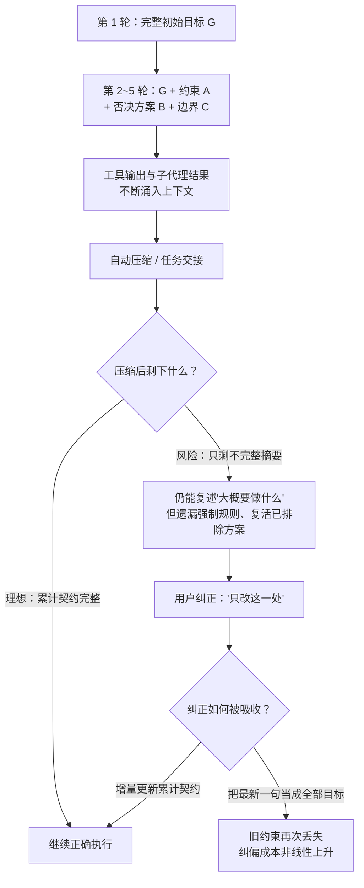

# Claude Code 与 Codex 真实协作可靠性调研

> **断言标注约定**：本文所有关键判断按证据类型标注——`[模型证据]`（公开研究在统一框架下直接测得）、`[框架与模型混合证据]`（模型与代理框架同时变化的对比研究）、`[产品案例]`（具体产品 issue/日志/复现，只证明失败模式存在）、`[用户观察]`（作者持续使用的经验，用于提出问题，不当统计事实）、`[综合推断]`（多类证据共同支持但尚无直接完整实验验证）、`[证据边界]`（明确说明证据不能外推到什么）、`[测评缺口]`（现有公开研究未覆盖的维度）。无标注的为可直接核对的定义或公开事实。

## 一、执行摘要

### 1. 核心问题与一句话答案

**问题**：面对模糊、口语化、依赖上下文并持续变化的真实需求，Claude/Claude Code 与 GPT/Codex 哪个更容易建立正确目标、减少人工纠偏，并在失败后继续迭代？

**答案**：`[综合推断]` 现有公开证据初步支持 **Claude/Claude Code 在模糊意图理解、多轮目标保持、较低用户纠偏成本和失败后持续协作方面优于 GPT/Codex**。Codex 并不缺少执行与解题能力，但更容易在长任务、连续纠正、上下文压缩和自动续跑中损坏内部任务模型；一旦损坏，其较强的执行倾向会加速混乱。

### 2. 先回答最刺眼的矛盾：Codex 解决率略高，为何仍判 Claude 更好？

TraceProbe 的数据里，Codex + GPT-5.4 的解决率是 78.4%，Claude Code + Opus 4.6 是 77.4%——差 1 个百分点，统计上几乎不可区分。但同一个数据集还显示：**Codex 的失败动作占比是 8.0%，Claude Code 是 3.3%（约 2.4 倍）；有害动作比例 0.10 对 0.07；工具成功率 91.9% 对 96.7%** `[框架与模型混合证据]`。

这三组数字合起来解释了矛盾所在：

- **单次通过率衡量的是终点对不对；协作可靠性衡量的是到达终点的路上你要付出什么、以及失败后爬出来的成本。**
- 78.4% 的解决率背后，是更多的失败动作、更多的回滚和重试——这些成本不会出现在排行榜上，但会出现在你的等待时间、token 账单和"再检查一下它到底改了什么"的焦虑里。
- 解决率相同不等于分布相同：一个稳定通过，一个靠更多试错撞过去，长期体验完全不同。这正是 TraceProbe 论文标题"What Resolve Rate Hides"（解决率掩盖了什么）的直接含义。

### 3. 证据不能证明什么（先立边界）

- 不能根据 GitHub issue 数量计算两者真实失败率——公开 issue 没有总使用次数这个分母；
- 不能把 Claude 模型在统一 OpenCode 框架中的优势，直接等同为 Claude Code 产品优势；
- 不能把 Codex 在 Terminal-Bench 或明确 issue 修复上的高分，外推为它更擅长模糊需求和长期协作；
- 不能用少数用户体验证明所有项目、模型版本和权限配置下都如此。

完整的边界讨论见第八节。

**本节本质**：先给答案和"答案为什么看起来矛盾"，再划清证据边界——证据评审型文章的第一义务是让读者知道每个判断踩在哪种证据上。

## 二、评价框架：比较的不是"简单与复杂"，而是协作不确定性

传统评测常把任务分成简单和复杂，但这个分类信息量有限：一个跨几十个文件的机械迁移可能很长却几乎没有业务判断；一个只改五行的需求可能依赖隐含产品语义、历史否决方案和接口契约，反而更难。真正决定协作难度的变量包括：初始表达完整度、上下文依赖、需求歧义、约束累积方式、反馈可观察性、路径长度、人类干预频率、恢复难度、上下文压缩损失和失败透明度。

由此，本报告采用三条主线评价真实协作可靠性：

1. **任务模型的建立与持续稳定性**；
2. **总人类协作成本**——它至少包含四类：需求显式化成本（你要把意图改写得多像规格书）、过程监督成本（要不要盯）、纠偏成本（指出错误后几轮才被吸收）、恢复成本（混乱后能否修复还是只能重开）；
3. **失败的可解释性与可恢复性**。

**任务模型**指代理在执行时实际依赖的内部工作表示，至少包含：用户真正想要的结果、当前代码和环境事实、已确认与未确认的假设、必须保留的约束、明确排除的范围、后续消息修改了旧目标的哪一部分、当前完成状态与验证标准。真实协作链条是：

```text
理解模糊、口语化表达
→ 结合代码和历史对话恢复真实意图
→ 把新纠正合并进累计目标
→ 长会话和压缩后保持完整约束
→ 依据同一个目标持续执行和验证
→ 在已有结果上继续迭代
```

其中任何一环损坏，后续步骤都可能高度自洽却整体错误。

**本节本质**：三条主线对应的不是"模型聪不聪明"，而是"代理维护的那个内部目标表征稳不稳定"。

## 三、证据一：SWE-Together——用户纠正首次成为主要指标

### 1. 研究做了什么

SWE-Together（arXiv 2606.29957，2026-06-29 提交）从 11,260 条真实用户—代理会话中筛出 109 个可复现的仓库级任务（转化率约 0.97%），用 LLM 用户模拟器按原始会话的意图锚点逐步释放澄清、纠正和新增要求，统一使用 OpenCode 框架、每模型两次独立运行，并同时测量最终正确性与**用户纠正度**（明确纠正记全权重、软性提醒记 0.2 权重）。`[模型证据]`（预印本）

### 2. 主要结果

因为评分门槛建立在"能力越强 → 用户纠正越少"这一强负相关上（pass@1 与纠正量的 Pearson 相关系数 −0.92，稳定解决率与纠正量 −0.84），这张表同时回答了"谁做得多对"和"谁让人陪跑得少"两个问题：

| 模型（统一 OpenCode 框架） | pass@1 | 两次均成功 pass² | 稳定解决率 SSR | 平均质量 | 用户纠正（越低越好） |
|---|---:|---:|---:|---:|---:|
| Claude Opus 4.8 | 63% | 52% | 59% | 0.801 | 1.38 |
| GPT-5.5 | 58% | 48% | 55% | 0.763 | 1.59 |
| Claude Opus 4.6 | 58% | 46% | 58% | 0.755 | 1.59 |
| GLM-5.2 | 55% | 42% | 48% | 0.735 | 1.53 |
| GLM-5.1 | 52% | 35% | 49% | 0.729 | 1.54 |
| DeepSeek V4 Pro | 48% | 29% | 38% | 0.679 | 1.76 |
| MiniMax 2.7 | 40% | 26% | 34% | 0.630 | 2.17 |

这张表不能告诉你什么：它不能直接比较 Claude Code 与 Codex 两个产品——实验统一使用 OpenCode 框架，这属于**模型层**证据；它也基于模型组层面的相关性（−0.92），不是受控因果比较；且 0.97% 的筛选转化率意味着任务集偏向"有可恢复仓库状态、目标清晰、结果可观察"的会话，对真实协作全谱系是有偏样本。

需要谨慎解释三点：

1. Opus 4.8 与 GPT-5.5 的平均纠正差距是 0.21 次，并非数量级差距；真正重要的是 Claude 在更少纠正的**同时**取得更高质量和更高稳定成功率。
2. Opus 4.6 与 GPT-5.5 的纠正量相同（1.59），说明"Claude 系列必然更少纠正"不成立——版本和能力水平仍然重要。
3. 论文同时报告了效率维度：GPT-5.5 每任务约 29.9k token、10.7 分钟，是全场最省；Opus 4.8 约 74.0k token、23.3 分钟。**纠正更少伴随 token 消耗更高**——"协作成本"必须同时算纠偏劳动和运行成本，这是选型时真实的权衡。（此点为本报告依据论文效率数据补充的外部推断）

**本节本质**：SWE-Together 的价值不在排名，而在它把"用户需要纠正多少"从干扰变量升格为主要指标——这恰是静态 benchmark 一直不测的东西。

## 四、证据二：TraceProbe——过程诊断揭示解决率掩盖的东西

### 1. 研究做了什么

TraceProbe（arXiv 2607.06184，2026-07-07 提交）把 2500 条轨迹（SWE-Bench Verified、五个生产设置，横跨 Claude Code/Codex/OpenCode 三个 scaffold 与 Opus 4.6/GPT-5.4/GLM-5 三个模型骨干）规范化为九类动作，用确定性规则检测搜索循环、验证遗漏、重复读取、修改回滚等反模式。数据与代码公开（Zenodo DOI 10.5281/zenodo.20789918）。`[框架与模型混合证据]`（审稿中预印本）

### 2. Claude Code + Opus 4.6 与 Codex + GPT-5.4 的直接对比

| 指标 | Claude Code + Opus 4.6 | Codex + GPT-5.4 |
|---|---:|---:|
| 解决率 | 77.4% | 78.4% |
| 每任务中位步骤 | 27 | 24 |
| 工具调用（中位） | 25 | 41 |
| 工具成功率 | 96.7% | 91.9% |
| 保留动作占比 | 27.6% | 36.2% |
| 失败动作占比 | 3.3% | 8.0% |
| 有依据动作占比 | 36.9% | 32.0% |
| 范围外探索 | 17.6% | 14.3% |
| 有害动作比例 | 0.07 | 0.10 |

这张表不能告诉你什么：它不能分离模型与框架的各自贡献——模型和 scaffold 同时变化，属于混合证据；研究自身也未能完成 Claude Code × GPT 与 Codex × Claude 的完整交叉实验；它测的是过程结构，不测用户纠偏的认知成本和失败解释质量。

解读时同样要克制：TraceProbe 论文自己指出，Codex 解决率最高且保留动作占比也最大——"过程更不稳"应限定在**失败动作更多、有害动作更多、工具成功率更低**这三个可测维度上，而不是笼统的"Codex 更乱"。同时，工具调用中位数 41 对 25，与解决率略高放在一起看，支持的是"Codex 用更多试错换到同等结果"这一幅画面。

**本节本质**：TraceProbe 证明的不是谁更强，而是**一维解决率信息量不足**——解决率相同的两个设置，在过程分布上可以完全不同。

## 五、证据三：GitHub 失败模式——累计约束碎裂是真实存在的

### 1. GitHub issue 能证明什么、不能证明什么

GitHub issue 可以证明：某类失败确实发生过、发生在哪个产品层、是否有复现步骤、多个用户是否独立描述相似症状、官方是否承认修复。它**不能**证明：真实发生概率、哪个产品整体更稳定、issue 是否来自独立底层原因、高热度项目是否因用户更多而 issue 更多。所以本报告把 GitHub 用作"失败模式证据"，不用作"失败率排行榜"。

### 2. Codex 相关失败模式聚类（7 例均已逐一打开核实，2026-10-16）

| 失败模式 | 代表案例 | 能支持的结论 |
|---|---|---|
| 累计约束丢失 | openai/codex #33262 | 长会话压缩后可能保留不完整任务契约 |
| 重复读取 | #33498 | 上下文利用可能退化为重复搜索 |
| 交接后提前停止 | #33398 | task handoff 未必可靠恢复执行状态 |
| 需要原子化 rollover | #33310 | 社区认为长任务交接缺少稳定契约 |
| 长会话上下文失控 | #33769 | 用户需要主动控制进入上下文的内容 |
| 过期消息重新执行 | #33819 | 会话队列错误可能导致旧意图重新生效 |
| Goal 恢复不执行 | #33829 | 声称继续与实际继续可能不一致 |

这张表不能告诉你什么：它不能告诉你这些失败多久发生一次（无分母），也不能告诉你 Claude Code 的同类失败是否更少或更多。其中 #33398 的后续讨论有报告者自报的量化统计（94 个长任务、27.8% 的压缩事件呈"丢失继续"模式），但那是单用户自报的模式计数、未经官方裁定，只作案例背景，不进本报告的数字体系。

### 3. 案例细节：#33262

报告者在长仓库任务中不断增加明确约束，并声明后续消息只修改指定部分、其余规则继续有效；上下文压缩后，Codex 可以近似描述任务，却遗漏"先文档后代码"等强制规则、重新引入明确排除的工作，把完整交付任务缩减成几个通用步骤。用户多次重述完整契约后，后续执行仍像只保留了最新消息或不完整摘要。`[产品案例｜无分母]`

### 4. Claude Code 也存在同类问题

Claude Code 仓库同样可以找到 `/compact` 崩溃或重复执行、resume-from-summary 保护未触发、context thrashing、中途切换模型后压缩窗口错误、hooks 未加载、模型忽略指令、后台会话恢复异常等报告（入口链接见附录 A-C）。因此本报告立场不是"Claude Code 稳定、Codex 不稳定"，而是：**两者都会失败，当前研究和持续使用观察更支持 Claude 的协作错误分布较温和、纠偏成本较低；Codex 更容易出现隐式任务模型损坏并继续执行**。`[综合推断]`

**本节本质**：issue 证据的用途是证明"这类失败真的存在、长这样"，从而把第三、四节的统计发现锚定到可复现的具体行为上。

## 六、一对示意对照会话与"用户观察"的方法说明

### 1. 构造的原型案例：同一个任务，两种走法

下面是一对**构造的原型案例**（示意性质，非任何真实会话的复盘记录），用于把"任务模型碎裂"从定义变成可想象的过程。任务相同："给导出功能加一个 CSV 选项，注意之前我们决定服务端不直接处理大文件，先只做前端分批。"业务细节可以不同，分叉结构高度相似：

**会话 A（对应"Claude 系"的典型模式）**

```text
用户：给导出加个 CSV 选项吧。记得大文件这事我们之前定过方向。
代理：好的。我先复述一下我的理解：导出加 CSV 格式；关于大文件，
      我理解之前定的是"服务端不直接处理"，所以我打算做前端分批——
      如果这个理解不对请纠正。
用户：对，就按这个来。
（一轮后交付基本正确的实现，用户指出一处日期格式不对，代理修正，
  未影响其他部分。）
```

关键特征：代理先**暴露自己的任务模型**——把理解、证据和不确定性组织成一份用户可修改的中间认知模型（你不必相信它全对，但能指出哪条假设不成立）；纠正被合并进既有理解，而不是覆盖它。

**会话 B（对应"Codex 系"在长任务中的典型风险模式）**

```text
用户：给导出加个 CSV 选项。（长任务中，此前已多轮讨论分批方案）
代理：（数轮后）我已添加 CSV 导出。
用户：分批呢？我们说好前端分批。
代理：抱歉，我加上分批。（修改时把上一轮刚修好的日期格式改回旧实现）
用户：日期格式又不对了。
代理：已修复日期格式。（但分批逻辑这次又被覆盖）
用户：（第 N 轮）……算了，我重新开个会话。
```

关键特征：每一步单独看都有理由，但不同步骤隐含的目标互相对不上——新纠正覆盖旧约束，用户无法判断该纠正哪一层，最终新开会话反而更便宜。

这两个会话是**示意的极端化原型**，不是实验数据；它们的价值是给出"纠偏成本低"与"累计目标碎裂"这两种失败形态的具象画面，其普遍性主张由第三、四、五节的可查证据承担。`[证据边界]`

### 2. "用户观察"的采集方法与已知偏差

本文所有 `[用户观察]` 标签下的判断来自作者的真实使用，方法说明如下：

- **观察时长与频次**：日常开发中的持续使用，累计约一年、数十次跨多轮的长会话，跨越两个产品的多个模型版本（版本随订阅自动更新）。
- **任务类型**：以前后端功能开发、缺陷修复、中小规模重构和代码库理解为主；不包含大规模架构迁移类任务。
- **记录方式**：非系统化的——没有结构化日志或逐会话打分，主要依据事后笔记和对戏剧性失败的记忆。这正是它被降级为"提出问题的证据"而非"统计事实"的原因。
- **已知偏差**：① 确认偏差——作者先有了"哪个更顺手"的整体印象，之后的观察可能选择性注意支持证据；② 记忆偏差——戏剧性失败（如约束被覆盖）比平淡成功更容易被记住；③ 版本漂移——观察期内两边模型都在更新，印象可能混合了不同版本的体验；④ 任务难度不平衡——交给两个产品的任务未必可比。

因此，用户观察在本文中的功能严格限定为：**提出研究问题、给出失败形态的假设**；其成立与否由 SWE-Together、TraceProbe 和 issue 证据独立检验。

**本节本质**：经验证据要诚实到"连自己怎么来的、可能怎么骗自己"都说清楚——这是它还能留在论证链里的唯一方式。

## 七、四个公开研究分别测到了什么

四份研究回答的是四个不同的问题，放在一起才覆盖"协作可靠性"的局部：

| 研究 | 回答的问题 | 关键设计 | 对本报告的价值 | 主要限制 |
|---|---|---|---|---|
| SWE-Together（arXiv 2606.29957） | 多轮真实协作中，谁需要更少纠正？ | 11,260 会话→109 任务；LLM 用户模拟器；统一 OpenCode；每模型 2 次运行 | 首次把用户纠正量列为主要指标；能力与纠正量 −0.92 | 只有 109 个高精度任务；统一框架，不能比较两个产品 |
| TraceProbe（arXiv 2607.06184） | 解决率掩盖了哪些过程差异？ | 2500 轨迹；九类动作规范化；确定性反模式检测 | 证明同解决率下过程分布可以完全不同 | 模型与框架同时变化；任务来自 SWE-bench |
| METR Time Horizons | 任务多长时成功概率掉到多少？ | 用人类专家完成时长标定难度；每任务 6 次独立运行；人工检查 reward hacking；50%/80% 可靠性口径 | 把"复杂度"改写成不同可靠性水平下的时间跨度 | 任务自包含、目标明确、可自动评分；scaffold 随模型选择，非固定产品正面对比（页面最近更新 2026-09-08，已声明不再活跃更新） |
| CodeClash（arXiv 2511.00839） | 从一次性任务转向长期目标后会怎样？ | 1680 个锦标赛、25,200 轮、8 模型、6 竞技场；模型自管代码库多轮演进 | 开始测量目标导向、持续改善与多轮策略 | 仍是新基准；不测真实用户纠偏、失败解释和团队上下文 |

这张表不能告诉你什么：它不能合成出一个总分——四个研究覆盖的任务形态、指标口径彼此不同，任何"加权合成分"都是伪精确。此外四个研究有一个共同盲区：**没有一个测量"失败解释是否让用户真正理解了问题"**。

**本节本质**：每份研究只照亮协作可靠性的一个切面；把它们读成互补的探针，而不是排行榜的四个分栏。

## 八、证据不能证明什么

综合前三节，以下外推全部不成立：

1. **失败率排行**。GitHub issue 无使用量分母；SWE-Together 只有 109 个经 0.97% 筛选的高精度任务；两者都支撑"失败模式存在"而非"多久失败一次"。
2. **模型优势 = 产品优势**。SWE-Together 的 Claude 优势在统一 OpenCode 框架下测得，属于模型层证据；Claude Code 产品自己的框架层（压缩策略、上下文管理、权限流）是另一套变量。
3. **解决率 = 协作质量**。TraceProbe 已展示同解决率下失败动作、有害动作可差 2~2.4 倍。
4. **明确的 benchmark 高分 = 擅长模糊协作**。Terminal-Bench 类任务目标明确、验收清晰，恰好绕开了本文的三条主线。
5. **本文的综合推断 = 已验证结论**。"Claude 更适合协商型协作"是多类证据共同指向的当前最优假设，尚无同时覆盖模糊意图、纠正吸收、失败解释与多轮迭代的成对实验直接验证。

**本节本质**：这份清单不是免责声明，而是本文的产出之一——知道证据不能证明什么，才知道下一个实验该测什么。

## 九、评测缺口与内部成对实验

### 1. 最大的测评缺口

真正贴近生产的成对评测至少还应测：口语理解成本、主动澄清质量、累计约束召回、纠正吸收率、纠正半衰期、假完成率、失败解释可用性、恢复成本、持续迭代成功率、人工审查时间。其中最值得优先展开的一处是**纠正吸收率与恢复成本**：

- 纠正吸收率 = 一次纠正后既修复了指定问题、又未破坏其他仍有效约束的比例。它是"任务模型是否增量更新"的直接可测代理——SWE-Together 只数纠正了几次，没有测一次纠正之后发生了什么；
- 恢复成本 = 跑偏后需要多少用户 token、多少分钟、多少轮才能回到正确方向。它把第六节会话 B 里"用户最终放弃"的那种体验变成可比数字。
- 这两个指标共同把"纠偏的认知劳动"从不可测的抱怨变成可复核的量，也是区分"每次都做对"与"错了能便宜地爬出来"两种能力的关键。

### 2. 建议的内部成对实验

若要验证个人体验是否具有统计稳定性：同一真实项目、相同初始状态、成对任务，两边用各自推荐的前沿模型，固定 commit/权限/工具/时间预算，每任务独立运行至少 10 次，不把一方的澄清答案复制给另一方，保存完整轨迹并由不知情的评审者盲评。任务类型覆盖：模糊口语需求、上下文恢复、局部纠正、冲突约束、跨压缩长会话、连续三轮追加需求、故意失败任务。

主要指标：首轮目标复述准确率、主动澄清有效率、用户纠正次数与字数、约束保持率、纠正吸收率、假完成率、严重跑偏率、可恢复率、持续迭代率、人工审查分钟。结果表达不要只报平均分：同时报告中位数、90 分位监督成本、最坏 10% 的失败、同任务方差、"一次成功"与"连续两次都成功"、失败类型分布、可恢复与必须重开的占比。

**本节本质**：评测缺口清单和实验设计是同一件事的两半——知道缺什么，才设计得出补什么的实验。

## 十、综合结论

### 1. 已有证据支持的结论

1. 明确、静态任务 benchmark 不能代表真实编码协作。`[强证据]`
2. 多轮真实会话中，用户纠正量是独立且重要的能力指标。`[强证据]`
3. SWE-Together 中 Claude Opus 4.8 相比 GPT-5.5 取得更高质量、更高稳定成功率和更少用户纠正（纠正量与 pass@1 相关 −0.92）。`[中强证据｜预印本]`
4. TraceProbe 中 Codex 最终解决率略高（78.4% vs 77.4%），但失败动作（8.0% vs 3.3%）和有害动作（0.10 vs 0.07）高于 Claude Code。`[中等证据｜模型与框架混合]`
5. Codex 长会话丢失累计约束、重复读取和交接失败是真实存在的产品失败模式（7 个已核实 issue）。`[案例证据]`
6. Claude Code 也存在上下文压缩、恢复和指令失效问题。`[案例证据]`

### 2. 任务模型如何随时间碎裂

把全文机制压成一张图——第三至五节的统计证据，对应的正是下面这条退化路径：



上图的要害在最后一个分叉：碎裂之后的每一次纠正都有 50% 的概率在"修复"与"覆盖"之间掷骰子（此处的 50% 是修辞性说法，不是测量值）——这正是第六节会话 B 让用户放弃的机制，也是 #33262 报告的现象。`[综合推断]`

### 3. 最终判断

如果把编码代理理解为"从完整规格到代码的执行工具"，Codex 与 Claude Code 的差距可能有限，且 Codex 在部分终端和明确任务中很强（且更省 token）。如果把编码代理理解为"与人共同发现目标、吸收纠正并持续演化软件的协作者"，现有证据与持续使用观察都更支持 Claude/Claude Code。真正决定体验的不是峰值能力，而是：

```text
自然意图理解 × 任务模型稳定性 × 低人工纠偏成本 × 失败透明度 × 恢复和持续迭代能力
```

这也是未来编码代理测评应当从"任务通过率"转向"协作可靠性"的原因。

### 4. 复核方式

本文的数据性断言均可独立复核：SWE-Together 论文与公开代码（github.com/Togetherbench/SWE-Together）、TraceProbe 轨迹数据（Zenodo DOI 10.5281/zenodo.20789918）、7 个 Codex issue 原文链接（附录 A-B）均公开可查。本文所有数字于 2026-10-16 逐项核对过一次；复核发现或论文改版导致的出入，以原始来源为准。

**本节本质**：证据评审型文章的结论强度，取决于别人复核它有多容易——所以把复核路径写进正文。

## 附录 A：证据索引

### A. 权威研究与公开评测

1. [SWE-Together: Evaluating Coding Agents in Interactive User Sessions](https://arxiv.org/abs/2606.29957)（2026-06-29 提交；预印本，方法与代码公开）。支持：多轮真实会话、用户纠正量、稳定重复成功率、统一框架下的模型对比。不支持：Claude Code 与 Codex 产品的直接对比。
2. [SWE-Together GitHub](https://github.com/Togetherbench/SWE-Together)：公开实现，可复现任务构造、模拟用户与评价方法。
3. [What Resolve Rate Hides: Trajectory Structure Diagnostics for Coding Agents](https://arxiv.org/abs/2607.06184)（2026-07-07 提交；审稿中预印本，数据公开）。支持：搜索循环、失败动作、回滚、范围漂移、验证遗漏等过程诊断。不支持：模糊需求下的完整用户纠偏成本；模型与框架完全解耦。
4. [TraceProbe 开放数据](https://doi.org/10.5281/zenodo.20789918)：公开轨迹数据，可用于复核。
5. [METR Task-Completion Time Horizons](https://metr.org/time-horizons/)（页面最近更新 2026-09-08，已声明不再活跃更新；专业评测机构）。支持：任务长度与成功概率、六次独立运行、reward hacking 人工检查、50%/80% 可靠性口径。不支持：固定 Claude Code—Codex 产品正面对比；模糊业务协作。
6. [CodeClash](https://codeclash.ai) 与 [论文（arXiv 2511.00839）](https://arxiv.org/abs/2511.00839)、[GitHub（开源，MIT）](https://github.com/codeclash-ai/codeclash)：1680 锦标赛、25200 轮、8 模型、6 竞技场。支持：目标导向、多轮持续改进。不支持：真实用户纠偏和失败解释质量。

### B. Codex 产品案例（均于 2026-10-16 逐一打开核实）

1. [#33262：长会话丢失累计操作约束](https://github.com/openai/codex/issues/33262)
2. [#33498：代理重复读取上下文中未变化文件](https://github.com/openai/codex/issues/33498)
3. [#33398：task handoff 后提前停止](https://github.com/openai/codex/issues/33398)
4. [#33310：请求原子化上下文 rollover](https://github.com/openai/codex/issues/33310)
5. [#33769：长会话主动排除上下文](https://github.com/openai/codex/issues/33769)
6. [#33819：旧用户消息被再次投递并执行](https://github.com/openai/codex/issues/33819)
7. [#33829：声称恢复计划但未真正继续](https://github.com/openai/codex/issues/33829)

这些来源用于证明失败模式存在，不用于估计实际发生率。

### C. Claude Code 产品案例入口

1. [Claude Code context / compaction issues](https://github.com/anthropics/claude-code/issues?q=is%3Aissue%20%28%22loses%20context%22%20OR%20%22context%20drift%22%20OR%20%22forgets%20instructions%22%20OR%20%22compaction%22%29)（搜索入口，未逐条编号核实）
2. [Claude Code Plan Mode issues](https://github.com/anthropics/claude-code/issues?q=is%3Aissue%20%22plan%20mode%22)
3. [Claude Code 官方概览](https://code.claude.com/docs/en/overview)

这些来源说明 Claude Code 也存在压缩、恢复、权限和指令失效问题，不支持"Claude Code 天然稳定"的绝对判断。

## 附录 B：证据标签说明与边界声明

| 标签 | 含义 |
|---|---|
| `[模型证据]` | 使用统一框架比较不同模型，主要支持模型层判断 |
| `[框架与模型混合证据]` | 模型与代理框架同时变化，只能支持"组合设置"层面的判断 |
| `[产品案例]` | 具体产品 issue、日志或复现，只证明失败模式存在（无分母） |
| `[用户观察]` | 持续使用形成的经验，采集方法与偏差见第六节；用于提出问题，不当统计事实 |
| `[综合推断]` | 多类证据共同支持，但尚无直接完整实验验证 |
| `[证据边界]` | 明确说明该证据不能外推到什么结论 |
| `[测评缺口]` | 当前公开研究尚未充分覆盖的维度 |

**声明范围**：适用于正文所有带标注的判断，也适用于未标注但涉及模型行为的描述。第六节的对照会话为**构造的原型案例**，用于说明失败形态结构，不作为任何真实会话的复盘；第六节第 2 小节的观察方法说明中的时长与频次为作者的概括性描述，未做系统统计。

## Changelog

- **v2（2026-10-16，重写 / 任务卡 5）**
  - 调研-1（数据核实）：全部可验证断言于 2026-10-16 逐项查实（两篇 arXiv 论文结果表、7 个 Codex issue、METR、CodeClash、Zenodo DOI），无一降级；核实记录见《核验/调研-核心论点清单.md》。加强：① 补入论文实际包含的第 7 个模型 GLM-5.1 与 SSR 列；② METR 更新状态刷新（2026-09-08 起不再活跃更新）；③ 新增 SWE-Together 效率维度边界（GPT-5.5 29.9k token vs Opus 4.8 74.0k，纠正少伴随 token 多）；④ 补 0.97% 筛选转化率作为选择偏差边界。
  - 调研-2：执行摘要新增第 2 小节，直接回答"Codex 解决率略高为何仍选 Claude"（通过率衡量终点、协作可靠性衡量路径成本；1 个百分点解决率差对应 2.4 倍失败动作差）。
  - 调研-3：新增第六节第 2 小节"用户观察方法说明"（时长/任务类型/记录方式/四类已知偏差），将用户观察的功能严格限定为提出问题。
  - 调研-4：新增第六节第 1 小节一对**明确标注为构造的原型案例**的对照会话（会话 A/B）。
  - 调研-5：原第七节四份研究逐段介绍压缩为一张四研究对比表；原九（评测缺口）与十（内部成对实验）合并为第九节，评测缺口十项压缩列举、只展开"纠正吸收率与恢复成本"一处；各表统一补"这张表不能告诉你什么"（[M-3]）。
  - 调研-6：第十节新增 mermaid"任务模型随时间碎裂"图。
  - 结构：按篇型 D 重组（结论先行→评价框架→证据逐条陈列→证据不能证明什么→局限与复核方式），13 节收敛为 10 节 + 2 附录，每节末补"本节本质"句；证据标签体系保留并扩展"混合证据"标签；开头新增断言标注约定（[M-7]）；证据索引中 7 个 issue 标注核实日期。
  - **[M-12] 基线比对结果**：11 条核心论点全部保留（论据只加强未消失）。四处原稿细节被压缩/降级并入，记录如下：① "持续迭代能力"五因子公式（质量×目标保持×吸收率×可解释×可继承）与第十节最终公式高度重复，按 P4 合并进后者；② 高成本纠正六步清单降级并入第六节会话 B 与第九节"恢复成本"定义；③ 失败解释"八问清单"压缩为会话 A"可编辑的中间认知模型"表述（术语保留）；④ 协作成本四分类表压缩为第二节一句话。原稿"任务模型七要素清单"保留在第二节。"为什么长会话后一团浆糊"症状清单并入会话 B 与碎裂图。
  - **偏离记录**：偏离 [P-2]（md 顶部→html 讲解版入口链接），理由：讲解版 html 位于 gitignore 的 `阅读/` 目录、不推送公开仓库（拍板 D2），在推送的 md 中放相对链接会在 GitHub 上 404；两层互引改在本地核验流程中完成。
- **v1（原稿）**：初始版本（status: verified，2026-07-17）。
