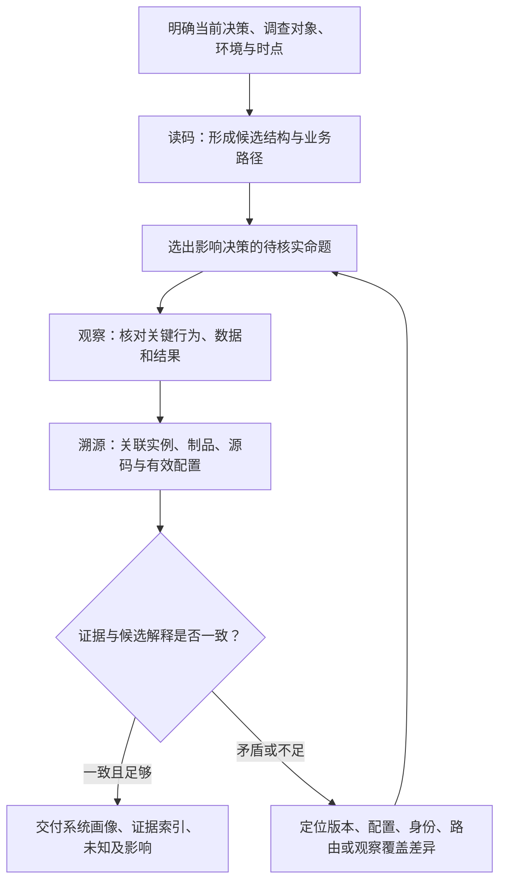
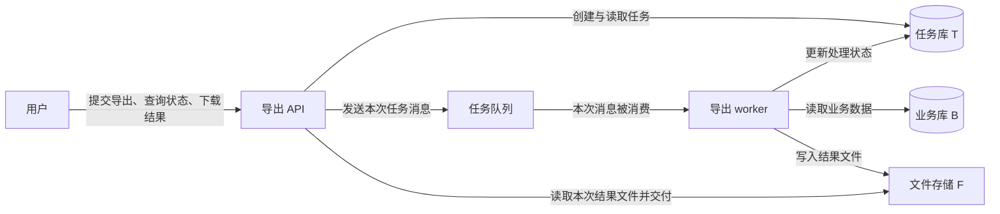

<!-- document-id: show-09 -->
<!-- document-version: 1.1-draft -->

# 读完代码，还不算了解这个系统：陌生后端的事实核验七步法

> 2026-10-28 · 方法指南 · 面向接手、对接和评估陌生后端的工程师与技术负责人  
> v1.1 审阅稿 · [旧版讲解（尚未同步本稿）](../阅读/讲解-09-项目事实核验.html) · [阅读目录](../阅读/index.html)

接手一个陌生后端，首先要建立一份能指导行动的系统画像：请求从哪里进来，核心业务由哪些组件完成，数据与外部依赖在哪里，目标环境实际运行哪个版本。AI 可以帮助搜索代码、整理线索，但这些线索必须和运行对象对应起来，才能支持后续对接、改造或接管判断。

**本文的方法是：读码建立候选结构，沿关键业务路径观察实际行为，再把观察关联到运行实例、构建来源和有效配置；遇到矛盾就回查，最终交付附有证据与未知项的系统画像。** 下文先解释调查为什么困难，再给出总体方案，最后用七步展开具体做法。全文的导出服务均为构造案例；流程是综合方法设计，未做量化效率实验。

<a id="repo-case"></a>
## 一、背景：接手一个服务，需要回答哪些问题

设想你接手一个导出服务。产品同事希望把它接到新的业务入口，负责人还想评估能否迁到另一个环境。你需要先回答四类问题：

| 必须查清的问题 | 它影响什么判断 |
|---|---|
| 入口在哪里，服务负责什么，哪些工作由其他组件完成？ | 新入口应该调用谁，改造范围覆盖哪些组件 |
| 它读取、写入哪些数据，还依赖哪些服务或基础设施？ | 需要哪些网络、账号、数据与外部资源 |
| 一次导出从请求到结果怎样完成？ | 接口返回表示什么，如何判断任务真的成功 |
| 目标环境运行什么制品、源码与配置？ | 当前代码能解释哪部分现象，后续验证应该基于哪个版本 |

只整理框架、目录、数据库地址和接口数量，尚不足以完成这些判断。导出接口可能只负责创建任务，真正生成文件的是后台 worker。**本文的 worker 指独立执行后台任务的进程**；它可能使用另一套启动命令、配置和发布制品。若迁移计划只覆盖 HTTP 服务，即使接口能接收请求，文件也可能永远生成不了。

本文用下面的业务链贯穿调查，具体组件关系将在后续逐项核对：用户提交导出请求，API 完成鉴权并创建任务；worker 取得任务后读取业务数据、生成文件；用户随后查询状态或下载结果。这里的 **API** 指接收 HTTP 请求的应用进程，任务传递方式和文件存放位置暂时都是待核实项。

这项调查的交付应能让接手者说明：“哪些组件一起完成导出；迁移它们需要什么；哪些判断已有对应证据；哪些未知仍会改变方案。”有了明确用途，才知道哪些线索值得继续追，哪些细节可以稍后再查。

<a id="repo-difficulty"></a>
## 二、难点：为什么读到的信息经常对不上

### 1. 仓库保存的是实现与默认选择，环境决定了其中哪些实际生效

仓库里有 `application.yml` 或 `.env.example`，不意味着运行进程就使用其中的地址。启动参数、环境变量、挂载文件、动态配置以及程序自身的加载逻辑都可能改变结果。

例如，导出 API 的默认配置连接开发库，部署时却通过环境变量选择任务库；worker 又从另一份挂载文件读取业务库。若只搜索一次数据库配置，调查者既可能漏掉真正的数据依赖，也可能把仅供本地启动的库写成生产依赖。以 Spring Boot 为例，官方明确规定了多类属性来源的覆盖顺序；其他框架与自定义加载器要按各自机制核对。[1]

### 2. 接口声明描述能力，业务路径解释怎样完成工作

路由里定义了“创建导出”“查询状态”“下载文件”，可以说明代码提供了这些操作，却没有直接说明一次导出如何完成。要解释业务，还需要追踪入口后的鉴权、任务持久化、后台处理、数据读取和文件交付。

在本案例中，“创建任务成功”只覆盖业务链的前半段。若 worker 没有收到任务，或生成的文件不属于当前用户，HTTP 层看起来正常也无法满足用户目标。因此，调查必须选一条实际业务路径，把零散接口和组件组织起来。

### 3. 每次观察都带着环境、身份、时点和覆盖范围

本地账号看不到某张表，可能是表不存在，也可能是 schema、权限或连接环境不同。某次健康检查返回成功，只说明该检查覆盖的条件在那个时刻满足；存活、就绪、启动探针本身也有不同职责。[2]

同样，一笔导出成功说明该笔输入在对应条件下完成，不能直接推出大数据量、不同身份、失败重试和所有租户都正常。调查记录必须能回答“观察了什么、在哪看、以谁的身份看、看到了哪一段”，才能判断证据是否足够。

### 4. 代码、制品与运行实例之间，需要另外建立对应关系

本地分支叫 `main`，不能说明正在运行的服务由它构建。镜像标签看起来像提交哈希，也需要构建记录把它与源码关联起来。即使源码相同，API 与 worker 的有效配置也可能不同。

运行环境还可能同时存在新旧实例。Kubernetes 的滚动更新会逐步增加新 ReplicaSet 的 Pod、减少旧 Pod；只看一份部署清单或一个实例，可能遗漏正在共存的版本。[3] **Pod** 在这里指 Kubernetes 中承载容器的运行单元；未使用 Kubernetes 的项目应换成进程、虚拟机或其他实际运行对象。

这四个难点说明，调查需要把不同来源的信息逐项关联：文件中的声明用来提出解释，业务观察用来核对行为，运行来源用来限定这些解释和观察属于谁。

<a id="repo-design"></a>
## 三、解决思路与总方案：先建图，再观察，最后对账

### 1. 三类工作各自解决什么问题

**读码建立候选结构。** 从构建文件、启动入口、配置加载、路由和关键模块中，画出“可能由哪些组件完成什么工作”。它的产物是一张带出处的候选地图，以及需要进一步核实的命题。例如：“API 创建任务后，是否通过消息队列通知 worker？”

**受控观察核对关键事实。** 在已明确的环境与身份下，查看相关配置、元数据、日志，必要时执行获授权且影响已知的业务验证。观察围绕会影响当前决策的命题进行。例如，借助同一个任务 ID 关联请求受理、任务创建、worker 处理和文件结果，核对候选路径是否成立。

**运行溯源把对象对齐。** 找到这些观察对应的进程或实例、运行制品、构建来源、源码提交及有效配置。这里的“溯源”是查明运行内容从何而来。例如，发现 worker 用的源码提交早于本地代码，就能解释为什么本地新增的处理逻辑没有出现在任务记录中。

三类证据共同形成系统画像。这与架构重建的基本目标相近：从已实现的系统中提取信息，逐层形成可供推理的结构表示。[4] 本文的三阶段、七步和记录方式是综合设计，并非该报告提出的原样流程。



图示为调查方法设计。实际执行可以往返：为了确定观察的是哪个服务，运行身份通常需要提前确认；发现依赖后，也可能返回代码继续追踪。图中箭头表示信息如何推进和修正判断，不要求把溯源全部留到最后。

### 2. 七步如何展开总方案

| 步骤 | 主要工作 | 本步形成的产物 |
|---|---|---|
| 1. 锁定范围与快照 | 明确决策、仓库、环境、身份和时点 | 调查范围与比较基准 |
| 2. 读码建立候选地图 | 找入口、组件、配置来源及关键业务代码 | 候选结构、待核实命题 |
| 3. 核对数据源 | 关联有效配置、访问身份、业务对象及用途 | 有范围的数据依赖记录 |
| 4. 追踪关键业务路径 | 对齐接口清单，连接输入、处理和结果 | 业务路径及已验证范围 |
| 5. 核对组件关系 | 区分服务调用、任务传递和共享数据访问 | 有依据的组件关系图 |
| 6. 反查运行来源 | 关联实例、制品、构建、源码与配置 | 运行身份与来源链条 |
| 7. 对账并交付 | 处理差异，判断剩余未知的影响 | 可支持当前决策的系统画像 |

<a id="repo-ledger"></a>
### 3. 事实底账怎样贯穿全程

**事实底账**是结论与证据的索引，用来记录每条重要判断的当前依据。可将记录分为声明、观察、推断、未知；这些类别描述信息性质，不是从低到高的固定等级。源码可以直接证明某段实现存在，运行观察则适合核对某个环境的行为。

| 类别 | 本案例中的记录 | 必须保留的限定 |
|---|---|---|
| 声明 | 某提交中的 API 代码包含任务创建逻辑 | 文件位置、源码版本、是否有本地改动 |
| 观察 | 测试环境一笔任务被 worker 处理并生成文件 | 对象、身份、时间、输入与观察范围 |
| 推断 | 两个组件可能访问同一个业务数据源 | 支持依据、竞争解释及需要补的证据 |
| 未知 | 未取得 worker 当前制品的构建来源记录 | 缺口会影响什么判断、由谁或何种证据补齐 |

记录可以采用：`问题 → 对象/环境/身份/时点 → 证据位置 → 取得的内容 → 当前结论及范围 → 剩余未知/下一步`。证据位置应指向有权限复查的原始材料，正文保留必要摘要，避免只留一张难以追溯的结果表。

一条命题可以同时引用多类记录。例如，“这笔任务由当前 worker 完成”需要任务处理记录和实例身份；若还要说明“由某提交的逻辑完成”，就要继续关联构建来源。这种关联比给整份报告统一标注“已验证”更有用。

<a id="repo-steps"></a>
## 四、七步展开：沿一笔导出任务查清系统

以下文件、接口、组件名和观察结果均属同一个构造案例，不是对某个真实项目的测量。

<a id="repo-scope"></a>
### 第一步：锁定调查范围，给后续比较设定基准

先写清这次调查要支持什么决定。本案例的目标是“识别导出能力接入与迁移涉及的组件和依赖，列出仍需验证的条件”。它可以产出迁移评估输入，距离承诺生产切换成功还需要专门的迁移验证。

调查范围至少注明仓库与提交、是否有本地改动、目标环境、可用观察身份及时间窗口。代码快照可先用以下命令确认：

```bash
git rev-parse HEAD
git status --short
git rev-parse --is-shallow-repository
```

源码提交标识只能定位已提交内容；工作区有修改时，需额外保留相关差异。记录中把“本地读到的版本”和“目标环境运行的版本”分列，后续再建立对应关系。

普通 `git clone` 不应一概视为浅克隆。`--depth` 等选项会限制历史；如果调查涉及缺失的祖先关系，才需要按实际情况补取历史与必要引用。仓库不浅也不等于远程所有分支和最新提交都已取回，分支分析还要说明使用了哪些引用及其更新时间。[5]

本步产物是一段明确的范围说明。例如：“读取仓库快照 R；观察测试环境 E 中的导出 API 与 worker；按测试身份查看任务链路；生产环境的行为与构建来源尚未核实。”后续证据无法对应这些条件时，先补齐对象信息再比较。

<a id="repo-map"></a>
### 第二步：从文件证据建立候选地图，并列出待核实命题

先找“程序怎样被构建和启动”，再找“启动后怎样接收并完成工作”。构建文件提供依赖与框架线索，启动命令确定执行哪个入口，入口决定加载哪些配置和路由，路由或消费者再连接业务模块。

假设在仓库中读到以下文件与职责线索：

```text
pyproject.toml          依赖与项目入口线索
Dockerfile              制品构建与默认启动命令
app/api.py              HTTP 应用及路由注册
app/worker.py           后台任务执行入口
app/settings.py         配置读取逻辑
app/export_service.py   创建、查询导出任务的逻辑
app/export_job.py       读取业务数据、生成文件的逻辑
deploy/                 部署模板与配置引用
```

此时已经可以提出一个比目录摘要更有价值的候选解释：“同仓库中至少存在 API 和 worker 两种执行角色；API 负责任务入口，worker 负责生成结果。”接下来分别检查启动入口、业务调用与部署模板，判断这两种角色是否真的独立启动，模板是否对应目标环境。

**配置要追到加载逻辑和运行来源。** 在本构造案例中，假设 API 加载器按“默认值→挂载文件→环境变量”覆盖，而 worker 还会读取一份单独的业务数据源配置。这里的顺序来自案例设定；真实项目要由对应版本的加载实现和框架规则确认，不能照搬。

例如，跟踪本案例自定义的配置键 `task_db`：源码默认值指向任务库 T0，挂载文件改为 T1，目标 API 进程的环境输入又指定 T。核对该版本加载器的覆盖逻辑，再由该实例启动后的脱敏配置摘要确认最终选择 T，才能把候选依赖修订为 T。摘要需注明实例、配置加载时点与材料取得身份；还要结合该实例的连接记录核对实际访问。若只有部署模板或环境输入，就只能说明提供了什么值，尚不能证明程序最终采用了它。动态配置发生变化时，还需对应观察时点。

再把重要字段列成待核实项：worker 的业务库由谁指定，任务传递地址如何配置，结果文件放在哪里。搜索时优先定位字段名和文件，确需查看值时按权限最小化读取并脱敏；凭据只记录引用方式。

本步的候选地图可以先写为“API→任务记录；API→待确认的任务传递机制→worker；worker→业务数据；worker→文件存储”。每个箭头带代码出处。尚未读到的组件保留未知，不用常见架构把空白补齐。

读码与维护者介绍不一致时，先列竞争解释：文档是否过期、代码是否属于另一版本、启动时是否选择了另一条入口、相关逻辑是否已停用。本步完成后，交付候选结构和一组有优先级的问题；影响本次接入与迁移的依赖应优先核对。

<a id="repo-data"></a>
### 第三步：把候选数据源追到有效配置、身份、对象和业务用途

对每个候选数据源，按这条链核对：**哪个组件读取哪项配置→目标环境使用什么端点与身份→该身份能访问什么对象→这些对象参与什么业务。** 这样才能把一个连接字段转化为对接或迁移依赖。

在导出案例中，API 可能写任务状态，worker 则读取业务数据并回写处理结果。即使两者使用相同数据库产品，也应分别记录用途。只读数据库、缓存、搜索索引、消息系统和文件存储可按业务角色检查，不必为了清单完整而把所有产品命令都跑一遍。

观察可以逐层推进：网络是否可达，身份是否被接受，目标对象是否可见，业务所需的数据是否能在预期条件下取得。**TCP 成功只支持网络可达；登录成功只支持该身份被接受。** 调查者自己的只读账号能查表，也不能直接证明应用账号具有同样权限；要么核对应用身份，要么写明身份差异。

以 PostgreSQL 为例，分别在任务库 T 与业务库 B 的已授权连接中记录数据库、当前用户和 schema 搜索路径。[6] 下面先在连接 T 中检查任务表：

```sql
-- 连接任务库 T 后执行
SELECT current_database(), current_user;
SHOW search_path;

SELECT table_schema, table_name, table_type
FROM information_schema.tables
WHERE table_schema = 'reporting'
  AND table_name = 'export_tasks';
```

再切换到业务库 B 的独立连接，重新记录数据库、身份与搜索路径，并将目标表改为 `business_orders` 核对。两次观察分别入账；这里的 schema 和表名均为构造名称。`information_schema.tables` 只展示当前用户有访问权限的表与视图。[6] 若查不到，先检查数据库、schema 和可见性，保留权限不足等解释；数据库还有其他 schema 时，不应只盯默认 `public`。

端点身份也要认真核对：同名数据库可能属于不同集群，不同地址可能是代理或副本。需要结合数据库或平台可提供的身份信息与拓扑记录，才能判断是否属于同一套资源；无法确认时保留“候选共享数据源”。数据是否符合业务所需的时间范围，也应结合更新时间、查询条件及业务定义判断，不能从一条连接成功记录推出。

本步产物可是一条依赖记录：“worker 的业务库配置来源已定位；目标测试环境的运行配置指向数据源 D；已确认的访问身份可见 `reporting.business_orders`；该任务读取哪些字段与条件，留待业务路径核对。”若只取得维护者导出的元数据，注明提供者、时间和可见范围。

行数只有在影响当前决策时才需要取得，例如估算迁移体量。大表优先使用适当统计估计并标明估算口径；即使查询只读，也要考虑资源开销。权限不足时请求有权限者提供最小必要证据，不把换入口绕过授权当作默认步骤。

<a id="repo-business"></a>
### 第四步：沿关键业务路径解释系统，并对齐接口清单

挑选关键路径时，先看本次决策最依赖什么：高频核心操作、跨组件流程、对结果正确性敏感的功能，通常值得优先追。路径范围要写清；若不同租户或数据源走不同分支，只验证其中一种就只能支持对应范围。

在本案例中，选择“一位有导出权限的测试用户，导出一个已知的小数据集”。代码追踪要回答：权限在哪里检查，任务怎样保存，后台工作怎样触发，worker 读取什么数据，文件怎样关联回任务，下载时如何判断当前用户有权取得它。

先按代码形成候选业务路径，再用获授权的观察补充。一次完整观察至少需要把请求、任务、后台处理和最终结果关联起来。HTTP 返回成功后，继续核对任务状态变化、文件可取得性，以及文件中的数据是否符合这次输入和权限范围。预期字段、记录或汇总值应来自业务规则或独立参考，不能仅用同一段导出逻辑再算一次，就宣称结果已独立验证。

如果系统通过任务 ID 关联流程，就记录该 ID 在哪些材料中出现，并核对身份和时间；若 ID 只在某租户或某环境内唯一，关联时也需带上这些条件。已有可信的业务记录可以用来观察；新触发任务则要明确写入、消息、存储和通知等影响。方法名为 GET 也不足以保证实现没有副作用。

**接口清单服务于这条路径的解释。** 至少区分源码定义、目标实例提供的接口描述、已观察到的操作。清单记录 HTTP 方法、路径、外部入口前缀及环境版本；需要时还要区分网关路径和应用内部路径。例如，外部 `POST /reports/exports` 经前缀改写后可能对应内部 `POST /exports`，不能把它们机械算成两个业务操作。

发现代码清单与实例描述不一致时，先统一方法、路径和版本口径，再检查条件注册、入口前缀、网关改写、文档过滤及不同部署版本。接口描述返回成功只证明取得了那份声明，不证明其中每项操作都已可用。

如果确实需要统计接口数量，可对已经取得的 OpenAPI 3.1 JSON 只统计 `paths` 下直接列出的方法：

```python
import json
from pathlib import Path

spec = json.loads(Path("openapi.json").read_text())
if not str(spec.get("openapi", "")).startswith("3.1."):
    raise ValueError("本示例只适用于 OpenAPI 3.1 文档")
methods = {"get", "put", "post", "delete", "options", "head", "patch", "trace"}
paths = {p: item for p, item in spec.get("paths", {}).items()
         if p.startswith("/")}
operations = [(p, method) for p, item in paths.items()
              for method in methods if method in item]
print({"described_paths": len(paths),
       "directly_described_operations": len(operations)})
```

Path Item 还包含参数、摘要等非方法字段，不能直接累加对象键数作为操作数。[7] 上例不解析 `$ref`，不包含 webhook；引用中的操作可能未计入。输出只是该口径下的描述数量，不代表全部暴露接口、已验证操作数或系统业务复杂度。

本步交付“业务路径＋接口映射＋观察范围”。例如：“测试环境的小数据集导出在该身份下完成，结果内容已按参考核对；大数据量、失败重试和其他权限分支尚未验证。”如果只能受理却没有结果，就沿任务创建、传递、后台处理与文件交付逐段查找缺失环节。

<a id="repo-relations"></a>
### 第五步：用不同证据核对服务调用、任务传递和共享数据访问

理解系统依赖时，箭头的含义必须明确。A 调用 B 的 HTTP API、A 给队列发送任务、A 和 B 访问同一数据库，是三种不同关系，决定了不同的网络、账号、发布和故障排查边界。

对同步调用，结合调用代码、目标环境实际配置及对应请求记录核对发送方和接收方。存在分布式追踪时，可以借助 trace 中的相关 span。**trace** 表示一次请求相关工作的追踪，**span** 表示其中一个操作；它们仍受埋点正确性与覆盖范围限制。[8]

对异步任务，继续关联发送与消费记录，确认任务 ID、队列或主题的身份、环境和时间条件。OpenTelemetry 支持通过 span links 关联异步操作；实际系统也可以使用可靠的业务 ID 和日志，不要求所有工作一定落在同一个 trace 中。[8]

对共享数据库访问，要分别证明两个组件访问同一资源及各自的读写用途。即使两边都能看到同一张表，也不能画成“A 调用了 B”。本案例中，若 worker 直接读取订单数据，应把它画为 worker 到业务库的访问边，而不是虚构一个订单服务 API 调用。

日志里没查到某条关系时，检查观察窗口是否包含相关业务，埋点是否覆盖该路径，以及采样、过滤和日志保留情况。未采样的 trace 或 span 可能根本没有被处理与导出，因此一次检索为空不足以证明从不调用。[9] 反过来，一条关联记录通常支持“这次发生过”，仍不足以说明每次都走同一路径。

本步产物是在候选地图上标清关系类型、证据和范围。没有足够证据的箭头保留候选状态；它若影响迁移资源清单，就明确列为待补项。

<a id="repo-runtime"></a>
### 第六步：把观察到的行为关联到实际运行内容

API 与 worker 要分别查，因为同仓库的两个角色可能由不同流水线、不同提交或不同配置部署。沿以下链条追溯：

```text
观察到的请求/任务
  → 处理它的实例与时间窗口
  → 该实例的运行制品身份
  → 与该制品对应的构建记录
  → 源码仓库、提交及其他构建输入

另行关联：启动命令、有效配置、挂载内容、动态开关及其版本/时点
```

在 Kubernetes 环境中，先确认集群、命名空间、工作负载及相关 Pod，再核对容器运行状态、镜像标识和实际启动配置；滚动更新中要关注仍在工作的不同实例。运行平台返回的镜像身份需按相应容器运行时语义解释，并与制品记录核对。未用 Kubernetes 时，同样的问题可以由进程、发布目录、包校验值和部署记录回答。

镜像标签可能变化，digest 用于标识特定镜像内容。[10] 取得具体制品身份后，再查对应的构建任务和来源记录。SLSA 的构建溯源格式提供了制品、构建平台、构建输入和解析后依赖等关联方式；实际项目也可以从能追溯且可信的流水线记录开始。[11] 记录里自报一个提交仍需要核对来源可信度、制品是否匹配，以及是否存在未记录的构建输入。

`git branch --contains` 回答的是“哪些已知分支的历史包含这个提交”。同一提交被 `main` 与 `release` 同时包含很正常，它不回答哪条流水线构建了当前制品。[12] 因此，报告优先记录可追溯的提交与制品身份；确需调查构建所用分支时，应从对应构建触发与输入记录查证。

即使源码和制品对应，配置仍可能改变行为。假设 API 的制品能关联到提交 R2，worker 则关联到 R1；worker 配置又选择了不同的数据源。这样的证据可以解释一部分差异，但是否影响目标功能还需要回到实际代码与业务路径核对。

本步交付的是各个运行角色的来源记录。若只能核实实例和制品，就写到这一层，同时保留“源码来源未核实”。不要让 API 已查清的版本覆盖 worker 的未知，也不要用当前实例的状态倒推一笔历史任务的处理版本；历史关联还需要当时的日志或发布记录。

<a id="repo-reconcile"></a>
### 第七步：对账，形成能支持当前决策的系统画像

汇总时，把候选结构、业务观察与运行来源放在一起逐项比较。**对账**指检查这些材料是否描述同一对象、条件和关系；出现矛盾就找到差异来源，再修正相应结论。

可以先查对象与口径，再查时间和运行来源，最后检查观察覆盖。例如，同样叫“导出服务”的两个实例是否属于同一环境；一份清单统计的是外部路由还是内部操作；日志是否来自部署前；某条链路是否被采样丢弃。这是方便推进的检查顺序，具体优先级要随现有证据调整。

若本地代码提供了一个新版导出操作，而实例文档里没有，先保留“版本差异、入口改写、文档过滤、条件注册”等解释。找到 worker 仍运行旧制品后，也不能自动结束：要确认缺失操作由 API 还是 worker 实现，并核对对应实例的实际版本。**差异解释必须能连接到发生差异的那个环节。**

每个问题最后落到明确状态：证据足够则给出有范围的结论；只是某种条件下成立则写清条件；仍缺证则列出补证方式与影响；若证据直接反驳原解释，就修改地图和下游依赖清单。这样，最终文档才能从一批资料摘要变成能被复查、能指导下一步的调查结果。

<a id="repo-example"></a>
## 五、完整案例：调查怎样改变接入与迁移判断

回到最初的导出服务。下面是一组**构造的调查材料与结果**，用于展示证据如何改变判断，不代表真实环境已经验证。

最初只看到一个仓库、一份数据库配置和三类 HTTP 接口，很容易得出一个粗略方案：“部署这个应用，接好数据库，再把三个接口接到新入口。”按前面的七步推进后，得到以下材料：

| 证据索引 | 构造材料摘要 | 它支持的判断 |
|---|---|---|
| E1：源码与启动材料 | API 和 worker 有各自的启动入口；创建任务与生成文件由不同入口调用 | 仓库内存在两种执行角色，需要分别调查 |
| E2：目标配置与资源记录 | 测试环境 API 使用任务库 T；worker 使用业务库 B，并回写任务库 T；平台记录区分了两套资源 | 本案例涉及任务数据与业务数据两类依赖；不能按库名直接合并 |
| E3：任务关联材料 | 一笔测试请求对应任务 t_demo；同环境中有对应消息发送、消费和 worker 处理记录 | 该笔任务经所记录的消息通道交给 worker 处理 |
| E4：结果与交付材料 | 任务完成，文件位于 F；已关联的实现与本次存储访问记录表明 API 读取该文件并返回；下载内容符合该测试输入的独立参考 | 本案例的结果经 API 读取并交付，这笔小数据集导出包含结果内容核对 |
| E5：运行与构建材料 | 处理时段的 API 制品关联源码提交 R2，worker 制品关联 R1；相关配置来源已记录 | 本次观察覆盖的是这组运行版本与配置，不能按本地单一提交概括 |

E1—E5 是演示证据编号。在真实报告里，每个编号需要链接到带对象、时间、身份和版本条件的材料，并保留必要上下文。

据此，原本的“一个应用连接一个库”被修订为以下结构：



图示是上述构造材料对应的结构，箭头表示已设定取得证据的关系，不表达吞吐、时延或所有任务的覆盖率。API、worker 分别有版本与有效配置；它们虽然来自同仓库，调查和迁移时仍需分别识别。

这张图对决策的作用很具体：新入口需要接入 API 的创建、查询与下载语义；迁移评估则需要把 worker、任务库、业务库访问、消息通道和文件存储一起列入依赖。API 返回任务已创建时，新入口还需要继续查询状态；下载成功以后，业务结果是否正确仍有自己的验收条件。

发现 API 与 worker 对应不同提交，并不直接意味着系统有故障。它提醒评估者：后续验证要固定这组版本及配置，或验证计划采用的另一组组合。若直接用本地 R2 同时构建两个角色，得到的是另一组运行条件，需要重新检查相关业务行为。

调查还没有覆盖生产环境、其他身份、跨用户下载、大数据量、任务失败和重试。因此，本案例可以给出下面这段交付结论：

> 已识别测试环境导出能力涉及的 API、worker、任务数据、业务数据、任务队列及文件存储依赖。按 E1—E5，测试身份的一笔小数据集导出完成了请求到结果内容的核对；观察对应 API 的 R2 制品和 worker 的 R1 制品及所记录配置。以上材料可作为接入和迁移依赖评估的输入。生产来源、跨用户权限、大数据量与失败重试尚未覆盖，会影响生产迁移与完整业务可用性的承诺，需要另行验证。

这段结论同时解释了系统是什么、查清到哪一步、下一步为什么要补证。接手者可以据此调整工作范围，而无需从命令输出里重新猜测系统关系。

<a id="repo-branch"></a>
## 六、交付、停止与维护：怎样判断查得够不够

### 1. 交付物要同时回答结构、行为、来源和未知

一份可用的调查文档可以从简短结论开始，再给出系统职责与入口、组件关系图、关键业务路径、数据及外部依赖、运行来源、证据索引和待核实项。结构可随项目调整，读者应能沿一个结论找到它的支持材料。

证据记录最好保留“下一步是什么”。例如：“生产 worker 制品来源尚未取得，影响迁移时构建版本选择；需由发布维护者提供对应制品的构建记录，再核对提交与构建输入。”这比只写“待确认版本”更容易推动后续工作。

数据源记录应能区分组件、用途、环境、资源身份和访问范围；运行来源记录应能区分不同执行角色；业务路径应说明哪些环节已经观察，哪些只由代码声明支持。用户数据、凭据和内部地址按交付范围处理，必要时使用受控证据链接，公开摘要不复制秘密。

### 2. 停止条件跟着当前决策走

停止前把问题改写为：“如果这个未知取另一种可能的值，会改变当前决定吗？”会改变，就补证或明确限制决定；不会改变，可以保留未知并停止本轮调查。这里没有通用的“覆盖多少接口就够了”阈值。

| 当前任务 | 可以支持本轮结论的材料示例 | 应触发补证或限制结论的情况 |
|---|---|---|
| 结构导读 | 有出处的职责、入口、候选依赖和关键路径，明确哪些未核实 | 核心职责仍靠目录名猜测，关键执行角色遗漏 |
| 接口对接评估 | 目标入口与接口口径、身份要求、异步状态语义和结果取得方式；关键路径对应证据 | 只取得 OpenAPI，尚不清楚任务如何完成，或鉴权条件未确认 |
| 迁移依赖评估 | API 与 worker 等角色清单、数据与外部依赖、版本及配置来源、权限和网络需求、未知影响 | 仍不知道某关键依赖的身份或来源，导致资源范围和版本选择可能变化 |
| 生产迁移承诺 | 在上述调查基础上，另有适配目标环境的迁移、数据一致性、业务、容量及回退验证 | 只有旧环境成功样本，目标环境或关键失败分支尚未验证 |

表中是判断示例，不是覆盖所有项目的验收规范。具体业务可能还需要合规、成本、性能或其他条件。本文的摸底方法形成调查输入，不能用一笔成功样本替代完整的发布与迁移验证。

没有生产权限仍可以完成声明地图和已有证据范围内的分析。权限本身不一定阻断结构导读；若当前决定依赖生产事实，就需要有权限的维护者提供可追溯材料，或把决定推迟到补证之后。对于纯库、离线算法或没有部署态的工具，应删减不适用的运行调查。

### 3. 稳定事实有维护位置，调查报告保留自己的证据时点

调查完成后，明确谁维护数据源清单、组件关系和部署来源，专项报告引用相应条目与版本。报告可以保留必要摘要和本次调查快照，以解释当时的判断；实时清单则记录当前状态。二者用途不同，需要能看出对应时点。

“权威维护位置”是一项组织约定，仍需要证据和复核。发布版本、配置、路由、数据 schema 或关键依赖变化时，按受影响的关系和结论定向复查。例如，worker 更换业务库后，应重新检查资源身份、访问权限、查询条件和对应导出结果；仅修改报告日期不会更新这些证据。

底账也可以交给 AI 协助更新：搜索变更、提示受影响条目、整理待核实问题。事实状态的升级仍要有相应证据，新版本的流畅说明不能覆盖旧版本留下的未知。

<a id="repo-boundary"></a>
## 七、证据边界与参考资料

全文的导出服务、文件名、接口、资源与观察结果均为构造案例，用于展示调查过程。本次重写核对的是原有素材与公开机制说明，没有连接生产数据库、调用内部服务或重跑真实部署调查；不把旧素材中的事故、数量或经验结论冒充本次实测成绩。

配置覆盖、接口字段、数据库可见性、追踪、镜像和构建溯源语义分别由下列公开资料支持。三阶段七步组织、事实底账、差异检查顺序和停止判断属于本文的综合方法；没有量化证明它比其他调查方法更快，也不要求所有后端都有队列、容器或分布式追踪。

参考资料核对日期为 2026-10-28。Git、Kubernetes、OpenTelemetry 等持续更新页面应结合目标项目实际版本使用；OpenAPI 计数示例固定为 3.1 口径。框架与标准说明支撑的是各自机制，整体调查结论仍需要对应项目的证据。

1. [Spring Boot：Externalized Configuration](https://docs.spring.io/spring-boot/reference/features/external-config.html)。支撑多配置来源与覆盖顺序；本案例的具体加载顺序为构造设定。
2. [Kubernetes：存活、就绪与启动探针](https://kubernetes.io/docs/tasks/configure-pod-container/configure-liveness-readiness-startup-probes/)。支撑探针职责与观察范围的区别。
3. [Kubernetes：Deployments](https://kubernetes.io/docs/concepts/workloads/controllers/deployment/)。支撑期望态、实际状态与滚动更新期间的实例变化。
4. [CMU SEI：Architecture Reconstruction Guidelines](https://www.sei.cmu.edu/library/architecture-reconstruction-guidelines/)。官方摘要支撑从已实现系统提取信息、逐层形成结构表示的目标；本轮未成功取得报告全文，不据此归因本文完整流程。
5. [Git：clone](https://git-scm.com/docs/git-clone)。支撑浅克隆与历史获取选项；分支分析还受本地已有引用与更新时间影响。
6. PostgreSQL 18：[information_schema.tables](https://www.postgresql.org/docs/18/infoschema-tables.html) 支撑当前身份可见表与视图的语义；[会话信息函数](https://www.postgresql.org/docs/18/functions-info.html#FUNCTIONS-INFO-SESSION) 支撑数据库与当前用户记录。其他引擎需查各自元数据与权限规则。
7. [OpenAPI 3.1.1：Path Item Object](https://spec.openapis.org/oas/v3.1.1.html#path-item-object)。支撑 HTTP 方法字段与其他字段的区分；示例未做引用展开。
8. [OpenTelemetry：Traces](https://opentelemetry.io/docs/concepts/signals/traces/)。支撑 trace、span 与异步操作关联的概念。
9. [OpenTelemetry：Sampling](https://opentelemetry.io/docs/concepts/sampling/)。支撑未采样记录可能不被处理与导出的机制；“缺少记录不足以证明从不调用”还需结合埋点与观察范围判断。
10. [Kubernetes：Images](https://kubernetes.io/docs/concepts/containers/images/)。支撑标签、digest 与具体镜像内容的区别。
11. [SLSA v1.2：Build Provenance](https://slsa.dev/spec/v1.2/build-provenance)。支撑制品与构建过程、输入及源码依赖的关联模型；核验仍需匹配实际制品并判断来源可信度。
12. [Git：branch](https://git-scm.com/docs/git-branch)。支撑 `--contains` 的分支包含语义，不用于证明部署或构建来源。
