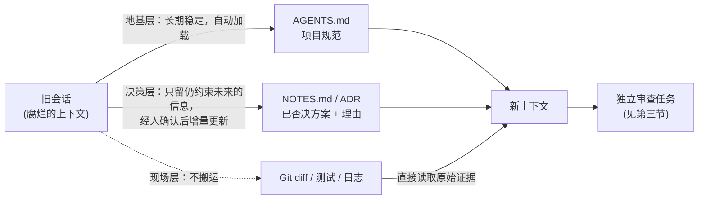

# 为什么编码 Agent 越聊越浅：上下文腐烂、自我纠错盲区与交接成本

> **断言标注约定**：本文所有关键判断按三分法标注——`[模型证据]`（公开研究/评测直接观察到的现象）、`[官方研究]`（厂商一手工程经验，属经验性证据）、`[经验]`（作者实践经验）、`[推测]`（本文提出的机制假设，附验证方式）。无标注的为可直接核对的定义或流程描述。

## 引子：症状与一句话答案

很多人都有类似体验：同一个编码 Agent，刚开始分析得很深，做着做着却越来越像在敷衍。

**症状清单**——如果你正在经历下面这些，本文就是为你写的：

- 它开始重复读取已经看过的文件，忘记前几轮明确排除的方案 `[经验]`；
- 修复一个问题，却重新引入几小时前已经处理过的旧问题 `[经验]`；
- 让它"深入复盘"，得到的往往不是问题清单，而是一段更完整的自我解释 `[经验]`；
- 最消耗人的信号：**人开始替 Agent 维护任务记忆**——反复提醒已确认的约束，阻止它复活被否决的方案，再逐项核对它口中的"完成"。Agent 仍在高速执行，但节省下来的编码时间被纠偏、回滚和复查重新吃掉。

**一句话答案**："越聊越浅"通常不是模型突然变笨，而是三个独立机制的叠加——上下文腐烂、自我纠错盲区、交接成本；此外还有一个必须最先排除的零号变量：推理预算或模型配置本身不适配。解法不是把提示词写得更凶，而是管理信息：把仍然约束未来的决定写进稳定载体，让干净的上下文直接读取原始证据。

本文要回答的具体问题是：**出现哪些信号时应该继续当前会话，哪些信号说明应该立即停手、固化决定，并让干净上下文读取原始证据？**

### 一个真实长任务通常怎样失控

下面是一条**构造的原型案例**：它不是某次真实事故的复盘记录，而是从跨文件重构、复杂缺陷修复、连续需求变更等长任务中归纳出的高度相似失控顺序`[经验]`。业务细节可以不同，但失控次序几乎一致：

1. 前几轮，Agent 正确找到了入口、约束和测试范围；
2. 中途用户否决方案 A，并补充"后端逻辑保留，只移除前端入口"；
3. Agent 又经历多轮搜索、测试失败和局部修复；
4. 后续它只记住"移除功能"，顺手删除后端逻辑，或者再次提出方案 A；
5. 用户要求复盘，它解释每一步为什么合理，却没有主动对照最初约束和当前 diff；
6. 用户不得不重新整理需求，再开一个上下文从头审查。

这条轨迹里至少藏着三个不同痛点：任务历史变成噪声（机制一）、作者难以推翻自己的既有解释（机制二）、换上下文又会丢失关键决定（机制三）。把它们统称为"模型变笨"，只会得到"换更强模型"或"提示词再强调"的泛化建议，对操作毫无指导。

三个机制各自的展开在第二到第四节；第五节给出解法；第八节是全文的速查表。

**本节本质**：先认症状、再拆机制、后谈解法——顺序不能反，因为三个机制的症状高度相似，只有拆开才能对症。

## 一、先排除零号变量：它可能从一开始就没认真想

如果回答从**第一轮**开始就浅，不要先诊断上下文。

推理模型通常存在不同的思考预算（即模型在给出答案前分配给内部推理的计算量）。格式化、重命名和样板代码可以使用低预算；复杂竞态、架构审查、安全检查和跨仓迁移需要更高预算。还要注意：**输出简洁**与**推理深入**是两个不同维度——让模型少说一点，不应该等价于让它少想一点。

因此，排查顺序应该是：

```text
推理档位是否匹配任务
→ 模型、版本或窗口配置近期是否变化
→ 前几轮是否正常、之后才退化
→ 再分析上下文和协作机制
```

只有"前面深、后面浅"，才更像上下文累积问题，才值得用下面三个机制去解释。

**本节本质**：零号变量是时间轴上的分诊台——它把"一直浅"（配置问题）与"后来浅"（本文主题）分开。

## 二、机制一：上下文腐烂

**是什么**：上下文窗口很大，不代表其中每条信息都能被同等有效地使用。所谓上下文腐烂，指的就是：随着会话变长，仍然有效的事实被越来越多的历史噪声包围，模型难以稳定判断哪一份信息才是当前权威版本。

**为什么会出现噪声**：编码 Agent 每执行一次搜索、读文件、跑测试、调用工具，结果都会进入会话。任务继续推进后，窗口里同时存在：

- 已经失效的旧方案；
- 多次重复的文件片段；
- 大量语义相似的搜索结果；
- 被后续决定覆盖的早期要求；
- 工具报错和重试记录；
- Agent 对自己过程的总结。

**一个机制假设**：检索与推理共享同一份注意力资源，噪声越多，留给当前推理的份额越少。需要说明：这是对下述实验现象的一种候选解释，属于本文的`[推测]`——相关研究观察到的是"输入变长、干扰变多则表现下降"，并未直接测量注意力分配。它的验证/证伪方式是：在信息总量恒定的前提下，只改变上下文中噪声与有效信息的比例，观察任务表现是否随噪声比例单调下降（剂量效应）；若表现与噪声比例无关，这个假设就被削弱。

**证据**：

- Chroma 的 Context Rot 研究在多个前沿模型上观察到：输入增长带来的退化并不是只在窗口接近上限时出现；即使正确答案已经在上下文中，周围信息增加也会降低表现。`[模型证据]`
- 另一项多轮对话研究发现：把同样的信息分散在多轮里，表现显著差于一次性提供；将信息重新组合成单个提示后，质量能够大幅恢复。这说明问题不只是信息是否存在，也在于信息以什么**历史形态**累积。`[模型证据]`（arXiv 2505.06120）

对编码任务而言，这个问题尤其严重，因为代码搜索会返回大量"看起来都相关"的内容。Agent 并不是找不到信息，而是很难稳定判断当前哪一份才是最新、权威、仍然有效的版本。

**典型症状**：

- 重复读取没有变化的文件；
- 忘记已经明确否决的方案；
- 只响应用户最新一句，遗漏累计约束；
- 计划、修改和最终总结对不上；
- 同一个问题时而回答很深，时而明显变浅。

最后一种"不稳定"很关键：上下文腐烂不一定让模型稳定变笨，更常见的是**方差变大**——有时仍然很好，有时突然丢掉关键约束。但反过来说，"方差变大"本身也不是充分证据：它也可能来自采样温度、模型服务端负载波动等干扰项`[经验]`。把它当作线索而非定论，结合下一节的排查顺序使用。

**本节本质**：上下文腐烂不是"信息丢了"，而是有效信息被噪声包围后，"哪份是权威版本"这个问题本身变得不稳定。

## 三、机制二：自我纠错盲区

**是什么**：让 Agent 复盘自己刚做的工作，听起来很合理：上下文都在，它最了解自己做过什么。但"最了解过程"不等于"最适合证伪过程"。自我纠错盲区指的就是：模型对自己刚生成内容的审查能力，系统性地弱于对同等外部材料的审查能力。

**为什么**：自回归模型（逐词生成、且已生成内容会作为后续生成条件的模型）在继续回答时，前面的判断更像既定前提，而不是一个需要从零审查的外部对象。因此，同一错误以"这是你刚才的结论"和"这是另一份待审查材料"两种身份出现，模型的审查表现可能不同。

**证据**：

- Self-Correction Bench 通过受控错误注入比较模型纠正自己与纠正外部答案的差异，报告了明显的自我纠错盲区，而且任务越复杂，盲区越严重。`[模型证据]`（arXiv 2507.02778）
- 更早的研究和综述也指出：缺少外部反馈时，仅靠提示模型"再想想""认真检查"，通常不能稳定提升推理正确率，有时还会把原本正确的答案改错；测试、编译器、检索结果、验证器等**外部信号**才是更可靠的纠错条件。`[模型证据]`（arXiv 2310.01798；ACL 2024）

这解释了为什么以下提示经常效果有限：

```text
请深入复盘你刚才的修改。
请认真检查是否遗漏了什么。
请反思你的方案有什么问题。
```

问题不是模型不愿认真，而是它仍站在原来的解释框架里——要求"更深入"只是让它在同一框架内生成更长、更自洽的解释。

**怎么办：改变"身份"，而不只是增加强调**。更有效的做法是把产物变成外部证据：

- 新开上下文；
- 提供 `git diff`、测试输出和原始需求；
- 称它为"这份修改"，而不是"你刚才写的"；
- 要求逐条寻找反例，而不是解释设计意图。

如果风险高，可以换一个模型或独立评审者。这里的价值不是简单投票，而是让验证者不继承原作者的全部隐含前提。

**本节本质**：让作者证伪自己，是结构性地难；有效动作是把"你的结论"降格为"一份待审查的外部材料"。

## 四、机制三：交接成本

前两个机制都指向同一个动作：换到更干净的上下文。但如果换上下文很贵，腐烂就会持续。

**是什么**：交接成本指把一个进行中的任务所需的知识，完整搬到新上下文所要付出的代价。代码任务高度紧耦合，一个修改可能同时依赖：

- 项目规范；
- 用户在多轮中追加的约束；
- 已经尝试失败的方案；
- 当前工作区的实际 diff；
- 测试和运行环境；
- 某些只能从历史讨论理解的设计意图。

如果每次新开窗口都要人工重写这些背景，交接成本很快高到让人放弃。于是大家继续留在已经腐烂的旧上下文里，质量进一步下降——交接成本是腐烂得以持续的经济学原因。

**多 Agent 也不会自动解决问题**：Anthropic 在多 Agent 研究系统的经验中明确区分：并行架构适合可以拆成独立分支的研究任务，对需要共享状态和持续协调的紧耦合任务效果更差，而且资源成本显著增加。`[官方研究]`

并行度解决的是吞吐，未必解决单点深度。

**本节本质**：已知旧会话有病，却因为"搬家太贵"选择忍受——这就是交接成本在机制链条里的位置。

## 五、解法：不要按任务切知识，按变化速度分层

交接难，是因为我们试图每次回答"新窗口需要知道哪些内容"。代码任务彼此纠缠，这个问题很难一次答对。

更稳定的问法是换一个切分维度：**这条信息变化得有多快？** 变化速度决定了它该被长期维护、少量增量更新，还是干脆不该搬运。由此得到三层：

| 层 | 内容 | 载体 | 处理方式 |
|---|---|---|---|
| 地基层 | 技术栈、代码规范、目录结构、绝对禁区 | `AGENTS.md`、项目规范 | 长期维护、自动加载 |
| 决策层 | 已定方案、失败过的路径、设计意图、当前卡点 | `NOTES.md`、ADR | 少量增量更新 |
| 现场层 | 当前 diff、测试结果、日志、报错 | Git 和工具输出 | 不搬运，由新上下文重新读取 |

这张表不能告诉你什么：它不回答"某个具体文件该进哪一层"（判断依据见第六节的两条轴），也不回答"每层该写多细"——那取决于项目规模和变更频率，需要按项目自行校准。



图上最关键的是那条虚线：现场层最容易纠缠、也最容易失真，所以**不让旧 Agent 转述**。新上下文直接读取当前工作区、重新运行测试，拿到的是现在的事实。

真正需要手工维护的只有决策层，尤其是"试过但失败的方案"。这类信息无法从当前代码自动恢复，却会持续约束未来选择。

**什么值得进入持久上下文**，判据可以压缩成一句话：

> 只保留仍然会约束未来推理的信息。

"我读了 20 个文件"不值得保留；"方案 A 因为事务边界不成立而被否决"值得保留。持久记忆也不是越多越好——过期笔记会在每次会话中重复污染上下文，因此需要删除已失效状态、合并重复规则，并给关键决定保留来源。

**本节本质**：按变化速度切分，绕开了"新窗口需要知道哪些内容"这个几乎答不对的问题——现场层不搬运，手工只维护决策层。

## 六、两条轴：每条信息该留、该清还是该重新注入

分层表给出了骨架，但具体到某一条上下文信息，还需要一个逐条判断的操作框架。可以问两个问题：

```text
身份轴：它是当前模型自己的产出，还是外部证据？
时效轴：它仍然约束未来，还是已经完成的过程？
```

为什么是这两条轴：身份轴对应机制二（模型自产内容难以被自己证伪），时效轴对应机制一和第五节分层的落点（已完成的过程信息是噪声的主要来源）。两条轴交叉，得到四种处理方式：

| | 仍约束未来 | 已完成过程 |
|---|---|---|
| **外部证据** | 保留或按需读取 | 用完清理 |
| **模型自产** | 写入文件、经人确认后重新加载 | 直接清理 |

这张表不能告诉你什么：它只做"处理方式"的分诊，不保证判断本身正确——"仍约束未来"依赖你对任务的理解，误判仍会发生；表中也没有"部分有效"这种中间态。

其中"经人确认"需要展开说清楚它到底在防什么：**防止模型对过程的有损总结，在未经人审阅的情况下写入持久层，变成下一轮会话的"权威事实"**。模型总结过程时会丢失细节、混入自己的解释（机制二），如果这些总结直接入库，等于把失真固化成了决策层的依据。

最没价值的是"已经完成的模型自述"：它既占空间，又可能只是对过程的有损总结，还容易触发自我纠错盲区。

这套框架也能解释几种常见做法：

| 做法 | 为什么有效或无效 |
|---|---|
| 在旧窗口反复要求深入 | 信息身份和噪声结构都没变 |
| 让状态已退化的窗口写交接总结 | 可能生成摘要的摘要，继续丢约束 |
| 新窗口读取原始 diff 和测试 | 身份变成外部证据，且反映当前事实 |
| 多开几个窗口做同一件事 | 增加并行尝试，不保证更深 |
| 换模型审查原始产物 | 改变视角，并减少盲点相关性 |

这张表不能告诉你什么：它解释的是"为什么常见做法有效或无效"的方向性原因，不能替代对具体会话的判断——例如"换模型审查"在错误类型高度依赖领域知识时，收益会明显下降。

**本节本质**：身份轴决定"信不信"，时效轴决定"留不留"——每条信息问这两个问题，处理方式就只有四种，不再靠感觉。

## 七、一套可执行的证据式复盘流程

当一个长任务进入复盘阶段，可以直接采用下面的输入结构：

```markdown
## 原始目标
用户真正要获得什么结果。

## 仍然有效的约束
只列当前有效规则，注明权威来源。

## 已否决方案
方案、否决原因、证据。

## 当前事实
让新上下文自行读取 git diff、测试和日志。

## 审查任务
寻找被绕过的要求、被掩盖的失败、未验证的假设和半途而废的工作。
```

然后遵守三条纪律：

1. 不要求旧窗口证明自己正确；
2. 不只读取作者总结，要读取原始产物；
3. 每个"已完成"都必须对应外部证据。

这套流程的目标不是让 Agent "记得更多"，而是缩短人类纠偏路径。一次有效交接至少应该让新上下文无需追问就能回答四件事：

```text
什么结果不能变？
哪些路已经证明走不通？
工作区现在客观变成了什么？
接下来用什么证据判断完成？
```

如果交接材料主要是"我做了什么"的流水账，而不是这四类信息，它仍然会把旧会话的噪声复制到新会话。

**本节本质**：复盘的质量取决于输入的身份（证据还是自述），而不是复盘指令的强度。

## 八、症状—原因速查表（含误判处理）

把全文压缩成一张可操作的表。使用方法：先按症状定位行，执行"首要动作"；若按该归因处理后没有改善，再查"误判时怎么办"——这一列处理的是"把 A 误判成 B"的情形，包括本文反复强调的零号变量干扰。

| 症状 | 优先怀疑 | 首要动作 | 误判时怎么办 |
|---|---|---|---|
| 从第一轮开始就浅 | 推理预算或模型配置（零号变量） | 检查档位和版本 | 若配置无问题，检查输入本身是否自相矛盾或缺关键材料——那是输入问题，不是预算问题 |
| 前几轮好，后来变浅 | 上下文腐烂 | 停止扩写历史，建立当前约束清单，新上下文读取当前事实 | 若会话历史其实很短仍退化，回到零号变量：查模型版本、采样参数与服务端状态 |
| 复盘全是自洽解释 | 自我纠错盲区 | 改成外部审查任务（diff + 测试 + 找反例） | 若外部审查同样放水，检查审查材料是否只给了作者总结——证据不独立，盲区照旧 |
| 新窗口总要重讲背景 | 缺少地基层和决策层 | 建项目规范与决策记录 | 若规范已建仍然如此，检查是否把易变的现场层写进了持久层，反而造成污染 |
| 反复采用已否决方案 | 决策层丢失 | 补记已否决方案与证据 | 若已记录仍复活，检查记录是否只写结论、没写否决理由——没有理由的禁令最难被遵守 |
| 多 Agent 很忙但结果不深 | 任务紧耦合，并行不适配 | 减少并行，明确单一责任链 | 若任务其实可拆分，问题可能在子任务边界模糊或缺少共享状态约定，而非并行本身 |
| 频繁新开窗口，总成本反而上升 | 误把"换上下文"当万能药 | 先跑下面的"抽查三问"再决定 | 若抽查通过且约束稳定，留在当前会话——腐烂不能靠日程表清空 |

这张表不能告诉你什么：它给的是"先怀疑谁"的排序，不是确诊；每行的两个候选原因也可能同时存在。最后一行是对"换上下文"这个本文主推动作的自我设限——**上下文腐烂不能被简化成定时清空会话**。以下情况继续当前上下文通常更划算：

- 当前修改很小，约束没有变化，测试反馈清晰；
- Agent 仍能准确回放目标、非目标和已否决方案；
- 问题依赖刚刚建立、尚未落盘的局部推理；
- 新会话的交接成本明显高于剩余工作。

真正的切换信号不是 token 数，而是**任务模型是否仍然稳定**。可以抽查三个问题：当前目标是什么、哪条路径已被否决、完成需要哪些证据。答错任何一个关键项，就不应继续让它扩大修改面。

**本节本质**：速查表是"假设生成器"——它给出最可能的归因和证伪路径，确诊永远要回到具体会话的证据。

## 结语

编码 Agent 越聊越浅，不一定是模型突然变差，也不一定能靠更强烈的提示词解决。

真正有效的方向是管理信息：减少已经失效的过程，把仍然有效的决定写进稳定载体，让新上下文从原始证据重新建立判断，并把自我复盘改成独立审查。

可以把全文压缩成一句工作原则：

> 别让旧上下文汇报自己做得怎么样；让它交出记录，再让一个干净的上下文读取证据。

---

## 证据边界声明

**这份声明的范围**：适用于正文所有带标注的判断，也适用于未标注但涉及模型行为的描述。

- `[模型证据]` 来自公开研究或评测报告，均为**受控或半受控的问答/推理实验**——它们能支持上下文与自我纠错的机制性判断，但不能直接给出某款编码 Agent 在所有真实仓库中的失败率；
- `[官方研究]` 是厂商一手工程经验，属经验性证据而非受控实验，例如多 Agent 的结论来自研究型任务，不能简单外推到所有代码任务；
- `[经验]` 是作者实践观察，样本有限，不可外推为普遍规律；
- `[推测]` 是本文提出的机制假设（目前一处：注意力挤占），已附验证/证伪方式，在获得直接证据前应视为未定；
- 全文的失控轨迹为**构造的原型案例**，用于说明症状结构，不作为任何真实事故的复盘。

### 这些来源分别支持什么

| 来源 | 能支持的判断 | 不能直接证明的判断 |
|---|---|---|
| Chroma Context Rot | 输入增长与干扰信息会降低检索和推理表现 | 某款编码 Agent 在真实仓库中的具体退化率 |
| LLMs Get Lost in Multi-Turn Conversation | 同样信息分散在多轮时表现可能显著变差 | 所有长会话都应定时清空 |
| Self-Correction Bench 等研究 | 无外部反馈的自我纠错存在系统性局限 | 独立审查一定能发现所有错误 |
| Anthropic context engineering | 压缩、外部记忆和按需加载是可行工程策略 | 某一产品天然优于另一产品 |
| Anthropic multi-agent 经验 | 并行研究适合可拆分任务，协调有额外成本 | 多 Agent 不适合任何编码任务 |

## 参考资料

- [Context Rot: How Increasing Input Tokens Impacts LLM Performance — Chroma](https://www.trychroma.com/research/context-rot)
- [LLMs Get Lost In Multi-Turn Conversation](https://arxiv.org/abs/2505.06120)
- [Self-Correction Bench](https://arxiv.org/abs/2507.02778)
- [Large Language Models Cannot Self-Correct Reasoning Yet](https://arxiv.org/abs/2310.01798)
- [When Can LLMs Actually Correct Their Own Mistakes?](https://aclanthology.org/2024.tacl-1.78/)
- [Effective context engineering for AI agents — Anthropic](https://www.anthropic.com/engineering/effective-context-engineering-for-ai-agents)
- [How we built our multi-agent research system — Anthropic](https://www.anthropic.com/engineering/multi-agent-research-system)

## Changelog

- **v2（2026-10-16，重写，样板篇 / 任务卡 1）**
  - 越聊-1：删除开头"先给结论"表（内容已并入第八节速查表），开头改为"症状清单 + 一句话答案"；
  - 越聊-2："检索和推理共享注意力预算、互相挤占"由断言降级为 `[推测]`，补充验证/证伪方式（控制信息总量、只变噪声比例的剂量效应实验）；
  - 越聊-3：速查表增加"误判时怎么办"列，缓解二元归因；"时而深时而浅"补充采样温度、服务端负载等干扰项说明；
  - 越聊-4：第六节补全"经人确认"的语义：防止模型有损总结未经审阅入库、变成下一轮的权威事实；
  - 越聊-5：原第八节"什么时候不该新开上下文"并入第八节速查表（新增一行 + 表后段落 + 抽查三问）；
  - 越聊-6：第五节新增 mermaid 信息分层流转图；
  - 结构：按篇型 A 重组（症状→零号变量→三机制→解法→判断框架→流程→速查），9 节收敛为 8 节，每节末补"本节本质"句；失控六步按 [M-8] 标注"构造的原型案例"；开头新增断言标注约定（[M-7]）；
  - **偏离记录**：偏离 [P-2]（md 顶部→html 讲解版入口链接），理由：讲解版 html 位于 gitignore 的 `阅读/` 目录、不推送公开仓库（拍板 D2），在推送的 md 中放相对链接会在 GitHub 上 404；两层互引改在本地核验流程中完成。
- **v1（原稿）**：初始版本（status: draft）。
